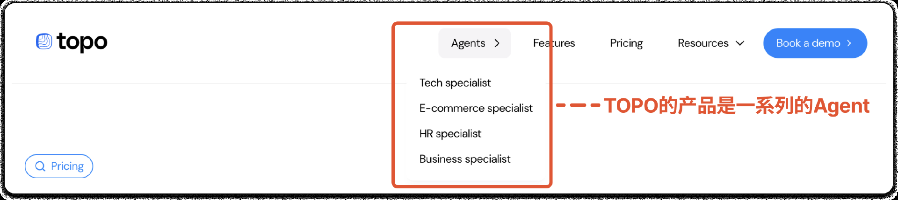
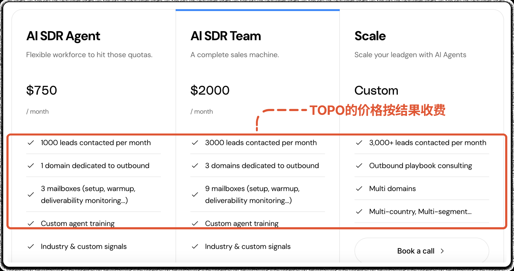
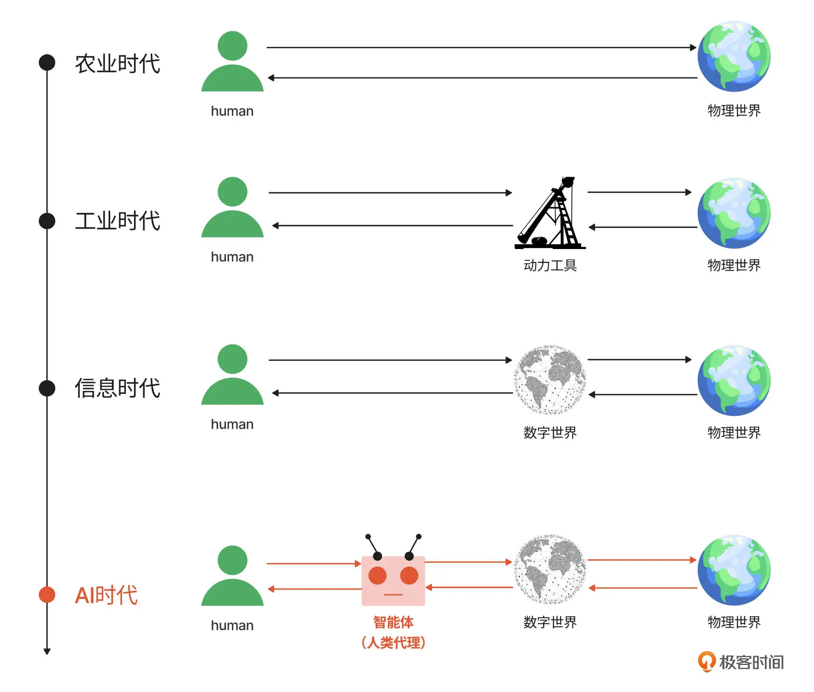
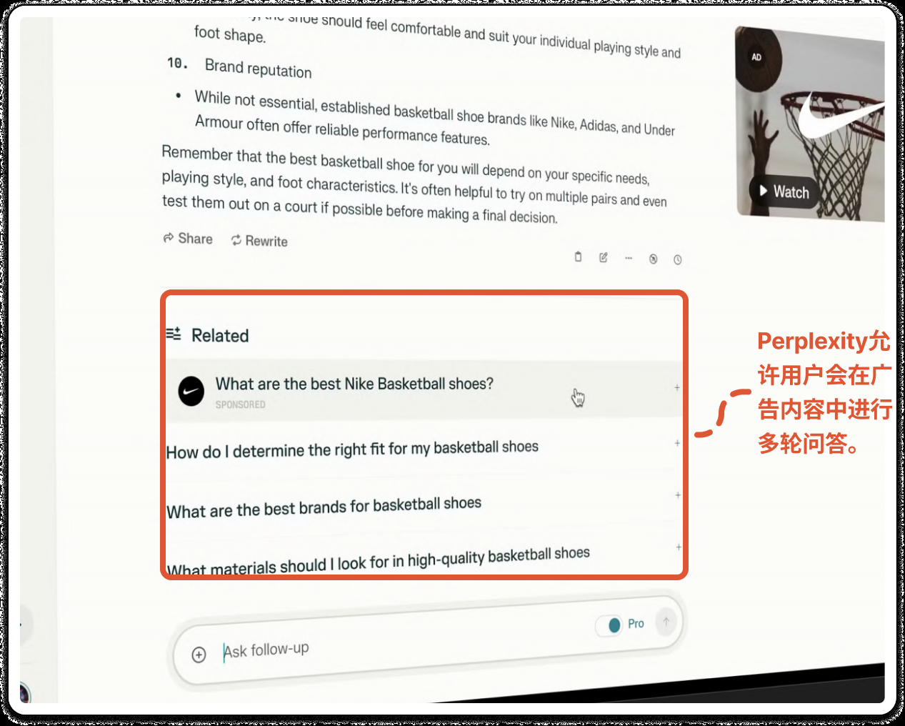
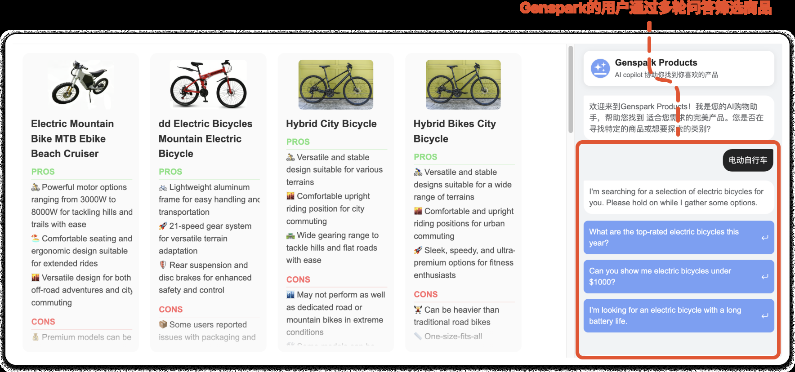

# 17 | 商业模式：AI技术将如何改变产品赚钱的方式

你好，我是产品二姐。

上两节课我们给 AI 产品做了一笔算力成本账。既然有成本开销，就要有收益方式，这节课我们就来讲讲 AI 产品的商业模式。如果说前面所有的课程是低头做事，那么今天的课程就是抬头望路，我会和你探讨 AI 技术对商业模式的一些影响。

首先我会用一个公式阐述什么是好的商业模式，讲述一个产品实现商业价值的基本要素。然后我会结合历史演进和当下案例带你去发现：AI 这项技术会给未来商业模式带来哪些改变。

这些内容会让我们带着未来视角提前思考和布局 AI 产品的变现方式，同时它们也可能对你的产品设计思路产生一些影响。

## 一个公式阐述什么是好的商业模式

商业模式，简单来说就是让产品能赚钱的方法。不管技术、产品如何改变，一个好商业模式的基本要素是不变的，即：

1. 好产品

好产品包括命中市场趋势、解决用户问题、方便用户使用，这三者分别对应着产品经理的市场洞察能力、产品功能设计能力和用户体验设计能力。好产品是商业模式成功的基础，就像OpenAI CEO Sam Altman 写的创业手册里说的：

- 优秀的产品是实现长期增长的唯一途径。最终，你的公司会变得非常庞大，以至于所有的增长策略都不再奏效，你必须通过吸引人们使用你的产品来实现增长。没有其他方法。

这一点在我们之前的课程如何找场景、如何设计功能、如何做人机交互中都有提到。今天我们还会提到一个新的维度，就是交付方式，我们稍后展开。

2. 好渠道

好渠道是指找到合适的人群去营销。它会放大产品的效能，注意这里的放大是中性的，意味着：

- 如果你的产品是 1.01，放大 10 次之后就是 1.01 的十次方，远远大于 1；

- 但如果你的产品是 0.99， 放大 10 次之后是 0.99 的十次方，可能接近于 0。

这方面你可以通过个人 IP、广告、打榜、社群、达人营销等方式来实现用户增长。

3. 好价格

好价格有两个维度考虑：

- 一是价格高低：这和产品的成本、产品给客户的价值、竞争对手价格以及市场供需情况息息相关。对于 AI 产品来说，成本问题我们在 15、16 节课中提到了，其他三项也是我们定义价格要考察的因素。

- 二是价格结构：比如你是一次性让用户支付，还是订阅 + 增值服务的方式支付。

一个好的价格会驱动产品付费转化率，让产品收获合理的收益。

随着技术变革上述三点也会产生改变，接下来我就和你分享在未来几年，AI 这场技术革命对商业模式这三个要素可能会带来的改变，其中有些部分可能会影响 AI 产品本身的设计。

## AI 技术对商业模式的改变

你也许会感到奇怪，技术改变产品形态很好理解，但技术革命怎么会改变商业模式呢？ 如果我们来纵向对比过去三十年，互联网技术是如何改变软件产品的商业模式的，你就容易理解为什么技术革命会改变商业模式了。

在互联网技术革命中，诞生了两种全新的商业模式，它们改变了上述提到的三要素：

- 一是 SAAS（Software as a Service）软件即服务，改变了商业模式三要素中的产品交付方式与价格。

- 二是计算广告，这改变了商业模式三要素中的渠道，同时它们本身也成为了众多互联网平台类产品的商业模式。

那么，AI 技术又会如何影响这两种商业模式的要素呢？ 我们一个个来看。

### AI 技术对软件产品交付和价格的影响：重新定义 SAAS

在互联网时代，更准确地说是云计算时代，SAAS 的定义是 Software-as-a-Service，软件即服务；在 AI 技术革命中，另一种 SAAS 正在萌芽，它的全称是：Service-as-a-Software。这个新名词有点拗口，在引入之前，我们先来看看互联网技术革命中，SAAS 商业模式是如何诞生的。

1999 年，一家小小的软件公司在旧金山成立，创始人是在软件巨头 Oracle 工作了 13 年的副总裁 Marc Benioff；2022 年，这家公司超越 SAP 成为全球最大的企业级软件服务供应商。它就是 Salesforce，而让 Salesforce 成功的最大战略决定就是从 25 年前开始就坚持用 SAAS 的方式来交付软件。

和互联网之前相比，SAAS 本质上改变了软件产品商业模式的两个方面：

- 一是产品交付方式，归属在商业模式三要素中的“好产品”。

- 二是产品价格结构，归属在商业模式三要素中的“好价格”。

在互联网之前，软件产品的交付是直接安装在用户的计算机上的，比如曾经是全球软件服务巨头的 IBM，它为全球各个银行提供的软件服务就是：大型机以及安装在大型机上的软件。这种软件交付方式不仅包含软件本身，还要包含安装、更新等人工服务；软件的价格是一次性的成本价格 + 增值服务。这非常像我们在购买一辆车时的交付方式和价格结构：购买车时交付车辆，并一次性支付主要费用，后续每年都有维护保养费用。

仔细想想，这种方式有个价值悖论，那就是：软件的价值依赖于用户的使用频次、时长，但用户在花大价钱购买时，却并不能预判使用频次和时长。

- 假使用户购买的软件在工作中并没有被充分使用，软件的价值是远低于价格的，但客户却不能因此而申请退款。

- 另一方面，假使用户购买了软件后，在工作中使用频次非常高，软件的价值是远高于价格的，但软件服务提供商也不能因此而多收钱。

而互联网，更准确地说是云计算，改变了这种价值悖论，即：

- 交付方式上：软件产品是云端交付，不再需要人工安装软件，软件更新可以自助更新。

- 价格上：SaaS 产品按效果收费，多用多收，少用少收。价值与价格交换更加合理。

可以说，如果没有互联网技术，就不会产生 SAAS 这种商业模式。 那前面所说的 AI 技术革命中正在萌芽的 Service-as-a-Software 又是什么呢？

我来举个例子你就明白了，比如 YC 投资的项目之一 TOPO 这个产品，它对自己的一句话介绍是：AI sales agent custom trained for each company to reach the best leads，翻译为中文是“专为公司定制训练的线索转化智能体”。在它的官网上，没有传统的软件名称列表，而是一个 Agents 列表，包括：转化 HR 类客户线索的智能体专员、转化科技类客户线索的智能体专员、转化电商类客户线索的智能体专员等等（如下图）。

而在 TOPO 的定价标准里，并不是像 SAAS 的定价席位来定价的，而是按照线索数量来定价的。

你看，TOPO 这家公司交付的是一个结果，而不是工具，这就是我们所说的 Service as aSoftware，更准确的说法应该是：Services delivered by agents via software，由 Agent 基于软件执行能力而交付的服务。也就是说软件公司交付的是 Agent 完成具体任务的成果，而不再是一个工具；价格上，它可以按照临时工或者小时工的支付模式来计算，比如另外一家出售Agent 服务的公司 OpenCall，就是按照使用时长，精确到分钟来收费。

这意味着，未来的软件公司可能会出售 Agent 劳动力，而不是真人的劳动力。随着大语言模型推理能力的不断增强，我们非常有希望能达成这样的商业模式，就像 2024 年 10 月全球著名风险投资机构红杉资本在他们的一篇报告（参考 1）写的：

- 云计算诞生了软件即服务，软件公司成为云服务提供商，这是一个 3500 亿的市场；（得益于以 openAI 草莓为代表的模型推理能力增强）人工智能会促生“服务即软件”，软件公司会将劳动力转化为软件。The cloud transition was software-as-a-service. Software companies became cloudservice providers. This was a $350B opportunity.Thanks to agentic reasoning, the AI transition is service-as-a-software. Softwarecompanies turn labor into software.

我们在第 11 节课也曾提到：这一代的 AI 发展趋势是通过 Agent 操作数字世界来改变物理世界。 我们再把时间线拉长来看，会发现这个趋势会更明显。

- 在农业时代，人类通过种地直接改造物理世界，那时的技术就是农垦工具，直接出售工具来赚钱。

- 工业时代，人类通过机器加速了改造物理世界的速度，技术领先者靠出售机器来赚钱。

- 信息时代，人类通过数字世界，扩展了改造物理世界的广度，技术领先者靠出售虚拟世界的服务来赚钱。比如打车 App 是一个由司机 - 乘客 - 出行工具组成的数字世界，我可以通过打车 App 来控制物理世界中的出行工具。

- 智能时代，人类希望构建出智能体 Agent 来接管数字世界，扩展了改造物理世界的便利性，那我们就可以通过出售 Agent 而赚钱。

如果看清了这个趋势，作为产品经理，是不是有了新的产品思路呢？我们是否可以挑出那些目前来说，劳动力成本较低的行业，来让 Agent 提供相同的服务呢？你可以思考一下。

接下来，我们聊聊 AI 技术可能对商业模式的另一个要素–渠道的改变。

### AI 技术对软件渠道的影响：计算广告

读懂 AI 技术对软件渠道的影响会激发我们两方面的思考：

- 一是免费的 AI 产品本身能否成为渠道（流量）的掌控方，走出成功的广告商业模式。

- 二是订阅制收费类的产品如何能在了解渠道发展方向的前提下，实现创新式的产品推广。

同样，我们会先来看互联网技术对广告的改变，然后再用案例来分析。

互联网之前，广告是投在电视、户外、报纸这些传统媒介上的，这种方式最大的弊端是：没有办法计算广告效果，就像美国百货业之父约翰·沃纳梅克曾说的：

- 我知道在广告上的投资有一半是无用的，但问题是我不知道是哪一半。

互联网技术将广告变为可计算的广告，也就是说：我们今天所看到的在 Google、Facebook 等媒介上投放的广告，每一笔都是可以通过播放量、阅读量、转化率等指标被计算出来效果。在《计算广告》这本书里，作者用 300 多页讲述了互联网技术栈实现可计算广告的过程，正是借助这一技术，平台类软件产品（比如抖音、小红书、亚马逊、淘宝）本身跑出了具备互联网特色的商业模式。

那么，同样拥有一定用户规模的 AI 产品又会对计算广告产生什么影响呢？

我们拿一个案例–全球第一 AI 搜索产品 Perplexity 来讲。2024 年 8 月，Perplexity 发布了一份 33 页的 PPT（参考 2），阐述了它在未来短期的广告策略，其中和 Google 这样的传统搜索引擎相比最大的不同就是：

Perplexity 把自己定义为问答引擎，而不是搜索引擎。

Perplexity 允许用户在广告内容中进行多轮问答。这意味着用户与广告交互、参与度会更高，对广告主来说也更有价值。在传统搜索引擎广告中，广告主能收集到的信息只有点击、播放、转化，在问答引擎中，广告主还能收集到用户关注哪些问题，他放弃的原因可能是什么。

无独有偶，在另外一款搜索工具 Genspark 的商品搜索中，用户在右侧同样可以针对一个商品进行多轮对话。

这两个案例给了我们两点启示：

一是如果未来你的 AI 产品想走广告的商业模式，不妨考虑在不损失用户体验的基础上，增加广告主的问答服务。比如 Perplexity 发现有 40% 的用户提问来自于答案内容之后系统生成的“Related”问题，因此，他们才会在广告中支持类似的功能。

二是如果你是平台流量的使用者，为自己的产品做一个可靠、高效的知识库是非常必要的。

我们再把时间线拉长看广告这种传播方式的演进：

- 电视、报纸媒体时代：广告主不知道哪部分广告是有效的。

- 互联网媒体时代：广告主知道了哪部分有效，但不知道为啥有效，或者为啥无效。

- AI 问答引擎媒体时代：广告主不但能知道哪部分有效，还能知道有效、无效的原因。

带着这样一个思路，作为产品经理的你，是不是会重新看待 AI 搜索呢？

## 小结

到这里，我们从目前的现象中看到了 AI 技术变革之下，商业模式产生的微妙变化。

- 对于 SAAS 这种模式来说，未来可能会变成直接的劳动力交付， AI 改变了产品的交付形式。

- 对于广告这个经久不衰的营销渠道，消费者与广告的互动因为 AI 而变得更加频繁、直接。

尽管初见端倪，业界对 AI 应用的商业模式仍然在艰难地探索中，而且这个过程可能会持续几年，正如互联时代的 Google 实现盈利用了 6 年，而亚马逊用了 8 年。

对于产品经理来说，商业化在产品初创时期也许并非是核心工作，但产品的商业化之路反过来也会影响产品设计本身。这节课和你分享 AI 技术对现有商业模式的影响，希望你在低头做事的同时也能抬头看路，思考如何让你的产品在 AI 2.0 时代用新的商业模式开始赚钱。

## 课后题

这里我给你留两个非常开放的讨论话题：

1. 在 Service-as-a-Software 这种模式下，想想 Coze 这种智能体平台可以如何实现商业变现呢？ Coze 能不能成为一个 Agent marketplace 呢？

2. 阅读参考文章里的《Perplexity 2024 年 8 月发布的广告计划》，同时去体验一下Genspark.ai，从用户和产品经理的角度，如何在这两个平台上插入广告能不损失用户体验，同时又能实现商业盈利呢？

欢迎你在评论区留言，如果觉得有所收获，也可以把课程分享给更多的朋友一起学习。我们下节课见！

## 参考

1. 《红杉资本关于生成式 AI 的报告》：https://www.sequoiacap.com/article/generative-ais-act-o1/

2. 《Perplexity 2024 年 8 月发布的广告计划》：https://www.adweek.com/wp-content/uploads/2024/08/Perplexity-Ads-Pitch-Deck.pdf

3. Genspark 产品搜索：https://www.genspark.ai/products
