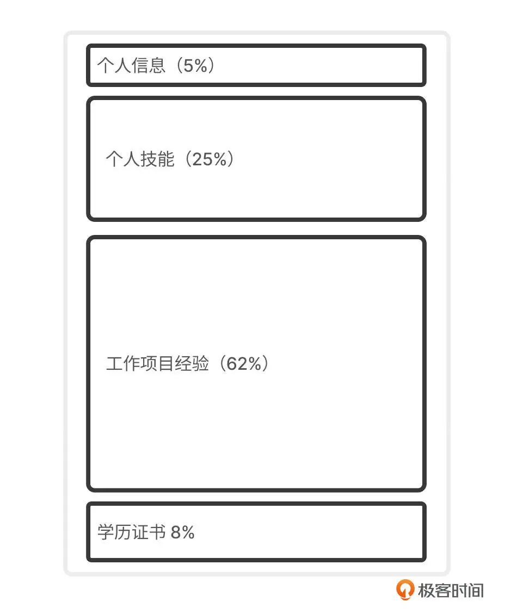
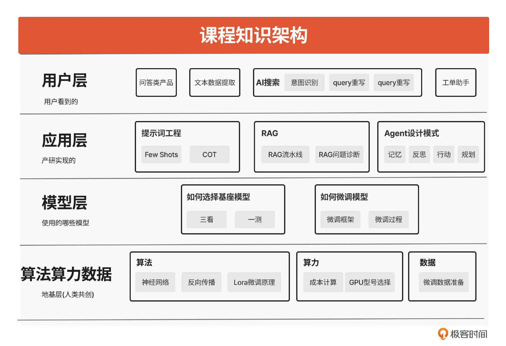
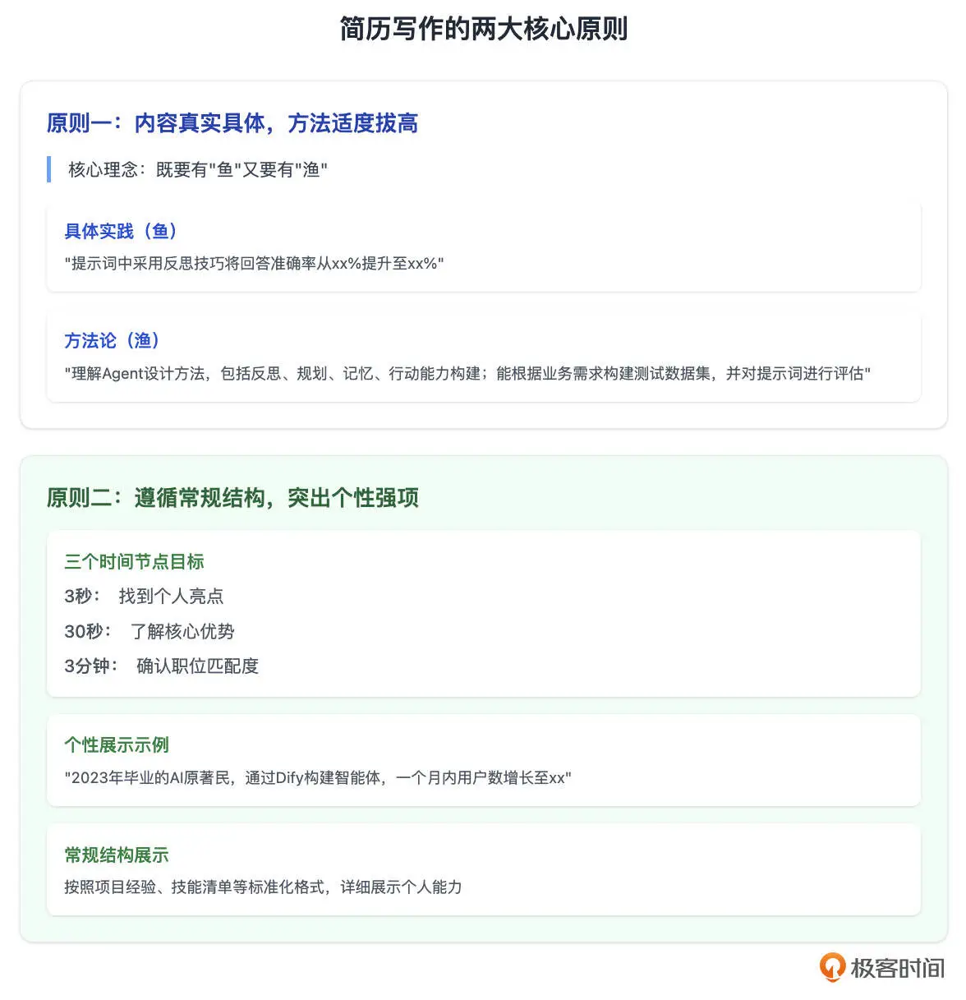
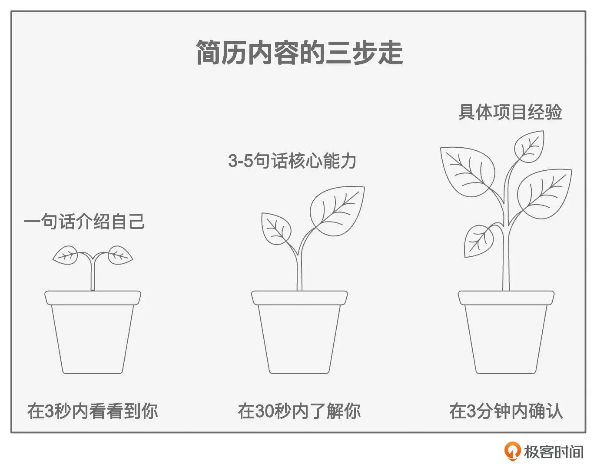

# 18 | AI产品经理的简历该怎么写？

你好，我是产品二姐。

到这里我们学完了前三章的大语言模型理论知识、产品实战案例、产研协作和商业化之路，不知道你有没有完成课后作业，比如用产品的四层结构剖析别人的产品，亲手做几个 Agent 并进行推广，或者将这些知识运用在自己的项目中呢？

如果你做过以上实践，那就不妨用写简历的方式来检验一下自己的学习成果吧。今天我们就来聊聊 AI 产品经理应该如何写出让人眼前一亮的简历，获得面试邀约的机会。

## 简历的两个基本原则

在开始之前，我想重点强调简历的两个基本原则。

一是内容真实具体，方法适度拔高。

这一点指的是：通过具体实践陈述事实，同时也要体现实践背后的指导思想。举个例子：

- “提示词中采用反思技巧将回答准确率从 xx% 提升至 xx%”–这句话体现了内容真实具体。

- “理解 Agent 设计方法，包括反思、规划、记忆、行动能力构建；能根据业务需求构建测试数据集，并对提示词进行评估” ——这句话体现了方法适度拔高。

因为在具体事实中给出的反思技巧、准确率定义都是依赖于后面的两个拔高的指导方法而得出的。也就是简历中既要有你抓到的“鱼”，又要有你捕鱼用的“渔”。

二是遵循常规结构，突出个性强项。

一份亮眼简历要达成“三个 3”的目标，即能让阅读者：

- 在 3 秒内找到重点。

- 在 30 秒内了解你的核心优势。

- 在 3 分钟内确认你是否适合这个职位。

达成第一点的手段是突出个性内容，达成后两点的手段是：遵循常规结构。我再来举个例子：

“2023 年毕业的 AI 原著民，通过 Dify 构建 xxx 智能体，一个月内用户数增长至 xx，自媒体涨粉 xx。” – 这句话是突出个性内容。

HR 看到：刚刚毕业就能主动做出并推广自己的智能体，在这个群体中是非常突出了，而且这里把“0 经验”变为“AI 原著民”，瞬间变劣势为优势。接下来 HR 就会好奇，诶，这位候选人是怎么做到这一点的呢？HR 就可以按照常规的简历结构迅速在技能、项目经验中找到答案。

比如在项目经验中可以写：

- 项目经验：

- xxx 智能体 （时间区间）项目介绍：xxx个人职责：- 利用 COT、Few shots 控制大语言模型准确输出关于日期的推算；- 在小红书、公众号、即刻等发布智能体使用效果，使用 xxx 等 AI 工具优化自媒体内容。

所以你看，眼前一亮的简历并不是说模板多么酷炫，照片多么好看，而是一针见血把自己最突出的东西展示出来，吸引到 HR，然后按照常规结构，让 HR 循着常规结构找到给你发面试offer 的动力。

在接下来的讲述中，我就以一个“常规结构”和你分享 AI 产品经理的简历应该怎么写，这个结构只有四个部分，即：

1. 个人基本信息

2. 个人技能

3. 工作项目经验

4. 证书学历

它们在一份简历中的占比大约是下面这张图的比例。



其中第一部分介绍姓名、性别、年龄、求职意向、联系方式即可；第四部分的学历、证书，除非特别牛，否则放在最后即可；在这里我重点介绍一下 AI 产品经理简历中的个人技能和工作项目经验。

## 个人技能：让 HR 快速了解你的 3 秒与 30 秒

这一部分是让 HR 在 3 秒内决定是否继续看，在 30 秒内了解你的核心优势，可以分为三部分：

- 一是让别人记住你的一句话：3 秒之内能看到的内容。

- 二是 3-8 项硬核技能：30 秒之内能看到的内容。

- 三是 1-2 项软实力：这部分不是必须内容，如果要写一定要有具体的事实依据。

我们一个个来看。

1. 让别人记住你的一句话。

我用三个例子来说明这一句话应该怎么写。

例 1： 5 年 B 端产品经理经验，负责 xxx 产品的 AI 化改造，相应的增值功能在 xx 天实现 xx元营收。

例 2：2023 年毕业的 AI 原著民，通过 Dify 搭建 xxx 智能体，一个月内用户数增长至 xx，收到用户反馈 xx 条。

例 3：1 年 AI 产品独立开发，xx 产品作者，通过 xx，xx 等运营平台宣传，目前付费用户数xxx 人。

可能你也发现了，这一句话的结构就是：

< 身份定位 >，< 核心项目成果 >，< 结果数据 >

1. 3-8 项核心技能

这里我们首先拿国内某大厂 AI 产品经理任职要求来看：

- 任职要求1. 有信仰：希望用 AI 让世界更好；2. 产品能力强，能很好把握用户需求：有过一款 AI 产品经验 (自己搭的一定复杂度的小工具、agent、workflow 也可)；3. 多款 AI 产品的重度用户；4. 对 AI 技术有一定的理解：知道 AI 大模型 / 多模态模型的能力边界和基本技术原理；5. 敢想、动手能力强、学习能力强：又有脑洞，又能想策略，又能干一线工作；多面手；6. 长期主义，能接受冒险、失败、耐得住寂寞，能坚持长期摸索。

我把其中的硬核技能概括出来就是：

- 使用过多个 AI 产品；

- 能动手做 AI 产品；

- 理解技术原理。

然后对其中每一项进行拆解、延伸，就是：

- 如何使用：使用过多款 AI 产品，能对各种 AI 产品进行评测、剖析、调研，这也是一种竞品调研的方法。

- 如何动手做：熟练操作 Dify、Coze 等智能体平台，会选择合适的模型，能合理利用提示词工程、RAG，Agent 设计模式提升 AI 产品的各项能力。

- 理解哪些技术原理：了解神经网络原理、Transformer 架构、Lora 微调原理，阅读过《xxx经典书籍》，并在 xx 平台输出自己的理解。

最后，将每项技能实例化，比如：

第一项如何使用可以是：

- ChatGPT、Claude 重度使用者；会使用 Claude Artifacts 编写 xx 小工具，提升工作效率。

- 深入开展竞品调研，能对竞品 xxxx 产品进行剖析与评测，包括提示词工程、技术栈剖析、不同维度的测试。

第二项如何动手做可以有：

- 提示词工程：熟练掌握提示词工程中的 Few Shots，COT 技巧，在 xxx 项目中使用，经过xx 轮测试，准确度提升 xxx。

- 熟悉 RAG 调优技巧：深入理解 RAG 技术在问答知识库中的应用，通过意图识别、Query重写在 xxx 项目中使用，经过 xx 轮测试，检索召回率提升 xxx。

- 掌握模型评测方法：针对 xx 业务构建测试集，并评测主流大模型 A,B,C 在测试集的表现，选择出正确率最高的 xx 模型。

第三项理解哪些技术原理可以是：

- 了解神经网络原理、Lora 微调原理，在 xx 项目中协同算法工程师准备业务训练数据集 xx条。

上述技能可以按照职位要求的重要性依次排序，也可以按照我们在 01 节讲的 AI 产品的四层结构来排序，从表现层的产品形态，到应用层的提示词、RAG、Agent 设计，再到模型使用，最后到算法原理、数据准备、算力成本等来写。

在这里，我把咱们这门课讲的所有内容分别放在对应的层里，你可以参考来写。



当然，除了上述 AI 相关技能，你也可以继续补足传统互联网产品经理的技能，比如：

- 熟练使用 Axure、墨刀、XMind 等软件工具输出产品原型、流程图。

- 通过 A/B 测试实现 xx 功能优化，将转化率提升 xxx。

这里就不再赘述。

1. 1-2 项软实力（可选）

在上述的任职要求中，我们还看到了两项软实力：长期主义，有信仰。这着实有点虚，但实际中我并不建议你“以虚对虚”，而是摆事实来说。在 AI 还处于早期探索的阶段，职场对 AI 产品经理的软实力要求有：

- 快速学习：以应对 AI 日新月异的变化速度。你可以这样说：

- 快速学习能力，x 个月内学完 xxx，并动手实践 xxx。

- 自我驱动：因为有时候连你的老板也会错过一些新事物、新思路。你可以这样说：

- 较强的自驱力，主动提出 xxx 解决方案，在团队内得到认可，并推动落地。

到这里，一位 AI 产品经理的简历完成了总内容的 1/4，不过你的简历已经达成了第二个目标：HR 用 30 秒了解了你的核心能力。到这里，我们成功了一半，剩下的我们继续来看。

## 工作经验：决定面试机会的 3 分钟

这部分我推荐你使用 STAR 法则，它是一种结构化叙述经验的方法，全球知名大厂亚马逊就明确要求面试者采用这种方式来介绍自己的经验。STAR 由四个要素组成，即 Situation（背景情况）、Task（任务）、Action（行动）、Result（结果），放在产品经理这个角色上就是：

1. Situation (Background)：介绍为什么要有这个产品，希望达成什么目的。

2. Task 和 Action：说明你在这个产品建设中需要完成什么任务，做了哪些事情。比如：

- 如何完成需求分析调研、完成了哪些功能设计。

- 如何跟进研发落地，在研发过程中如何协助开发、算法工程师进行测试、数据收集。

3. Result：用量化结果说明成果或者是失败的原因分析，常见的指标按照重要性依次是：

- 商业指标：可以是订单量、订单金额。

- 用户指标：总用户数、新增用户数、日活、月活等。

- 用户参与度指标：停留时长、完成任务数（比如对话类产品中的对话次数、产生多少次回答等等）。

接下来，我们看一个示例。假设你做了一个“产品经理竞品调研助手”的 Agent，我首先套用一位朋友的模式写出项目经验，你需要仔细阅读，然后我们来分析一下：

```
# 个人Agent项目：产品经理竞品调研小助手
## 项目介绍Situation (Background)
```

- 辅助产品经理竞品调研的小工具，解决产品经理竞品调研耗时长的问题。

```
## 主要职责 Task和Action
- 学习、总结竞品调研的方法论，形成竞品调研工作流。
- 调研主流Agent平台上的竞品调研分析助手，并分析优劣势，确定产品功能特性。
- 在dify上搭建工作流，设计各节点任务，完善各节点提示词。
- 提示词调优：输出稳定性及格式调优
- 构建测试集：针对不同的官网内容测试dify 工作流的表现。
- 以测试集为基准，对不同节点的提示词进行调优。
- 发布和推广：在产品经理社群发布并收集反馈，获得迭代反馈建议。
- 未来规划：构建AI产品库，支持用户通过功能特性进行调研参考
## 成果(result)：
在小范围社群内推广后用户数达到100+人，活跃度50+次对话/天。
```

读完之后，你可以停一下，想想如果你是面试官，你会怎么看待这位求职者呢？

好，我们来分析一下。其实这个项目陈述已经非常好了，在这个例子里开头提到了非常吸引人的结果，而且个人职责也是按照产品的研发流程（调研 -> 搭建 -> 调优 -> 测试 -> 推广）来写的，说明本人确实有一定的产品经理经验。但是我们会发现：这其中只有“方法适度拔高”，没有“内容真实具体”。比如面试官可能会有以下疑问：

- 这个竞品分析助手，用户具体是怎么使用的？

- 这里的竞品调研工作流是否可以简单介绍一下？

- Dify 上搭建的工作流可大可小，你做的有多复杂呢？

- 提示词工程调优，采用了什么策略呢？

- 测试集构建的方法是什么呢？准备 5 条测试集也是测试，准备 100 条也是准备，这背后对应的能力可是完全不一样的。

这些内容更能表现面试者的实践能力，而且在面试环节一定会深入探讨，如果在写简历的时候没有想清楚怎么说，后面的面试也很有可能会挂掉。按照这个思路，我们可以把项目经历改成下面这样，我把增加的内容用红色部分展示出来了，大家可以仔细看一下。

```
# 个人Agent项目：产品经理竞品调研小助手
# 项目介绍Situation (Background)
辅助产品经理竞品调研，**调研主流Agent平台上的竞品调研分析助手，发现暂无专门面向产品经理的竞品分析
## 主要职责 Task和Action
- 学习、总结竞品调研的方法论，形成竞品调研工作流：**官网查看功能特性->通过产品帮助文档调研功能->
- 在Dify上搭建工作流，设计各节点任务，完善各节点提示词，**总结节点15个。**
- 初步通过测试不同模型的能力，**发现在帮助文档中抽取功能对文字理解能力要求较高**，选用GPT-4o作为
- 提示词调优：**采用few shots,COT**对输出稳定性及格式进行调优，**格式准确性明显提高，便于节点
- 测试：针对不同的官网内容构建测试集，**目前总结了5类官网模式，收集20条测试集。**以测试集为基准
- 发布和推广：在产品经理社群发布**覆盖1000人**，并收集反馈建议**20条**。
- 未来规划：**收集反馈后发现大部分用户是AI产品经理，大家并不知道竞品是谁**，计划构建AI产品库**(
## 成果
小范围社群内推广后用户数达到100+人，活跃度在前一周维持在50次对话/天。
```

你看，这样一说，就有理有据，既有“渔”，又有“鱼”，HR 心理就会有底，马上就会把你列入推进面试的名单啦。

## 小结

这节课我们迈出了开启 AI 产品经理的第一步：写简历。如果说持续学一门课是最系统地掌握一项技能的方法，那么投简历找工作是最快速地掌握一项技能的方法。这节课我给出了写简历的两个原则和两项内容，我们来回顾总结一下。

两个原则是：

- 内容真实具体，方法适度拔高。

- 遵循常规结构，突出个性强项。

这可以说是适用于所有的职场简历，甚至是每一次的向上汇报、述职报告中。我总结了张知识卡片你可以收藏。



两项内容是：

- 个人技能：一句话介绍让 HR 在 3 秒内记住你；而后用 30 秒了解你的 N 个硬技能和软实力。

- 工作经验：用 STAR 法则让 HR 在 3 分钟内深入了解你，而后推动 ta 发出面试邀约。

这就像你在 HR 的心中种下种子，让 ta 看到你、了解你、然后认定你，邀请你来面试。



最后，也请你记住：一份亮眼简历的背后是你扎实的理论学习和动手实践，简历只能做到锦上添花，不能做到稻草变金条；而简历也只是拿到面试的敲门砖，当你敲开面试的大门，就需要另一种方式来展现自己，别急，这个我们下节课继续。

## 课后题

这节课的课后题很自然啦，就是写一份你的 AI 产品经理简历，不管你是不是在看工作机会，我都推荐你在每 get 一个新技能或者完成一个新项目之后更新一下自己的简历，这一方面能让你很好地复盘，另一方面能让你时刻把握市场趋势，保持职场技能的新鲜度。

如果你喜欢，也可以选用咱们示例中产品经理竞品调研助手来做一个自己的 Agent，希望它能激发到你，做出一款对自己有用且能写入简历的小产品！

欢迎你在留言区和我交流。如果觉得有所收获，也可以把课程分享给更多的朋友一起学习。我们下节课见！
