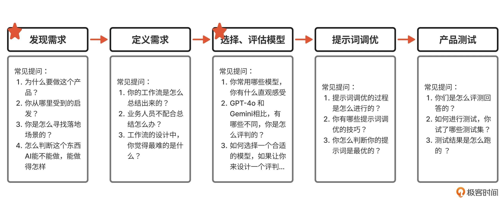
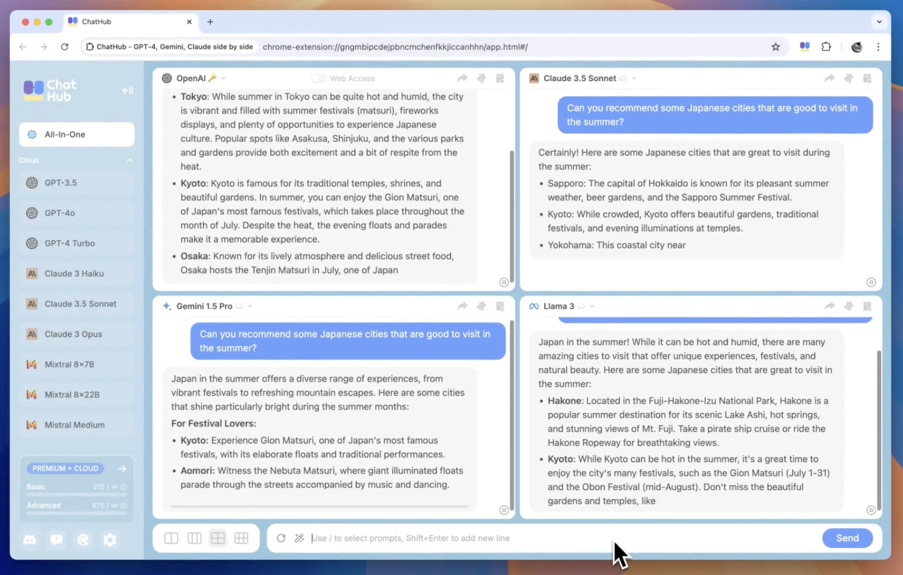
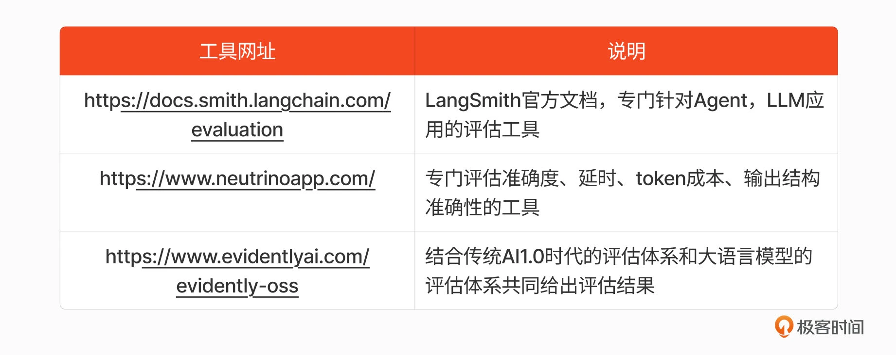
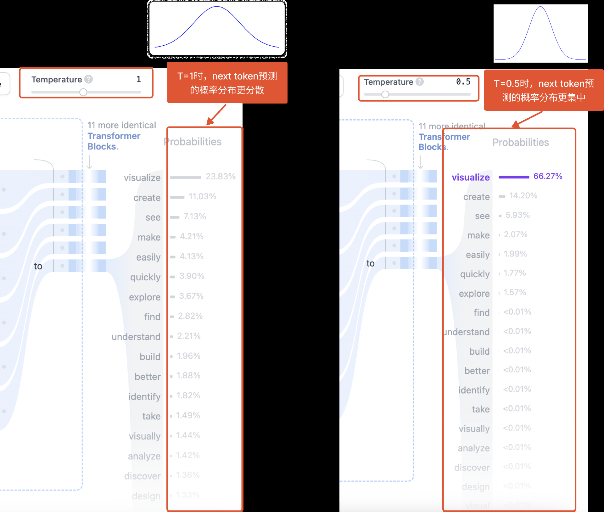
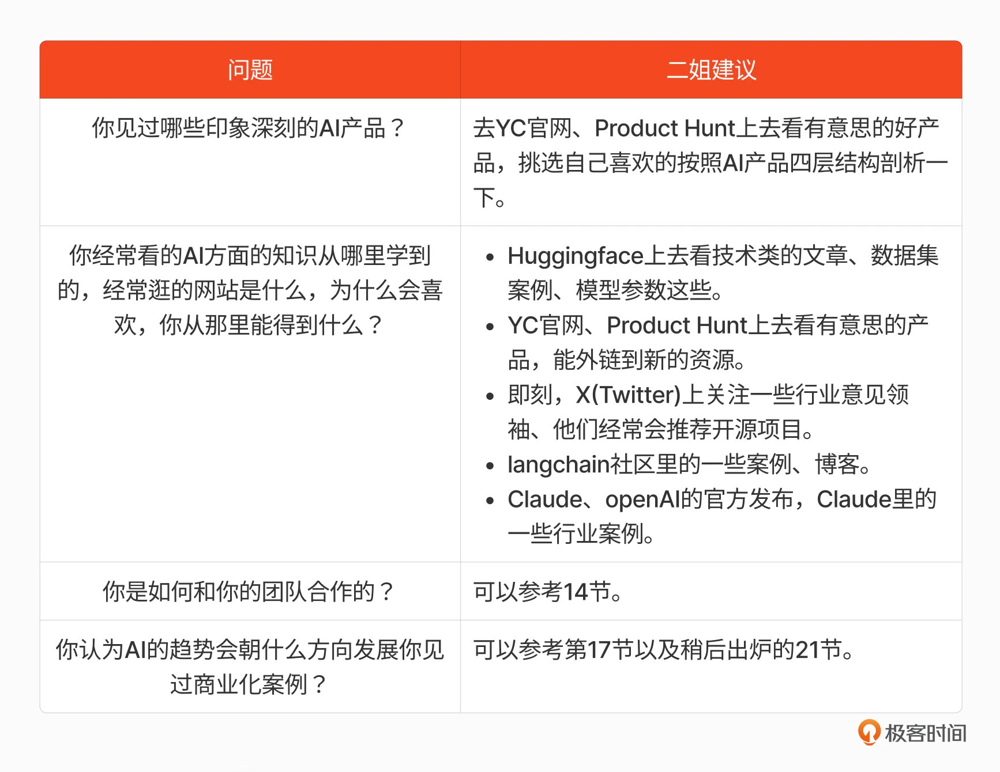

# 19 | AI产品经理常见的面试题有哪些？

你好，我是产品二姐。

上节课我们讲了如何写好简历，这节课来聊聊面试。在过去的一年中，我收到过不少同学的面试问题，也和一些 AI 产品经理的面试官、猎头有过各种沟通。今天的课可以说是这些访谈、解答的大合集。包含了三大块内容：

- 首先，我会和你从宏观上分析在过去一年中，AI 产品经理能力模型的演进过程，方便你把握当下面试的重点。

- 接下来，我会简单介绍一场面试的内容分布，让你在面试前心里有底。

- 最后，就是重点内容。我会给你总结常见的面试题、解答技巧及示例回答，你也可以把这部分内容当做对前面所有课程的回顾与查漏补缺。

无论你是刚开始准备转型，还是已经在找工作的过程中，这些内容都将帮助你在面试中展现最好的自己。准备好了吗？让我们开始吧！

## 产品经理的 AI 能力演进

还记得 2023 年初 ChatGPT 刚刚爆火时，大家都在争相尝试各种 AI 工具，产品经理们也开始寻求转型机会。一年多过去了，AI 产品经理这个新兴职位也发生了很多变化，这种变化大致分为几个阶段。

- 2023 年中旬～2023 年底：产品经理要“用好”大模型。首先你是一个 GPT 的专业用户，精通提示词工程，了解大语言模型的基本原理和局限性。

- 2023 年 12 月～2024 年 3 月：产品经理要“会做”简单 Agent。比如能通过 Dify、Coze 搭建简单工作流，开始掌握检索增强生成（RAG）这类工程技术的应用，并将提示词工程的技巧整合到实际产品中。

- 2024 年 3 月至今：产品经理要能找到落地场景。比如识别哪些场景需要用什么技术，能达到什么样的效果，切实解决实际问题。

这些变化一方面意味着 AI 生态中基座模型的能力正在趋于稳定，AI 的应用方向还有点迷茫；另一方面也提醒我们在面试的时候，要重点准备如何寻找场景并落地实现的问题，别着急，这两块内容我们马上就会作为重点讲到，在这之前我们先来了解一下面试的“全貌”。

## 开始面试

按照时间顺序，一场规范的面试有三个环节。

1. 自我介绍：由你向面试官介绍自己，一般 5 分钟就可以了。

2. 双向交流：这部分是二者双向沟通，一般来说都在 40 分钟～80 分钟之间。一般包括项目实践、理论知识点考察和综合实力考察，这些是你要重点发挥的地方。

3. 向面试官提问：你来提问，面试官解答，这部分也是 5 分钟。

其中第一个环节和第三个环节分别是个人经历的高度总结和面试的收尾阶段。尤其是第一环节，一定要简练、轮廓化介绍。我遇到有的同学在这一部分会花掉大段时间，导致后面的双向沟通非常匆忙，而面试官仅作为聆听者也会感到疲劳，所以我建议你一定要提前准备，对着镜子计时练习是一个不错的方法，你可以试试。

同时我也推荐你看一下极客时间课程《面试现场》里的两节课：

- 12 | 如何做好开场：给自我介绍加“特效”

- 19 | 应该如何向面试官提问？

作者白海飞是我在 IBM 的同事，后来去了领英中国，是一名出色的管理者，你可以借鉴他里面提到的方法。

那么，在这节课里我们会重点突出双向交流的部分。我把这部分内容分为三个主题。

1. 实践考察

2. 理论考察

3. 综合实力考察

每个主题我会列出和 AI 相关的面试题，带你一起练习。

## 面试中的实践考察

实践考察这一部分面试题，我们按照 AI 产品的研发流程依次来看，并在重点的地方会打上星标。不过面试并非严格按照这个顺序展开，你依据现场情况灵活应对即可。



### 发现需求

一般的提问方式是：为什么要做这个产品？你从哪里受到的启发？ 这个问题回答起来很简单，但背后却需要很多工作的支持，我们先来看如何回答，再来看这个问题背后实际考察的能力。回答分两种情况。

第一种情况：自己独立做 Agent

首先，你可以说一说需求来源。

大部分情况下，这里的需求来源是从个人爱好、经历中发现的痛点，然后向周围的人群扩展，抽象出你们共同的诉求。YC 的创业手册中也提到过：“创业中最好的情况是你自己就是目标用户”。所以，千万不要因为这是为了满足自己的诉求而觉得产品没价值，或者不好意思描述，我相信一位具备伯乐精神的面试官一定会非常欣赏你的这种动机。

其次，描述你认为这个场景可以用 AI 开发的原因。

目前有两个实用可操作的方法，来判断一个场景是否可以用 AI 来开发。

- 一是看同类产品、场景中是否已经有人做了尝试验证，这里一定要亲自试用，而不是听宣传片。

- 二是当前的大语言模型模式化模拟能力很强，你可以从一些具备固定流程、仅需要语言理解能力的场景入手。

比如针对上节课我们提到的产品经理竞品调研小助手的 Agent，你可以说：

```
## 首先是需求来源
我自己就是产品经理，我发现做竞品调研是任何产品、任何功能前必做的事情。我最开始用AI搜索帮我完成这个
## 其次是为什么用AI可以解决
```

- 但是竞品调研每次有固定的套路：就是查看官网、搜索公司的相关信息，包括创始人、历史等等信息。

```
## 最后是扩散需求描述
于是就把我自己的想法放在xx自媒体上，让大家评论、点赞，当做一个小小的客户调研。 大家的反馈也会让我
```

这个描述里既有自我驱动（主动尝试新技术解决问题）、需求洞察（我自己）、技术匹配（有固定套路），还有实际的客户调研数据（点赞数、评论数），能很好地体现出一个优秀产品经理的潜质。

另外在扩散需求调研的时候，我推荐你使用兴趣社交类 App，比如国内的即刻、知乎，海外的Reddit，它们是介于熟人和陌生人社交的中间态，非常适合做非正式的调研。我就经常看到独立开发者、自媒体人在上面发布自己的想法，听取反馈。

第二种情况：为公司做相关业务

这种情况的需求来源有两种。

- 一是开拓增量业务，探索新赛道，这种情况的应对方法和上述自己独立做 Agent 类似。

- 二是对现有业务进行降本提效，“锦上添花”，你可以重点讲述你是如何在现有业务流中如何找到那些可以用 AI 开发的场景。

到这里你可能也发现了，这两个问题的本质是在问大家：如何寻找场景，这也是产品经理演进到现在的必备能力。在这里我给你几条建议。

1. 多看产品形态：比如 YC 的 580+ 个项目、Product Hunt 榜单上的热门项目，你都可以经常翻阅。这些项目背后是全球最有想法的一批人，每个项目都是他们学习、实践的结晶，相当于你在看一本年度精选杂志。

2. 掌握技术趋势：这里我推荐创新工场 CTO 王咏刚先生的一篇知乎回答。在这篇文章里他介绍了基于可控性的生成式 AI 应用场景路线图，文章发表于 2023 年 6 月，一年半过去了，这张路线图仍然有效。

3. 多链接多分享：包括在兴趣类社交平台分享你的想法，不要羞于说出想法或者担心好的想法会被别人窃取，Sam Altman 曾说过：

- 你不需要对自己的想法过于保密——如果它真的是一个好主意，那么它听起来可能不值得窃取。即使听起来值得窃取，拥有好主意的人至少比愿意付出努力将好主意变成好公司的人多一千倍。

4. 多做：实践上手操作。当你开始上手操作的时候，就像是看了众多旅游攻略后，你自己真正出发了，当你朝着目的地前进时，会遇到各种困难，甚至可能改变目的地，发现新的“景点”（场景）。

这四点都做到了，并且反复做，和你现有的场景不断碰撞、重叠、结合，质变就会产生量变。这就是发现需求的过程。那么在发现需求之后，就是定义需求了。

### 定义需求

这里面试官可能会问：你的工作流是怎么总结出来的？

这部分考察的是你的思维严密性。因为工作流是大部分垂直类 AI 产品的一个框架，而工作流中的每个节点都需要与相邻节点进行严丝合缝的对接，才是一个可以被执行的工作流。

这里你的回答可以是专家访谈，也可以是现有工作流的积累，你按照自己的项目说就好。

需要注意的是：给 AI 设计的工作流会比专家总结出来的工作流更琐碎，细致。就比如第 11节的“自助工单小助手”，它在做事的时候，背后就需要进行多步思考，而业务专家在总结的时候可能不会那么仔细，作为产品经理要能把人类工作流的步骤拆解到 Agent 工作流的每个节点。

定义好需求之后，就开始落地了。

### 落地第一步：选择模型

落地的第一步面试官经常会问：

- 你经常用哪些模型，对于这些模型，你有什么直观感受？

- GPT-4o 和 Gemini 相比，有哪些不同，你是怎么评判的？

- 如何选择一个合适的模型，如果让你来设计一个评判体系，你会怎么设计？

这些问题实际是为了考察什么呢？一是你是不是真的做过这些项目，二是考察你在模型评测过程的严谨性。在这里我推荐你做以下几件事来巩固你选择模型的能力。

1. 复习 02 节模型的三看一测，尤其是一测的方法。

2. 仔细阅读百度千帆的微调作文打分案例。因为在大语言模型产生之前，大部分的评测都有固定答案，就像给选择题打分；而大语言模型产生之后，评测是给一段话打分，这就不是固定答案了，就是像给作文打分。 因此，这个案例非常普适地展现了给模型打分的步骤。当然，针对这个问题，你重点看案例中给作文打分的方法，而不是微调过程。

3. 使用一些模型对比工具，直观感受同一问题不同模型的表现，比如 Chathub。



4. 参考专门提供模型评估、对比的一些海外初创公司。比如以下表格里的一些工具，特别是LangSmith 里的测试概念和方法。



当然，除了上述四点之外，你还要注意每个业务场景有不同的评估模型，要根据自己的场景适度定制。这里我给出了一个示例回答供你参考，你可以停下来仔细读一读，括号里是我的注释。

```
## 表达通用测试方法
```

- 我知道各个模型会有各种榜单，但是后来发现这些榜单不一定适合自己的业务，仅能作为参考项。后来我去学习

```
我首先想到既然通用领域，大家都有榜单和测试集。那为了适应自己的业务，我先要设定自己的标准。(**测试
其次，定好标准后，还有对实际回答进行测试，这一步我想用机器+业务专家共同来完成。
因为在国内，我们不能用OpenAI，Antropic 这类最好的模型，但是我们可以把它们作为建立标准和评判国内
## 限定测试范围
```

- 接下来就是限定一个测试范围。而在我的工作流里，会有不同的节点，不同节点对模型的能力要求也是不一样的

```
## 陈述测试理论
给语言模型建标准的过程我觉得某种程度上像以前历史课里的论述题，比如论述"为什么南宋会灭亡"， 因为大
```

- 如果我们参考论述题的出题和阅卷过程，就会觉得比较清晰：

```
- 一是要出题，并且给出标准答案，也就是确定这个节点的输入和期待输出的数据对。
- 二是定义阅卷标准。也就是如何把实际结果标准回答的差距做量化表示。比如按照内容完整度、正确度、相关
## 具体实操步骤
```

- 具体我们是这样操作的：第一步：找到问题与标准回答数据对。这一步我们有专门的业务专家来定，不过为了节省他们的工作量，我会准

- 第二步：总结评判方法，接下来，我会用回答最好的模型辅助业务专家一起构建一个评判方法，就像给历史论述

```
- 相关度：回答是否与主题相关。
- 正确度：是否包含错误内容。
- 完整度：是否完整包含了所有内容。
- 逻辑性：这一步对模型有一定的推理能力要求。
第三步：使用其他模型对测试集中的问题进行回答。
把这些第二步中的评判方法，加上第一步生产出的标准答案，再加上实际答案，构建出阅卷的提示词，发送给G
第四步：让专家审核GPT4给出分数和打分原因。必要的时候对分数进行修正。
```

- 第五步：扩大测试规模，用第一步调整出来的最优提示词，生产出更多的标准答案。之后重复第三步。直到测试

你看，“如何选择模型”这个简单的问题，其实反映出来大量的工程能力，整个过程也涉及到了提示词调优、评估模型这些实际落地能力。有了这个回答，接下来的问题就可以在这个基础上“借坡下驴”了。

### 提示词调优

这里常见的问题是：提示词调优的过程是怎么进行的，你有哪些提示词调优的技巧？

其实在上一个问题，我们回答实际操作步骤时，就已经提到提示词调优的场景了，如果你还记得我们在 03 节的课后题里，要求大家从 twitter 数据集中选取 20 条数据，写一条提示词，使模型输出结果与 20 条数据中的标注数据保持一致。

这个过程就是提示词调优的过程，和刚刚的模型选择类似，提示词调优首先也是有一个标准的。标准可以由业务专家制定，也可以由业界最好的模型辅助业务专家来制定，方法和上一个问题示例回答中的“具体实操步骤中第一步”一样，在这里就不再赘述。

更多的提示词调优技巧，你可以参考03 节、06 节里的内容回看。在这里就不再赘述。接下来我们就来到了最后一步。

### 产品测试

这部分常见的问题有：

- 你们是怎么评测回答的？

- 如何进行测试，你试了哪些测试集，测试结果是怎么跑的？

这里的测试和刚刚选择模型的测试在业务逻辑上是不一样的：刚才是针对单个节点选择模型的测试，这里是针对整个产品的测试。

因此这里的测试方法，除了刚刚提到的之外，还有其他方法，在这里我推荐你先阅读我们刚刚表格里列出的 LangSmith 的评估方法和概念，以及开源测试标准 RAGAS。从去年 8 月我关注 RAGAS 到现在，RAGAS 已经从最初单一为 RAG 建立测试标准，到现在支持工具使用、自然语言比较、text to SQL 以及简单分类等多个场景。

读完之后，你可以从中选择适合自己场景的方法综合测试。

### 阶段小结

到这里，我们阶段小结一下。这部分项目实践重点考察面试者的场景寻找能力和实际落地能力，你按照产品研发步骤这个思路来整理、陈述、沟通就好。当然，面试官也可能不会从具体问题问起，而是问：

- 你遇到的最大困难是什么，又是如何解决的？

- 你觉得从这个项目中获得的最大收获是什么？

- 如果下次你还做这个项目，你会怎么做？有什么遗憾的地方？

你可以从自己最熟悉、印象最深刻的话题聊起，然后再扩展到其他话题。

接下来，我们看看第二部分。

## 面试中的理论考察

这一部分你可以参考 01、02、12 节中关于神经网络、反向传播算法、Lora 微调的讲解，这些内容对应的具体问题有：

1. 谈谈你是怎么理解大语言模型的？

2. 用简单通俗的语言讲讲你对神经网络，梯度下降法，反向传播算法，Transformer 的理解？

3. 你觉得微调的作用是什么，什么情况下你会选择微调？

除此之外，还有一个经常被问到的问题是：

- Temprature 温度对模型输出有什么影响？

这在之前的课程中没有做具体解释，我在这里补充一下：神经网络的 Temprature 是参考了热力学里的概念，比如水在加热到 100 度时，水分子的分布就会更加发散，在 0 度时，分布会更加集中。

我们在一个 Transformer 可视化的开源项目里，可以清晰地看到 Temprature 对模型输出的影响，其中重点需要观察的部分我放在下面这张图中。可以看到：当模型温度越高（T=1）时，模型预测 next token 的概率分布更加发散，反之（T=0.5）则越集中。因此，在发散场景（比如文学创作）Temprature 可以调高一些，在可控性较强的场景（比如要判断正面、负面情绪）Temprature 可以调低一些，在一些常规对话场景（比如客服）可以调整在中间（T=0.5~0.7），这样既显得真实，也不会过于发散。



那么，看完理论考察，剩下的就是综合素质考察了。

## 面试中的综合素质考察

不止是 AI 产品经理面试，这部分的考察几乎是所有面试都会涉及的环节，我在这里列出来供你参考。

在非 AI 方面，你可能会遇到以下问题：

1. 动机：为什么转型，离职原因？

2. 匹配度： 你的优势是什么，为什么选择我们公司？

3. 个人发展：你有什么职业规划？

这些问题你按照自己的情况提前准备，我就不再赘述，当然你也可以参考极客时间的课程《面试现场》来学习。

在 AI 方面，你可能会遇到以下问题，我依次给出建议并列在了表格里，你可以参考。



## 总结

到这里，关于面试的过程我们就梳理完了。结合上节课中的简历准备，你是不是已经开始准备面试了呢？ 这节课我们用三分之二的篇幅重点讲述了实践考察的这一环节，也是需要你重点准备的部分。我希望在提出切实建议的同时，也能帮你总结前面课程的知识。

另外，二姐还想嘱咐你两点：

1. 面试不仅是为了让你找到一份好工作，而且是反复认识、发现、提升自己的好机会。把每次面试当做一次提升机会，放开心态展示自己，会让你在面试中更加自信、自然。

2. 面试是双向匹配度的测试，并不是能力高低的测试，面试结果也并不是评判你能力的唯一标准。所以无论什么结果，都希望你能以冷静、乐观的心态对待面试结果。

最后，二姐祝你顺利找到心仪的工作。如果暂时不能，我们还有另外一种选择：那就是做一名独立开发者，或者过一段有意义的 GAP 时间为自己充电，我会在下节课分享我自己和周围人的经验，期待你来！

## 课后题

这一节课，二姐也为你来出一道面试题：在过去的一年中，让你最骄傲的一件关于 AI 的事情是什么呢？可以是你自己做的一个小助手，也可以是你的产品用户数有一定的突破，为什么这些事情让你骄傲，背后你做了哪些努力呢？

欢迎你在评论区留言，如果觉得有所收获，也可以把课程分享给更多的朋友一起学习。我们下节课见！
