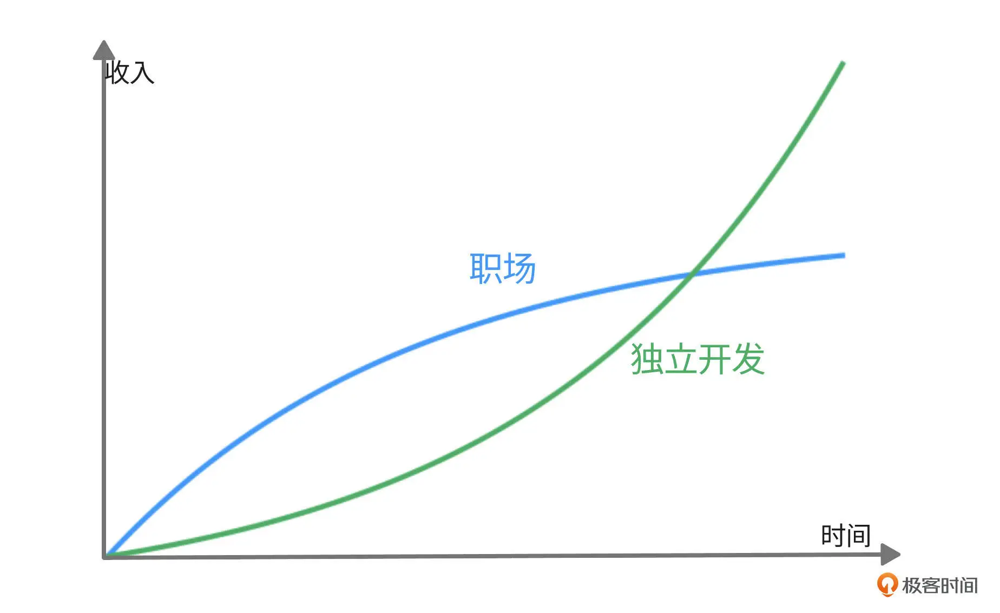
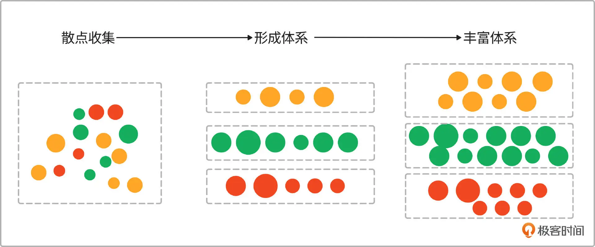

# 20 | 新AI时代数字游民：如何成为一名AI产品独立开发者？

你好，我是产品二姐。

在 AI 日新月异的今天，我们看到越来越多的工作多面手，他们在 AI 工具的辅助下，能做出一人 App。比如做出《胃之书》和《陌生人闹钟》的赵纯想在一次访谈中就提到他最新的两款应用都是和 AI 编码工具 Cursor 一起写的。于是，有很多同学开始思考选择作为一个独立开发者，开启另外一种形式的职业生涯。

那么，独立开发者在没有公司发工资的情况下，要做哪些事情才能让自己既享有自由，又享有财富呢？在硅谷著名投资人写的《纳瓦尔宝典》一书中，有这样一句话让人印象深刻，书中说：

- 要想致富，需要杠杆。杠杆来自于人力、来自于资本、也可能来自于代码或媒体。

对于大多数普通个体来说，我们没有巨大的资本，也没有团队成为财富杠杆，那么，“代码和媒体”就最有可能在这个时代成为我们的杠杆。而这二者在我看来正是独立开发者的两大基石。所以我们今天的内容分为两大块：

- 一是独立开发者如何做好一个自媒体。

- 二是独立开发者如何做好一个代码类产品。

在切入正题之前，我们非常有必要先来定义一下什么是独立开发者。

## 什么是独立开发者？

首先我想和你澄清几个常见的误区。

误区一：独立开发是一种副业。在我看来，独立开发需要投入相当大的时间、精力，如果是作为副业，那么前提是主业花去的精力非常少，比如占用你全部工作时间的 30%。

误区二：独立开发赚的钱比公司赚的多。大部分独立开发者的收入在刚起步的一段时间比不上职场的收入；但随着时间的投入和积累，独立开发者的收入可能会超出职场收入。我用下面这张图来大致对比一下两种选择的收入增长模式，从这方面讲，独立开发更像是一次个体创业。

独立开发的收获更像一个小雪球，最开始微不足道，经过合理的积累之后，会慢慢变大，你可以把这段时间当做一次个体创业，也可以是一次 GAP year 的充电，这些电也可以成为你重新进入职场的资本。

所以你需要冷静地选择，避免被媒体的狂轰乱炸一时冲动。同时，在开启独立开发者的生活状态之前，我还想提醒你完成以下准备工作。

1. 确认好社保缴纳等基础保障。

2. 计划好你未来一段时间（1～2 年）的开销支出计划。

3. 这一点最重要，那就是列出你在最初几个月想做的所有事情，这些事情可以包括旅行，一段时间的休息。但更重要的，它们是你发自内心想做的事情，并且未来也可能会成为你的资本。比如列出你想做的 5 个应用，清晰地列出你为什么要做，目前市面上有没有类似的东西，它们未来的发展空间如何，具体有哪些功能。或者是你想在自媒体上写 30 个主题，为了这 30 个主题的内容，列出学习计划。尽管后来你的计划会根据实际情况改变，但这些列表能保证你不会闲着。

做好这些准备后，接下来我就和你分享一下如何做好代码或媒体。因为到目前为止，我并不认为我是一个完整的独立开发者，因此接下来的内容有我自己切身的经验，同时也借鉴了很多朋友的访谈与观察，希望能给你带来帮助。

## 如何经营你的自媒体？

独立开发者的自媒体和目前想通过流量带货的自媒体有本质区别，我们需要认清自己的目标，然后一点点靠近。这里我给你几点建议。

建议一：不必一味地追求粉丝量和热点。自媒体定义为个人品牌、产品的推广渠道，而不是走媒体或者带货路线，一味追求粉丝量和热点非常容易迷失个人品牌和产品本身的路线。

除非你拥有绝密渠道能先获得信息，否则不要刻意追求热点。因为头部媒体有大量的资源跟踪热点，他们背后有大量的渠道和分布全球的写手，做热点追踪的优势远大于个体。而大众的消费时间是有限的，一个热点来临之后，总是最先出来的那批头部媒体抢走了大众的时间，在同一个话题上，留给小自媒体时间又有多少呢？

建议二：内容的质量比数量重要。当然追求质量意味着时长。好内容所消耗的精力比你想象中大，因此同时兼顾好内容、好代码是非常困难的。当然你可以在一些短、平、快的兴趣媒体上保持与大家的连接。

建议三：一个好传播的名字可能比想象中作用更大。你的名字就是你的品牌名称，越大的公司品牌名称越简单、容易记忆，比如小米、苹果、MUJI。当然在最开始没有影响力的时候，可以换名字，但当你渐渐有影响力，推荐你将你的“品牌名称”确定下来，并保持如一。

在这些基础上，我们来看一个好内容的生产过程。

### 好内容生产过程

B 站博主小林说在一次访谈中曾经提到她的团队制作爆款内容的逻辑是：

- 爆款 = 热点 + 有趣 + 干货

独立开发者与之的区别是选题上不必跟随热点，跟随自己原本的计划来做就好，但输出内容上做到有趣、有干货，才能吸引到和你志同道合的伙伴，我们一个个来看。

1. 如何做到有干货？

我把优质内容创作者的生产过程分为三个阶段：散点收集、形成体系和丰富体系。用图形化的表示就是下面这样。

第一阶段是散点收集，这种收集并不是刻意地确定好一个主题才开始的，而是通过每天记录自己的学习所得来收集的。这个阶段不要给自己设限，遇到不懂的问题就立刻查资料或请教他人。这些看似零散的点都是未来内容的养分。

第二阶段是形成体系，随着零散的点积累到一定程度，可以有意识地将这些点按照一定方式组织起来，这些方式可以是：

- 体现并列关系的四象限，比如我们在 10 节提到的 Agent 的记忆可以按照长期短期和事实性记忆程序性记忆来划分。

- 体现依赖关系的层级结构：比如 01 节我们把 AI 产品分为四层。

- 体现顺序关系的流程图：比如 03 节里的 RAG 流水线。

- 体现事物发展的时间轴：比如在 17 节里把人类与物理世界关系的发展历史梳理出来。

第三阶段是丰富体系，也就是当你总结出一个框架结构的时候，发现过去的记录不能完全对应结构中的内容，于是我们要针对框架中的每一个部分进行深入展开，补充具体的案例、数据和洞察，让内容变得更加丰富。

这三个阶段缺一不可：如果只有散点收集，内容就会零散凌乱；如果只有框架而不丰富细节，内容就会显得空洞。只有经过这样系统性地积累、梳理和充实，才能产出既有深度又有体系的优质内容。

2. 如何做到有趣：直白、易懂

这里我有两个技巧：开门见山和文字视觉化。开门见山很容易理解，文字视觉化怎么理解呢？

我们知道，人类 80% 的信息都来自视觉输入，也有人说“一图胜千言”。把你的理解用视觉类的图片或者视频表现出来，会更容易让人接受。在这里，你可以有意识地构建自己的品牌色和视觉风格。

内容上，独立开发者的媒体内容一般可以有：

- 清晰的思维表达图。

- 逻辑正确的流程图。

- 自己产品的效果图或者视频展示。

总之，优质的内容就像一栋精心设计的建筑，内容是地基和框架，确保建筑稳固可靠；形式则是外立面和装修，让建筑美观动人。只有两者兼顾，才能打造出既有内涵又有颜值的作品，这样的作品在信息洪流中会自然而然带来流量。如果你持续保持优质的记录、输出，就会慢慢发生以下事情：

- 首先，会有人发现你的认真与坚持，发来点赞与关注。

- 接着，会有优质的内容创作者来关注并推荐你的文章。

- 然后，会有平台的运营编辑找到你，可能会推荐你参加一些平台活动获得流量扶持。

- 后来，会有志同道合的人向你靠近，你们开始合作做一些事情。

- 再后来，有熟人发觉你可能是 ta 在这个领域内能找到的最专业人士，所以当他们遇到这个领域的问题时，就来请教你。

- 这些熟人会带来一些真正愿意付费的客户。

- 慢慢地，你的圈子会越来越大。

- 当你发现读者的正反馈越来越多，就可以借助互联网的裂变、营销等方式扩大传播。

读到这里，你会发现，独立开发者的自媒体同样是你的产品，在这里我想把 Sam Altman 在创业手册里关于产品增长的策略，同样应用于媒体。

- 优质的内容是实现自媒体长期增长的唯一途径。…你必须通过吸引人们阅读内容来实现增长。没有其他方法。

但好的内容，同样离不开你有一个好的、让你骄傲的产品，那就是独立开发者的第二个武器：代码。

## 如何做你的“代码”？

作为一个产品经理，我的代码水平仍然不够高，但我特别庆幸通过自媒体找到了非常厉害的程序员朋友，共同开启了独立开发者生涯。但目前我们自己的产品仍然在研发当中，还不能算是完整经历过产品研发的独立开发者。因此这部分内容，我会结合自身有限的体会，以及对一些朋友的访谈和你分享其中的经验，他们其中有我的合作伙伴公众号[AI 小智]，流光卡片产品的开发者。

### 代码成为产品后才是资本

在开启具体操作步骤之前，我们要先明白：纳瓦尔宝典中的代码，指代的是用代码构建的产品。因为他在书中把比尔盖茨、贝佐斯、扎克伯格等人说成是通过代码这个杠杆获得财富的人，而这些人显然是做了一个基于代码做的产品，而不是单纯地写代码。

产品与代码的区别是：产品是可以高效复制、为大多数人带来价值的商品，它并不是一次性完成的项目。而代码可能是产品，也可能是一次性的项目。更具体来说：

- 如果你是在开发或者是合伙开发自己的产品，那么这是一次创业。

- 如果你是在外包平台上找一份软件外包的订单，这是副业。

当然，二者并不冲突，因为项目可以是你暂时用来练习，让你获得产品的途径。比如你现在服务一个客户，那就要思考如何让这个解决方案满足十个客户的需求。这样，等你有十个客户的时候，就可以把它扩大到一百个，当你的软件有一百个人在使用时，就可以说一个产品雏形出现了。

接下来我和你分享一下独立开发者产品诞生的过程。

### 独立开发者诞生好产品的过程

这部分会分三步走：一是找到一个好点子；二是做出一个好产品；三是推广你的产品。我们一个个来看。

1. 如何酝酿一个好主意？

优秀的独立开发者总有一大堆的点子，源于平时的日积月累，就像乔布斯曾经说过的：

- You can’t connect the dots looking forward; you can only connect them looking backwards.So you have to trust that the dots will somehow connect in your future.在我们向前看时，无法预见未来的点如何连接，但回顾过去时，这些经历和知识会形成一个完整的图景，因此我们必须相信未来的点会以某种方式连接起来

并不是说每有一个点子你都可以拿来做产品，一个适合做产品的好主意必须具备以下两个特征之一，或者二者兼备。

- 这个点子是一群客户的共同诉求，意味着诉求覆盖面广。

- 这个点子是某些小众群体经常遇到的诉求，意味着这个诉求可能只覆盖一小部分人群，但他们却频繁使用。

在这里，我分享两段[流光卡片]开发者对这两个特征的切实感受，希望你能从中体会到一个独立开发者在发现需求方面做的观察和思考。他说：

- 软件外包并不是长期的，在给甲方开发积累经验过程中，去积累一些对产品细节的观察，之后专门抽出一个小组对这类产品进行模板化，而这些积累下来的很多实用的想法也可以在这里得以实现成为更好的产品，或者改造成开源项目，提高影响力，后续将模板化软件作为一个收入来源，…有一个好产品，然后有一群用户愿意为此买单。

这段话里的“把外包需求进行模板化”就是形成产品的过程。对于小众的产品，他是这样看待的。

- 因为小众的特点，注定他很难在短期内引来大的流量增长，但也因为小众，用户忠诚度会更高，更容易做到小众领域的头部。也因为小众，所以其实不同用户需求也有差异，需要多采访倾听慢工出细活…这种小众产品很多时候会扮演副产品探索更多应用场景，获得更多的用户。

你会发现：从“小事”切入，获得小众客户，然后再探索更多，这种“涟漪”般的扩张也是独立开发者做大的过程。

那么当你在做的过程中发现点子，在发现点子的过程中持续实践，一个好的点子就是在这种实践中慢慢长大的。二者是螺旋上升相互促进的，那么如何实践呢？

2. 如何开发？

在 AI 时代，有一种简单的开发方式就是构建智能体，在 Coze 平台上发布自己的智能体，你可以在社群里友好地进行推广，尝试获得大家的反馈，并以此迭代。

第二种是使用传统的编码方式开发。你可能会问：AI 时代是否还需要程序员的帮助完成开发？在我看来，尽管 AI 编码工具越来越多，但我仍然认为程序员的技术栈并不是一两个工具能取代的，这些技术栈包括：合理的架构设计、快速的编码能力、独立部署、搭建服务等等。

所以，如果你是一个人，你仍然需要构建起这些能力，只是现在可以借助 AI 工具完成得更快。如果能找到一个程序员合作伙伴，也是非常好的选择。实际上，大多数 YC 的项目也是 2～3 个人。

3. 如何推广？

除了上述提到可以通过自媒体来推广之外，独立开发者还有一个非常重要的推广方式是开源。开源之后，我们可以推介给各个平台支持开源的博主、意见领袖，他们会非常乐意为好产品代言，从而为你带来一定流量。同时，开源也会给你带来更多的用户反馈和社区贡献者。

## 小结

到这里，我和你介绍了独立开发者这种生活状态。

在我看来，独立开发是一种个体创业，或者是短时间内充电的生活方式。在我过去十几年的职业生涯中，最常听到的学习方式是：在工作中学习。然而，在 AI 这项新技术来临的时候，我对这种学习方式有所动摇，因为相比个人而言，公司的学习速度是慢一拍的。

当然，我非常理解开启独立开发的职业生涯需要勇气和物质条件。你也可以从副业的方式开始，只是在做副业的时候你需要思考：如何能把副业变成一种资本，而不是单纯的出售个人时间。

开启你的独立开发者生涯之后，媒体与代码是你的两大杠杆，杠杆是中性的，用好了会扩大你的收益，用不好可能会带来更快速度的衰落，怀着敬畏的心做好内容与产品，是独立开发者应有的态度。

## 课后题

最后给你留个作业，从今天起，每想到一个点子就迅速把它记下来，几个月之后再回头看这些点子，看看它们是不是仍然有效。如果你能从这些点子中发现一条长期不变的内核，恭喜你，可以把它完整地写下来，包括：

- 你的点子能解决什么痛点？

- 现在是不是已经有人在做了，体验这些已经做出来的产品，并试着分析它的闪光、不足。

- 用户的使用场景是什么？

- 如果你要说服别人使用，你会怎么说？

- 现在的技术是否能实现？ 如果不能实现，某些地方降级后是不是仍然对用户具有吸引力？

如果这些你都做了调研，那么我鼓励你亲手尝试。

欢迎你在评论区留言，如果觉得有所收获，也可以把课程分享给更多的朋友一起学习。我们下节课见！
