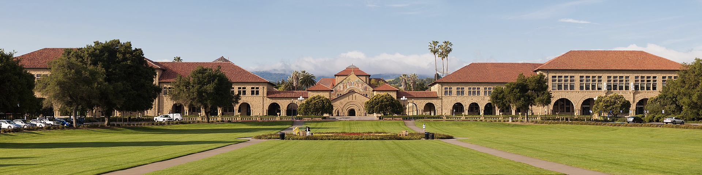
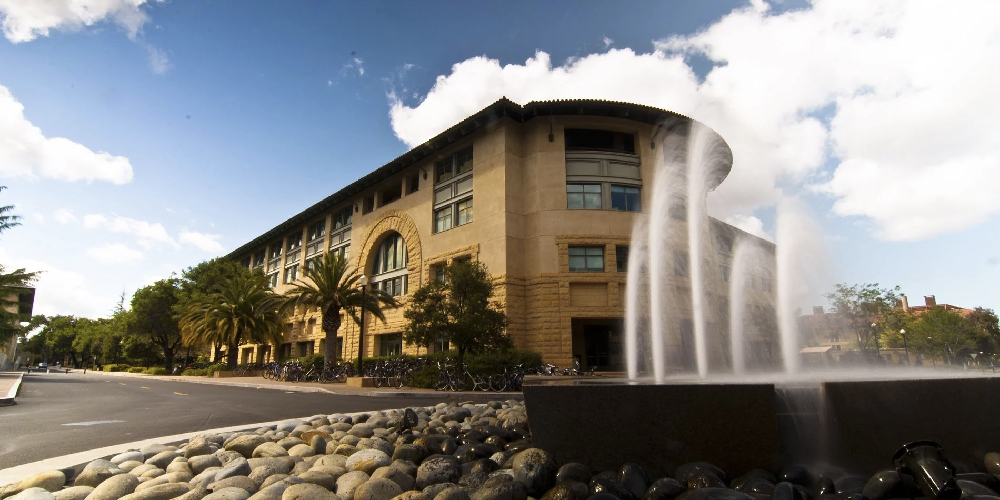
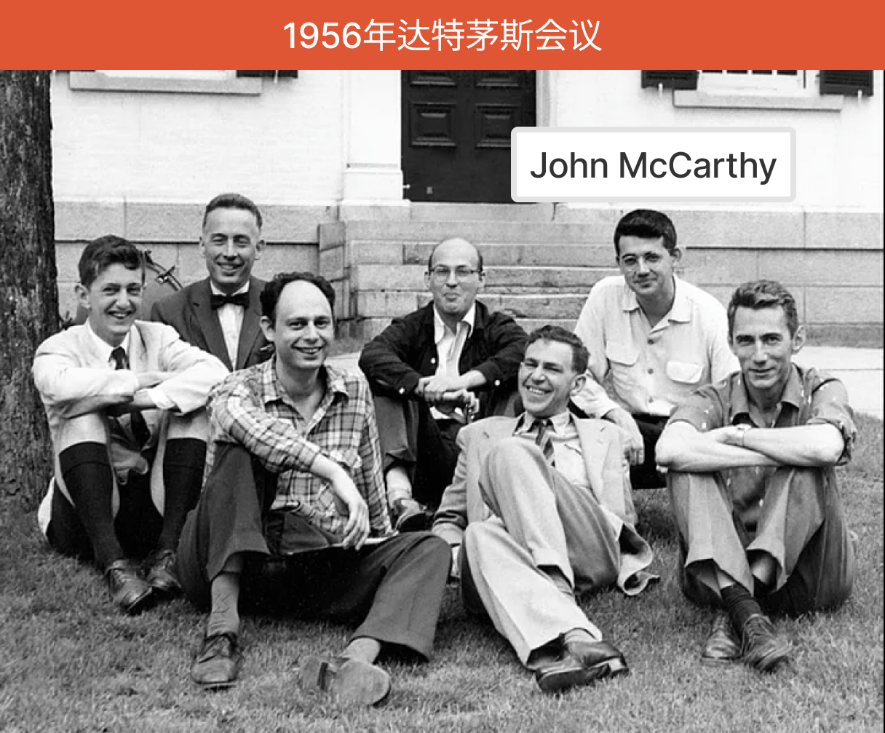
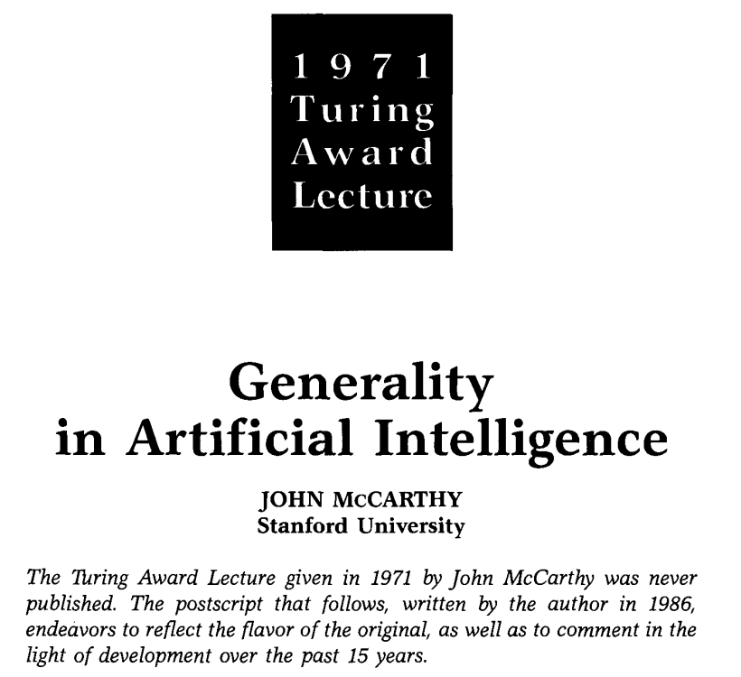
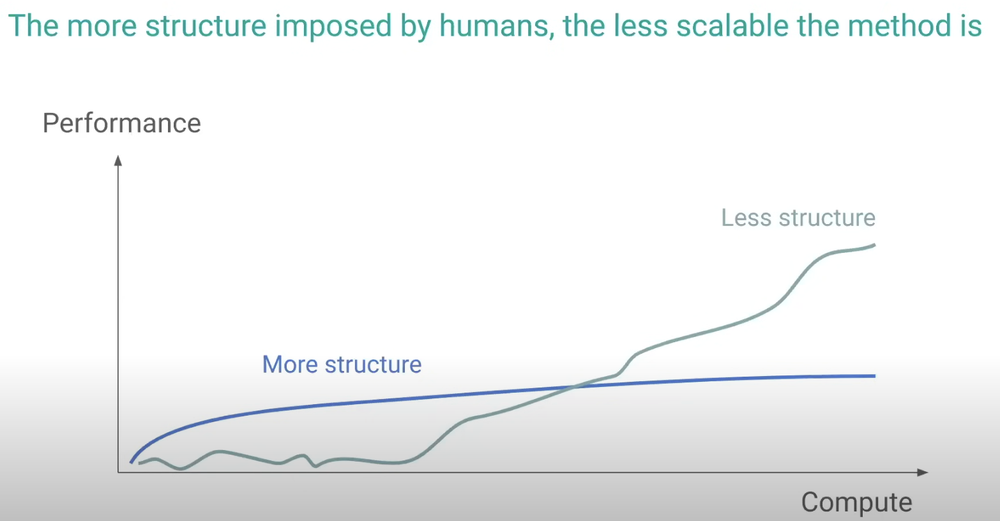
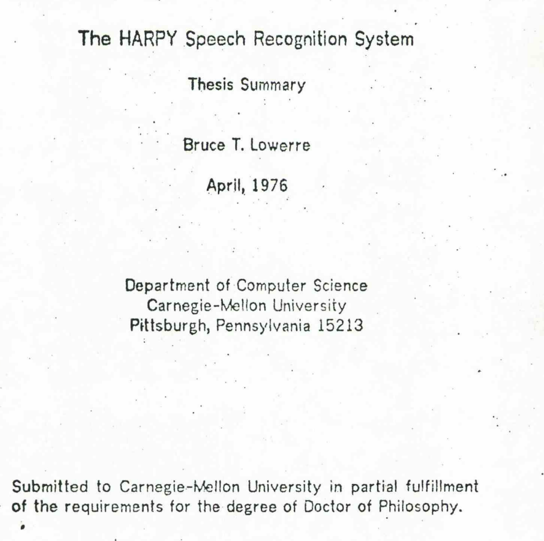
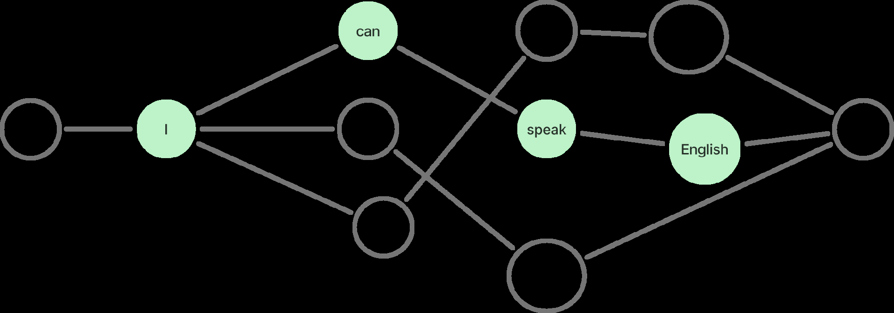

# 国庆加餐：参拜斯坦福，带你感受AI殿堂级人物的历史故事

你好，我是产品二姐。

一年一度的国庆旅行大季来了，相信不少朋友已经踏上旅途。二姐的家人也要飞越大洋，前往美国感受全球科技圣地–硅谷的风采。与硅谷毗邻的斯坦福，更是全球科技人才向往的顶级学府。在 AI 的历史上，就有不少殿堂级的人物曾经在这里生活、工作过。

今天咱们就聊聊从斯坦福走出来的两位重要的人物 John McCarthy 和他的学生 Raj Reddy。他们分别获得了 1971 年和 1994 年的图灵奖，希望未来你有机会去硅谷的时候，能带着他的故事去旅行，会更加有趣。

## 斯坦福 AI 实验室创始人：John McCarthy

1927 年，John McCarthy 出生于一个俄裔家庭，在高中期间就自学了大学前两年的数学课程。1951 年，他在普林斯顿大学获得了博士学位。毕业之后的几年，他先后在普林斯顿、斯坦福、达特茅斯任教。直到 1962 年，John McCarthy 在斯坦福任教直到退休。在斯坦福期间，他创办了 SAIL（Standford Artificial Intelligence Lab，斯坦福人工智能实验室），我们熟悉的吴恩达老师、李飞飞老师都是在 SAIL 开展他们的研究的。

有的同学可能知道，1956 年的达特茅斯会议是人工智能诞生的标志。而组织这次会议的人，正是当时年仅 29 岁的 John McCarthy。

在 1958 年，John McCarthy 在达特茅斯学院发明了 LISP 语言。你可能没有听说过 LISP，但你一定听说过 Java、Java Script、Python，它们都与 LISP 语言有着千丝万缕的联系。硅谷最大的天使投资机构 YC 的创始人 Paul Graham 曾在一篇博客中说道：

- LISP 语言之于计算机语言，就像《几何原本》之于几何学。

我们知道，在《几何原本》里，欧几里得从基本 23 个定义、5 个公设和 5 个公理出发，给出了 119 个定义和 465 个命题及证明，可以说奠定了人类对几何结构的认知基础。类似地，Paul Graham 就从 LISP 当中提取出了七个原始操作、一个函数表示推导出若干其他函数，奠定了计算机语言的基础。（感兴趣的朋友大家可以细读文末的参考一：Paul Graham 的原文《LISP 之根》）

而就在最近，还有 AI 爱好者将 LISP 语言用在提示词工程中，做出了非常有趣，可以让大语言模型稳定输出的海报。

1971 年， John McCarthy 被授予计算机界的诺贝尔奖 - 图灵奖，他将自己的演讲题目命名为“Generality in Artificial Intelligence”（人工智能的通用性）。

听到这个题目，你是不是被触动了一下？“难道，今天我们所讲的通用人工智能，竟然在 50 年前就被实现了吗？ ”

答案当然是否定的！哈哈。

实际上， 人工智能的通用性从 AI 诞生的那一天起，就成了所有从业者的奋斗目标。而今天，我们依然在这条路上前行还未达到目标。

1986 年，John McCarthy 在重新谈起这次演讲的时候，也公开承认当时的想法过于乐观了。他补充了当时 AI 实现通用性上要解决的几个问题：

- 一是，当我们需要增加一点点新的想法时，经常需要重写整个数据结构。

- 二是，目前还没有人知道如何创建一个通用的常识知识数据库。比如我们没有办法通过程序让一个机器人知道，搬动一个东西会造成什么样的影响。

- 三是，当我们采用逻辑方法研究人工智能时，我们设计的公理对于一般常识数据库的适用性太有限。

这些问题，你是不是听起来也特别熟悉呢？ 是的，这正是 Software 1.0 时代的程序员每天都在经历的事情。而今天，我们处在 Software 2.0 的初期，已经看到：

- 通过数据对就能够定义一个神经网络，而不需要重写整个数据结构。

- 互联网时代生产的大量网络数据已经形成一个巨大的常识知识库，可以被大模型拿来训练。

- 神经网络可以学习一切的方法，把 AI 从逻辑方法的局限性中拉了出来。

而就在前几天，OpenAI 的一位研究员 Hyung Won Chung 也分享了这样一个现象，那就是：

随着算力、数据的上升，弱结构化 AI 模型会比强结构化 AI 模型表现更加优异。

这里的弱结构化 AI 模型就是 Software 2.0 时代以神经网络以基础的模型，而强结构化 AI 模型是指 Software 1.0 时代指定规则的模型。

这个对比也正是当年 John McCarthy 所提出的三个问题，那一刻，我仿佛看到跨越 30 年的两代 AI 研究者隔空对话。

如果 John McCarthy 今天还在世，他可能真的会拍拍你的肩膀说：“嗨，伙计（翻译腔），恭喜你赶上了一个好时代！”

除此个人的学术贡献之外，John McCarthy 还在斯坦福培养出了两位图灵奖得主的学生 RajReddy、Barbara Liskov，他们一起组成了图灵奖评奖历史上罕有的“一门三杰”，被传为一段佳话。其中，Raj Reddy 在 AI 语音识别方面做出了巨大贡献。

## 斯坦福毕业的图灵奖得主 Raj Reddy

1963 年， Raj 来到斯坦福，师从 John McCarthy，进入 AI 语音识别研究领域，也就是研究如何把人类说出来话转换成对应的文字。1971 年，美国国防高级研究计划局 DARPA 提供资金，计划在五年内研究大规模语音理解的可能性，要求能识别 1000 个单词，连续的、不同人的语音。当时在卡耐基梅隆大学任职的 Raj 主要负责这一项目，并且将这一项目命名为HARPY。现在我们在网络上仍然能看到 50 年前 HARPY 背后的原理陈述。

当我们回头看 HARPY 及其背后的实现原理时，从某些方面，依稀能看到 GPT 的影子。在1976 年 HARPY 的 Demo 视频里，Raj 团队是这样描述 HARPY 的原理的：

研究者根据人类语言构建出一个网络。比如按照英文的句法结构，我们将下面的几句话讲变成一个词序网，每个节点是一个单词。

比如对于下面三句话：

- I am from China.

- I can speak English.

- I like football.

这个网络就会变成下图这样：

那么，当 HARPY 在识别语音的时候，就会把人类的语音输入从这些网络中去检索出最匹配的那个单词。 比如当用户说 “I” 的时候，系统会检索 “I” 后面会有三种可能：can, like, am，那么它就会根据用户说的单词从这三个中选择其中一个。

这个过程相当于是，研究者们人工为计算机输入了一套人类语句知识库，然后让计算机和这一套知识库进行匹配。如果没有这样一套网络，我们每听到一个单词，计算机就要随机地去和所有的单词进行匹配，而这个词序网将待匹配单词的范围大大缩小，从而大大提高了语音识别速度。

你看，在这里，HARPY 是预先用人工构建了一个词序网，而 GPT 的预测下一个 token 的能力就是能让机器自己构建出词的顺序，这又是一次多么美妙的跨越时空的对话呀！

1979 年，Raj 创办了卡耐基梅隆大学的机器人学院，从事包括空间机器人、计算机视觉、计算机图形学、医学机器人等人工领域的研究。

1986 年，一位华裔年轻人来到卡耐基梅隆大学的机器人学院，在 Raj 的支持下将 HARPY 改进为 Sphinx，可以支持更大规模、更多输入的语音识别，并且能真实地被应用在辅助儿童阅读的教学场景中（Project LISTEN）。2000 年，Sphinx 团队将 Shhinx 开源，促进了语音识别的进一步发展。而这个年轻人就是：李开复。

在 1994 年，Raj 获得图灵奖，最主要的原因是感谢他在大规模知识工程领域的贡献。

## 小结

到这里，我们领略了几十年前从斯坦福走出来的两位图灵奖得主对 AI 的贡献。其实，除了John McCarthy 和 Raj Reddy， 从斯坦福走出来的 AI 人物举不胜举，二姐也无法一一列举。

今天，我更多的是希望和大家从历史照进未来，不管是 John McCarthy 的 LISP 语言，还是Raj 主导的 AI 语音识别技术，都是今天这场科技盛宴的重要贡献者，值得被所有人记住。

同时，也希望你能从历史中受到启发，更深刻地理解现代人工智能技术。

最后，祝你国庆愉快~ 我们节后再见！

## 参考

1. Paul Graham 写的《LISP 之根》。

2. John McCarthy Generality in Artificial Intelligence

3. OpenAI 研究者 Hyung Won Chung 的分享。

4. HARPY 原理综述。

5. HARPY 的 Demo 视频。
