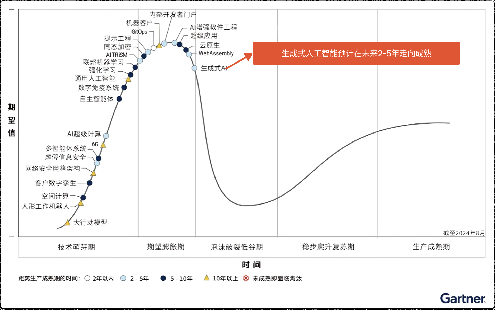
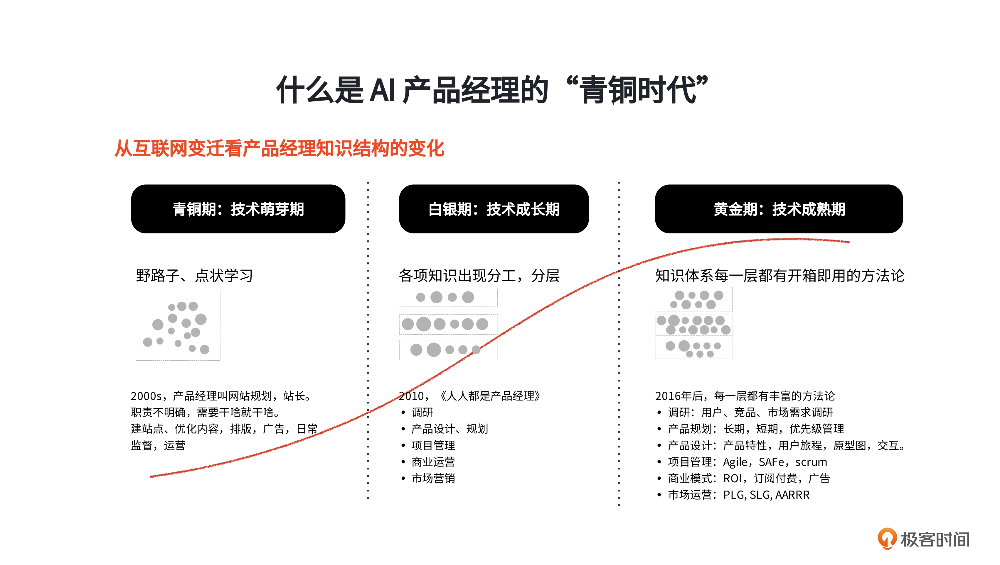
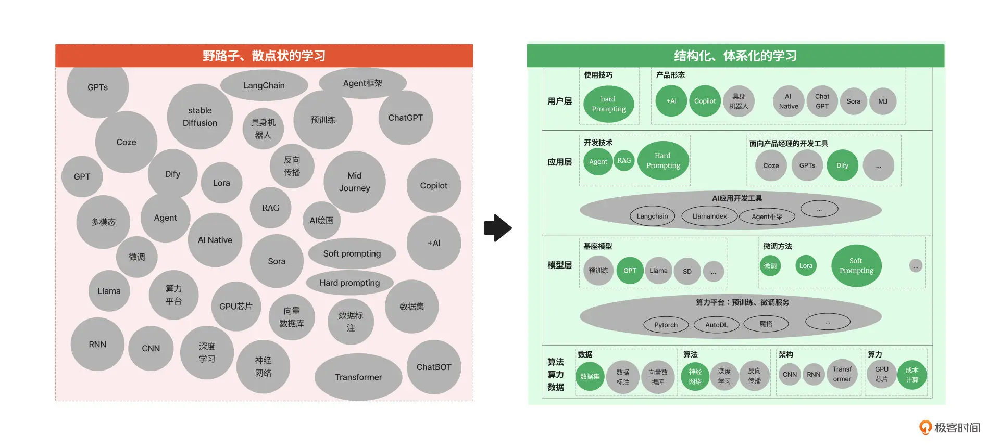

# 开篇词 | 跨越AGI产品经理的青铜时代

你好，我是姬阁阁，网名产品二姐，是一名新晋的 AGI 产品经理。

2021 年，我开始接触生成式 AI。2023 年 8 月，我按捺不住内心对 AI 技术浪潮的热情，从外企裸辞投身 AI。2023 年，我们团队先后入围由百度和阿里组织的 AGI 黑客马拉松活动，并在阿里第三季 AI 创客松中获得“从 0 到 1 奖”。截至 2024 年 5 月，我们前后服务了 4 家企业客户，其中一个客户是估值几十亿的行业细分赛道头部企业，我们负责提供企业内部 AI 落地咨询、产品交付的服务。

之后，我们萌生了自己做产品的想法，经过多轮打磨，我们的产品构想在今年 7 月得到一家投资机构的认可，目前在这家机构的孵化器开启了人生的首次创业。

可以说，过去一年是我职业生涯成长最快、变化最大的一年，这一年最大的感受用一个词来说，就是冰火两重天。

## 为啥学？

从微观个体来说，我作为老牌互联网产品经理，看到互联网已经走进传统行业队列，那些依然在互联网一线奋战的同学，在职业生涯遇到了巨大瓶颈；而另外一边，作为新晋的 AGI 产品经理，我看到 AGI 人才在市场上供不应求，有的同学在投递简历后的一周之内就收获了六七次面试机会。

从宏观历史来说，每一次技术革命到达巅峰之后，必然会红利殆尽，产生新的技术革命。互联网革命经过 40 年的发展，今天已经到达了顶峰。而这一轮大语言生成式 AI 革命，从 2017 年OpenAI 成立之时就已经开始酝酿。到今年 8 月，在 Gatner 公布的技术发展曲线中预测，生成式人工智能会在短暂的低谷期后，在未来 2-5 年内走向成熟。

- 注：本课程提到的 AI，除非特别说明，都指的是大语言生成式人工智能。 严格来说，AI 技术涵盖范围很广，从 1956 年到现在，先后经历过几次起起落落，每一次崛起都有不同的主题，大语言生成式人工智能是这个时代的新主题。

所以说，不管是微观个体，还是宏观历史，新一轮的 AI 浪潮已经势不可当。

我们首先要恭喜自己赶上了难得一遇的时代浪潮，而具体到一个产品经理个体来说，我们要恭喜自己拥有了创造新一代产品的好时机。那么我们要如何做才能抓住这个好时机呢？

## 如何学？

在我的公众号读者中，有很多同学都在咨询如何成为一名优秀的 AGI 产品经理。这些问题归结起来有三类。

- 一是能不能的问题：我没有做 AI 产品的经验，还能成为 AGI 产品经理吗？

- 二是目标是啥的问题：AGI 产品经理需要具备什么能力，技术要求高吗？Ta 们的日常工作是什么样的，和传统互联网产品经理有什么区别呢？

- 三是如何达成的问题：如果要成为一个 AGI 产品经理，我应该以什么样的学习路径来获取这些知识？

其实这些问题我也曾问过自己，今天回头再看这些问题，答案变得清晰了许多。

### 问题 1：我能不能成为 AGI 产品经理？

我是 2021 年第一次见识到生成式 AI 的魅力。当时的主要工作就是把一个第三方 AI 生成商品描述的接口集成到商家端，给商家提供建议。尽管当时我对此印象深刻，但这个功能并没有得到公司重视，也没有持续打磨。由于工作繁忙，我个人也没有继续进行深入研究。直到 2023年初 ChatGPT 出世之后，我那个尘封两年的记忆才重新被唤起。

可以说，我是从彻头彻尾的互联网产品经理转型到现在的角色的。这得益于一个经久不衰的规律：当新的技术被普遍认可时，就会把大家拉到同一个起跑线上，而不是让个体之间差距越来越大。因为此时的新进者进步会非常快，不必再像早期技术探索者那样“大海捞针”，直接站在巨人的肩膀上利用这个探索成果就可以了。

有些同学可能会说：二姐，你是自己创业，可是我还是想找个公司做。但是我发现很多公司在招聘时，就要求有 AGI 产品经验，这不陷入死循环了吗？

这个问题并不难。我的一个朋友在 AI 工具的协助下，搭建了自己的 AI 产品，并且在海外推广的时候获得了不少关注。这个产品麻雀虽小五脏俱全，涵盖了市场需求调研、产品落地、商业推广的全过程。靠着这个经验，Ta 也很快就拿到了公司 offer。

所以，能不能的问题，其实仅仅是一个心理障碍，你只需要相信自己永远有学习新事物的能力，就能克服这个障碍。

### 问题 2：明确目标，成为 AGI 产品经理要学啥？

我们再来看看目标是啥、如何达成的问题。这一部分需要你静下心来，和我逐步深入。首先，我想带你以史为鉴，从历史的脉搏中感受通往未来的节奏。

下面这张图是互联网技术变革的 20 年中，产品经理的演进过程：总共经历了从技术萌芽到技术成熟的三个时期，我称为：青铜、白银、黄金期。

- 青铜期：这是技术萌芽期。互联网在 2000 年左右处于这一时期，那时候的产品经理叫网站策划、站长，分工也不明确，要干很多杂活，比如网站建设，内容、排版优化，日常站点监控，甚至还有广告承接。比如理想汽车 CEO 李想就是从一个站长开始，成长为现在的超级

- CEO。那时候只有少数从业者，大家都是野路子、散点状地学习，甚至都没有出现产品经理这个职位。

- 白银期：这是技术成长期。2010 年，有一本书叫《人人都是产品经理》，让产品经理第一次广泛走入公众视野。在这本书里，作者苏杰以简单的结构化知识体系阐述了产品经理职责、能力模型，比如怎样定义需求，如何做好项目管理、市场推广等。初代的产品经理几乎都是看过这本书的。

- 黄金期：这是技术成熟期。对应 2016 年左右的互联网。这段时间，《人人都是产品经理》的作者苏杰将所有产品经理的知识通过“人人都是产品经理”这个网站呈现出来，形成了完整、周密的结构化知识体系。与此同时，各路英雄纷纷涌入产品经理这个赛道，促进了全行业的繁荣。

如果将互联网技术革命和 AI 变革对应，我认为当下正处于青铜到白银的过渡期。这门课的目标就是带你跨越 AI 的青铜时代，顺利进入白银时代。也就是把我个人原本走过的野路子、散点学习，总结为结构化的知识体系和学习路径，分享给你。

在我看来，一个 AGI 产品经理的知识体系在传统产品经理的基础之上还应该包括 3 点。

1. AI 技术原理。

2. 寻找 AI 落地场景的方法。

3. 独立搭建 AI 产品 MVP（最小可行性）的能力。

这三者我会分层融合到课程内容中。

### 问题 3：学习路径，如何达到目标

我用下面这张图来表达我所说的结构化的知识体系和学习路径。

一个 AGI 产品可以拆分为四个层次，所以我会在每层架构里选择最具代表性的内容（深绿色气泡）详细讲述。

- 第一章，知识积累

在课程第一章，我们首先会一起“全身打量”一下这套 AGI 产品经理的知识架构，串讲这个架构里的基础知识。我会把最精华的部分以最简单易懂的方式总结出来分享给你，为后面的实战做好 AI 常识储备。

- 第二章，产品实战

很快，我们就会进入 4 个案例的实战学习。这里的四个案例都是我精挑细选的，难度由浅入深，每个案例会覆盖不同类型的场景、不同技术（RAG、提示词、Agent、微调）的应用。学完这四个案例，你不仅能理解 AI 技术是如何解决具体问题，加深对技术原理的理解，还能掌握最重要的寻找 AI 落地场景的方法论。

为了方便你记忆，我还在某一节课准备了打油诗。你先看看我的打油诗水平，能不能从这首诗里面咂摸出点什么？

- 企业场景难找寻，一个框架来扫描，知识生产都渗透，比比性价哪个高。全面铺开不合适，单点切入更容易，提示工程出小样，据此收获真反馈。

- 单个问题不算牛，一类场景才算强，AI 还是小学生，人当将军 ta 当兵。视觉交互有变革，图形融入对话中，信息架构要清晰，原型设计旅程先。

- 第三章，商业落地

4 个产品设计的实战之后，就要考虑商业落地了。这一章节，我们一起思考几个问题：市面上有哪些已经赚到钱的产品，它们是如何做到盈利的？如果想打平产品的 ROI，首先要算清一笔成本账，都说算力要花很多钱，真实的情况是这样的吗？会不会被算力公司坑了？私有化部署要花很多钱吗？我会从原理给出六个公式，对应六个场景，让你能清清楚楚地给自己算笔合理的账。

到这里，我们完成了 AGI 产品经理的三大基础能力准备，涵盖技术原理、产品实战和商业落地。接下来就是“操刀上阵”的技巧学习，正式开启 AGI 产品经理的职业生涯。

- 第四章，职业规划

我会在这章给你提供两种选择建议。

1. 选择一家成长型公司，跟着公司一起进步。

2. 自己做独立开发者，以后考虑创业或者做新时代的数字游民。

在过去的一年里，我既给转型到 AGI 产品经理的同学做过面试辅导，也和招聘 AI 产品经理的管理者进行过深入交流，我经常开玩笑说，求职和招聘在我这里闭环了。在和他们的沟通中，我能够体会出企业需要什么样的人，产品经理应该如何在面试中展示出自己的水平，这些都会在课程中提到。

但是，你要记住，一切的技巧必须建立在扎实的基础之上，泛泛而谈终究会被识破，所以我非常鼓励你跟着课后题实操，保证每节课都亲手实践过。

当然，如果有更好的想法，你也可以原创属于自己的产品，也就是做独立开发者。这一轮 AI带给我们非常显著的一个功能就是：编程技术平权化。自然语言编程已经被很多行业先锋认可。可以说，互联网时代的《人人都是产品经理》在 AI 时代可能会成为“人人都会做一款产品”。所以，我还会和你分享我自己的一些编程实践和先锋榜样，让独立开发成为你职业生涯的一种可能。

- 第五章，未来生态

最后一章，就是展望未来了。前面提到，我希望这门课带着你从青铜走向白银，而从白银到黄金期，我们还有很长一段路要走，业界也在期待一个类似 AI 版微信、AI 版抖音这样 KillerApp（杀手级应用）诞生。但在我看来，这种应用的长成绝不是单纯靠技术进步就能实现，更需要优秀的产品让 AI 融于无形之中，以优秀的用户体验让用户自然过渡到新的技术圈里。

这也许需要很长一段时间（比如 3-5 年），在这里，我们不妨畅想一下未来 5 年的 AI 应用会是什么样子。比如会不会有一个类似 iPhone 的 AI 版硬件出现，AI 版的美团、知乎、滴滴又会是什么样子？希望这些点子能激发到一群正在跨越青铜时代的 AGI 产品经理，也许未来五年，你就是 Killer App 的缔造者！

>> 戳此加入课程交流群
