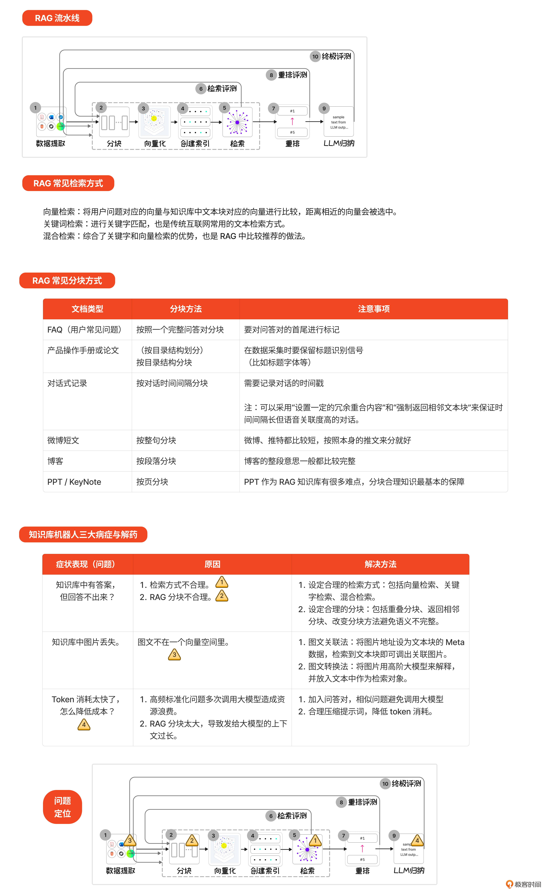
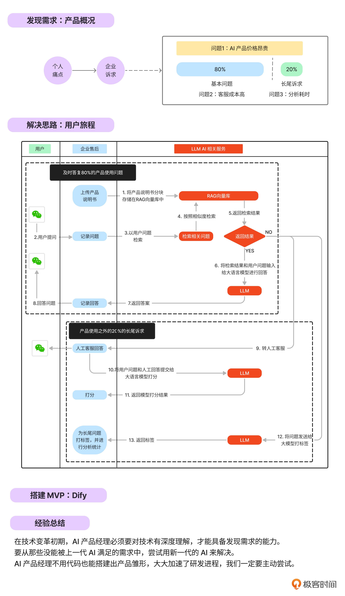

# 阶段复习（一） | RAG技术+知识库机器人产品，拿下！

你好，我是《成为 AGI 产品经理》这门课的编辑晓蕾。

到今天，咱们课程主要的四大案例已经讲解完了。通过四款产品，我们接触了四类 AI 相关技术：RAG、提示词、Agent 和微调。

可能追更到现在的你已经有点疲惫了，别怕！接下来就进入到咱们的阶段复习周！

我按照技术、产品两个脉络，分别总结了这四个产品，分为四节课。因为是复习课，所以咱们加快更新节奏，在本周四、五，下周一、二每天更新一节。希望这些复习小卡片能帮助你快速回顾每个案例的基础技术知识以及产品设计思路。

话不多说，咱们这节课就来复习复习，RAG 技术到底是怎么回事？想做一个知识库机器人产品，大概的解决思路是怎么样的？

### RAG 技术脉络

RAG 的全称是 Retrieval Argumented Generation，中文是检索增强生成。意思是把检索（资料库）的结果发给大模型，增强大模型的生成能力。RAG 本质上就是把搜索到的资料作为提示词的一部分发给大语言模型，让大语言模型有根据地输出内容，从而降低大模型“臆想答案”的概率。

### 电子消费品智能说明书设计思路

在 AI 技术还没有被广泛认知的时代，主动发现痛点比等着别人提出需求更重要，这也是传统产品经理在转型到 AI 产品经理必备的思维转变。

说明书就像是客服坐席的外挂检索知识库，即客服本身不需要记忆这些说明书，而只要知道怎么查这些知识库资料就可以了，这种能力和 RAG 赋予大模型的能力极其类似。或者说，这个过程本质上就是一个 RAG 的过程，即“检索 -> 理解 -> 输出”的过程。

- 请对照图片仔细梳理用户旅程～

最后，再提醒你一次这两节课的作业：

1. 你有没有想过把这些资料整理一下，做一个你自己专属的外挂知识库和“外交”小助理呢？或者，你觉得哪些场景下需要这样的小助理呢？把这些场景列出来，试着按照场景逐步构建出自己的知识库，自己的个人小助理吧！

2. 下次你家再买电子消费品的时候，要不要把对应的电子说明书改成“智能说明书”呢？你甚至还可以在 Coze 或者 Dify 里搭建完之后发布在微信小号上，放在家庭群里，这样就有个家电消费品小助手啦。

这里悄悄告诉你，基于编辑这个岗位，我搭建了一个“录音笔使用小助手”，这样下次老师使用录音笔录制音频有什么问题，问小助手就好啦！你的家电消费品小助手搭建好了吗？期待你在留言区分享自己的小助手。另外，关于专栏，如果你有什么建议或更好的想法，也欢迎你分享在留言区，我一定会关注。

如果你觉得这门课对你有所帮助的话，欢迎你把课程分享给同事或朋友，我们共同学习进步！我们下节复习课见！

>> 戳此加入课程交流群
