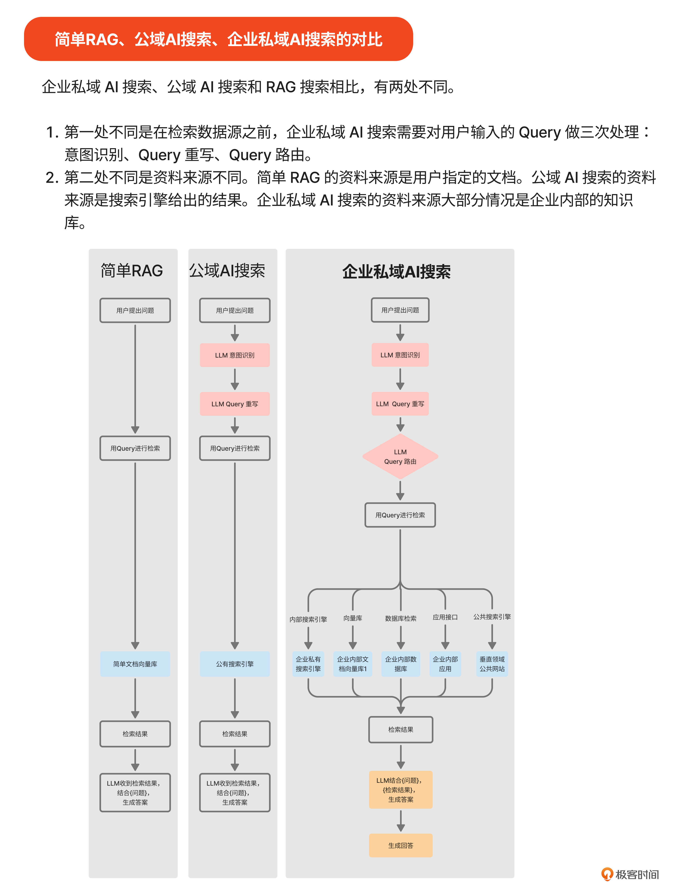
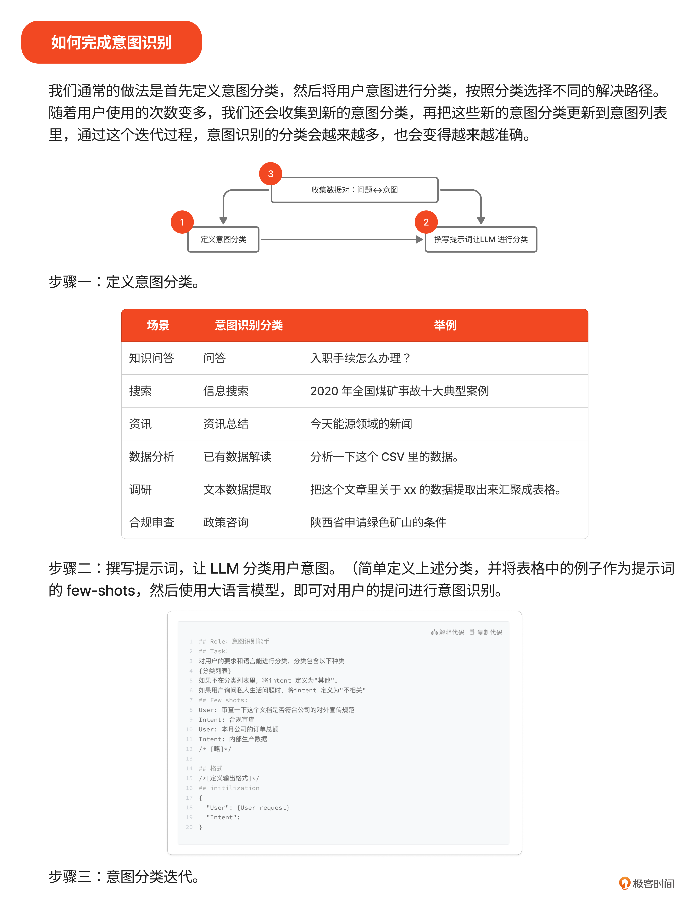
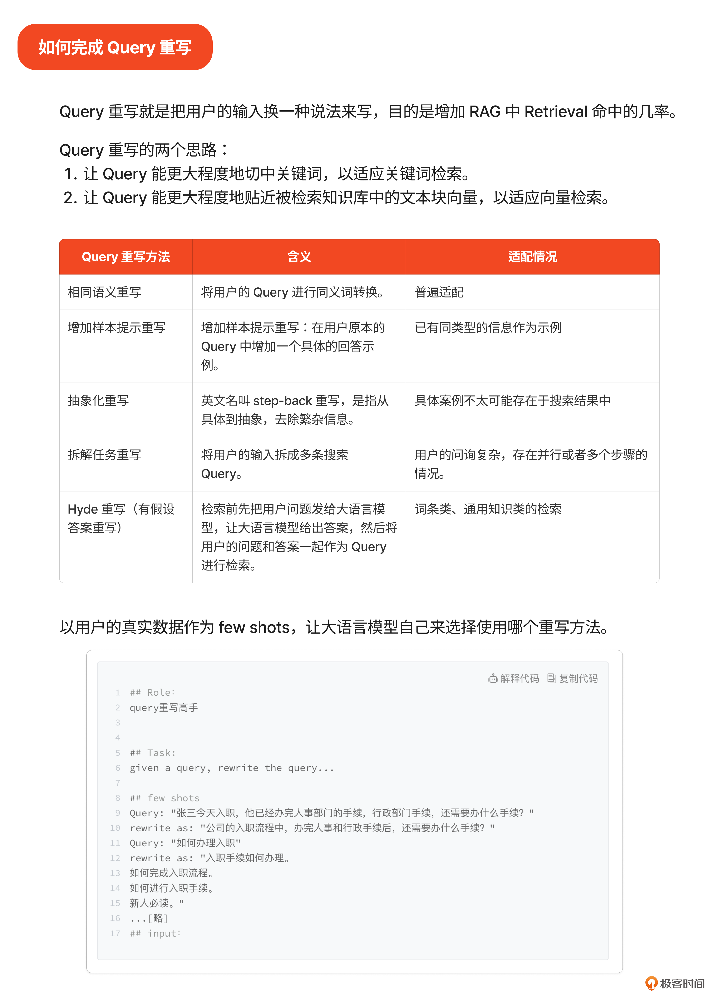
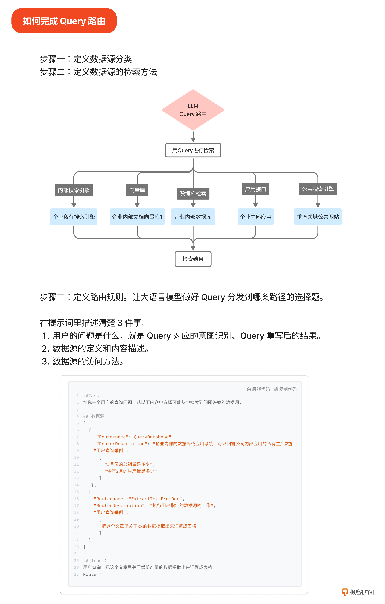
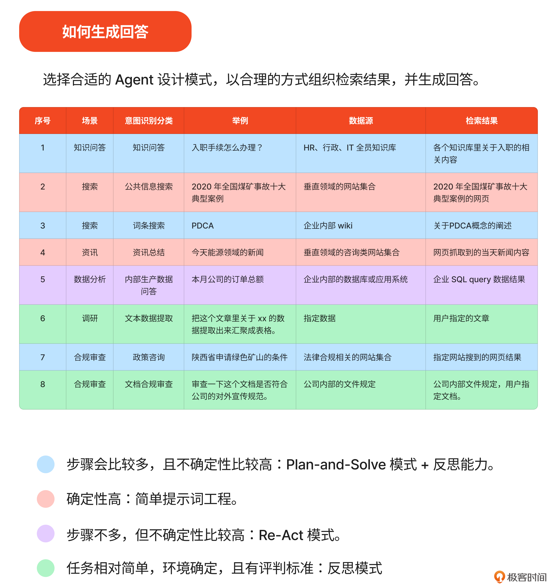
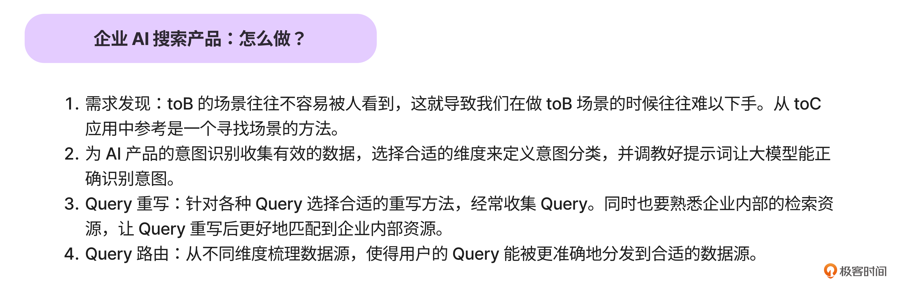

# 阶段复习（三） | 一个企业私域AI搜索的问答产品，竟然涉及这么多知识点！

你好，我是晓蕾。这节课我们来复习怎么做一个企业私域 AI 搜索产品。

这部分对应的是 8-10 课的内容，我在做知识小卡片的时候发现：原来涉及的知识点有这么多！

为了让这节课的复习效果更好，我决定变化一下复习思路，先从产品视角重温一下“企业私域AI 搜索”这个产品，这段话会包含很多知识点。

请看：

- 企业 AI 搜索产品，相当于一个善于倾听、表达、思维活跃的智者。

- 他首先会倾听你的想法（意图识别），通过上下文将你的问题归类到他早已整理好的问题分类里。这些问题分类可能是基于内容分的，也可能是基于问题的解决方法（要通过访问数据库还是调用搜索引擎等）来分的。

- 然后他转述成自己的语言（Query 重写），使用问题转述、拆解等方法尽可能地从自己的知识库中搜索到对应内容。

- 最后，他拿到这些检索结果后，反复审视（ReAct），重新规划问题解决思路（Plan-and-Solve）；并且在生成回答后还会再核对一下答案（反思）。这个过程会灵活运用各种工具来完成。

上面这段话，很明显包含意图识别、Query 重写、Query 路由，Agent 生成模式这些关键词，甚至在他们的背后，还有需要我们掌握的内容。接下来，我们就一起逐个击破这些知识点。

## 问题一：什么是企业私域 AI 搜索？

某些大型企业客户，也就是 KA（Key Account）客户，往往需要的是一整套解决方案，比如一个完整的企业级知识管理 AI 升级解决方案。听起来和 RAG 差不多，那为什么我们还要拎出来单独讲解呢？企业私域的 AI 搜索和 RAG 有什么区别呢？

## 问题二：如何完成意图识别？

“意图识别”相当于首先让你的产品学会倾听、理解用户的真实意图。它也是各种“对话类”产品中的必做部分。

## 问题三：如何完成 Query 重写？

看字面意思，Query 重写就是把用户的输入换一种说法来写。为什么要这么做呢？具体怎么完成呢？

## 问题四：如何完成 Query 路由？

Query 路由，简单来说就是为 Query 找到正确的数据源。

## 问题五：为什么会提到 Agent 设计模式？

为什么我们不能直接把检索结果发给大模型，让它自己生成回答？这有什么难的呢？

可是，你有没有想过以下几种情况：生成回答前，发现检索结果中没有答案怎么办？生成回答的过程中，有些复杂问题会衍生出来新的问题怎么办？生成回答后，发现回答和检索结果内容不符怎么办？

这时候，我们就要用到 “Agent 设计模式”这个知识点了。

## 问题六：如何生成企业私域 AI 搜索的回答？

这一步需要我们对每一个场景都有深刻的理解。而且，初步确定这些设计模式后，还需要在初始提示词的基础上根据真实使用反复迭代。这个迭代的过程是非常漫长的，可能要经过几个月甚至 1-2 年的迭代。到最后，你可能会发现本质上所有的 Agent 设计模式都是将人类的思维、管理模式以结构化 prompt 的方式告诉大模型来进行规划，并调用工具执行，且不断迭代（反思）的过程。

## 在这个产品中，产品经理的主要任务是什么？

最后，我们大致梳理一下产品经理在这个产品中的主要任务。不过注意，千万不要抱着“那我只做这些就好了”的想法。向前迈一步，往往会有更大的收获哦！

最后，老规矩，提醒一下这几节课的课后作业，如果你还没有做，没关系，这三次作业关系非常密切，强烈推荐你一次完成，绝对酸爽。

- 作业一

将你熟悉的语料，比如你关注的微信公众号内容、知乎问答等按照领域分类，然后将你平时在学习、工作中遇到的问题积累起来，也按照这个领域进行分类；这样你就得到一系列的“问题<-> 意图分类”数据对。

然后，选定一个大模型（比如智谱的 ChatGLM)，看看模型是否能对你的问题进行准确的意图识别，如果不能，考虑修改你的提示词，直到可以准确识别为止。

这样你就完成了打造个人私域 AI 搜索的第一步。

- 作业二

对自己的问题做好分类，确定每种类别做合适的 Query 重写方法。之后将自己的知识库按工作、生活、学习这几个种类（或者其他维度）分类，建好知识库（你可以使用 Coze、Dify），然后做一个简单的 Query 路由，试着将你的问题路由到不同知识库进行回答。

你可以观察：

1. Query 重写对检索结果的准确率是否有所提升？

2. 你的 Query 是否可以正确地被路由到对应的知识库呢？

- 作业三

前两次作业，我们完成了个人私域 AI 搜索的意图识别、query 重写、路由。

在 Coze、Dify 中的最后一步，大语言模型生成回答的时候，请你组合使用 ReAct 模式、Plan-and-Solve 模式、反思模式来回答问题。你也可以尝试一个问题用 “ReAct 模式 + 反思模式” 和 “Plan-and-Solve 模式 + 反思模式” 来分别回答。看看到底哪种模式回答得更准确？

好啦，欢迎你在留言区分享你的成果，交流遇到的问题。另外，关于专栏，如果你有什么建议或更好的想法，也欢迎你分享在留言区，我一定会关注。如果你觉得这门课有所帮助，欢迎把课程分享给同事或朋友，我们下节复习课见！
