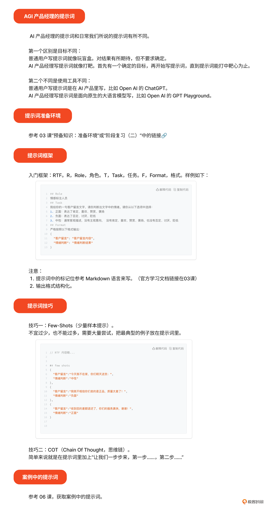
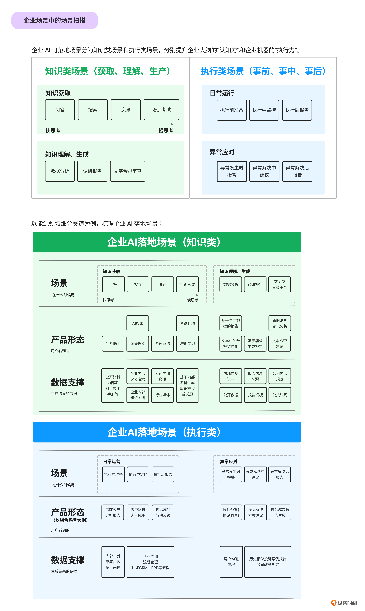
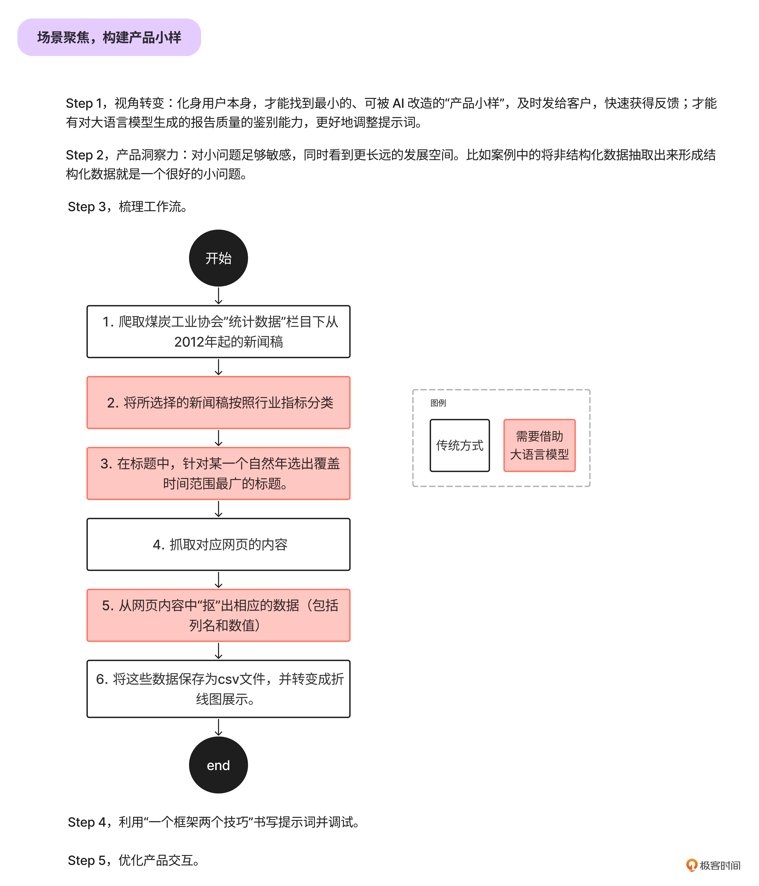
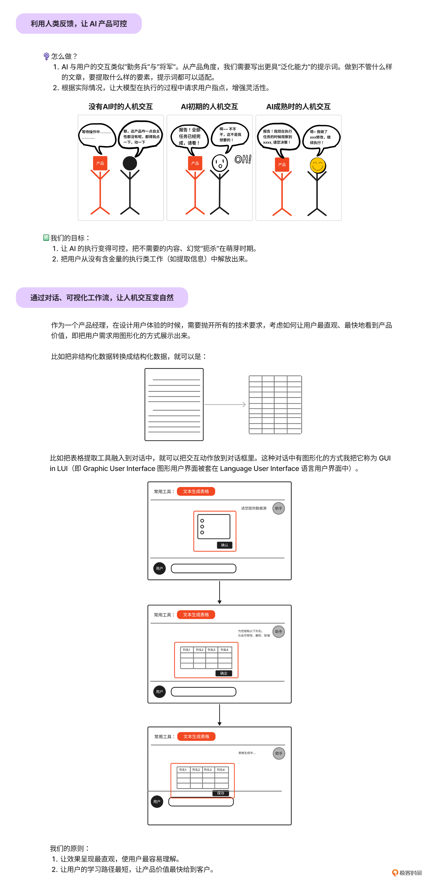
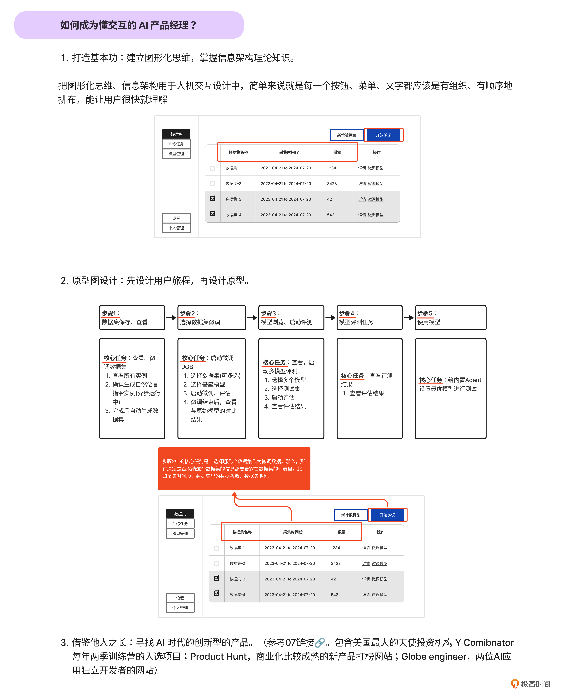

# 阶段复习（二） | 找场景，做Demo，优化交互，一站式搞定！

你好，我是《成为 AGI 产品经理》的课程编辑晓蕾。

不知道你还记不记得那位苦恼着如何在企业内落地 AI 的老板？TA 是不是和你的老板面临的困境一样呢？接下来，我们就来看看怎么解决 “AI 落地迷茫期”的问题。

课程里给出的步骤是先扫描场景、再聚焦场景，最后深入场景。那具体怎么扫描？怎么聚焦？怎么深入？

针对这位老板，二姐构建了一个“文本数据提取小助手”的产品，主要用到的是“提示词”技术。那问题来了，产品经理的提示词和我们日常所说的提示词有什么不同吗？怎么写一份基础的提示词来着？

还有，想要让从文本提取数据的流程可控、交互自然，这里面的人机交互应该怎么设计？更长远一点去想，怎么成为一名懂交互的 AI 产品经理呢？

带着这些问题，点开下方的复习小卡片吧！

## AGI 产品经理的提示词

提示词技巧难度不高，网上也有很多资料。但随着实战深入，你会发现提示词更多的是一项“工程”。比如对于不同模型，我们需要调整不同的提示词；对于同一场景，也需要需要调整提示词以达到最大化满足需求。

参考链接：

1. 03｜AI 产品的上层建筑：提示词工程、RAG 与 Agent

2. 06｜一招致胜：AI 落地迷茫期，怎么快速扫描场景，构建产品小样？

3. 更多提示词框架

4. 有了 Chain of Thought Prompting，大模型能做逻辑推理吗？

5. 提示词指南

## 场景扫描，精准切入

如何在企业场景中，合理挑选“小而美”场景切入呢？答案是，套用一个框架构建企业 AI 化全景图！

## 场景聚焦，构建小样

场景聚焦，就是从“小而美”场景切入，构建出“产品小样”。这部分内容我们会利用提示词工程中的思维链和少量样本技巧，实现从海量文本中提取数据，构建出《能源行业数据提取》的产品小样。

## 场景深入，优化交互

在 ChatGPT 刚刚出来的时候，人们都惊讶于 Ta “长篇大论”的输出能力。但不久大家就发现，这个长篇大论可能在最开始的思路上就错了，或者某些局部需要修改。此时再想修改的时候就要费好大力气修改。这种“亡羊补牢”不仅消耗算力，也会消耗用户精力。

而现在 AI 产品已经过了被 AI “惊艳”的阶段，回归理性。此时我们更需要通过“及时汇报 -> 人类反馈”的方式让 AI 变得实用，这种关系就像是勤务兵与将军的关系。

## 如何成为懂交互的 AI 产品经理？

下面的三点是二姐在思考产品交互设计时的心得，更系统的学习，你也可以参考极客时间的《体验设计案例课》，二姐从中也收获颇多哦。

参考项目：

1. Y Comibnator 入选项目。

2. Product Hunt。

3. Globe engineer。

最后，同样提示你一下这个案例中的课后作业题。

- 作业一

观察中国煤炭行业协会官网的统计数据，利用提示词工程中的少量样本和 COT 技巧，撰写这个案例中的第三个提示词：将不同新闻稿中的同一指标数据汇总，并在智谱 AI 的开放平台进行测试。

1. 煤炭工业协会的数据统计板块。

2. 智谱开放平台免费体验中心。

提示：这个题目里输入项是几个网页的内容，输出项是一段 csv 格式的文字。比如将 2024 年1-6 月和 2023 年 1-11 月的大型煤炭企业掘进工作面月均单进（米）两篇网页中的数据输出为一个 csv 格式的文字。

- 作业二

尝试把Y Comibnator里的项目描述（非结构化文本数据）转化成表格形式（结构化数据），这样这个表格就可以成为随时翻阅的用户体验参考手册啦。

提示：先利用网页爬取工具提取所有的项目 URL，再循环遍历每个 URL 地址对应的网页内容，把一个网页的信息通过提示词工程提取为结构化数据，然后保存为 csv 文件即可。这个过程会用到简单的 Python 完成 URL 地址爬取、网页信息爬取的工作，对产品经理来说有点挑战。

不过现在的大模型产品代码能力也很强，你可以借助智谱的ChatGLM来编码。完成这个小小的挑战吧。

关于作业二，给你分享一位 @lori 同学的作业，翻译质量很高：https://tvwoo39m87e.feishu.cn/base/WBA8b3PHIa1BXUsi9CscabODnFb?from=from_copylink。他在翻译的部分做了一些处理：

1. 将公司页面 HTML 内容用豆包免费模型进行总结。

2. 调用 YC 官网一个接口返回一个公司列表，其中也有公司的简介及业务描述。

3. 使用飞书多维表格的字段 AI 能力，基于第一步和第二步的两个信息再总结成最后的公司业务介绍。

好了，技巧放在这儿了，如果你想和 lori 同学交流，欢迎你加入>> 课程交流群，我们一起进步！

另外，关于专栏，如果你有什么建议或更好的想法，也欢迎你分享在留言区，我一定会关注。如果你觉得这门课对你有所帮助的话，欢迎你把课程分享给同事或朋友，我们下节复习课见！
