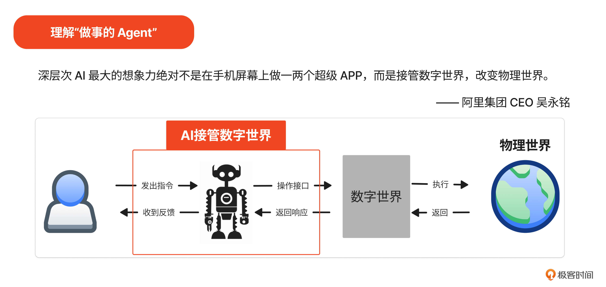
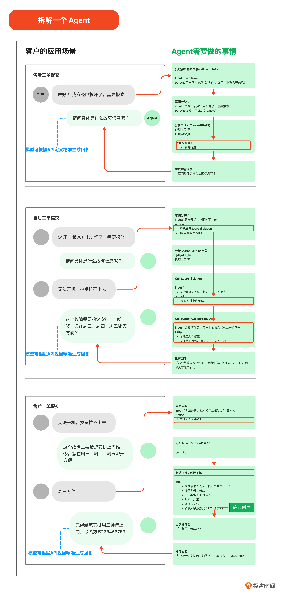
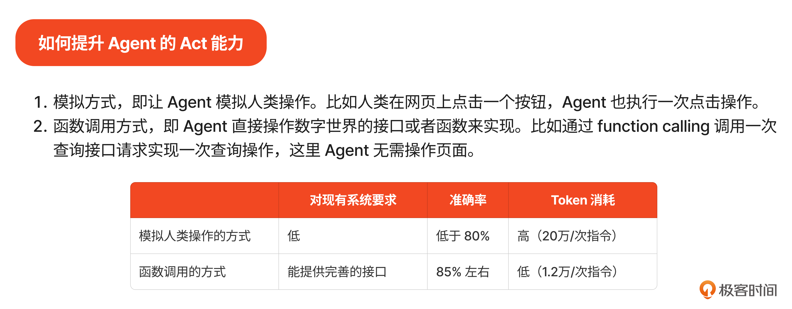
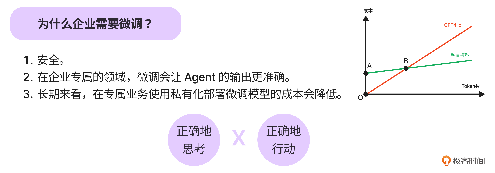
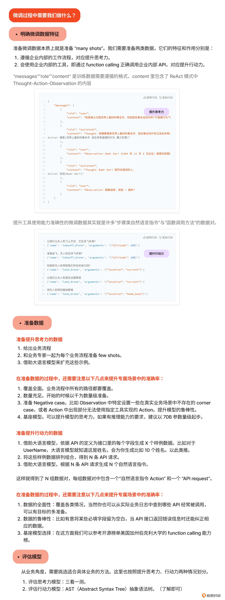
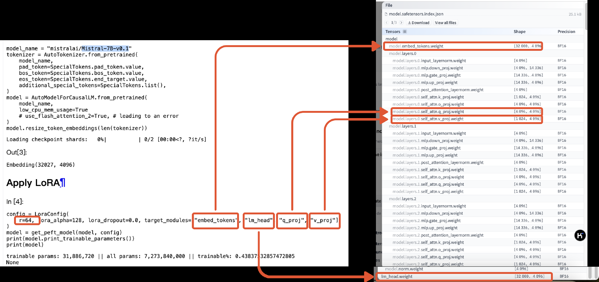

# 阶段复习（四） | 设计一个能做事Agent（内含技术小白也能读懂的LoRA微调过程）

你好，我是晓蕾。

终于来到了最后一个案例，今天我们复习一下怎么做一个“自助工单小助手”。和前面的 Chat类工作不同，这次我们会让 Agent 做 Act 类的工作。

想做好这个产品，首先我们要理解什么是“做事的 Agent”。

过去几十年互联网的发展帮我们构建起了巨大的数字世界，它使人类与物理世界可以进行广泛链接。比如在某打车软件的 App 里，完成了出行工具、司机与乘客的链接；在某个购物 App里，完成了商品、卖家与买家的链接。

而 AI 带给我们的，就是把人类从数字世界中解放出来，让 Agent 代替人类完成这一链接。

（上面都是二姐说的，为了保证阅读连贯性，没用引用格式，特此声明～）

我们试着拆解一下这次的 Agent 案例。

梳理之后，我们发现一个 Agent 需要具备 3 个方面的能力。

1. 准确的意图识别、Query 重写和路由能力。

2. 正确地思考。

3. 正确地行动。

其中，二姐特意讲了提升行动力的两种方式，我也放到这里，如果有需要可以保存。

话说回来，前面说的 3 个能力，我们已经掌握了“准确的意图识别、Query 重写和路由能力”，那如何正确地思考、正确地行动呢？答案是：微调。

听到这个技术名词，是不是觉得可以“休息一下”了？No！作为产品经理，我们在这一步还有很多事情要做。从明确微调数据特征，到准备数据，再到评估模型，都少不了咱们的身影。

最后，我们一起复习一下“千层饼抹酱”的生动比喻，理解 LoRA 微调的过程，让你和技术同学的沟通更加丝滑～

好啦，以上就是这次案例的重点内容。老规矩，提醒下这个案例的几次作业。

- 作业一

下载蚂蚁金服的生活助手支小宝，让支小宝帮你做点“事”，测一测它执行得是否准确？对于执行较好的指令，想想它背后到底调用了什么样的接口？对于执行错误的指令，想想如何才能让它做得更好？

- 作业二

我们提到过，LoRA 中被训练的参数量大幅降低，那么到底降幅有多大呢？ 我们做一道加减乘除运算题来体会一下。

观察 Huggingface 上训练 Mistral 7B 的案例：

在这个案例里，

- 指定 Target Module 是 “embed_tokens”, “lm_head”, “q_proj”, “v_proj”，结合Mistral-7B这个模型的架构，这几层对应的参数矩阵大小分别是：32000 x 4096， 32000 x 4096，4096 x 4096，1024 x 4096。

- 指定 Rank=64。

根据这些数值，计算 LoRA 微调总共需要的训练参数，看看和 Mistral 7B 的总共参数量7,273,849,000 相比，有多大幅度的降低呢？

- 作业三

体验一次数据准备的过程吧。使用你曾经遇到的一个工作流，你也可以使用我们在文中提到的工作流，借助 OpenAI 或者智谱等大语言模型完成从工作流到 few shots，再到 many shots 的过程。

到这里，咱们的四个案例就复习完毕了。明天会正式开启“商业化”章节的学习，我先列出几个问题：

- AGI 产品经理的 PRD 怎么写？

- AI 技术将如何改变产品赚钱的方式？

- 那些算力成本、私有化部署成本到底怎么算？

学到这里，这些问题你有头绪了吗？可以在留言区和大家分享分享。另外，关于专栏，如果你有什么建议或更好的想法，也欢迎分享在留言区，我一定会关注。如果觉得这门课有所帮助，也可以把课程分享给同事或朋友。

我们下节课见！
