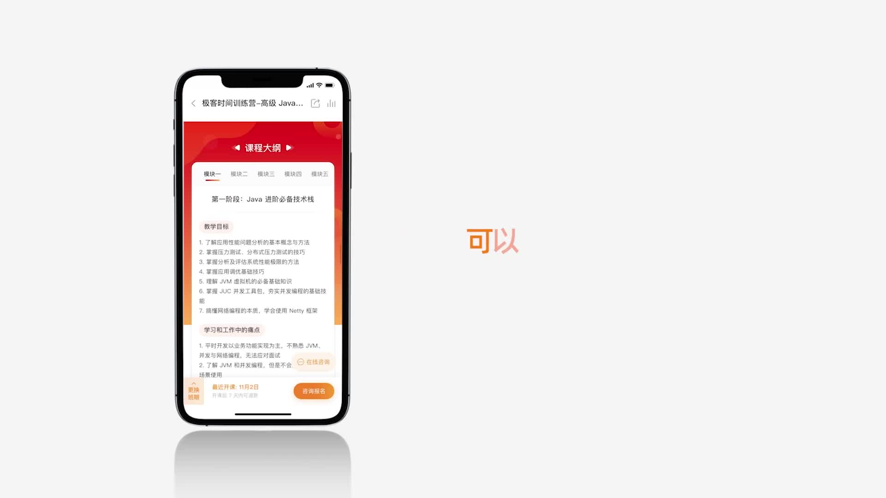

# 导学 | 三小时掌握C++（上）

你好，我是海纳。

5 月 15 号我进行了 3 小时掌握 C++ 系列直播的第一场，分 3 次讲解，每次播大约 1 个小时。为什么做这个系列直播呢？

因为很多同学看到我们的 Python 虚拟机是用 C++ 代码来实现的，所以就有一些畏难情绪，其实在我看来用什么语言并没有那么重要，重要是掌握其中的方法。不过为了让大家消除这样的顾虑，我准备了这个直播。视频我放在下面了，开始学习吧！

下次直播是 5 月 22 日 19:30，期待在直播间看到你的身影，我们不见不散！
