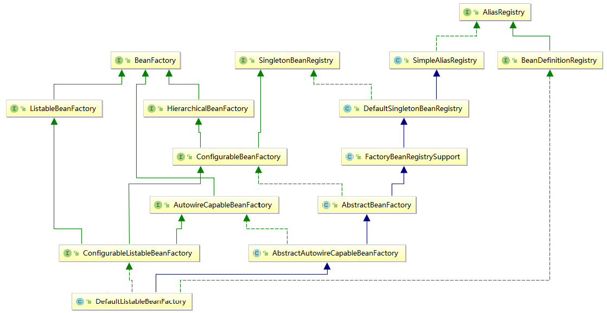
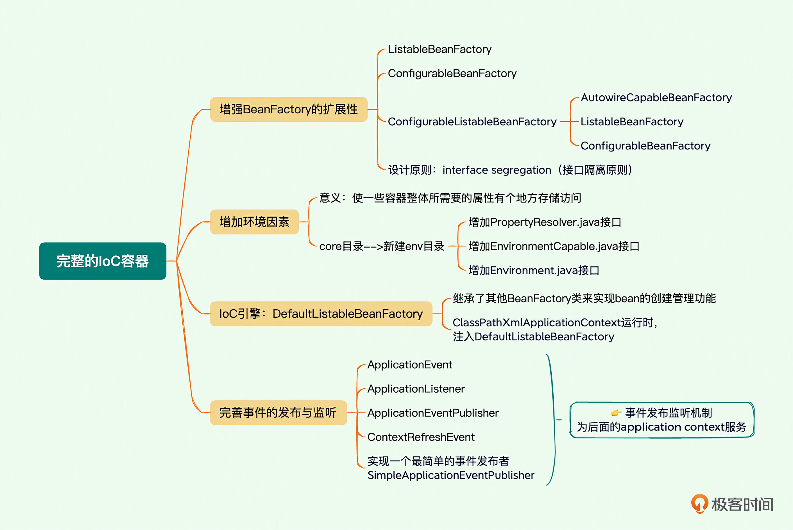

# 05 | 实现完整的IoC容器：构建工厂体系并添加容器事件

你好，我是郭屹。

前面我们已经实现了 IoC 的核心部分，骨架已经有了，那怎么让这个 IoC 丰满起来呢？这就需要实现更多的功能，让我们的 IoC 更加完备。所以这节课我们将通过建立 BeanFactory 体系，添加容器事件等一系列操作，进一步完善 IoC 的功能。

## 实现一个完整的 IoC 容器

为了让我们的 MiniSpring 更加专业一点，也更像 Spring 一点，我们将实现 3 个功能点。

1. 进一步增强扩展性，新增 4 个接口。

- ListableBeanFactory

- ConfigurableBeanFactory

- ConfigurableListableBeanFactory

- EnvironmentCapable

2. 实现 DefaultListableBeanFactory，该类就是 Spring IoC 的引擎。

3. 改造 ApplicationContext。

下面我们就一条条来看。

### 增强扩展性

首先我们来增强 BeanFactory 的扩展性，使它具有不同的特性。

我们以前定义的 AutowireCapableBeanFactory 就是在通用的 BeanFactory 的基础上添加了Autowired 注解特性。比如可以将 Factory 内部管理的 Bean 作为一个集合来对待，获取 Bean的数量，得到所有 Bean 的名字，按照某个类型获取 Bean 列表等等。这个特性就定义在ListableBeanFactory 中。

```java
public interface ListableBeanFactory extends BeanFactory {
   boolean containsBeanDefinition(String beanName);
   int getBeanDefinitionCount();
   String[] getBeanDefinitionNames();
   String[] getBeanNamesForType(Class<?> type);
   <T> Map<String, T> getBeansOfType(Class<T> type) throws BeansException;
}
```

我们还可以将维护 Bean 之间的依赖关系以及支持 Bean 处理器也看作一个独立的特性，这个特性定义在 ConfigurableBeanFactory 接口中。

```java
public interface ConfigurableBeanFactory extends
BeanFactory,SingletonBeanRegistry {
   String SCOPE_SINGLETON = "singleton";
   String SCOPE_PROTOTYPE = "prototype";
   void addBeanPostProcessor(BeanPostProcessor beanPostProcessor);
   int getBeanPostProcessorCount();
   void registerDependentBean(String beanName, String dependentBeanName);
   String[] getDependentBeans(String beanName);
   String[] getDependenciesForBean(String beanName);
}
```

然后还可以集成，用一个 ConfigurableListableBeanFactory 接口把AutowireCapableBeanFactory、ListableBeanFactory 和 ConfigurableBeanFactory 合并在一起。

```java
package com.minis.beans.factory.config;
import com.minis.beans.factory.ListableBeanFactory;
public interface ConfigurableListableBeanFactory
       extends ListableBeanFactory, AutowireCapableBeanFactory,
ConfigurableBeanFactory {
}
```

由上述接口定义的方法可以看出，这些接口都给通用的 BeanFactory 与 BeanDefinition 新增了众多处理方法，用来增强各种特性。

在 Java 语言的设计中，一个 Interface 代表的是一种特性或者能力，我们把这些特性或能力一个个抽取出来，各自独立互不干扰。如果一个具体的类，想具备某些特性或者能力，就去实现这些 interface，随意组合。这是一种良好的设计原则，叫 interface segregation（接口隔离原则）。这条原则在 Spring 框架中用得很多，你可以注意一下。

由于 ConfigurableListableBeanFactory 继承了 AutowireCapableBeanFactory，所以我们需要调整之前定义的 AutowireCapableBeanFactory，由 class 改为 interface。

```java
public interface AutowireCapableBeanFactory  extends BeanFactory{
   int AUTOWIRE_NO = 0;
   int AUTOWIRE_BY_NAME = 1;
   int AUTOWIRE_BY_TYPE = 2;
   Object applyBeanPostProcessorsBeforeInitialization(Object existingBean,
String beanName) throws BeansException;
   Object applyBeanPostProcessorsAfterInitialization(Object existingBean,
String beanName) throws BeansException;
}
```

新增抽象类 AbstractAutowireCapableBeanFactory 替代原有的实现类。

```java
public abstract class AbstractAutowireCapableBeanFactory
                       extends AbstractBeanFactory implements
AutowireCapableBeanFactory{
   private final List<BeanPostProcessor> beanPostProcessors = new
ArrayList<BeanPostProcessor>();
   public void addBeanPostProcessor(BeanPostProcessor beanPostProcessor) {
       this.beanPostProcessors.remove(beanPostProcessor);
       this.beanPostProcessors.add(beanPostProcessor);
   }
   public int getBeanPostProcessorCount() {
       return this.beanPostProcessors.size();
   }
   public List<BeanPostProcessor> getBeanPostProcessors() {
       return this.beanPostProcessors;
   }
   public Object applyBeanPostProcessorsBeforeInitialization(Object
existingBean, String beanName)
           throws BeansException {
       Object result = existingBean;
       for (BeanPostProcessor beanProcessor : getBeanPostProcessors()) {
           beanProcessor.setBeanFactory(this);
           result = beanProcessor.postProcessBeforeInitialization(result,
beanName);
           if (result == null) {
               return result;
           }
       }
       return result;
   }
   public Object applyBeanPostProcessorsAfterInitialization(Object
existingBean, String beanName)
           throws BeansException {
       Object result = existingBean;
       for (BeanPostProcessor beanProcessor : getBeanPostProcessors()) {
           result = beanProcessor.postProcessAfterInitialization(result,
beanName);
           if (result == null) {
               return result;
           }
       }
       return result;
   }
}
```

上述代码与之前的实现类一致，在此不多赘述。

### 环境

除了扩充 BeanFactory 体系，我们还打算给容器增加一些环境因素，使一些容器整体所需要的属性有个地方存储访问。

在 core 目录下新建 env 目录，增加 PropertyResolver.java、EnvironmentCapable.java、Environment.java 三个接口类。EnvironmentCapable 主要用于获取 Environment 实例，Environment 则继承 PropertyResoulver 接口，用于获取属性。所有的 ApplicationContext 都实现了 Environment 接口。

Environment.java 接口

```java
public interface Environment extends PropertyResolver {
   String[] getActiveProfiles();
   String[] getDefaultProfiles();
   boolean acceptsProfiles(String... profiles);
}
```

EnvironmentCapable.java 接口

```java
public interface EnvironmentCapable {
   Environment getEnvironment();
}
```

PropertyResolver.java 接口

```java
public interface PropertyResolver {
   boolean containsProperty(String key);
   String getProperty(String key);
   String getProperty(String key, String defaultValue);
   <T> T getProperty(String key, Class<T> targetType);
   <T> T getProperty(String key, Class<T> targetType, T defaultValue);
   <T> Class<T> getPropertyAsClass(String key, Class<T> targetType);
   String getRequiredProperty(String key) throws IllegalStateException;
   <T> T getRequiredProperty(String key, Class<T> targetType) throws
IllegalStateException;
   String resolvePlaceholders(String text);
   String resolveRequiredPlaceholders(String text) throws
IllegalArgumentException;
}
```

### IoC 引擎

接下来我们看看 IoC 引擎——DefaultListableBeanFactory 的实现。

```java
public class DefaultListableBeanFactory extends
AbstractAutowireCapableBeanFactory
                   implements ConfigurableListableBeanFactory{
   public int getBeanDefinitionCount() {
       return this.beanDefinitionMap.size();
   }
   public String[] getBeanDefinitionNames() {
       return (String[]) this.beanDefinitionNames.toArray();
   }
   public String[] getBeanNamesForType(Class<?> type) {
       List<String> result = new ArrayList<>();
       for (String beanName : this.beanDefinitionNames) {
           boolean matchFound = false;
           BeanDefinition mbd = this.getBeanDefinition(beanName);
           Class<?> classToMatch = mbd.getClass();
           if (type.isAssignableFrom(classToMatch)) {
               matchFound = true;
           }
           else {
               matchFound = false;
           }
           if (matchFound) {
               result.add(beanName);
           }
       }
       return (String[]) result.toArray();
   }
   @SuppressWarnings("unchecked")
   @Override
   public <T> Map<String, T> getBeansOfType(Class<T> type) throws BeansException
{
       String[] beanNames = getBeanNamesForType(type);
       Map<String, T> result = new LinkedHashMap<>(beanNames.length);
       for (String beanName : beanNames) {
           Object beanInstance = getBean(beanName);
           result.put(beanName, (T) beanInstance);
       }
       return result;
   }
}
```

从上述代码中，似乎看不出这个类是如何成为 IoC 引擎的，因为它的实现都是很简单地获取各种属性的方法。它成为引擎的秘诀在于它继承了其他 BeanFactory 类来实现 Bean 的创建管理功能。从代码可以看出它继承了 AbstractAutowireCapableBeanFactory 并实现了ConfigurableListableBeanFactory 接口。

参看 Spring 框架的这一部分，整个继承体系图。



- 图源自网络

可以看出，我们的 MiniSpring 跟 Spring 框架设计得几乎是一模一样。当然，这是我们有意为之，我们手写 MiniSpring 就是为了深入理解 Spring。

当 ClassPathXmlApplicationContext 这个 Spring 核心启动类运行时，注入了DefaultListableBeanFactory，为整个 Spring 框架做了默认实现，这样就完成了框架内部的逻辑闭环。

### 事件

接着我们来完善事件的发布与监听，包括 ApplicationEvent、ApplicationListener、ApplicationEventPublisher 以及 ContextRefreshEvent，事件一经发布就能让监听者监听到。

ApplicationEvent

```java
public class ApplicationEvent extends EventObject {
   private static final long serialVersionUID = 1L;
   protected String msg = null;
   public ApplicationEvent(Object arg0) {
       super(arg0);
       this.msg = arg0.toString();
   }
}
```

ApplicationListener

```java
public class ApplicationListener implements EventListener {
   void onApplicationEvent(ApplicationEvent event) {
       System.out.println(event.toString());
   }
}
```

ContextRefreshEvent

```java
public class ContextRefreshEvent extends ApplicationEvent{
   private static final long serialVersionUID = 1L;
   public ContextRefreshEvent(Object arg0) {
       super(arg0);
   }
   public String toString() {
       return this.msg;
   }
}
```

ApplicationEventPublisher

```java
public interface ApplicationEventPublisher {
   void publishEvent(ApplicationEvent event);
   void addApplicationListener(ApplicationListener listener);
}
```

可以看出，框架的 EventPublisher，本质是对 JDK 事件类的封装。接口已经定义好了，接下来我们实现一个最简单的事件发布者 SimpleApplicationEventPublisher。

```java
public class SimpleApplicationEventPublisher implements
ApplicationEventPublisher{
   List<ApplicationListener> listeners = new ArrayList<>();
   @Override
   public void publishEvent(ApplicationEvent event) {
       for (ApplicationListener listener : listeners) {
           listener.onApplicationEvent(event);
       }
   }
   @Override
   public void addApplicationListener(ApplicationListener listener) {
       this.listeners.add(listener);
   }
}
```

这个事件发布监听机制就可以为后面 ApplicationContext 的使用服务了。

## 完整的 ApplicationContext

最后，我们来完善 ApplicationContext，并把它作为公共接口，所有的上下文都实现自

ApplicationContext，支持上下文环境和事件发布。

```java
public interface ApplicationContext
       extends EnvironmentCapable, ListableBeanFactory, ConfigurableBeanFactory,
ApplicationEventPublisher{
}
```

我们计划做 4 件事。

1. 抽取 ApplicationContext 接口，实现更多有关上下文的内容。

2. 支持事件的发布与监听。

3. 新增 AbstractApplicationContext，规范刷新上下文 refresh 方法的步骤规范，且将每一步骤进行抽象，提供默认实现类，同时支持自定义。

4. 完成刷新之后发布事件。

首先我们来增加 ApplicationContext 接口的内容，丰富它的功能。

```java
public interface ApplicationContext
       extends EnvironmentCapable, ListableBeanFactory,
ConfigurableBeanFactory, ApplicationEventPublisher{
   String getApplicationName();
   long getStartupDate();
   ConfigurableListableBeanFactory getBeanFactory() throws
IllegalStateException;
   void setEnvironment(Environment environment);
   Environment getEnvironment();
   void addBeanFactoryPostProcessor(BeanFactoryPostProcessor postProcessor);
   void refresh() throws BeansException, IllegalStateException;
   void close();
   boolean isActive();
}
```

还是按照以前的模式，先定义接口，然后用一个抽象类搭建框架，最后提供一个具体实现类进行默认实现。Spring 的这个 interface-abstract-class 模式是值得我们学习的，它极大地增强了框架的扩展性。

我们重点看看 AbstractApplicationContext 的实现。因为现在我们只做到了从 XML 里读取配置，用来获取应用的上下文信息，但实际 Spring 框架里不只支持这一种方式。但无论哪种方式，究其本质都是对应用上下文的处理，所以我们来抽象 ApplicationContext 的公共部分。

```java
public abstract class AbstractApplicationContext implements ApplicationContext{
   private Environment environment;
   private final List<BeanFactoryPostProcessor> beanFactoryPostProcessors = new
ArrayList<>();
   private long startupDate;
   private final AtomicBoolean active = new AtomicBoolean();
   private final AtomicBoolean closed = new AtomicBoolean();
   private ApplicationEventPublisher applicationEventPublisher;
   @Override
   public Object getBean(String beanName) throws BeansException {
       return getBeanFactory().getBean(beanName);
   }
   public List<BeanFactoryPostProcessor> getBeanFactoryPostProcessors() {
       return this.beanFactoryPostProcessors;
   }
   public void refresh() throws BeansException, IllegalStateException {
       postProcessBeanFactory(getBeanFactory());
       registerBeanPostProcessors(getBeanFactory());
       initApplicationEventPublisher();
       onRefresh();
       registerListeners();
       finishRefresh();
   }
   abstract void registerListeners();
   abstract void initApplicationEventPublisher();
   abstract void postProcessBeanFactory(ConfigurableListableBeanFactory
beanFactory);
   abstract void registerBeanPostProcessors(ConfigurableListableBeanFactory
beanFactory);
   abstract void onRefresh();
   abstract void finishRefresh();
   @Override
   public String getApplicationName() {
       return "";
   }
   @Override
   public long getStartupDate() {
       return this.startupDate;
   }
   @Override
   public abstract ConfigurableListableBeanFactory getBeanFactory() throws
IllegalStateException;
   @Override
   public void addBeanFactoryPostProcessor(BeanFactoryPostProcessor
postProcessor) {
       this.beanFactoryPostProcessors.add(postProcessor);
   }
   @Override
   public void close() {
   }
   @Override
   public boolean isActive(){
       return true;
   }
   //省略包装beanfactory的方法
}
```

上面这段代码的核心是 refresh() 方法的定义，而这个方法又由下面这几个步骤组成。

```
   abstract void registerListeners();
   abstract void initApplicationEventPublisher();
   abstract void postProcessBeanFactory(ConfigurableListableBeanFactory
beanFactory);
   abstract void registerBeanPostProcessors(ConfigurableListableBeanFactory
beanFactory);
   abstract void onRefresh();
   abstract void finishRefresh();
```

看名字就比较容易理解，首先是注册监听者，接下来初始化事件发布者，随后处理 Bean 以及对 Bean 的状态进行一些操作，最后是将初始化完毕的 Bean 进行应用上下文刷新以及完成刷新后进行自定义操作。因为这些方法都有 abstract 修饰，允许把这些步骤交给用户自定义处理，因此极大地增强了扩展性。

我们现在已经拥有了一个 ClassPathXmlApplicationContext，我们以这个类为例，看看如何实现上面的几个步骤。ClassPathXmlApplicationContext 代码改造如下：

```java
public class ClassPathXmlApplicationContext extends AbstractApplicationContext{
   DefaultListableBeanFactory beanFactory;
   private final List<BeanFactoryPostProcessor> beanFactoryPostProcessors = new
ArrayList<>();
   public ClassPathXmlApplicationContext(String fileName) {
       this(fileName, true);
   }
   public ClassPathXmlApplicationContext(String fileName, boolean isRefresh) {
       Resource resource = new ClassPathXmlResource(fileName);
       DefaultListableBeanFactory beanFactory = new
DefaultListableBeanFactory();
       XmlBeanDefinitionReader reader = new
XmlBeanDefinitionReader(beanFactory);
       reader.loadBeanDefinitions(resource);
       this.beanFactory = beanFactory;
       if (isRefresh) {
           try {
               refresh();
           }
      }
   }
   @Override
   void registerListeners() {
       ApplicationListener listener = new ApplicationListener();
       this.getApplicationEventPublisher().addApplicationListener(listener);
   }
   @Override
   void initApplicationEventPublisher() {
       ApplicationEventPublisher aep = new SimpleApplicationEventPublisher();
       this.setApplicationEventPublisher(aep);
   }
   @Override
   void postProcessBeanFactory(ConfigurableListableBeanFactory beanFactory) {
   }
   @Override
   public void publishEvent(ApplicationEvent event) {
       this.getApplicationEventPublisher().publishEvent(event);
   }
   @Override
   public void addApplicationListener(ApplicationListener listener) {
       this.getApplicationEventPublisher().addApplicationListener(listener);
   }
   public void addBeanFactoryPostProcessor(BeanFactoryPostProcessor
postProcessor) {
       this.beanFactoryPostProcessors.add(postProcessor);
   }
   @Override
   void registerBeanPostProcessors(ConfigurableListableBeanFactory beanFactory)
{
       this.beanFactory.addBeanPostProcessor(new
AutowiredAnnotationBeanPostProcessor());
   }
   @Override
   void onRefresh() {
       this.beanFactory.refresh();
   }
   @Override
   public ConfigurableListableBeanFactory getBeanFactory() throws
IllegalStateException {
       return this.beanFactory;
   }
   @Override
   void finishRefresh() {
       publishEvent(new ContextRefreshEvent("Context Refreshed..."));
   }
}
```

上述代码分别实现了几个抽象方法，就很高效地把 ClassPathXmlApplicationContext 类融入到了 ApplicationContext 框架里了。Spring 的这个设计模式值得我们学习，采用抽象类的方式来解耦，为用户提供了极大的扩展性的便利，这也是 Spring 框架强大的原因之一。Spring 能集成 MyBatis、MySQL、Redis 等框架，少不了设计模式在背后支持。

至此，我们的 IoC 容器就完成了，它很简单，但是这个容器麻雀虽小五脏俱全，关键是为我们深入理解 Spring 框架提供了很好的解剖样本。



## 小结

经过这节课的学习，我们初步构造了一个完整的 IoC 容器，目前它的功能包括 4 项。

1. 识别配置文件中的 Bean 定义，创建 Bean，并放入容器中进行管理。

2. 支持配置方式或者注解方式进行 Bean 的依赖注入。

3. 构建了 BeanFactory 体系。

4. 容器应用上下文和事件发布。对照 Spring 框架，上述几点就是 Spring IoC 的核心。通过这个容器，我们构建应用程序的时候，将业务逻辑封装在 Bean 中，把对 Bean 的创建管理交给框架，即所谓的“控制反转”，应用程序与框架程序互动，共同运行完整程序。

实现这些概念和特性的手段和具体代码，我们都有意模仿了 Spring，它们的结构和名字都是一样的，所以你回头阅读 Spring 框架本身代码的时候，会觉得很熟悉，学习曲线平滑。我们沿着大师的脚步往前走，不断参照大师的作品，吸收大师的养分培育自己，让我们的 MiniSpring一步步成长为一棵大树。

完整源代码参见 https://github.com/YaleGuo/minis

## 课后题

学完这节课，我也给你留一道思考题。我们的容器以单例模式管理所有的 Bean，那么怎么应对多线程环境？欢迎你在留言区与我交流讨论，也欢迎你把这节课分享给需要的朋友，我们下节课见！
