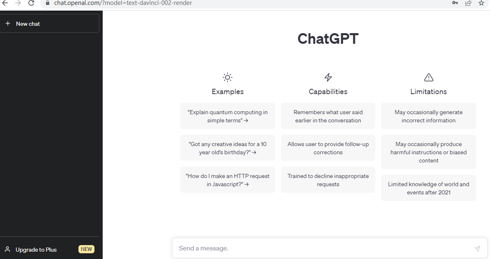
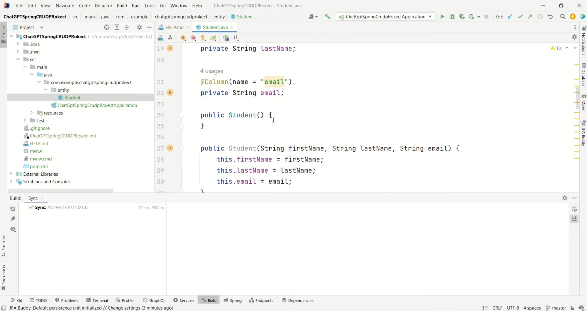
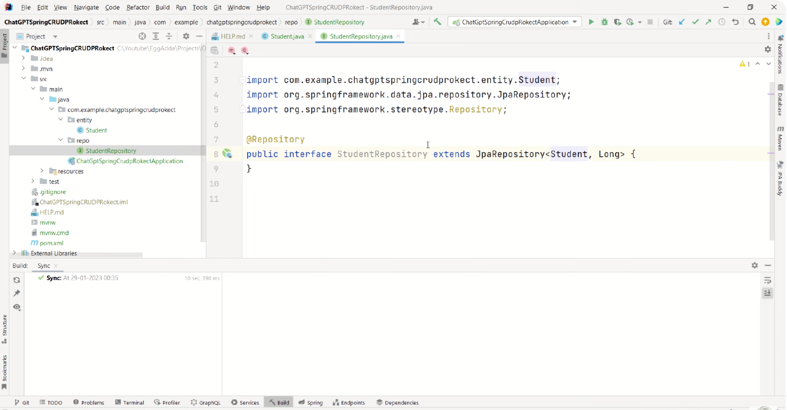
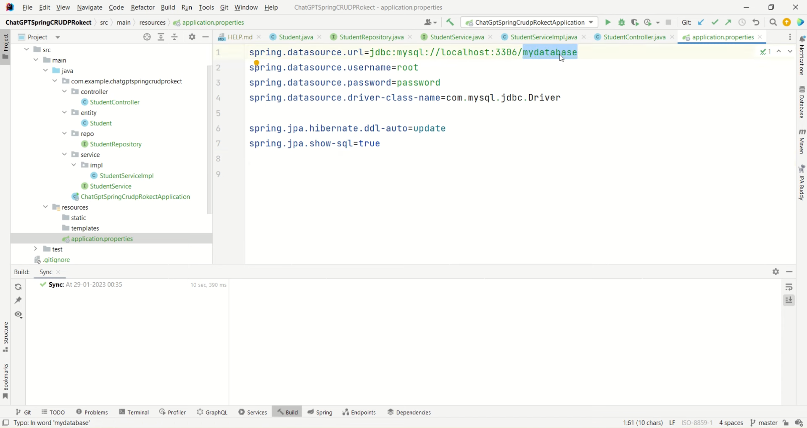

# 加餐 | GPT编程（上）：如何用ChatGPT辅助我们编程？

你好，我是郭屹。

这节课，我们来了解一下 GPT 的基本知识，以及如何在编程中使用它。开发技术和模式正在开始一个巨大的变革，就是以 GPT 为代表的 AI 辅助编程。

AI 不是一个新事物，在将近七十年的发展历史中，起起落落，一会儿被捧上天，一会儿被踩到脚下。在这个艰难的过程中，AI 开始逐步显现它的强大，越来越成熟。就拿 NLP 自然语言处理这个领域来讲，实际上一直不温不火，直到 2017 年的 Transformer 技术问世，才打开了新局面，一时间 GPT 和 BERT 同时火热起来。最近这几年，BERT 的风头一直压倒 GPT，直到 2022 年底 GPT 演进为 ChatGPT 才开始标志着变革的力量登上主流舞台。

ChatGPT 真正解决了长期困扰自然语言处理的一大难题，即上下文相关的问题。以前的 AI 对话系统，虽然也有很多成绩，但是明显不能很好地连贯对话，把握上下文。因此，这一领域也一直没有办法实用化。

ChatGPT 及其后续 GPT 版本的出现，标志着自然语言理解进入新纪元。我们程序员也要拥抱这个新时代。

## ChatGPT 是什么

ChatGPT，全称是聊天生成预训练转换器（Chat Generative Pre-trained Transformer），是OpenAI 在 2022 年 11 月发布的大语言模型，它以人机自然语言对话的方式进行交互。它上下文相关的连续对话的能力极强，一经发布就震惊了世界，两个月的时间用户就超过了一亿。它的功能主要有文本生成、对话、摘要、修正等等。

它还能编写程序，但是它并不懂编程，因为它是一个语言模式，只是基于代码语言之间的统计相关性进行建议而已。现在 ChatGPT 还在持续进化，基于实际用户的反馈在扩大语料，使得它的回答更加精准。同时，模型也在提升，2023 年 3 月 OpenAI 发布了多模态模型 GPT-4，这个模型更加强大。

## 注册 ChatGPT

ChatGPT 的正式访问地址是https://chat.openai.com/，在网页上你可以通过 Sign up 进行注册。登录进去之后，就是对话主界面，你可以看一下。



这时候，你就可以在文本框里输入内容开始对话了。英文和中文都可以，但是基于 ChatGPT的训练数据，输入英文得到的回答质量会好很多。

## ChatGPT 人工对话示例

我们试着和它进行一次对话。

我：Create a Spring MVC application which connect to MySQL database

它的回复是这样的：To create a Spring MVC application which connects to a MySQLdatabase, follow these steps:

1. Set up a MySQL database: Install MySQL on your machine and create a database. Then,create a table with some sample data.

2. Create a Spring MVC project: Create a new Spring MVC project in your favorite IDE. Youcan use Maven or Gradle as your build tool.

3. Add MySQL dependencies: Add the MySQL JDBC driver and Spring JDBC dependenciesto your project. You can add them in your build file (pom.xml or build.gradle).

4. Configure the database connection: In your Spring configuration file(applicationContext.xml), configure the database connection details such as driver class,URL, username, and password.

5. Create a data access object (DAO): Create a DAO class to interact with the database.This class should have methods to insert, update, delete, and select data from thedatabase.

6. Create a controller: Create a Spring controller to handle the HTTP requests. The controllershould use the DAO to fetch data from the database and return it as a response.

7. Create a view: Create a view to display the data returned by the controller. You can useJSP, Thymeleaf, or any other view technology.

这里它把如何创建一个 SpringMVC 数据库应用的步骤告诉我们了，它还给出了示例代码。这就是应用程序的整体框架步骤，对其中的任何一步，如果我们不知道怎么做，可以进一步追问，比如我们继续让它给出第六步 controller 的完整例子。

我：good. then the 6th step, I also need the complete code.

它回复：Sure, here is the complete code for the 6th step:

Create a controller

1. Create a class called EmployeeController with the following methods:

```java
@Controller
public class EmployeeController {
  @Autowired
  private EmployeeDAO employeeDAO;
  @RequestMapping(value = "/", method = RequestMethod.GET)
  public ModelAndView home() {
       List<Employee> employees = employeeDAO.getAllEmployees();
       ModelAndView model = new ModelAndView("home");
       model.addObject("employees", employees);
       return model;
   }
   @RequestMapping(value = "/addEmployee", method = RequestMethod.GET)
   public ModelAndView addEmployee() {
        ModelAndView model = new ModelAndView("addEmployee");
        model.addObject("employee", new Employee());
        return model;
    }
    @RequestMapping(value = "/saveEmployee", method = RequestMethod.POST)
    public ModelAndView saveEmployee(@ModelAttribute("employee") Employee employ
        employeeDAO.addEmployee(employee);
        return new ModelAndView("redirect:/");
    }
}
```

对于它的答案，我们可以校正，比如告诉它最后一步我们不想用 JSP，而是想用 React，让它给个例子。

我：great! fot the last step, I do not want to use JSP, but prefer to use React, could give methe script to access the above controller?

它也会接着给出答案。

从这里我们可以看出，对常规的任务，它能给我们一个程序框架，像一个编程助手一样跟我们对话，很强。下面我们再看一个完整例子，在 Spring Boot 中开发一个数据库应用项目。

## 用 ChatGPT 辅助编程

我们以典型的 CRUD 应用为例。ChatGPT 并不能生成完整的 CRUD 应用程序，但是可以给出建立程序的步骤，指引我们一步一步地建立应用。

我们先从建立项目开始，跟它开始对话。

我：create a new spring boot crud project

它的回复是：Sure, here’s a step-by-step guide on how to create a new Spring Boot CRUDproject:

1. Open your preferred IDE (Integrated Development Environment) such as Eclipse or IntelliJIDEA.

2. Create a new Spring Boot project using the Spring Initializr. You can do this by going tohttps://start.spring.io/ and filling out the necessary information such as project type,language, packaging, and dependencies. For this example, we’ll use Maven as the projecttype and select Spring Web, Spring Data JPA, and H2 Database as the dependencies.

3. Click the Generate button to download the project as a zip file.

4. Extract the contents of the downloaded zip file to a directory on your computer.

5. Open your IDE and import the project. In Eclipse, go to File > Import > Maven > ExistingMaven Projects and select the directory where you extracted the project. In IntelliJ IDEA,go to File > New > Project from Existing Sources and select the directory where youextracted the project.

6. Once the project is imported, open the application.properties file located in thesrc/main/resources directory. This file contains configuration properties for the project suchas database connection settings. For this example, we’ll use the default H2 databasesettings.

7. Create a new package called “model” and create a new class called “Person” in thatpackage. This class will represent our data model for the CRUD operations. Add thenecessary fields such as “id”, “firstName”, “lastName”, and “email”. Add getters and settersfor each field.

8. Create a new package called “repository” and create a new interface called“PersonRepository” in that package. This interface will extend the JpaRepository interfaceprovided by Spring Data JPA and will allow us to perform CRUD operations on the“Person” class. Add any custom methods you need for your application.

9. Create a new package called “controller” and create a new class called “PersonController”in that package. This class will handle incoming requests and call the appropriate methods

- in the “PersonRepository”. Use annotations such as @RestController and@RequestMapping to define the endpoint mappings.

10. Run the project using your IDE or by running the “mvn spring-boot:run” command in theproject directory. This will start the Spring Boot application and make it available athttp://localhost:8080.

11. Test the CRUD operations by sending HTTP requests to the appropriate endpoints using atool such as Postman or cURL. You can use the following endpoints as examples:

- GET /person - Retrieve a list of all persons

- GET /person/{id} - Retrieve a person by ID

- POST /person - Create a new person

- PUT /person/{id} - Update an existing person

- DELETE /person/{id} - Delete a person by IDThat’s it! You now have a basic Spring Boot CRUD project up and running. From here,you can add more features and functionality as needed for your application.

如果你熟悉 Spring Boot 的话，应该能看出来，ChatGPT 它已经把整个应用创建的完整步骤发给我们了，我们用 Intellij IDea 建立一个 Spring Boot Web 项目，按照步骤就可以把项目建立起来。项目建立起来以后，还要进一步细化每一步。要实现 CRUD 功能，需要依次创建entity、repository、service、controller 等包和类，我们完全可以用 GPT，让它帮我们建立，而不用我们写一行代码。

我们继续跟它对话，根据步骤，首先我们要先创建 entities。

我：create a student entity for above project

此时它回复：Sure, here’s an example of a Student entity class that you can add to yourSpring Boot project:

```java
package com.example.demo.model;
import javax.persistence.*;
@Entity
@Table(name = "students")
public class Student {
   @Id
   @GeneratedValue(strategy = GenerationType.IDENTITY)
   private Long id;
   private String firstName;
   private String lastName;
   private String email;
   public Student() {}
   public Student(String firstName, String lastName, String email) {
       this.firstName = firstName;
       this.lastName = lastName;
       this.email = email;
   }
   public Long getId() {
       return id;
   }
   public void setId(Long id) {
       this.id = id;
   }
   public String getFirstName() {
       return firstName;
   }
   public void setFirstName(String firstName) {
       this.firstName = firstName;
   }
   public String getLastName() {
       return lastName;
   }
   public void setLastName(String lastName) {
       this.lastName = lastName;
   }
   public String getEmail() {
       return email;
   }
   public void setEmail(String email) {
       this.email = email;
   }
   @Override
   public String toString() {
       return "Student{" +
               "id=" + id +
               ", firstName='" + firstName + '\'' +
               ", lastName='" + lastName + '\'' +
               ", email='" + email + '\'' +
               '}';
   }
}
```

它的回答中已经把 student 的 entity 代码给到我们了，我们直接复制到开发工具里。你可以看一下图片。



这样 entity 就建好了，然后我们创建 repository。这时候我们继续询问 GPT。

我：create a student repo for above project.

然后它回复：Sure, here’s an example of a StudentRepository interface that you can add toyour Spring Boot project:

```java
package com.example.demo.repository;
import com.example.demo.model.Student;
import org.springframework.data.jpa.repository.JpaRepository;
import org.springframework.stereotype.Repository;
@Repository
public interface StudentRepository extends JpaRepository<Student, Long> {
   Student findByEmail(String email);
   Student findByLastName(String lastName)
   // add additional CRUD methods as needed
}
```

我们创建 StudentRepository 类，将上边 GPT 的代码粘贴进去，这样 student 的 repository 就创建好了。如下图所示：



我们继续创建 service，给 GPT 发送指令：create Student service interface for above project.

GPT 回复：Sure, here’s an example of a StudentService interface that you can add to yourSpring Boot project:

```java
package com.example.demo.service;
import com.example.demo.model.Student;
import java.util.List;
public interface StudentService {
   List<Student> getAllStudents();
   Student getStudentById(Long id);
   Student createStudent(Student student);
   Student updateStudent(Long id, Student student);
   void deleteStudent(Long id);
}
```

GPT 同样把代码给到我们了，我们创建好 StudentService，把代码粘贴过去，这样 Student的数据操作接口类 StudentService 就创建好了。

然后我们利用 GPT 继续写这个类的实现类。给 GPT 发送指令。

我：create student service impl class for above project

GPT 回复：Certainly, here’s an example of a StudentServiceImpl class that implements theStudentService interface:

```java
package com.example.demo.service;
import com.example.demo.model.Student;
import com.example.demo.repository.StudentRepository;
import org.springframework.beans.factory.annotation.Autowired;
import org.springframework.stereotype.Service;
import org.springframework.transaction.annotation.Transactional;
import java.util.List;
@Service
@Transactional
public class StudentServiceImpl implements StudentService {
   @Autowired
   private StudentRepository studentRepository;
   @Override
   public List<Student> getAllStudents() {
       return studentRepository.findAll();
   }
   @Override
   public Student getStudentById(Long id) {
       return studentRepository.findById(id).orElse(null);
   }
   @Override
   public Student createStudent(Student student) {
       return studentRepository.save(student);
   }
   @Override
   public Student updateStudent(Long id, Student student) {
       Student existingStudent = studentRepository.findById(id).orElse(null);
       if (existingStudent != null) {
           existingStudent.setName(student.getName());
           existingStudent.setEmail(student.getEmail());
           existingStudent.setDepartment(student.getDepartment());
           return studentRepository.save(existingStudent);
       }
       return null;
   }
   @Override
   public void deleteStudent(Long id) {
       studentRepository.deleteById(id);
   }
}
```

创建好 StudentService 类，把代码粘帖过去，一个 service 类就创建好了。接下来开始创建Controller。我们继续跟它对话。

我：create student controller for above project.

GPT 回复：Sure! Here’s an example of a StudentController class that you can add to yourSpring Boot project:

```java
package com.example.demo.controller;
import com.example.demo.model.Student;
import com.example.demo.service.StudentService;
import org.springframework.beans.factory.annotation.Autowired;
import org.springframework.http.HttpStatus;
import org.springframework.http.ResponseEntity;
import org.springframework.web.bind.annotation.*;
import java.util.List;
@RestController
@RequestMapping("/students")
public class StudentController {
   @Autowired
   private StudentService studentService;
   @GetMapping
   public ResponseEntity<List<Student>> getAllStudents() {
       List<Student> students = studentService.getAllStudents();
       return new ResponseEntity<>(students, HttpStatus.OK);
   }
   @GetMapping("/{id}")
   public ResponseEntity<Student> getStudentById(@PathVariable("id") Long id) {
       Student student = studentService.getStudentById(id);
       if (student == null) {
           return new ResponseEntity<>(HttpStatus.NOT_FOUND);
       }
       return new ResponseEntity<>(student, HttpStatus.OK);
   }
   @PostMapping
   public ResponseEntity<Student> createStudent(@RequestBody Student student) {
       Student newStudent = studentService.createStudent(student);
       return new ResponseEntity<>(newStudent, HttpStatus.CREATED);
   }
   @PutMapping("/{id}")
   public ResponseEntity<Student> updateStudent(@PathVariable("id") Long id, @Re
       Student updatedStudent = studentService.updateStudent(id, student);
       if (updatedStudent == null) {
           return new ResponseEntity<>(HttpStatus.NOT_FOUND);
       }
       return new ResponseEntity<>(updatedStudent, HttpStatus.OK);
   }
   @DeleteMapping("/{id}")
   public ResponseEntity<HttpStatus> deleteStudent(@PathVariable("id") Long id)
       studentService.deleteStudent(id);
       return new ResponseEntity<>(HttpStatus.NO_CONTENT);
   }
}
```

将上述的代码放到 StudentController 类中，这样 Student 的操作接口类就好了。接下来，我们让 GPT 帮我们建立数据库连接。

我：create application properties file configuration for database connectivity.

它回复：Sure! Here’s an example of an application.properties file that you can use toconfigure the database connectivity in your Spring Boot project:

```sql
# Database Configuration
spring.datasource.driver-class-name=com.mysql.jdbc.Driver
spring.datasource.url=jdbc:mysql://localhost:3306/your_database_name_here
spring.datasource.username=your_database_username_here
spring.datasource.password=your_database_password_here
# Hibernate Configuration
spring.jpa.hibernate.ddl-auto=update
spring.jpa.properties.hibernate.dialect=org.hibernate.dialect.MySQL8Dialect
```

GPT 已经给出了 application.properties 文件的内容，我们把这些内容拷贝到项目的application.properties 文件里，并把其中的 your_database_name_here、your_databas_username_here、your_database_password_here 换成我们实际的值。



配置好正确的参数后，接下来我们尝试运行一下，看看能不能跑起来。如果能正常运行，就可以用 postman 来模拟请求验证项目的功能是否正确了。

到这里，我们整个项目就完整地搭建起来了。从项目的建立到各个类的建立，再到数据库的连接配置，GPT 都可以帮助我们，我们甚至都没有写一行代码。当然，我们也必须知道用Spring Boot 怎么创建项目，也得知道如何编程，但是一些常规性的具体代码则可以交给ChatGPT 来完成。

不过有一点需要注意，ChatGPT 的使用与编程是脱钩的，不太方便。不过现在也有很多插件可供我们使用，我们可以一起来看一下。

## Intellij 中的 OpenAI 插件

前面我们用跟 ChatGPT 对话的方式，实现了一个完整的 CRUD 项目。这种方式主要还是通过

支持多种基于 GPT 模型实现的开发插件，比如 Github copilot、chatGPT、Bito 等。这些插件可以实现代码生成、备注生成、代码检查等多个强大功能。

下面我们就以 Bito 为例，来感受一下它们的强大。

Bito 是一款由 ChatGPT 团队基于 ChatGPT 和 GPT-4 开发的插件。它能够在开发过程中为开发者提供方便快捷的人工智能交互工具。该插件支持 IntelliJ IDEA、Android Studio 等主流开发工具，可以为程序员提供一个智能化的编程过程。Bito 支持以下功能：

1. GPT 对话；

2. 代码检查；

3. 解释代码；

4. 自动生成注释；

5. 安全检查；

6. 样式检查；

7. 优化代码，提高可读性；

8. 清理代码，让代码更整洁；

9. 生成单元测试。

安装完并注册成功以后，就可以正常使用了。目前免费版每天只能使用一个小时。下面我们具体看看应该怎么使用。

1. 编写一个算法

安装好之后，在 IDE 环境中就显示了这个插件。我们在提问框里输入：请帮我写一个可靠性威布尔分布算法。

此时它回答：好的，以下是一个可靠性威布尔分布算法的实现。

```java
public class WeibullDistribution {
   public static void main(String[] args) {
       double beta = 2.5; // 分布参数
       double eta = 100.0; // 可靠寿命（无故障时间）
       double t = 50.0; // 已运行时间
       double reliability = getReliability(beta, eta, t);
       System.out.println("The reliability of the system is " + reliability);
   }
    public static double getReliability(double beta, double eta, double t) {
       double reliability = Math.exp(-Math.pow(t / eta, beta));
       return reliability;
   }
}
```

2. 生成代码注释

然后我们选中代码，鼠标右键弹出菜单，选择 Bito AI->Improve Readability。这时它就会把选中的代码的每一行都给出详细的英文注释。如果想把英文注释换成中文，就可以给插件发指令：把上面的注释从英文换成中文。

此时它回复：好的，以下是加入中文注释的重写代码。

```java
//按照给定的beta、eta和t值计算系统的可靠性
public class Main {
   public static void main(String[] args) {
       //初始化变量
       double beta = 2.5; // 分布参数
       double eta = 100.0; // 可靠寿命（无故障时间）
       double t = 50.0; // 已运行时间
       // 计算可靠性
       double reliability = getReliability(beta, eta, t);
       // 打印结果
       System.out.println("系统可靠性为：" + reliability);
   }
    //根据给定参数计算可靠性
   public static double getReliability(double beta, double eta, double t) {
       double reliability = Math.exp(-Math.pow(t / eta, beta));
       return reliability;
   }
}
```

3. 检查代码质量

如果我们想知道一段代码的执行性能如何，Bito 也可以帮助我们来判断。选中代码，然后点击右键菜单，选择 Bito AI->Performance Check。这时候 Bito 就会帮我们检查代码的性能，并给出代码修改意见。

4. 生成单元测试代码

Bito 同时也可以生成单元测试代码。选中代码，然后点击右键菜单，选择 Bito AI->GenerateUnit Test。这时它会帮我们生成测试代码。

```java
@Test
public void testGetReliabilityPositive() {
   double beta = 2.5;
   double eta = 100.0;
   double t = 50.0;
   double expected = 0.006737946999085467;
   double actual = Main.getReliability(beta, eta, t);
   assertEquals(expected, actual, 0.001);
}
@Test
public void testGetReliabilityNegative() {
   double beta = 2.5;
   double eta = 100.0;
   double t = 50.0;
   double expected = 0.006737946999085468;
   double actual = Main.getReliability(beta, eta, t);
   assertNotEquals(expected, actual, 0.001);
}
@Test
public void testGetReliabilityBoundary() {
   double beta = 0;
   double eta = 100.0;
   double t = 0;
   double expected = 1.0;
   double actual = Main.getReliability(beta, eta, t);
   assertEquals(expected, actual, 0.001);
}
@Test
public void testGetReliabilityEdge() {
   double beta = 2.5;
   double eta = 0;
   double t = 50.0;
   double expected = Double.POSITIVE_INFINITY;
   double actual = Main.getReliability(beta, eta, t);
   assertEquals(expected, actual, 0.001);
}
@Test
public void testGetReliabilityCorner() {
   double beta = 0;
   double eta = 0;
   double t = 0;
   double expected = 1.0;
   double actual = Main.getReliability(beta, eta, t);
   assertEquals(expected, actual, 0.001);
}
```

除了上述的四个功能以外，它还有 Security Check、Style Check、Clean Code 等功能，帮助我们实现代码的安全检查、代码样式检查等功能。体验完之后，我们发现 GPT-4 的 Bito，比之前的 ChatGPT 更加强大，生成的代码质量更高，并且插件的方式让我们使用起来更加方便。这真是我们程序员的福音！

## 小结

今天，我们介绍了 ChatGPT 的基本知识，重点看了它辅助编程这一方面的表现。不过ChatGPT 只是一个语言模型，它的核心仍然是统计相关性，因此它从原理上并不理解知识，没有推理，对真理、隐私权和价值观更是一无所知。甚至对语言本身来讲，它生成的文本经常也是似是而非的，准确度还有欠缺，它回答的问题可靠性并没有保障。但是，这并不妨碍我们对它的高度评价，因为这是自然语言处理方面目前的最高水准，接近人类对语言的使用了。随着后面的继续进化，相信它会有更加可靠、实用的一天。

好了，今天的内容就到这里，如果你觉得这节课的知识对你有帮助的话，欢迎你分享给你的朋友和同事，如果你有好的想法也欢迎你分享到评论区，我们一起讨论，共同进步，我们下节课见！
