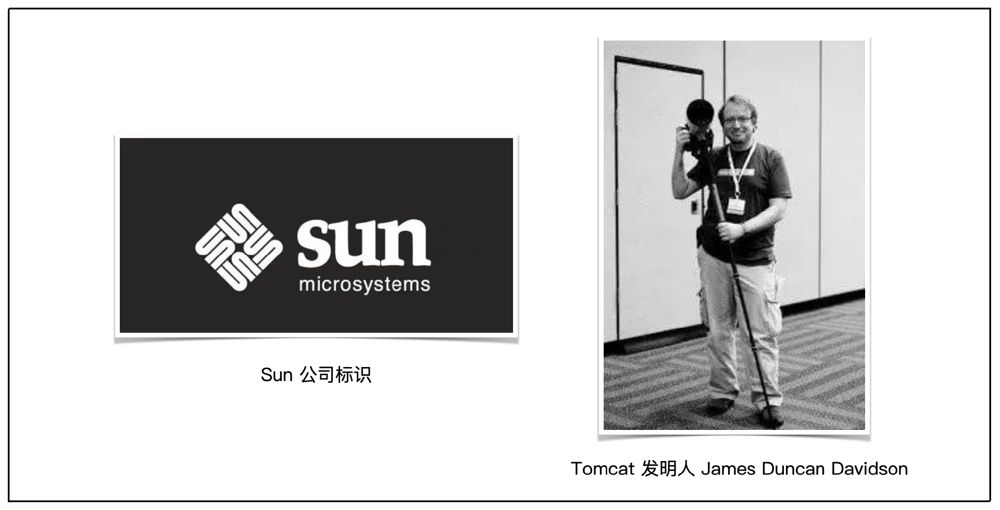
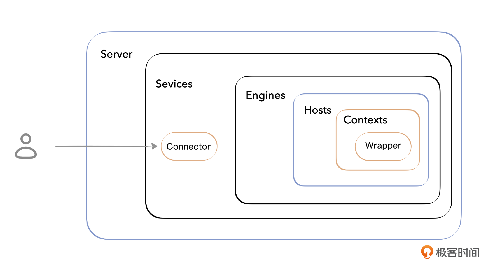
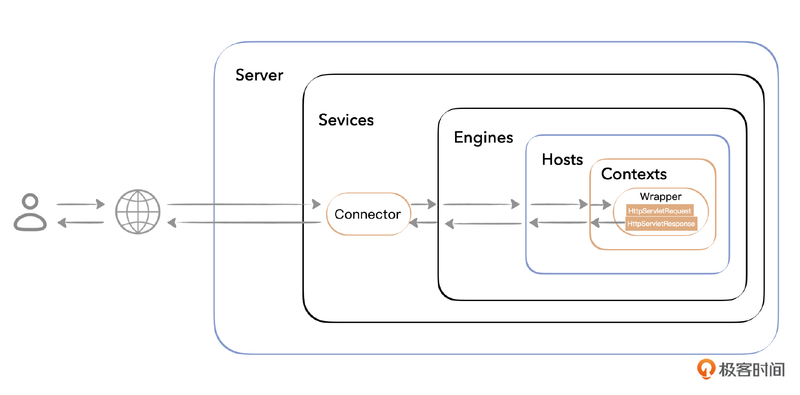
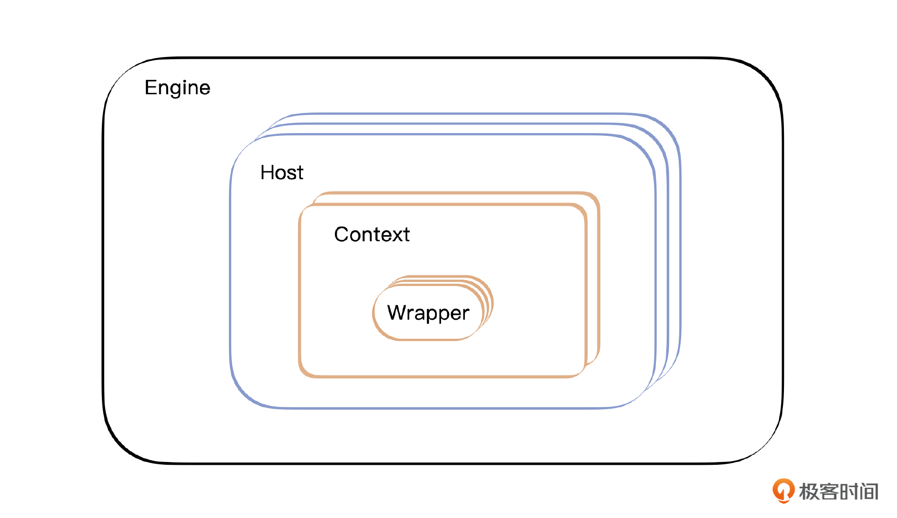
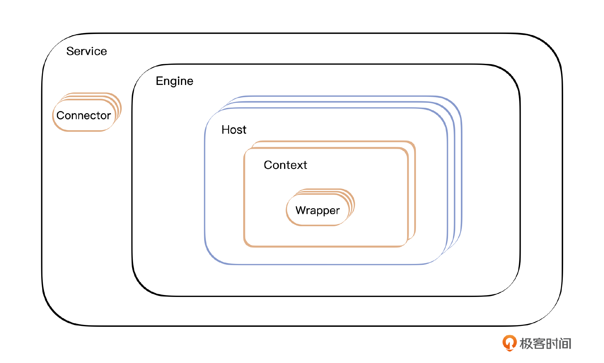
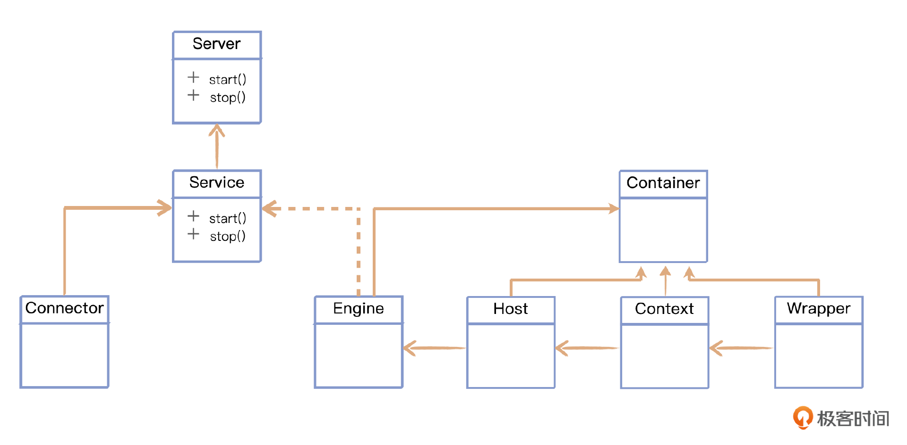
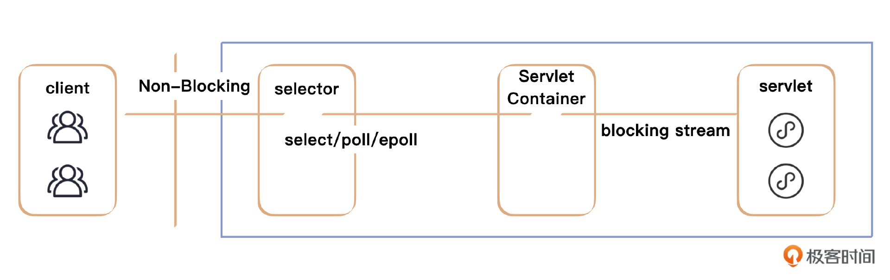
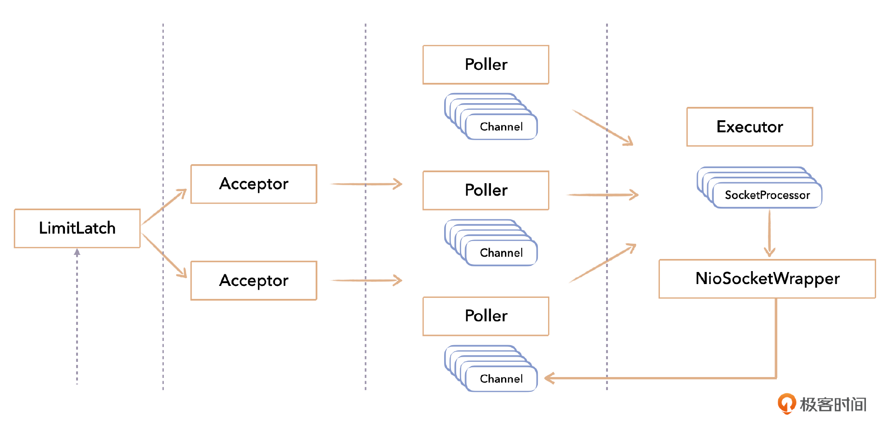

# 01 | 持久的传奇：Tomcat的发展历程与框架演进

你好，我是郭屹，从今天开始我们来学习手写 MiniTomcat。

作为使用 Java 语言进行 Web 程序开发的人来说，对 Tomcat 想必是不陌生的。Tomcat 是一款轻量级的 Java 应用服务器，最早是 Sun 公司在 1998 年开发的。当时开发 Tomcat 的目标是成为 Sun 公司的 Java Servlet 和 JSP 规范的参考实现。

如今 Tomcat 是业务开发首选的开源 Web 应用服务器，在 Spring MVC 项目中会把它作为程序的启动容器，甚至在 Spring Boot 框架中直接将 Tomcat 内置为 Web 应用的启动容器，不再需要程序开发者自行配置，进一步简化了开发门槛。可以说，虽然 Tomcat 不是 Web 服务器的唯一选择，但也和 Spring 一样，成为了 Java 开发领域事实上的标准。二十五年以来长盛不衰，在日新月异的 IT 领域，可谓是持久的传奇。

## 版本变化

跟任何一个成功的产品一样，Tomcat 也不是一诞生就是现在这个样子的，它也是经历了逐渐完善和强大的发展历程。



- 图片源自网络

Tomcat 的发明人是 James Duncan Davidson。他在 1997 年加入 Sun 公司，然后开始动手写Tomcat，这是 Sun 对外提供的一个 Servlet 容器的参考实现，后来大名鼎鼎的 Spring 发明人Rod Johnson 也是 Servlet 专家组成员。1998 年对外公开的时候标记为 2.0 版本，到了 1999年，Sun 公司就把它捐赠给了 Apache 基金会。

下面我们按照发布时间来梳理一下 Tomcat 的主要版本。

目前正在开发中的版本是 11。

## 程序内部结构

作为程序员，除了了解版本发布情况之外，我们更要仔细琢磨 Tomcat 程序的内部结构，因为从内部结构中我们可以收获更多的技术思想。

我们先看一下它的宏观结构。



一眼就可以看出，Tomcat 的结构出奇地简单自然，从最顶层来看，就是一个 Server 提供Service，在内部通过容器管理 Servlet，对外通过 Connector 接受客户端的访问。

如果你写过服务器程序，那么你应该对这个结构一点都不陌生，几乎所有的 Server 软件都是这个结构。往内部再细分，一般就是通过 Socket 完成客户端的连接管理，由一个内部容器按照规定的生命周期管理 Servlet。

我们再仔细点，看看 Tomcat 是如何响应请求的。

1. 用户在浏览器输入地址，请求被发送到服务器端，按照 Socket 模型，这个访问被一个端口驻守的程序收到，如 8080。在 Tomcat 中，负责这一块的是在那里监听的 CoyoteConnector。

2. Connector 解析 Socket 来的请求流，再将该请求交给它所在的 Service 的 Engine 来处理，并等待 Engine 的回应。

3. Engine 获得请求 URI，匹配到合适的虚拟主机 Host。

4. 这个 Host 获得请求串，匹配到合适的 Context。

5. 在 Context 中寻找出对应的 Servlet（其实是一个 Wrapper） 处理数据。

6. 将构造 HttpServletRequest 对象和 HttpServletResponse 对象，作为参数调用 Servlet 的

```
service() 执行业务逻辑、数据存储等程序。
```

7. Context 把执行完之后的 HttpServletResponse 对象返回给 Host。

8. Host 把 HttpServletResponse 对象返回给 Engine。

9. Engine 把 HttpServletResponse 对象返回 Connector。

10. Connector 把 HttpServletResponse 对象序列化返回给浏览器。



以上就是 Tomcat 处理一个 HTTP 请求的完整流程。

核心道理很简单，说白了就是一个 Socket Server，但是对应到工程上却并不容易。如果这个服务器只需要响应一次请求，确实是没有什么可做的，但是现实世界并不是这样，我们还要考虑一些啰嗦事。

1. 如何管理多个 Servlet？

2. 如何支持多个独立的应用？

3. 大量用户请求的性能问题如何解决？

作为一款实用的 Servlet 应用服务器，考虑到这些事项，内部的程序结构会变得很复杂。这些在我们学习了 Tomcat 的源码后，会有很多的启发。

## 程序结构的演化

没有人能一步到达终点，软件的演化过程中有很多争论妥协，有的设计到后面又被抛弃了，反反复复。Tomcat 也走过了同样的路，编程的顶级高手也是要呕心沥血才能修得正果的。接下来我们就来看一下，Tomcat 是如何一步步演化的。

### 第一步：设计一个简单的 Socket Server

设计一个 Socket Server，启动后负责监听网络来的请求，获得一个 Socket 连接。然后这个Server 要解析请求串，知道需要处理什么事情，然后调用相关的程序完成相关任务。最后得到返回处理结果，将这个结果再通过 Socket 传回客户端。

这个简单的结构很有效，也很简明，但是缺点显而易见：请求监听和处理逻辑放在一起扩展性很差。处理是一个一个串行完成的，性能不好。

### 第二步：将连接与处理分离

因为第一步显而易见的缺点，所以我们把 Server 拆分成两部分：Connector 和 Processor。Server 只是一个外壳，负责启动。Connector 来负责监听网络来的请求，获得一个 Socket 连接，解析请求后发给 Processor，然后 Processor 调用相关的程序完成相关任务，最后得到返回处理结果，将这个结果返回给 Connector，Connector 再通过 Socket 传回网络客户端。

经过这一步的分工，Server 的程序结构更加清晰，各司其职。但之前的缺点并没有完全优化，性能问题还没有解决。为了提高性能，需要设计多个 Processor，放到一个池中，支持并发执行。

### 第三步：多层容器 Container

为了进一步扩展，这一步我们要把后面对 Servlet 的处理分成多层容器，首先是直接包装Servlet 的 Wrapper，然后对应一个应用 Context，一个 Context 对象会包含多个 Wrapper 对象，用于分别管理多个 Servlet，而 Context 之间是独立的，再往上抽象出 Host 和 Engine。

结构图如下：



- Engine：这个是 Tomcat 的顶层容器，字如其义，一个 Engine 就是一个完整的 Servlet 引擎，它接收来自 Connector 的请求，并传给合适的 Host 来处理，并将结果返回给Connector。

- Host：表示一个主机，即一个 Tomcat 可以管理多个虚拟的主机。

- Context：表示一个 Web 应用，即 WebApp 下的应用。一个 Host 可以有多个 Context。

- Wrapper：表示一个 Servlet，用来具体处理相应请求。一个 Context 可以有多个Wrapper。

这个多层嵌套的 Container 结构一直保留着，不过从实际效果上看，Engine 和 Host 其实意义不大了，Docker 技术的出现，将 Tomcat 的这个设计变成了鸡肋。

### 第四步：Service

现在演化到了 Connecter + 多层 Container 这个结构，继续扩展。用 Service 这个概念把Connector 和 Container 包含进去了。



这样在一个 Server 中可以包含多个 Service，每一个 Service 都是独立的。一个 Service 负责维护多个 Connector 和一个顶层 Container。当需要使用多个端口时，只需要配置多个Service。

Tomcat 默认会启动一个名为 Catalina 的 Service。



### 第五步：生命周期（LifeCycle）

Tomcat 中每个组件都有生命周期。Connector 和 Container 都实现了 LifeCycle 接口。生命周期有 BEFORE_INIT_EVENT、AFTER_INIT_EVENT、START_EVENT 等状态。生命周期相关的方法有 init()、start()、stop、getState() 等。

### 第六步：引入 NIO

为了支持高并发，在原有的 BIO 模式下已经很难继续扩展这个能力，于是 Tomcat 6.0 之后引入了 NIO 的支持。结构图示如下：



对 NIO 的支持，宏观上主要影响的是 Connector 这一部分。它是现代 Tomcat 对高并发提供支持的设计，Tomcat 6.0 中就提供了支持，早期的 server.xml 文件中，我们可以看到这么一个配置：

```
<Connector connectionTimeout="20000" maxThreads="1000" port="8080" protocol="org.
```

这就表明它使用了 NIO 模式。

总体来看，对大规模企业应用，NIO 性能上会明显优于 BIO，所以 Tomcat 9.0 之后干脆就不支持 BIO 模式了。程序模式由 BIO 演化到 NIO，是为了多路复用，技术上是比较困难的，从实际过程来回顾，这一部分的设计也经历了反复。

开始的结构是这样的：



这个结构很庞大，有多个 Acceptor 和多个 Poller，程序复杂性也高。由于复杂性以及实际效果，后面的版本将这个设计缩了回来，从 Tomcat 9.0 开始，NioEndpoint 结构中 Acceptor 与Poller 仅支持定义单个 Acceptor 和单个 Poller。也就是说开始的构思有点过度设计了，可见高手也不是一次性能把事情弄好的，凡事都要不断切磋。现在的版本进一步将 NIO 变成了NIO2，成了完全的异步模式。

## MiniTomcat 的路径

我们自己手写 MiniTomcat 的目的是学习 Tomcat，更好地弄懂它。我们也会按照由简到繁的过程一步步构建，因为我们知道了 Tomcat 本身的发展过程，所以也按照它的过程一步步走过来。自己手写一遍是最好的学习方式，纸上得来终觉浅，绝知此事要躬行。

实际上，我们只会走到第四步，也就是 Connector + 多层 Container。这么考虑的原因是后面的内容难度比较高，篇幅也多，应当单独成书，未来有机会我们再公布出来。到了第四步，Tomcat 早期版本的核心部分也都包含进来了，对应着 Tomcat 6.0 之前的状况。

我们在今后的学习过程中，心里要有这个大图景。

## 小结

Tomcat 获得了持久的成功，对业界影响深远。这里的关键就在于创始者 James DuncanDavidson，他立意高远，眼界宏大，终成数十年以来的“名门正派”。同时，我们也看到了，顶级程序员也不是神仙，并不能一次性构建好一个 Server，也需要不断尝试，不断接受真实世界的反馈并调整设计方案，NIO 实现中的 Acceptor 和 Poller 池最终被废弃就是明证。

我们作为后学者要学会沿着巨人的脚步，一步步前进。对技术的高峰，或许“虽不能至，而心向往焉”，相信沿途也会收获很多悟道的喜悦。

## 思考题

你可以说一说 Tomcat 的内部构造是怎样的吗，共包含哪几部分？欢迎你把答案分享到评论区，也欢迎你把这节课的内容分享给其他朋友，邀他一起学习。我们下节课再见！
