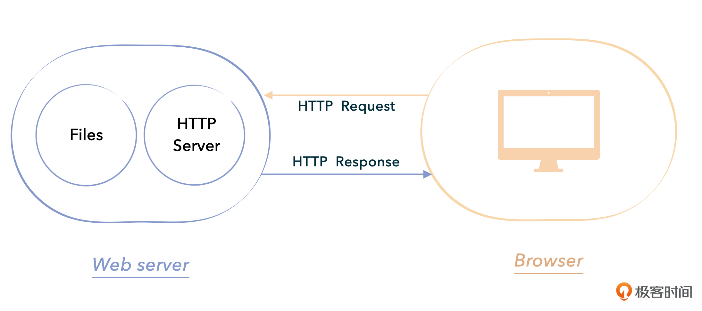
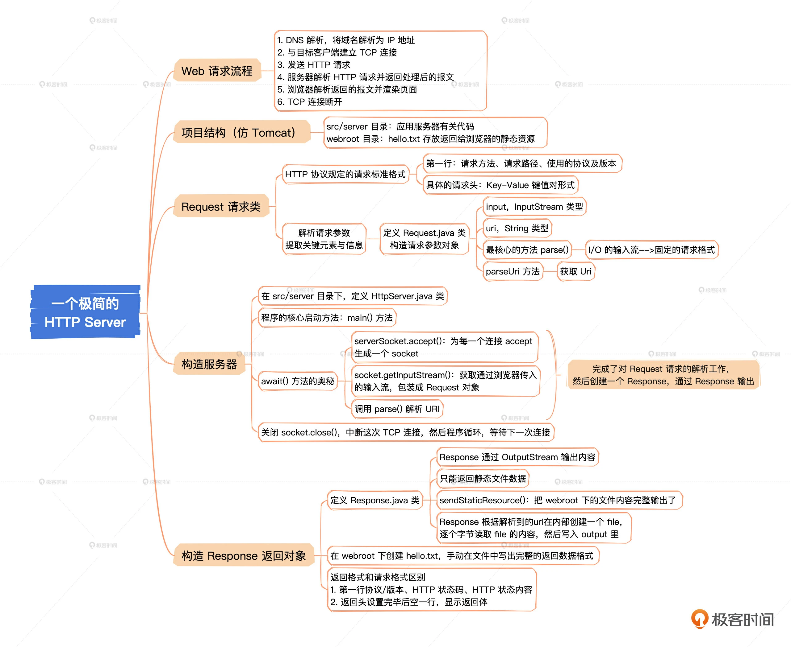

# 02 | 初出茅庐：构造一个极简的HttpServer

你好，我是郭屹，今天我们继续学习手写 MiniTomcat，从这里开始要同步写代码了。

与 MiniSpring 相同，我们也会从一个最简单的程序开始，一步步地演化迭代，最终实现Tomcat 的核心功能。这节课，我们就来构造第一个简单的 Web 服务器应用程序。结构如图所示：



可以看出，当用户从浏览器这端发起一个静态的请求时，这个极简 HTTP Server 仅仅是简单地将本地的静态文件返回给客户端。这也正是我们手写 MiniTomcat 的第一步。

## Web 请求流程

一个 Web 服务器，简单来讲，就是要按照 HTTP 协议的规范处理前端发过来的 Request 并返

```
回 Response。在这节课中，我们计划请求 http://localhost:8080/test.txt 这个地
```

址，实现一个最简单的 Web 应用服务器。

我们简单回顾一下，在浏览器中输入一个网页地址，键入回车的那一刻，从请求开始到请求结束这个过程会经历几步。

1. DNS 解析，将域名解析为 IP 地址。

2. 与目标端建立 TCP 连接。

3. 发送 HTTP 请求。

4. 服务器解析 HTTP 请求并返回处理后的报文。

5. 浏览器解析返回的报文并渲染页面。

6. TCP 连接断开。

在这个过程中，还有很多诸如三次握手，DNS 解析顺序等具体技术细节，因为不是这节课的主要论题，所以这里不再详细说明。在上述 Web 请求流程中，我们重点关注“发送 HTTP 请求”“服务器解析 HTTP 请求并返回处理后的报文”以及“浏览器解析返回的报文并渲染页面”这三步。

## 项目结构

首先我们定义项目的结构，为减少阅读 Tomcat 实际源码的障碍，项目结构以及类的名字会仿照 Tomcat 源码中的定义。作为起步，在这节课中项目结构简单定义如下：

```
MiniTomcat
├─ src
│  ├─ server
│  │  ├─ HttpServer.java
│  │  ├─ Request.java
│  │  ├─ Response.java
├─ webroot
│  ├─ hello.txt
和应用服务器有关的代码放在 src/server 目录下，而 webroot 目录下目前放了一个名叫
```

hello.txt 的文本文件，这个目录下计划存放返回给浏览器的静态资源。

## Request 请求类

```
我们打开浏览器，尝试输入 http://localhost:8080/hello.txt， 看看请求参数有哪
```

些内容。

```
GET /hello.txt HTTP/1.1
Accept: text/html,application/xhtml+xml,application/xml;q=0.9,image/avif,image/we
Accept-Encoding: gzip, deflate, br
Accept-Language: zh-CN,zh;q=0.9
Cache-Control: max-age=0
Connection: keep-alive
Host: localhost:8080
Sec-Fetch-Dest: document
Sec-Fetch-Mode: navigate
Sec-Fetch-Site: none
Sec-Fetch-User: ?1
Upgrade-Insecure-Requests: 1
User-Agent: Mozilla/5.0 (Macintosh; Intel Mac OS X 10_15_7) AppleWebKit/537.36 (K
sec-ch-ua: "Google Chrome";v="113", "Chromium";v="113", "Not-A.Brand";v="24"
```

以上是 HTTP 协议规定的请求标准格式。由上述内容可以看出，请求按行划分，首先可以分为两部分：第一行与其他行。第一行的内容中包含请求方法（GET）、请求路径（/hello.txt）、使用的协议以及版本（HTTP/1.1）。从第一行往下就是具体的请求头了，以 Key-Value 键值对的形式按行列出。一般关注较多的 Key 是 Accept、Host、Content-Type、Authorization 等。

现在我们就有了作为参考的 Request 示例，接下来我们就参考标准格式，对 Request 参数进行解析，提取我们需要的关键元素与信息。

我们定义 Request.java 类，用来构造请求参数对象。

```java
package src.server;
public class Request {
   private InputStream input;
   private String uri;
   public Request(InputStream input) {
       this.input = input;
   }
   public void parse() {
       StringBuffer request = new StringBuffer(2048);
       int i;
       byte[] buffer = new byte[2048];
       try {
           i = input.read(buffer);
       } catch (IOException e) {
           e.printStackTrace();
           i = -1;
       }
       for (int j = 0; j < i; j++) {
           request.append((char) buffer[j]);
       }
       uri = parseUri(request.toString());
   }
   private String parseUri(String requestString) {
       int index1, index2;
       index1 = requestString.indexOf(' ');
       if (index1 != -1) {
           index2 = requestString.indexOf(' ', index1 + 1);
           if (index2 > index1) return requestString.substring(index1 + 1, index
       }
       return null;
   }
   public String getUri() {
       return uri;
   }
}
```

Request 类中目前有两个域，一个是 input，类型为 InputStream，另外一个是 URI，类型为String。我们希望以此接收请求来的输入流，并提取出其中的 URI 来。因此，Request 对象必须由传入的 InputStream 这一输入流对类进行初始化。在 Request 类中，最核心的当数

```
parse() 方法，主要的工作都由这个过程完成。
在 parse() 方法中，主要将 I/O 的输入流转换成固定的请求格式（参见前面列出的请求
类）。InputStream 先用 byte 数组接收，执行 input.read(buffer) 后，input 的内容会转
```

换成 byte 数组，填充 buffer。这个方法的返回值表示写入 buffer 中的总字节数（代码中的2048）。随后将 byte 数组的内容通过循环拼接至 StringBuffer 中，转换成我们熟悉的请求格式。

然后我们用 parseUri 方法，获取 Uri。

```
 private String parseUri(String requestString) {
   int index1, index2;
   index1 = requestString.indexOf(' ');
   if (index1 != -1) {
     index2 = requestString.indexOf(' ', index1 + 1);
     if (index2 > index1)
       return requestString.substring(index1 + 1, index2);
   }
   return null;
 }
```

前面我们说过，HTTP 协议规定，在请求格式第一行的内容中，包含请求方法、请求路径、使用的协议以及版本，用一个空格分开。上述代码的功能在于，获取传入参数第一行两个空格中的一段，作为请求的 URI。如果格式稍微有点出入，这个解析就会失败。从这里也可以看出，遵守协议的重要性。

## 构造服务器

在构造了 HTTP 请求类之后，我们来看看服务器是如何处理这个 HTTP 请求以及如何传输返回报文的。

在 src/server 目录下，定义 HttpServer.java 类。

```java
package src.server;
public class HttpServer {
   public static final String WEB_ROOT = System.getProperty("user.dir") + File.s
   public static void main(String[] args) {
       HttpServer server = new HttpServer();
       server.await();
   }
   public void await() { //服务器循环等待请求并处理
       ServerSocket serverSocket = null;
       int port = 8080;
       try {
           serverSocket = new ServerSocket(port, 1, InetAddress.getByName("127.0
       } catch (IOException e) {
           e.printStackTrace();
           System.exit(1);
       }
       while (true) {
           Socket socket = null;
           InputStream input = null;
           OutputStream output = null;
           try {
               socket = serverSocket.accept(); //接收请求连接
               input = socket.getInputStream();
               output = socket.getOutputStream();
               // create Request object and parse
               Request request = new Request(input);
               request.parse();
               // create Response object
               Response response = new Response(output);
               response.setRequest(request);
               response.sendStaticResource();
               // close the socket
               socket.close();
           } catch (Exception e) {
               e.printStackTrace();
           }
       }
   }
}
首先我们看一下 main() 方法，这也是我们整个程序的核心启动方法。
   public static void main(String[] args) {
       HttpServer server = new HttpServer();
       server.await();
   }
可以看到启动类很简单，实例化一个 HTTP Server 对象后，调用 await() 方法。随后我们
看看 await() 方法内有什么奥秘吧！
public void await() {
   ServerSocket serverSocket = null;
   int port = 8080;
   try {
       serverSocket = new ServerSocket(port, 1, InetAddress.getByName("127.0.0.1
   } catch (IOException e) {
       e.printStackTrace();
       System.exit(1);
   }
   while (true) {
       Socket socket = null;
       InputStream input = null;
       OutputStream output = null;
       try {
           socket = serverSocket.accept();
           input = socket.getInputStream();
           output = socket.getOutputStream();
           // create Request object and parse
           Request request = new Request(input);
           request.parse();
           // create Response object
           Response response = new Response(output);
           response.setRequest(request);
           response.sendStaticResource();
           // close the socket
           socket.close();
       } catch (Exception e) {
           e.printStackTrace();
       }
   }
}
```

从上面的代码中可以看出，这其实就是一个简单的网络服务器程序。如果你熟悉 Java 网络I/O 的话，一眼就能看出来，整个过程就是启动了一个 ServerSocket 接收客户端的请求，生成Socket 连接后包装成 Request/Response 进行处理。

我们看看具体代码。

```
new ServerSocket(port, 1, InetAddress.getByName("127.0.0.1"))
```

使用 ServerSocket 监听 8080 端口，为方便测试，在这个地方直接写死 127.0.0.1 这个值，我们可以在本地进行测试。

```
通过 serverSocket.accept() 为每一个连接生成一个 socket。通过
socket.getInputStream() 获取通过浏览器传入的输入流，包装成前面提到的 Request
对象，调用 parse() 解析 URI。在这一步我们完成了对 Request 请求的解析工作。然后创建
一个 Response，通过 Response 输出，具体实现后面再说。最后关闭 socket.close()，
```

中断这次 TCP 连接，然后程序循环，等待下一次连接。

到此为止我们就构建出了一个最简单的 HTTP Server，即构建 Request -> 解析 -> 构建Response 输出，这样我们就模拟实现了一个最简单的 Web 应用服务器。现在我们还需要构造 Response 对象，就可以完成一次完整的 HTTP 交互。

## Response 返回对象

和构造 Request 请求对象一样，我们用同样的方法来构造 Response 返回对象，将 HTTP 返回对象处理成浏览器可渲染，便于用户浏览的数据。

先定义 Response.java 类。

```java
package src.server;
public class Response {
   private static final int BUFFER_SIZE = 1024;
   Request request;
   OutputStream output;
   public Response(OutputStream output) {
       this.output = output;
   }
   public void setRequest(Request request) {
       this.request = request;
   }
   public void sendStaticResource() throws IOException {
       byte[] bytes = new byte[BUFFER_SIZE];
       FileInputStream fis = null;
       try {
           File file = new File(HttpServer.WEB_ROOT, request.getUri());
           if (file.exists()) {
               fis = new FileInputStream(file);
               int ch = fis.read(bytes, 0, BUFFER_SIZE);
               while (ch != -1) {
                   output.write(bytes, 0, ch);
                   ch = fis.read(bytes, 0, BUFFER_SIZE);
               }
               output.flush();
           }
           else {
               String errorMessage = "HTTP/1.1 404 FIle Not Found\r\n" +
                       "Content-Type: text/html\r\n" +
                       "Content-Length: 23\r\n" +
                       "\r\n" +
                       "<h1>File Not Found</h1>";
               output.write(errorMessage.getBytes());
           }
       }
       catch (Exception e) {
           System.out.println(e.toString());
       }
       finally {
           if (fis != null) {
               fis.close();
           }
       }
   }
}
```

Response 类和 Request 类有些类似，不一样的地方在于 Response 通过 OutputStream 输出内容。我们可以看到，现在这个 Response 其实只能返回静态文件数据。在

```
sendStaticResource() 方法中，我们的实现非常简单粗糙，就是直接把 webroot 下的文
```

件内容完整地输出了。

代码如下所示：

```
File file = new File(HttpServer.WEB_ROOT, request.getUri());
if (file.exists()) {
   fis = new FileInputStream(file);
   int ch = fis.read(bytes, 0, BUFFER_SIZE);
   while (ch != -1) {
       output.write(bytes, 0, ch);
       ch = fis.read(bytes, 0, BUFFER_SIZE);
   }
   output.flush();
}
```

我们看到，Response 它就是根据解析到的 URI 在内部创建一个 file，逐个字节读取 file 的内容，然后写入 output 里。中间并没有进行任何处理，也没有按照 HTTP 协议拼接格式串。也正因如此，这就需要我们自己手动在文件中写出完整的返回数据格式，在 webroot 下创建hello.txt。

```
HTTP/1.1 200 OK
Content-Type: text/html
Content-Length: 12
Hello World!
```

如上所示，这个文本文件的内容就是按照 HTTP 规定的返回格式手工写好的。因为这是第一步，实现极简，我们先这么写，这也是后面需要优化改造的点。不过从这里我们可以感受到HTTP 协议本身的简单，就是一些文本字符串的格式约定。

可以看到，返回格式和请求格式有些不一样，区别在于第一行先展示协议及其版本（HTTP/1.1）、HTTP 状态码（200）与 HTTP 状态内容（OK）。在返回头设置完毕后空一

```
行，显示返回体 Hello World!。
```

## 测试

```
在上述准备工作完毕后，在 HttpServer 类中运行 main() 方法，程序会在本地 8080 端口启
```

动一个 Socket 持续监听请求。这时我们在浏览器中键入

```
http://localhost:8080/hello.txt，可以看到浏览器页面上返回了 Hello World！
```

字样，说明我们的第一个 HTTP 服务器构建成功了，顺利返回了 hello.txt 中的返回体内容。

## 小结



这节课我们构造了第一个可运行的 HttpServer。我们按照 Java 网络编程的规程，启动了一个ServerSocket 在 8080 端口进行监听，对 HTTP 请求的传入串进行了封装，且实现了对输入串的解析，提取出了 URI，并根据 URI 创建文件，读取文件中的内容，然后写入到outputStream 中。

虽然极为简单粗糙，功能也极简，但是确实是做到响应 HTTP Request -> 解析 -> 构建Response 输出全闭环。当然，我们也知道，这个闭环中请求这个环节是依靠的浏览器的功能，不是我们自己实现的，响应的格式也是由用户自己在文件中写好的，不是我们的服务器完成的，后面我们再来改进。

注：由于许多学员反映 GitHub 从国内访问太慢甚至出现访问不了的状况，我请助手帮我将代码搬到国内的 Gitee 上来了，感谢。

## 思考题

学完了这节课的内容，我们来思考一个问题：我们的这个 HTTP Server 只能返回静态资源，没有动态内容，所以不能叫做应用服务器 Application Server，那么从原理上如何将它变成一个应用服务器呢？

欢迎你把你思考后的结果分享到评论区，也欢迎你把这节课的内容分享给其他朋友，我们下节课再见！
