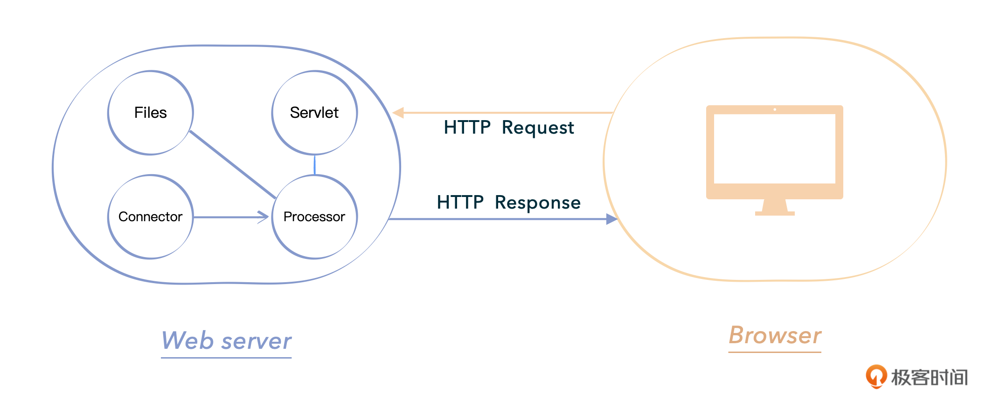
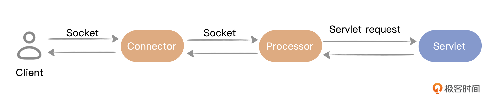
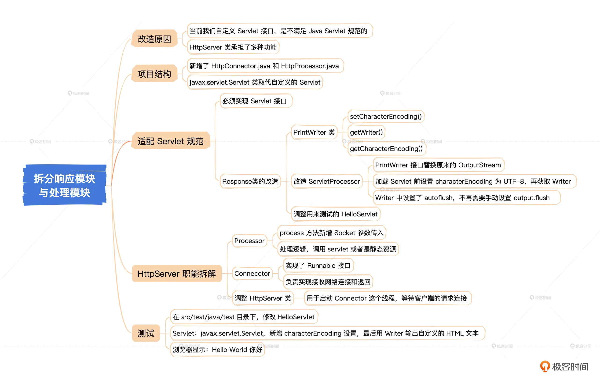

# 04 | 各司其职的Server：拆分响应模块与处理模块

你好，我是郭屹。今天我们继续手写 MiniTomcat。

在上一节课，我们基于最早的最小可用 HttpServer 服务器进行了改造。主要包括对 HTTP 协议返回内容中的状态行与返回头进行封装，以及引入动态资源和 Servlet 的概念，对 Web 端返回内容进行了扩充，已经有点 Servlet 容器的雏形了。

但我也提到，当前我们自定义的 Servlet 接口是不满足 Java Servlet 规范的。因此这节课我们首先会讨论如何符合 Servlet 规范，在 Java 的规则下实现 MiniTomcat。

其次，在当前的 HttpServer 中，HttpServer 类承担了接收客户端请求、调用 Servlet、响应客户端等多种功能，功能太多了，因此我们要将其进行功能拆分，使各个部分各司其职。



好，就让我们一起来动手实现。

## 项目结构

这节课我们计划采用 Maven 结构对项目的包依赖进行管理，省去了导入 jar 包的环节。但有一点我们始终坚持，就是引入最少的依赖包，一切功能尽可能用最原生的 JDK 来实现，以便于我们从头做起更深地理解原理。在这节课中，项目结构变化如下：

```
MiniTomcat
├─ src
│  ├─ main
│  │  ├─ java
│  │  │  ├─ server
│  │  │  │  ├─ HttpConnector.java
│  │  │  │  ├─ HttpProcessor.java
│  │  │  │  ├─ HttpServer.java
│  │  │  │  ├─ Request.java
│  │  │  │  ├─ Response.java
│  │  │  │  ├─ ServletProcessor.java
│  │  │  │  ├─ StatisResourceProcessor.java
│  │  ├─ resources
│  ├─ test
│  │  ├─ java
│  │  │  ├─ test
│  │  │  │  ├─ HelloServlet.java
│  │  ├─ resources
├─ webroot
│  ├─ test
│  │  ├─ HelloServlet.class
│  ├─ hello.txt
├─ pom.xml
```

对比上节课的目录，你会发现新增了 HttpConnector.java 和 HttpProcessor.java，这正是用来拆分 HttpServer 两个类的，而我们自定义的 Servlet 就消失不见了。根据 Servlet 规范，取而代之的应该是 javax.servlet.Servlet 类。

接下来我们需要把 javax.servlet.Servlet 引入到代码之中，参考以下 pom.xml：

```xml
<project xmlns="http://maven.apache.org/POM/4.0.0" xmlns:xsi="http://www.w3.org/2
   <modelVersion>4.0.0</modelVersion>
   <groupId>day3</groupId>
   <artifactId>day3</artifactId>
   <version>0.0.1-SNAPSHOT</version>
   <dependencies>
       <dependency>
           <groupId>javax.servlet</groupId>
           <artifactId>javax.servlet-api</artifactId>
           <version>4.0.1</version>
       </dependency>
       <dependency>
           <groupId>org.apache.commons</groupId>
           <artifactId>commons-lang3</artifactId>
           <version>3.4</version>
       </dependency>
   </dependencies>
</project>
```

## 适配 Servlet 规范

所谓符合规范，对编写程序来讲，就是遵守流程调用时序和使用规定的 API 接口及数据格式。对 Servlet 规范来讲，第一个要遵守的就是必须实现 Servlet 接口。

在引入上文的 servlet-api 依赖后，我们可以把原来自己定义的 Servlet 接口删除，用javax.servlet.Servlet 替换。我们先看看 javax.servlet.Servlet 的接口定义。

```java
package javax.servlet;
import java.io.IOException;
public interface Servlet {
   void init(ServletConfig var1) throws ServletException;
   ServletConfig getServletConfig();
   void service(ServletRequest var1, ServletResponse var2) throws ServletExcepti
   String getServletInfo();
   void destroy();
}
```

在工程中替换后，原先的代码会立即报错，因为 service 方法传入的参数是 ServletRequest 和ServletResponse，而我们目前使用的是自定义的 Request 类和 Response 类。

因此，接下来分别让 Request 和 Response 实现 ServletRequest 与 ServletResponse，实现如下：

```java
public class Request implements ServletRequest{
   private InputStream input;
   private String uri;
   //以输入流作为Request的接收参数
   public Request(InputStream input) {
       this.input = input;
   }
   //简单的parser，假定从输入流中一次性获取全部字节，存放到2K缓存中
   public void parse() {
       StringBuffer request = new StringBuffer(2048);
       int i;
       byte[] buffer = new byte[2048];
       try {
           i = input.read(buffer);
       }
       catch (IOException e) {
           e.printStackTrace();
           i = -1;
       }
       for (int j=0; j<i; j++) {
           request.append((char) buffer[j]);
       }
       //从输入的字符串中解析URI
       uri = parseUri(request.toString());
   }
   //根据协议格式，以空格为界，截取中间的一段，即为URI
   private String parseUri(String requestString) {
       int index1, index2;
       index1 = requestString.indexOf(' ');
       if (index1 != -1) {
           index2 = requestString.indexOf(' ', index1 + 1);
           if (index2 > index1)
               return requestString.substring(index1 + 1, index2);
       }
       return null;
   }
   public String getUri() {
       return uri;
   }
   @Override
   public AsyncContext getAsyncContext() {
       return null;
   }
   @Override
   public Object getAttribute(String arg0) {
       return null;
   }
   @Override
   public Enumeration<String> getAttributeNames() {
       return null;
   }
   @Override
   public String getCharacterEncoding() {
       return null;
   }
   @Override
   public int getContentLength() {
       return 0;
   }
   @Override
   public long getContentLengthLong() {
       return 0;
   }
   @Override
   public String getContentType() {
       return null;
   }
   @Override
   public DispatcherType getDispatcherType() {
       return null;
   }
   @Override
   public ServletInputStream getInputStream() throws IOException {
       return null;
   }
   @Override
   public String getLocalAddr() {
       return null;
   }
   @Override
   public String getLocalName() {
       return null;
   }
   @Override
   public int getLocalPort() {
       return 0;
   }
   @Override
   public Locale getLocale() {
       return null;
   }
   @Override
   public Enumeration<Locale> getLocales() {
       return null;
   }
   @Override
   public String getParameter(String arg0) {
       return null;
   }
   @Override
   public Map<String, String[]> getParameterMap() {
       return null;
   }
   @Override
   public Enumeration<String> getParameterNames() {
       return null;
   }
   @Override
   public String[] getParameterValues(String arg0) {
       return null;
   }
   @Override
   public String getProtocol() {
       return null;
   }
   @Override
   public BufferedReader getReader() throws IOException {
       return null;
   }
   @Override
   public String getRealPath(String arg0) {
       return null;
   }
   @Override
   public String getRemoteAddr() {
       return null;
   }
   @Override
   public String getRemoteHost() {
       return null;
   }
   @Override
   public int getRemotePort() {
       return 0;
   }
   @Override
   public RequestDispatcher getRequestDispatcher(String arg0) {
       return null;
   }
   @Override
   public String getScheme() {
       return null;
   }
   @Override
   public String getServerName() {
       return null;
   }
   @Override
   public int getServerPort() {
       return 0;
   }
   @Override
   public ServletContext getServletContext() {
       return null;
   }
   @Override
   public boolean isAsyncStarted() {
       return false;
   }
   @Override
   public boolean isAsyncSupported() {
       return false;
   }
   @Override
   public boolean isSecure() {
       return false;
   }
   @Override
   public void removeAttribute(String arg0) {
   }
   @Override
   public void setAttribute(String arg0, Object arg1) {
   }
   @Override
   public void setCharacterEncoding(String arg0) throws UnsupportedEncodingExcep
   }
   @Override
   public AsyncContext startAsync() throws IllegalStateException {
       return null;
   }
   @Override
   public AsyncContext startAsync(ServletRequest arg0, ServletResponse arg1) thr
       return null;
   }
}
```

从代码中可以看出，我们只是简单地实现了对 URI 的解析，别的方法都是留空的。Java 的API 考虑得很全面，在 Request 里面新增了许多接口实现方法，但是就基本功能来讲，只要很少的方法就可以了，我们暂且先把这些现在不用的方法放在一边不实现。

接下来我们看看 Response 类的改造。

```java
package server;
import javax.servlet.ServletOutputStream;
import javax.servlet.ServletResponse;
import java.io.IOException;
import java.io.OutputStream;
import java.io.OutputStreamWriter;
import java.io.PrintWriter;
import java.util.Locale;
public class Response implements ServletResponse{
   Request request;
   OutputStream output;
   PrintWriter writer;
   String contentType = null;
   long contentLength = -1;
   String charset = null;
   String characterEncoding = null;
   //以输出流作为接收参数
   public Response(OutputStream output) {
       this.output = output;
   }
   public void setRequest(Request request) {
       this.request = request;
   }
   public OutputStream getOutput() {
       return this.output;
   }
   @Override
   public void flushBuffer() throws IOException {
   }
   @Override
   public int getBufferSize() {
       return 0;
   }
   @Override
   public String getCharacterEncoding() {
       return this.characterEncoding;
   }
   @Override
   public String getContentType() {
       return null;
   }
   @Override
   public Locale getLocale() {
       return null;
   }
   @Override
   public ServletOutputStream getOutputStream() throws IOException {
       return null;
   }
   @Override
   public PrintWriter getWriter() throws IOException {
       writer = new PrintWriter(new OutputStreamWriter(output,getCharacterEncodi
       return writer;
   }
   @Override
   public boolean isCommitted() {
       return false;
   }
   @Override
   public void reset() {
   }
   @Override
   public void resetBuffer() {
   }
   @Override
   public void setBufferSize(int arg0) {
   }
   @Override
   public void setCharacterEncoding(String arg0) {
       this.characterEncoding = arg0;
   }
   @Override
   public void setContentLength(int arg0) {
   }
   @Override
   public void setContentLengthLong(long arg0) {
   }
   @Override
   public void setContentType(String arg0) {
   }
   @Override
   public void setLocale(Locale arg0) {
   }
}
```

同样的，这个 API 也提供了一大堆方法。Response 类里也因为实现接口，新增了许多接口实现方法，在目前这个阶段，我们只需要关注 getWriter() 这一个方法。

```
public PrintWriter getWriter() throws IOException {
   writer = new PrintWriter(new OutputStreamWriter(output,getCharacterEncoding()
   return writer;
}
看上述实现，在这之前我们用 byte[] 数组类型作为 output 的输出，这对业务程序员来说是
```

不太便利的，因此我们现在支持往输出流里写入 String 字符串数据，于是就需要用到

```
PrintWriter 类。可以看到这里调用了 getCharacterEncoding() 方法，一般常用的是
UTF-8，所以在调用 getWriter() 之前，一定要先调用 setCharacterEncoding() 设置
```

字符集。

在 PrintWriter 构造函数中，我们目前设置了一个值为 true。这个值的含义为 autoflush，当为true 时，println、printf 等方法会自动刷新输出流的缓冲。

当提供了 writer 后，我们着手改造 ServletProcessor，改造后如下所示：

```java
public class ServletProcessor {
   //返回串的模板，实际返回时替换变量
   private static String OKMessage = "HTTP/1.1 ${StatusCode} ${StatusName}\r\n"+
           "Content-Type: ${ContentType}\r\n"+
           "Server: minit\r\n"+
           "Date: ${ZonedDateTime}\r\n"+
           "\r\n";
   public void process(Request request, Response response) {
       String uri = request.getUri(); //获取URI
       //按照简单规则确定servlet名，认为最后一个/符号后的就是servlet名
       String servletName = uri.substring(uri.lastIndexOf("/") + 1);
       URLClassLoader loader = null;
       PrintWriter writer = null;
       try {
           // create a URLClassLoader
           URL[] urls = new URL[1];
           URLStreamHandler streamHandler = null;
           //从全局变量HttpServer.WEB_ROOT中设置类的目录
           File classPath = new File(HttpServer.WEB_ROOT);
           String repository = (new URL("file", null, classPath.getCanonicalPath
           urls[0] = new URL(null, repository, streamHandler);
           loader = new URLClassLoader(urls);
       }
       catch (IOException e) {
           System.out.println(e.toString() );
       }
       //获取PrintWriter
       try {
           response.setCharacterEncoding("UTF-8");
           writer = response.getWriter();
       } catch (IOException e1) {
           e1.printStackTrace();
       }
       //加载servlet
       Class<?> servletClass = null;
       try {
           servletClass = loader.loadClass(servletName);
       }
       catch (ClassNotFoundException e) {
           System.out.println(e.toString());
       }
       //生成返回头
       String head = composeResponseHead();
       writer.println(head);
       Servlet servlet = null;
       try {
           //调用servlet，由servlet写response体
           servlet = (Servlet) servletClass.newInstance();
           servlet.service(request, response);
       }
       catch (Exception e) {
           System.out.println(e.toString());
       }
       catch (Throwable e) {
           System.out.println(e.toString());
       }
   }
   //生成返回头，根据协议格式替换变量
   private String composeResponseHead() {
       Map<String,Object> valuesMap = new HashMap<>();
       valuesMap.put("StatusCode","200");
       valuesMap.put("StatusName","OK");
       valuesMap.put("ContentType","text/html;charset=UTF-8");
       valuesMap.put("ZonedDateTime", DateTimeFormatter.ISO_ZONED_DATE_TIME.form
       StrSubstitutor sub = new StrSubstitutor(valuesMap);
       String responseHead = sub.replace(OKMessage);
       return responseHead;
   }
}
```

主要变化有 3 处。

1. 使用 PrintWriter 接口替换了原来的 OutputStream。

2. 在加载 Servlet 之前设置 characterEncoding 为 UTF-8，再获取 Writer。

3. Writer 中设置了 autoflush，因此不再需要像原来一样手动设置 output.flush。

最后则是调整用来测试的 HelloServlet，实现 Servlet 接口，在输出之前设置characterEncoding。

```java
public class HelloServlet implements Servlet{
   @Override
   public void service(ServletRequest req, ServletResponse res) throws ServletEx
       res.setCharacterEncoding("UTF-8");
       String doc = "<!DOCTYPE html> \n" +
               "<html>\n" +
               "<head><meta charset=\"utf-8\"><title>Test</title></head>\n"+
               "<body bgcolor=\"#f0f0f0\">\n" +
               "<h1 align=\"center\">" + "Hello World 你好" + "</h1>\n";
       res.getWriter().println(doc);
   }
   @Override
   public void destroy() {
   }
   @Override
   public ServletConfig getServletConfig() {
       return null;
   }
   @Override
   public String getServletInfo() {
       return null;
   }
   @Override
   public void init(ServletConfig arg0) throws ServletException {
   }
}
```

通过测试我们可以看到，中文正确地输出了。

## HttpServer 职能拆解

在服务器符合 Servlet 规范之后，我们再转向服务器本身，也就是 HttpServer 这个核心实现类。

目前我们已拥有基本的 Servlet Container 功能，具备接收客户端请求，调用 Servlet 以及响应客户端请求的能力。为了达到各司其职的目标，我们可以把它拆分成两个大块：Connecctor和 Processor，分别负责处理接收、响应客户端请求以及调用 Servlet。

实现 HttpProcessor.java 如下：

```java
public class HttpProcessor {
   public HttpProcessor(){
   }
   public void process(Socket socket) {
       InputStream input = null;
       OutputStream output = null;
       try {
           input = socket.getInputStream();
           output = socket.getOutputStream();
           // create Request object and parse
           Request request = new Request(input);
           request.parse();
           // create Response object
           Response response = new Response(output);
           response.setRequest(request);
           // check if this is a request for a servlet or a static resource
           // a request for a servlet begins with "/servlet/"
           if (request.getUri().startsWith("/servlet/")) {
               ServletProcessor processor = new ServletProcessor();
               processor.process(request, response);
           }
           else {
               StaticResourceProcessor processor = new StaticResourceProcessor()
               processor.process(request, response);
           }
           // Close the socket
           //socket.close();
       } catch (Exception e) {
           e.printStackTrace();
       }
   }
}
```

在 HttpProcessor 中，process 方法具体实现和原本并没有差异，只是新增 Socket 参数传入。现在有了这个专门的机构来分工，调用 Servlet 或者是静态资源。

HttpConnector 实现如下：

```java
public class HttpConnector implements Runnable {
   public void run() {
       ServerSocket serverSocket = null;
       int port = 8080;
       try {
           serverSocket = new ServerSocket(port, 1, InetAddress.getByName("127.0
       } catch (IOException e) {
           e.printStackTrace();
           System.exit(1);
       }
       while (true) {
           Socket socket = null;
           try {
               socket = serverSocket.accept();
               HttpProcessor processor = new HttpProcessor();
               processor.process(socket);
               // Close the socket
               socket.close();
           } catch (Exception e) {
               e.printStackTrace();
           }
       }
   }
   public void start() {
       Thread thread = new Thread(this);
       thread.start();
   }
}
```

需要注意的是 HttpConnector，它实现了 Runnable 接口，把它看作一个线程，支持并发处理，提高整个服务器的吞吐量。而 Socket 的关闭，最后也统一交给 Connector 处理。

这样整个服务器基本的工作流程就是：由 Connector 接收连接，来了一个 Socket 之后，就转手交给 Processor 进行处理，处理完之后再返回给 Connector 来关闭。



最后调整 HttpServer 类，当前这个类的实现非常简单，只用于启动 Connector 这个线程，来等待客户端的请求连接。

```java
public class HttpServer {
   public static final String WEB_ROOT =
           System.getProperty("user.dir") + File.separator + "webroot";
   public static void main(String[] args) {
       HttpConnector connector = new HttpConnector();
       connector.start();
   }
}
```

## 测试

```java
在 src/test/java/test 目录下，修改 HelloServlet。
package test;
import java.io.IOException;
import javax.servlet.Servlet;
import javax.servlet.ServletConfig;
import javax.servlet.ServletException;
import javax.servlet.ServletRequest;
import javax.servlet.ServletResponse;
public class HelloServlet implements Servlet{
   @Override
   public void service(ServletRequest req, ServletResponse res) throws ServletEx
       res.setCharacterEncoding("UTF-8");
       String doc = "<!DOCTYPE html> \n" +
               "<html>\n" +
               "<head><meta charset=\"utf-8\"><title>Test</title></head>\n"+
               "<body bgcolor=\"#f0f0f0\">\n" +
               "<h1 align=\"center\">" + "Hello World 你好" + "</h1>\n";
       res.getWriter().println(doc);
   }
   @Override
   public void destroy() {
   }
   @Override
   public ServletConfig getServletConfig() {
       return null;
   }
   @Override
   public String getServletInfo() {
       return null;
   }
   @Override
   public void init(ServletConfig arg0) throws ServletException {
   }
}
```

实现的 Servlet 是 javax.servlet.Servlet，新增 characterEncoding 设置，最后用 Writer 输出自定义的 HTML 文本。

在准备工作进行完毕之后，我们运行 HttpServer 服务器，键入http://localhost:8080/hello.txt 后，可以发现 hello.txt 里的所有文本内容，都作为返回体展示在浏览器页面上了。再输入 http://localhost:8080/servlet/test.HelloServlet 后，就可以看到浏览器显示：Hello World 你好。这也是我们在 HelloServlet 里定义的返回资源内容。

这说明整体功能改造成功。

## 小结



这节课我们按照 Servlet 规范，对 Request、Response 类以及测试用的 HelloServlet 进行了改造，主要的内容就是支持规范，所以从代码层面看增加了许多方法，但是目前我们都没有用到，实现的也仅仅是核心部分。

然后我们进一步将 HttpServer 功能进行拆分解耦，分成 Connector 和 Processor，Connector负责实现接收网络连接和返回，Processor 负责处理逻辑，即调用 Servlet 并返回。各个部分各司其职，并且考虑实现 Runnable 接口支持独立线程并发调用，为未来提高整体性能做准备。

本节课代码参见：https://gitee.com/yaleguo1/minit-learning-demo/tree/geek_chapter04

## 思考题

学完了这节课的内容，我们来思考一个问题：我们现在是在一个无限循环中每接收一个Socket 连接就临时创建一个 Processor 来处理这个 Socket，处理完毕之后再开始下一个循环，这个 Server 是串行工作模式，怎么提高这个 Server 的并发度？

欢迎你把你思考后的结果分享到评论区，也欢迎你把这节课的内容分享给其他朋友，我们下节课再见！
