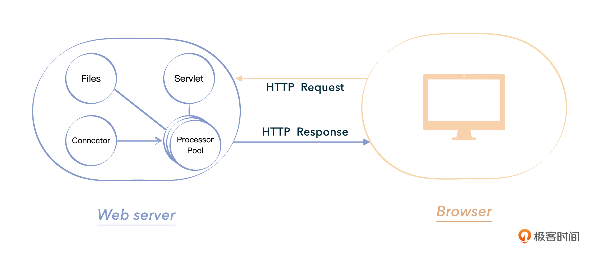
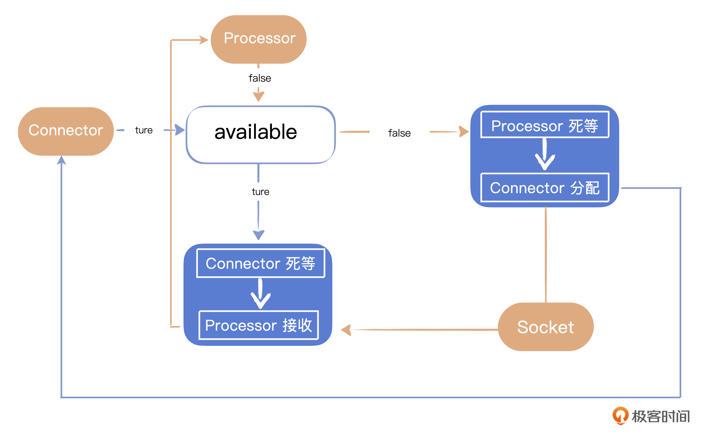
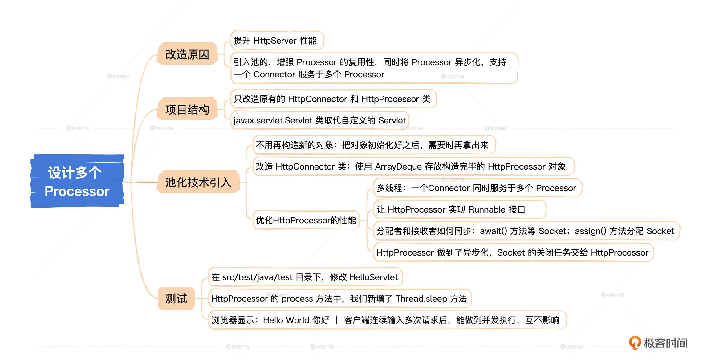

# 05 | Server性能提升：设计多个Processor

你好，我是郭屹。今天我们继续手写 MiniTomcat。

学完前几节课的内容之后，现在我们已经做到接口满足 Servlet 规范，而且功能模块拆分成了Connector 和 Processor 两部分，它们各司其职，一个负责网络连接，一个负责 Servlet 调用处理。

但现在这个 Server 的运行模式是，一个 Connector 服务于一个 Processor，而且每次创建Processor 的时候都是重新实例化一个新的对象，Processor 还不支持多线程处理，所以我们在 HttpServer 性能方面还有提升的空间。

这节课，我们计划引入池的概念，增强 Processor 的复用性，同时将 Processor 异步化，支持一个 Connector 服务于多个 Processor。



## 项目结构

这节课，我们只针对原有的 HttpConnector 和 HttpProcessor 类进行改造，所以项目结构和maven 引入依赖保持不变，还是延续下面的结构和配置。

```
MiniTomcat
├─ src
│  ├─ main
│  │  ├─ java
│  │  │  ├─ server
│  │  │  │  ├─ HttpConnector.java
│  │  │  │  ├─ HttpProcessor.java
│  │  │  │  ├─ HttpServer.java
│  │  │  │  ├─ Request.java
│  │  │  │  ├─ Response.java
│  │  │  │  ├─ ServletProcessor.java
│  │  │  │  ├─ StatisResourceProcessor.java
│  │  ├─ resources
│  ├─ test
│  │  ├─ java
│  │  │  ├─ test
│  │  │  │  ├─ HelloServlet.java
│  │  ├─ resources
├─ webroot
│  ├─ test
│  │  ├─ HelloServlet.class
│  ├─ hello.txt
├─ pom.xml
```

pom.xml 参考如下：

```xml
<project xmlns="http://maven.apache.org/POM/4.0.0" xmlns:xsi="http://www.w3.org/2
   <modelVersion>4.0.0</modelVersion>
   <groupId>day3</groupId>
   <artifactId>day3</artifactId>
   <version>0.0.1-SNAPSHOT</version>
   <dependencies>
       <dependency>
           <groupId>javax.servlet</groupId>
           <artifactId>javax.servlet-api</artifactId>
           <version>4.0.1</version>
       </dependency>
       <dependency>
           <groupId>org.apache.commons</groupId>
           <artifactId>commons-lang3</artifactId>
           <version>3.4</version>
       </dependency>
   </dependencies>
</project>
```

## 池化技术引入

现在我们在 HttpConnector 里获取到 Socket 后，每次都是创建一个全新的 HttpProcessor 对象，如下所示：

```
socket = serverSocket.accept();
HttpProcessor processor = new HttpProcessor();
processor.process(socket);
```

在并发请求逐步增加后，构造新对象会对服务器的性能造成负担，所以我们打算引入池，把对象初始化好之后，需要用的时候再拿出来使用，不需要使用的时候就再放回池里，不用再构造新的对象。

因此，接下来我们先改造 HttpConnector 类，使用 ArrayDeque 存放构造完毕的HttpProcessor 对象。改造如下：

```java
public class HttpConnector implements Runnable {
   int minProcessors = 3;
   int maxProcessors = 10;
   int curProcessors = 0;
   //存放多个processor的池子
   Deque<HttpProcessor> processors = new ArrayDeque<>();
   public void run() {
       ServerSocket serverSocket = null;
       int port = 8080;
       try {
           serverSocket = new ServerSocket(port, 1, InetAddress.getByName("127.0
       } catch (IOException e) {
           e.printStackTrace();
           System.exit(1);
       }
       // initialize processors pool
       for (int i = 0; i < minProcessors; i++) {
           HttpProcessor processor = new HttpProcessor();
           processors.push(processor);
       }
       curProcessors = minProcessors;
       while (true) {
           Socket socket = null;
           try {
               socket = serverSocket.accept();
               //得到一个新的processor，这个processor从池中获取(池中有可能新建)
               HttpProcessor processor = createProcessor();
               if (processor == null) {
                   socket.close();
                   continue;
               }
               processor.process(socket); //处理
               processors.push(processor); //处理完毕后放回池子
               // Close the socket
               socket.close();
           } catch (Exception e) {
               e.printStackTrace();
           }
       }
   }
   public void start() {
       Thread thread = new Thread(this);
       thread.start();
   }
   //从池子中获取一个processor，如果池子为空且小于最大限制，则新建一个
   private HttpProcessor createProcessor() {
       synchronized (processors) {
           if (processors.size() > 0) {
               //获取一个
               return ((HttpProcessor) processors.pop());
           }
           if (curProcessors < maxProcessors) {
               //新建一个
               return (newProcessor());
           }
           else {
               return (null);
           }
       }
   }
   //新建一个processor
   private HttpProcessor newProcessor() {
       HttpProcessor initprocessor = new HttpProcessor();
       processors.push(initprocessor);
       curProcessors++;
       return ((HttpProcessor) processors.pop());
   }
}
```

从上述代码中，我们可以看到，run() 方法中先进行了 processors 池的初始化，就是循环创建新的 HttpProcessor 对象后，push 到 processors 这个 ArrayDeque 里，processors 作为HttpProcessor 对象的存储池使用。

之后，每次接收到一个 socket，就用 createProcessor() 方法获取到一个 processor。看一下createProcessor() 方法的代码，可以发现当 processors 内元素不为空的时候，直接从ArrayDeque 内获取 HttpProcessor 对象，每次从池里获取一个 processor。如果池子里没有processor，就新创建一个。

无论池子里有没有，最后的结果都是拿到了一个 processor，然后执行它，任务执行完之后再把它放回池里。完成了一次请求响应。

但是我们要注意，到现在为止，HttpProcessor 并没有做到多线程，也没有实现 NIO，只是在池中放置了多个对象，做到了多路复用。目前整体架构还是阻塞式运行的，Socket 每次用之后也关闭丢弃了。

所以我们要继续改造，优化 HttpProcessor 的性能。

## 多线程 HttpProcessor

接下来，我们计划设置多线程 Processor，通过这个手段继续优化它的性能。这可以使一个Connector 同时服务于多个 Processor。

基本的思路是使用多个线程，让 Connector 和 Processor 分别由不同的线程来运行。工作的基本流程是由 Connector 接收某个 Socket 连接后交给某个 Processor 线程处理，而Processor 线程等待某个 Socket 连接到来后进行处理，处理完毕之后要交回给 Connector。因此，这里的核心是要设计一个线程之间的同步机制。

首先我们让 HttpProcessor 实现 Runnable 接口，这样每一个 HttpProcessor 都可以在独立的线程中运行。改造如下：

```java
public class HttpProcessor implements Runnable{
   @Override
   public void run() {
       while (true) {
           // 等待socket分配过来
           Socket socket = await();
           if (socket == null) continue;
           // 处理请求
           process(socket);
           // 回收processor
           connector.recycle(this);
       }
   }
}
```

上述 Processor 的 run() 方法执行过程是，等待某个 Socket，收到 Connector 交过来的Socket 后，Process 方法处理这个 Socket，处理完毕之后交回给 Connector 回收，并重新把这个 processor 放入池里。

这是 Processor 接收者这一边，而另一边就是作为分配者的 Connector。类似地，我们提供一个 assign 方法让 Connector 分配 Socket 给 Processor。

接下来我们重点解决分配者和接收者如何同步的问题。因为这是两个线程，一定需要同步才能

```
协同工作。基本的思路就是 await() 方法里等着 Socket，而 assign() 方法里分配 Socket，
```

中间通过一个标志来表示分配和接收状态，以此进行同步。

这个同步的机制内部其实就是用的 Java 自身提供的 notify 和 wait。

看程序代码，如下所示：

```
synchronized void assign(Socket socket) {
   // 等待connector提供一个新的socket
   while (available) {
       try {
           wait();
       } catch (InterruptedException e) {
       }
   }
   // 获取到这个新的Socket
   this.socket = socket;
   // 把标志设置回去
   available = true;
   //通知另外的线程
   notifyAll();
}
private synchronized Socket await() {
   // 等待connector提供一个新的socket
   while (!available) {
       try {
           wait();
       }catch (InterruptedException e) {
       }
   }
   // 获得这个新的Socket
   Socket socket = this.socket;
   //设置标志为false
   available = false;
   //通知另外的线程
   notifyAll();
   return (socket);
}
首先看 assign(socket) 方法，在这里，我们用一个标志 available 来标记，如果标志为
```

true，Connetor 线程就继续死等。到了某个时候，Processor 线程把这个标志设置为 false，Connector 线程就跳出死等的循环，然后把接收到的 Socket 交给 Processor。然后要立刻重

```
新把 available 标志设置为 true，再调用 notifyAll() 通知其他线程。
再看 await()，这是作为接收者 Processor 的线程使用的方法。反过来，如果 avaliable 标志
```

为 false，那么 Processor 线程继续死等。到了某个时候，Connector 线把这个标志设置为true，那么 Processor 线程就跳出死等的循环，拿到 Socket。然后要立刻重新把 avaiable 标

```
志设置为 false，再调用 notifyAll() 通知其他线程。
```

这个线程互锁机制保证了两个线程之间的同步协调。图示如下：



下面我列出 HttpProcessor 的完整代码，因为 HttpProcessor 构造函数调整，增加了HttpConnector 的参数，所以我把 HttpConnector 类调整后的代码一并列出了，随后我们统一说明调整步骤还有调整的理由。

HttpProcessor 代码：

```java
public class HttpProcessor implements Runnable{
   Socket socket;
   boolean available = false;
   HttpConnector connector;
   public HttpProcessor(HttpConnector connector) {
       this.connector = connector;
   }
   @Override
   public void run() {
       while (true) {
           // 等待分配下一个 socket
           Socket socket = await();
           if (socket == null) continue;
           // 处理来自这个socket的请求
           process(socket);
           // 完成此请求
           connector.recycle(this);
       }
   }
   public void start() {
       Thread thread = new Thread(this);
       thread.start();
   }
   public void process(Socket socket) {
       try {
           Thread.sleep(3000);
       } catch (InterruptedException e1) {
           e1.printStackTrace();
       }
       InputStream input = null;
       OutputStream output = null;
       try {
           input = socket.getInputStream();
           output = socket.getOutputStream();
           // 创建请求对象并解析
           Request request = new Request(input);
           request.parse();
           // 创建响应对象
           Response response = new Response(output);
           response.setRequest(request);
//               response.sendStaticResource();
           // 检查这是对servlet还是静态资源的请求
           // a request for a servlet begins with "/servlet/"
           if (request.getUri().startsWith("/servlet/")) {
               ServletProcessor processor = new ServletProcessor();
               processor.process(request, response);
           }
           else {
               StaticResourceProcessor processor = new StaticResourceProcessor()
               processor.process(request, response);
           }
           // 关闭 socket
           socket.close();
       } catch (Exception e) {
           e.printStackTrace();
       }
   }
   synchronized void assign(Socket socket) {
       // 等待 connector 提供新的 Socket
       while (available) {
           try {
               wait();
           } catch (InterruptedException e) {
           }
       }
       // 存储新可用的 Socket 并通知我们的线程
       this.socket = socket;
       available = true;
       notifyAll();
   }
   private synchronized Socket await() {
       // 等待 connector 提供一个新的 Socket
       while (!available) {
           try {
               wait();
           }catch (InterruptedException e) {
           }
       }
       // 通知Connector我们已经收到这个Socket了
       Socket socket = this.socket;
       available = false;
       notifyAll();
       return (socket);
   }
}
要注意 available 标志和 assign() 方法都是写在 Processor 类里的。
processor.assign(socket);
但是这并不表示 assign() 是 Processor 线程来执行，因为这个方法的调用者是
```

Connector。

HttpConnector 代码：

```java
public class HttpConnector implements Runnable {
   int minProcessors = 3;
   int maxProcessors = 10;
   int curProcessors = 0;
   //存放Processor的池子
   Deque<HttpProcessor> processors = new ArrayDeque<>();
   public void run() {
       ServerSocket serverSocket = null;
       int port = 8080;
       try {
           serverSocket = new ServerSocket(port, 1, InetAddress.getByName("127.0
       } catch (IOException e) {
           e.printStackTrace();
           System.exit(1);
       }
       // 初始化池子initialize processors pool
       for (int i = 0; i < minProcessors; i++) {
           HttpProcessor initprocessor = new HttpProcessor(this);
           initprocessor.start();
           processors.push(initprocessor);
       }
       curProcessors = minProcessors;
       while (true) {
           Socket socket = null;
           try {
               socket = serverSocket.accept();
               //对每一个socket，从池子中拿到一个processor
               HttpProcessor processor = createProcessor();
               if (processor == null) {
                   socket.close();
                   continue;
               }
               //分配给这个processor
               processor.assign(socket);
               // Close the socket
//                socket.close();
           } catch (Exception e) {
               e.printStackTrace();
           }
       }
   }
   public void start() {
       Thread thread = new Thread(this);
       thread.start();
   }
   //从池子中获取一个processor，池子为空且数量小于最大限制则会新建一个processor
   private HttpProcessor createProcessor() {
       synchronized (processors) {
           if (processors.size() > 0) {
               return ((HttpProcessor) processors.pop());
           }
           if (curProcessors < maxProcessors) {
               return (newProcessor());
           }
           else {
               return (null);
           }
       }
   }
   private HttpProcessor newProcessor() {
       HttpProcessor initprocessor = new HttpProcessor(this);
       initprocessor.start();
       processors.push(initprocessor);
       curProcessors++;
       return ((HttpProcessor) processors.pop());
   }
   void recycle(HttpProcessor processor) {
       processors.push(processor);
   }
}
```

我们再回顾一下 HttpProcessor 类中的 assign 方法与 await 方法。在 HttpProcessor 的线程启动之后，available 的标识一直是 false，这个时候这个线程会一直等待。在 HttpConnector 类

```
里构造 Processor，并且调用 processor.assign(socket) 给 HttpProcessor 分配 Socket
```

之后，标识符 available 改成 true，并且调用 notifyAll 这个本地方法通知唤醒所有等待的线程。

而在 await 方法里，HttpProcessor 拿到 HttpConnector 传来的 Socket 之后，首先会接收Socket，并且立即把 available 由 true 改为 false，最后以拿到的这个 Socket 为基准继续进行Processor 中的处理工作。

这也意味着，一旦 Connector 分配了一个 Socket 给到 Processor，后者就能立即结束等待，拿到 Socket 后调用 Process 方法继续后面的工作。这时 available 的状态立刻修改，进而用notifyAll 方法唤醒 Connector 的等待线程，Connector 就可以全身而退，去处理下一个HttpProcessor 了。

Tomcat 中两个线程互锁的这种机制很经典，在后续版本的 NIO 和 Servlet 协调的设计中都用到了。

这样也就做到了 HttpProcessor 的异步化，也正因为做到了异步化，我们就不能再利用Connector 去关闭 Socket 了，因为 Connector 是不知道 Processor 何时处理完毕的，Socket的关闭任务就交给 Processor 自己处理了。

因此在 Connector 类里，socket.close() 这一行被注释掉了，而在 Processor 类里新增了那一行代码。

## 测试

在 src/test/java/test 目录下，修改 HelloServlet。

```java
package test;
import java.io.IOException;
import javax.servlet.Servlet;
import javax.servlet.ServletConfig;
import javax.servlet.ServletException;
import javax.servlet.ServletRequest;
import javax.servlet.ServletResponse;
public class HelloServlet implements Servlet{
   @Override
   public void service(ServletRequest req, ServletResponse res) throws ServletEx
       res.setCharacterEncoding("UTF-8");
       String doc = "<!DOCTYPE html> \n" +
               "<html>\n" +
               "<head><meta charset=\"utf-8\"><title>Test</title></head>\n"+
               "<body bgcolor=\"#f0f0f0\">\n" +
               "<h1 align=\"center\">" + "Hello World 你好" + "</h1>\n";
       res.getWriter().println(doc);
   }
   @Override
   public void destroy() {
   }
   @Override
   public ServletConfig getServletConfig() {
       return null;
   }
   @Override
   public String getServletInfo() {
       return null;
   }
   @Override
   public void init(ServletConfig arg0) throws ServletException {
   }
}
```

这一次我们的测试类还是和之前差不多，但在 Processor 的 process 方法中，我们新增了Thread.sleep 方法。

在准备工作进行完毕之后，我们运行 HttpServer 服务器，在浏览器中可以连续打开多个页

```
面，键入 http://localhost:8080/hello.txt 后，等待一小段时间（这个时间由
```

Thread.sleep 传入参数 timeout 决定，timeout 以毫秒为单位），随后我们可以发现 hello.txt 里的所有文本内容，都作为返回体展示在浏览器页面上了。

再以同样的方法测试 HelloServlet，输入

```
http://localhost:8080/servlet/test.HelloServlet 后等待一小会儿还是可以看
```

到浏览器显示：Hello World 你好。这也是我们在 HelloServlet 里定义的返回资源内容。

这些结果可以证明，我们整体的改造已经做到 Processor 异步化的改造，在客户端连续输入多次请求后，能做到并发执行，互不影响。

## 小结



这节课我们主要做了两件事：引入池化技术以及 Processor 多线程。前者我们从优化对象构造，持续复用的角度，做到了性能的优化提升，压缩了构造对象的性能开销；而后者则从并发的角度，使 Connector 能同时服务于多个 Processor，减少了原来因等待 Processor 处理而产生的时间消耗，但是也需要仔细编写线程同步代码。

本节课完整代码参见：https://gitee.com/yaleguo1/minit-learning-demo/tree/geek_chapter05

## 思考题

学完了这节课的内容，我们来思考一个问题：Tomcat 为什么用一个简单的 queue 来实现多线程而不是用 JDK 自带的线程池？

欢迎你把你思考后的结果分享到评论区，也欢迎你把这节课的内容分享给其他朋友，我们下节课再见！
