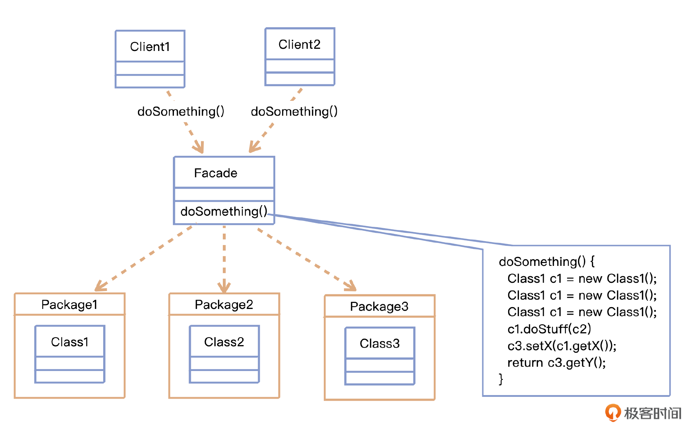
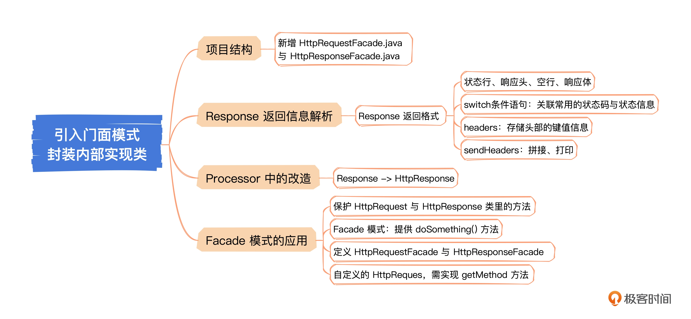

# 07 | 对内的保护：引入门面模式封装内部实现类

你好，我是郭屹。今天我们继续手写 MiniTomcat。

在前面的学习内容中，我们为了符合 Servlet 规范，新增了 HttpRequest 与 HttpResponse类，但截止到现在我们只对 Request 请求相关的代码进行了实现，所以这节课我们就来改造Response 返回代码。

另外，我们也注意到，在 HttpProcessor 类里，我们直接使用的是 HttpRequest 与HttpResponse，这两个对象要传入 Servlet 里，但在这两个类中我们也定义了许多内部的方法，一旦被用户知晓我们的实现类，那么这些内部方法就暴露在用户面前了，这是我们不愿看到的，也是我们需要规避的。因此这节课我们计划用门面（Facade）设计模式来解决这个问题。

下面就让我们一起来动手实现。

## 项目结构

这节课的项目结构主要新增了 HttpRequestFacade.java 与 HttpResponseFacade.java 两个类，如下所示：

```
MiniTomcat
├─ src
│  ├─ main
│  │  ├─ java
│  │  │  ├─ server
│  │  │  │  ├─ DefaultHeaders.java
│  │  │  │  ├─ HttpConnector.java
│  │  │  │  ├─ HttpHeader.java
│  │  │  │  ├─ HttpProcessor.java
│  │  │  │  ├─ HttpRequest.java
│  │  │  │  ├─ HttpRequestFacade.java
│  │  │  │  ├─ HttpRequestLine.java
│  │  │  │  ├─ HttpResponse.java
│  │  │  │  ├─ HttpResponseFacade.java
│  │  │  │  ├─ HttpServer.java
│  │  │  │  ├─ Request.java
│  │  │  │  ├─ Response.java
│  │  │  │  ├─ ServletProcessor.java
│  │  │  │  ├─ SocketInputStream.java
│  │  │  │  ├─ StatisResourceProcessor.java
│  │  ├─ resources
│  ├─ test
│  │  ├─ java
│  │  │  ├─ test
│  │  │  │  ├─ HelloServlet.java
│  │  ├─ resources
├─ webroot
│  ├─ test
│  │  ├─ HelloServlet.class
│  ├─ hello.txt
├─ pom.xml
```

## Response 返回信息解析

上一节课我们完成了 Request 请求信息解析，有了前文铺垫，接下来针对 Response 的改造就容易很多了。

我们在前面提到过，HTTP 协议中规定 Response 返回格式由以下几部分组成：状态行、响应头、空行、响应体。我们常用的状态码一般为 200、401、404、500、503、504 等，我们在HttpResponse 里用 switch 条件语句先关联常用的状态码与状态信息。

```java
package server;
public class HttpResponse implements HttpServletResponse {
 protected String getStatusMessage(int status) {
   switch (status) {
       case SC_OK:
           return ("OK");
       case SC_ACCEPTED:
           return ("Accepted");
       case SC_BAD_GATEWAY:
           return ("Bad Gateway");
       case SC_BAD_REQUEST:
           return ("Bad Request");
       case SC_CONTINUE:
           return ("Continue");
       case SC_FORBIDDEN:
           return ("Forbidden");
       case SC_INTERNAL_SERVER_ERROR:
           return ("Internal Server Error");
       case SC_METHOD_NOT_ALLOWED:
           return ("Method Not Allowed");
       case SC_NOT_FOUND:
           return ("Not Found");
       case SC_NOT_IMPLEMENTED:
           return ("Not Implemented");
       case SC_REQUEST_URI_TOO_LONG:
           return ("Request URI Too Long");
       case SC_SERVICE_UNAVAILABLE:
           return ("Service Unavailable");
       case SC_UNAUTHORIZED:
           return ("Unauthorized");
       default:
           return ("HTTP Response Status " + status);
   }
}
```

其中定义的状态常量都来自 HttpServletResponse 里的定义。

接下来我们关注头部信息的操作，使用 headers 这样一个 concurrentHashMap 存储头部的键值信息，里面是 content-length 和 content-type 的时候，我们还会设置相关属性。代码如下：

```java
public class HttpResponse implements HttpServletResponse {
   Map<String, String> headers = new ConcurrentHashMap<>();
   @Override
   public void addHeader(String name, String value) {
       headers.put(name, value);
       if (name.toLowerCase() == DefaultHeaders.CONTENT_LENGTH_NAME) {
           setContentLength(Integer.parseInt(value));
       }
       if (name.toLowerCase() == DefaultHeaders.CONTENT_TYPE_NAME) {
           setContentType(value);
       }
   }
   @Override
   public void setHeader(String name, String value) {
       headers.put(name, value);
       if (name.toLowerCase() == DefaultHeaders.CONTENT_LENGTH_NAME) {
           setContentLength(Integer.parseInt(value));
       }
       if (name.toLowerCase() == DefaultHeaders.CONTENT_TYPE_NAME) {
           setContentType(value);
       }
   }
}
```

有了内部的头部信息，我们还会提供一个 sendHeaders 方法，按照 HTTP 协议的规定拼接，包含状态行、头信息和空行，将 Header 打印出来，如下所示：

```java
public void sendHeaders() throws IOException {
   PrintWriter outputWriter = getWriter();
   //下面这一端是输出状态行
   outputWriter.print(this.getProtocol());
   outputWriter.print(" ");
   outputWriter.print(status);
   if (message != null) {
       outputWriter.print(" ");
       outputWriter.print(message);
   }
   outputWriter.print("\r\n");
   if (getContentType() != null) {
       outputWriter.print("Content-Type: " + getContentType() + "\r\n");
   }
   if (getContentLength() >= 0) {
       outputWriter.print("Content-Length: " + getContentLength() + "\r\n");
   }
   //输出头信息
   Iterator<String> names = headers.keySet().iterator();
   while (names.hasNext()) {
       String name = names.next();
       String value = headers.get(name);
       outputWriter.print(name);
       outputWriter.print(": ");
       outputWriter.print(value);
       outputWriter.print("\r\n");
   }
   //最后输出空行
   outputWriter.print("\r\n");
   outputWriter.flush();
}
```

完整的 HttpResponse 改造如下，由于代码太长，其中非关键的实现方法就不列在这里了。

```java
package server;
public class HttpResponse implements HttpServletResponse {
   HttpRequest request;
   OutputStream output;
   PrintWriter writer;
   String contentType = null;
   long contentLength = -1;
   String charset = null;
   String characterEncoding = null;
   String protocol = "HTTP/1.1";
   //headers是一个保存头信息的map
   Map<String, String> headers = new ConcurrentHashMap<>();
   //默认返回OK
   String message = getStatusMessage(HttpServletResponse.SC_OK);
   int status = HttpServletResponse.SC_OK;
   public HttpResponse(OutputStream output) {
       this.output = output;
   }
   public void setRequest(HttpRequest request) {
       this.request = request;
   }
   //状态码以及消息文本，没有考虑国际化
   protected String getStatusMessage(int status) {
       switch (status) {
           case SC_OK:
               return ("OK");
           case SC_ACCEPTED:
               return ("Accepted");
           case SC_BAD_GATEWAY:
               return ("Bad Gateway");
           case SC_BAD_REQUEST:
               return ("Bad Request");
           case SC_CONTINUE:
               return ("Continue");
           case SC_FORBIDDEN:
               return ("Forbidden");
           case SC_INTERNAL_SERVER_ERROR:
               return ("Internal Server Error");
           case SC_METHOD_NOT_ALLOWED:
               return ("Method Not Allowed");
           case SC_NOT_FOUND:
               return ("Not Found");
           case SC_NOT_IMPLEMENTED:
               return ("Not Implemented");
           case SC_REQUEST_URI_TOO_LONG:
               return ("Request URI Too Long");
           case SC_SERVICE_UNAVAILABLE:
               return ("Service Unavailable");
           case SC_UNAUTHORIZED:
               return ("Unauthorized");
           default:
               return ("HTTP Response Status " + status);
       }
   }
   public void sendHeaders() throws IOException {
       PrintWriter outputWriter = getWriter();
       //下面这一端是输出状态行
       outputWriter.print(this.getProtocol());
       outputWriter.print(" ");
       outputWriter.print(status);
       if (message != null) {
           outputWriter.print(" ");
           outputWriter.print(message);
       }
       outputWriter.print("\r\n");
       if (getContentType() != null) {
           outputWriter.print("Content-Type: " + getContentType() + "\r\n");
       }
       if (getContentLength() >= 0) {
           outputWriter.print("Content-Length: " + getContentLength() + "\r\n");
       }
       //输出头信息
       Iterator<String> names = headers.keySet().iterator();
       while (names.hasNext()) {
           String name = names.next();
           String value = headers.get(name);
           outputWriter.print(name);
           outputWriter.print(": ");
           outputWriter.print(value);
           outputWriter.print("\r\n");
       }
       //最后输出空行
       outputWriter.print("\r\n");
       outputWriter.flush();
   }
   @Override
   public String getCharacterEncoding() {
       return this.characterEncoding;
   }
   @Override
   public String getContentType() {
       return this.contentType;
   }
   @Override
   public PrintWriter getWriter() throws IOException {
       writer = new PrintWriter(new OutputStreamWriter(output, getCharacterEncod
       return writer;
   }
   @Override
   public void setCharacterEncoding(String arg0) {
       this.characterEncoding = arg0;
   }
   @Override
   public void setContentType(String arg0) {
       this.contentType = arg0;
   }
   @Override
   public void addHeader(String name, String value) {
       headers.put(name, value);
       if (name.toLowerCase() == DefaultHeaders.CONTENT_LENGTH_NAME) {
           setContentLength(Integer.parseInt(value));
       }
       if (name.toLowerCase() == DefaultHeaders.CONTENT_TYPE_NAME) {
           setContentType(value);
       }
   }
   @Override
   public String getHeader(String name) {
       return headers.get(name);
   }
   @Override
   public Collection<String> getHeaderNames() {
       return headers.keySet();
   }
   public void setHeader(String name, String value) {
       headers.put(name, value);
       if (name.toLowerCase() == DefaultHeaders.CONTENT_LENGTH_NAME) {
           setContentLength(Integer.parseInt(value));
       }
       if (name.toLowerCase() == DefaultHeaders.CONTENT_TYPE_NAME) {
           setContentType(value);
       }
   }
```

## Processor 中的改造

修改完 response 之后，自然地，我们在 HttpProcessor 中，将原来引用或初始化 Response类的地方，全部用 HttpResponse 替代。

```
HttpProcessor.java
 // create Response object
 HttpResponse response = new HttpResponse(output);
 response.setRequest(request);
```

ServletProcessor 类 process 代码如下：

```java
public class ServletProcessor {
   public void process(HttpRequest request, HttpResponse response) {
       String uri = request.getUri();
       String servletName = uri.substring(uri.lastIndexOf("/") + 1);
       URLClassLoader loader = null;
       try {
           // create a URLClassLoader
           URL[] urls = new URL[1];
           URLStreamHandler streamHandler = null;
           //这个URLClassloader的工作目录设置在HttpServer.WEB_ROOT
           File classPath = new File(HttpServer.WEB_ROOT);
           String repository = (new URL("file", null, classPath.getCanonicalPath
           urls[0] = new URL(null, repository, streamHandler);
           loader = new URLClassLoader(urls);
       }
       catch (IOException e) {
           System.out.println(e.toString() );
       }
       //response默认为UTF-8编码
       response.setCharacterEncoding("UTF-8");
       Class<?> servletClass = null;
       try {
           servletClass = loader.loadClass(servletName);
       }
       catch (ClassNotFoundException e) {
           System.out.println(e.toString());
       }
       //回写头信息
       try {
           response.sendHeaders();
       } catch (IOException e1) {
           e1.printStackTrace();
       }
       //创建servlet新实例，调用service()
       Servlet servlet = null;
       try {
           servlet = (Servlet) servletClass.newInstance();
           servlet.service(request, response);
       }
       catch (Exception e) {
           System.out.println(e.toString());
       }
       catch (Throwable e) {
           System.out.println(e.toString());
       }
   }
}
```

在此我们完成了 HttpRequest 与 HttpResponse 的替换。

## Facade 模式的应用

现在有一个问题需要我们解决：我们直接使用的是 HttpRequest 与 HttpResponse，这两个对象要传入 Servlet 中，但在这两个类中我们也定义了许多内部的方法，一旦被用户知晓我们的实现类，则这些内部方法就暴露在用户面前了。

这样其实是不好的。面向对象编程的思想，是将内部实现的结构和复杂性包装在一层壳里面，能不对外暴露就不要对外暴露。作为客户程序，最好只知道最小知识集。另外，这个 Request和 Response 类是要传给外部的 Servlet 程序的，跳出了 Tomcat 本身，如果这个写 Servlet 的程序员他知道传的这个类里面有一些额外的方法，原理上他可以进行强制转换之后调用，这样也不是很安全。

接下来我们看看如何使用门面设计模式，规避上述问题。

先解释一下 Facade 模式，Facade 这个词来自于建筑学，字面意思是“立面”，就是我们在大街上看到的门面。门面把建筑的内部结构包装起来给人们展示了一个新的友好的有特色的外观。软件中用同样的手法，将软件的内部结构进行包装，对外用简单的 API 供人使用。

下面是 Facade 的结构图：



看上图，本来一个软件中有几个类，一个类里面有一堆方法，给外面的 client 程序直接用会增添很多复杂性而且不安全，于是中间加了一层 Facade，提供一个简单的 doSomething() 方法。这样对使用者来说很简单方便，也便于内部结构的调整，未来需要改动内部实现的时候，因为有这个 Facade 存在，所以并不需要改动对外的接口。

Facade 类是一个新类，外部使用者没法根据它来强制转换获得内部的结构和方法，这样将实际实现的几个类保护起来了，提高了安全性。这正是我们现在在处理 Request 和 Response的时候所希望看到的。我们按照这个思路写自己的 Facade。

首先定义 HttpRequestFacade 与 HttpResponseFacade，分别实现 HttpServletRequest 与HttpServletResponse。你可以看一下我给出的代码主体部分，大部分都是直接转到 request和 response 里面的相应调用，完整代码就不一一展示了，你可以看最后的 Gitee 链接。

HttpRequestFacade.java：

```java
package server;
public class HttpRequestFacade implements HttpServletRequest {
   private HttpServletRequest request;
   public HttpRequestFacade(HttpRequest request) {
       this.request = request;
   }
   /* implementation of the HttpServletRequest*/
   public Object getAttribute(String name) {
       return request.getAttribute(name);
   }
   public Enumeration getAttributeNames() {
       return request.getAttributeNames();
   }
   public String getCharacterEncoding() {
       return request.getCharacterEncoding();
   }
   public int getContentLength() {
       return request.getContentLength();
   }
   public String getContentType() {
       return request.getContentType();
   }
   public Cookie[] getCookies() {
       return request.getCookies();
   }
   public Enumeration getHeaderNames() {
       return request.getHeaderNames();
   }
   public String getHeader(String name) {
       return request.getHeader(name);
   }
   public Enumeration getHeaders(String name) {
       return request.getHeaders(name);
   }
   public ServletInputStream getInputStream() throws IOException {
       return request.getInputStream();
   }
   public int getIntHeader(String name) {
       return request.getIntHeader(name);
   }
   public String getMethod() {
       return request.getMethod();
   }
   public String getParameter(String name) {
       return request.getParameter(name);
   }
   public Map getParameterMap() {
       return request.getParameterMap();
   }
   public Enumeration getParameterNames() {
       return request.getParameterNames();
   }
   public String[] getParameterValues(String name) {
       return request.getParameterValues(name);
   }
   public String getQueryString() {
       return request.getQueryString();
   }
   public BufferedReader getReader() throws IOException {
       return request.getReader();
   }
   public String getRequestURI() {
       return request.getRequestURI();
   }
   public StringBuffer getRequestURL() {
       return request.getRequestURL();
   }
   public HttpSession getSession() {
       return request.getSession();
   }
   public HttpSession getSession(boolean create) {
       return request.getSession(create);
   }
   public void removeAttribute(String attribute) {
       request.removeAttribute(attribute);
   }
   public void setAttribute(String key, Object value) {
       request.setAttribute(key, value);
   }
   public void setCharacterEncoding(String encoding) throws UnsupportedEncodingE
       request.setCharacterEncoding(encoding);
   }
}
```

HttpResponseFacade.java 类主体定义如下：

```java
package server;
public class HttpResponseFacade implements HttpServletResponse {
   private HttpServletResponse response;
   public HttpResponseFacade(HttpResponse response) {
       this.response = response;
   }
   public void addDateHeader(String name, long value) {
       response.addDateHeader(name, value);
   }
   public void addHeader(String name, String value) {
       response.addHeader(name, value);
   }
   public boolean containsHeader(String name) {
       return response.containsHeader(name);
   }
   public String encodeUrl(String url) {
       return response.encodeUrl(url);
   }
   public String encodeURL(String url) {
       return response.encodeURL(url);
   }
   public void flushBuffer() throws IOException {
       response.flushBuffer();
   }
   public String getCharacterEncoding() {
       return response.getCharacterEncoding();
   }
   @Override
   public String getContentType() {
       return null;
   }
   @Override
   public void setCharacterEncoding(String s) {
   }
   public void setContentLength(int length) {
       response.setContentLength(length);
   }
   public void setContentType(String type) {
       response.setContentType(type);
   }
   public void setHeader(String name, String value) {
       response.setHeader(name, value);
   }
   public ServletOutputStream getOutputStream() throws IOException {
       return response.getOutputStream();
   }
   @Override
   public PrintWriter getWriter() throws IOException {
       return response.getWriter();
   }
   @Override
   public void addCookie(Cookie arg0) {
       response.addCookie(arg0);
   }
   @Override
   public String getHeader(String arg0) {
       return response.getHeader(arg0);
   }
   @Override
   public Collection<String> getHeaderNames() {
       return response.getHeaderNames();
   }
   @Override
   public Collection<String> getHeaders(String arg0) {
       return response.getHeaders(arg0);
   }
}
```

在此两个 Facade 就定义完毕了，前面我们也说过，我们要做的是向 Servlet 传入参数时规避内部方法，而 Facade 的作用就是封装不希望暴露的方法，更深层的内部方法不予展示。因而在 ServletProcessor 中，Servlet 调用 service 时我们传入 HttpRequestFacade 与HttpResponseFacade，你可以看一下需要调整的部分代码。

```
ServletProcessor.java
Servlet servlet = null;
//调用servlet的service()方法时传入的是Facade对象
try {
   servlet = (Servlet) servletClass.newInstance();
   HttpRequestFacade requestFacade = new HttpRequestFacade(request);
   HttpResponseFacade responseFacade = new HttpResponseFacade(response);
   servlet.service(requestFacade, responseFacade);
}
```

这样在 Servlet 中，我们看到的只是 Facade，看不见内部方法，应用程序员想进行强制转化也不行，这样既简单又安全。

还有，按照 Servlet 的规范，客户自定义的 Servlet 是要继承 HttpServlet 的，在调用的service 方法内，它的实际行为是通过 method 判断调用的是哪一个方法，如果是 Get 方法就调用 doGet()，如果是 Post 方法调用的就是 doPost()，其他的方法也是一样的道理。

所以在我们自定义的 HttpRequest 里，一定要实现 getMethod 方法，我们来调整一下。

```java
package server;
public class HttpRequest implements HttpServletRequest{
   @Override
   public String getMethod() {
     return new String(this.requestLine.method, 0, this.requestLine.methodEnd);
   }
}
```

这样做可以简化客户程序，让业务程序员写 Servlet 的时候只需要重载 doGet() 或 doPost() 方法即可。

这样我们这个阶段的改造就完成了。

## 测试

我们这节课的实现只是内部程序结构的变动，并不影响用户的 Servlet 和客户端的访问。所以还是可以沿用以前的测试办法进行验证。

## 小结



这节课我们主要做了两件事：一是解析 Response 的返回信息，存储 Header 信息，可以让我们更好地处理服务器响应；二是采用 Facade 门面模式，新增 HttpRequestFacade 与HttpResponseFacade，封装我们不希望暴露的方法体，避免被业务程序员直接调用实现类的内部方法。

通过这两件事情，我们既符合了 Servlet 的规范，又让 MiniTomcat 本身在面对 Servlet 应用程序员的时候更加安全。这个 Facade 的设计是 Tomcat 中被人称赞的优点，我们自己尝试设计框架的时候可以借鉴。

本节课完整代码参见：https://gitee.com/yaleguo1/minit-learning-demo/tree/geek_chapter07

## 思考题

学完了这节课的内容，我们来思考一个问题：如果我们不引入 Facade，那么一个 Servlet 程序员有可能做些什么我们不希望他们做的事情？

欢迎你把你思考后的结果分享到评论区，也欢迎你把这节课的内容分享给其他朋友，我们下节课再见！
