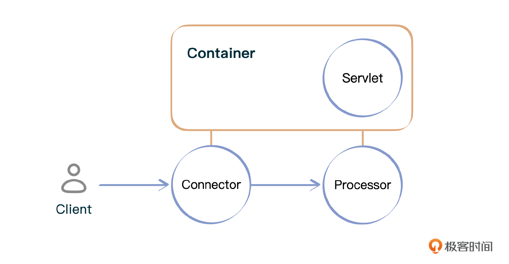

# 10 | ServletWrapper：如何维护Servlet生命周期及实现容器管理？

你好，我是郭屹。今天我们继续手写 MiniTomcat。

上节课我们把 Request 和 Response 从无状态变成了有状态，实现了 Session 和 Cookie 的管理，还实现了同一页面的资源请求复用 Socket，减少了性能消耗。

到目前为止，我们已经基本将浏览器与服务器之间的通信处理完毕。接下来我们再看后端服务器，现在我们还是使用 ServletProcessor 简单地调用 Servlet 的 service 方法，接下来我们考虑将其扩展，对 Servlet 进行管理，这就引入了 Container 容器的概念。我们计划让Container 和 Connector 配合在一起工作，前者负责后端 Servlet 管理，而后者则负责通信管理。



初步构建容器后，我们还会考虑使用 Wrapper 进行包装，用于维护 Servlet 的生命周期：初始化、提供服务、销毁这个全过程，把 Servlet 完全纳入程序自动管理之中，让应用程序员更少地感知到底层的配置，更专注于业务逻辑本身。

接下来我们一起来动手实现。

## 项目结构

这节课我们新增 ServletContainer 与 ServletWrapper 两个类，分别定义 Container 与Wrapper，你可以看一下现在的程序结构。

```
MiniTomcat
├─ src
│  ├─ main
│  │  ├─ java
│  │  │  ├─ server
│  │  │  │  ├─ CookieTools.java
│  │  │  │  ├─ DefaultHeaders.java
│  │  │  │  ├─ HttpConnector.java
│  │  │  │  ├─ HttpHeader.java
│  │  │  │  ├─ HttpProcessor.java
│  │  │  │  ├─ HttpRequest.java
│  │  │  │  ├─ HttpRequestFacade.java
│  │  │  │  ├─ HttpRequestLine.java
│  │  │  │  ├─ HttpResponse.java
│  │  │  │  ├─ HttpResponseFacade.java
│  │  │  │  ├─ HttpServer.java
│  │  │  │  ├─ Request.java
│  │  │  │  ├─ ServletContainer.java
│  │  │  │  ├─ Response.java
│  │  │  │  ├─ ServletProcessor.java
│  │  │  │  ├─ ServletWrapper.java
│  │  │  │  ├─ Session.java
│  │  │  │  ├─ SessionFacade.java
│  │  │  │  ├─ SocketInputStream.java
│  │  │  │  ├─ StatisResourceProcessor.java
│  │  ├─ resources
│  ├─ test
│  │  ├─ java
│  │  │  ├─ test
│  │  │  │  ├─ HelloServlet.java
│  │  │  │  ├─ TestServlet.java
│  │  ├─ resources
├─ webroot
│  ├─ test
│  │  ├─ HelloServlet.class
│  │  ├─ TestServlet.class
│  ├─ hello.txt
├─ pom.xml
```

## Container——Servlet 管理容器

在改造之前，我们先关注一下整个 Server 的启动类——HttpServer。目前，我们的启动类是比较简单的，main 函数内只有两行。

```java
package server;
public class HttpServer {
   public static void main(String[] args) {
       HttpConnector connector = new HttpConnector();
       connector.start();
   }
}
```

通过代码可以知道，我们 Server 的起点就是 HttpConnector，所以之前对 Servlet 的管理也全是交由 Connector 进行处理，不过这并不好，角色混合了。所以接下来我们要做的，就是引入Container 容器这个概念，将 Servlet 管理和网络通信功能一分为二。

首先是定义 ServletContainer 类。

```java
package server;
//Servlet容器
public class ServletContainer {
   HttpConnector connector = null;
   ClassLoader loader = null;
   //包含servlet类和实例的map
   Map<String,String> servletClsMap = new ConcurrentHashMap<>(); //servletName -
   Map<String,Servlet> servletInstanceMap = new ConcurrentHashMap<>();//servletN
   public ServletContainer() {
       try {
           // create a URLClassLoader
           URL[] urls = new URL[1];
           URLStreamHandler streamHandler = null;
           File classPath = new File(HttpServer.WEB_ROOT);
           String repository = (new URL("file", null, classPath.getCanonicalPath
           urls[0] = new URL(null, repository, streamHandler);
           loader = new URLClassLoader(urls);
       } catch (IOException e) {
           System.out.println(e.toString() );
       }
   }
   public String getInfo() {
       return null;
   }
   public ClassLoader getLoader(){
       return this.loader;
   }
   public void setLoader(ClassLoader loader) {
       this.loader = loader;
   }
   public HttpConnector getConnector() {
       return connector;
   }
   public void setConnector(HttpConnector connector) {
       this.connector = connector;
   }
   public String getName() {
       return null;
   }
   public void setName(String name) {
   }
   //invoke方法用于从map中找到相关的servlet，然后调用
   public void invoke(HttpRequest request, HttpResponse response)
           throws IOException, ServletException {
       Servlet servlet = null;
       ClassLoader loader = getLoader();
       String uri = request.getUri();
       String servletName = uri.substring(uri.lastIndexOf("/") + 1);
       String servletClassName = servletName;
       servlet = servletInstanceMap.get(servletName);
       //如果容器内没有这个servlet，先要load类，创建新实例
       if (servlet == null) {
           Class<?> servletClass = null;
           try {
               servletClass = loader.loadClass(servletClassName);
           } catch (ClassNotFoundException e) {
               System.out.println(e.toString());
           }
           try {
               servlet = (Servlet) servletClass.newInstance();
           } catch (InstantiationException e) {
               e.printStackTrace();
           } catch (IllegalAccessException e) {
               e.printStackTrace();
           }
           servletClsMap.put(servletName, servletClassName);
           servletInstanceMap.put(servletName, servlet);
           //按照规范，创建新实例的时候需要调用init()
           servlet.init(null);
       }
       //然后调用service()
       try {
           HttpRequestFacade requestFacade = new HttpRequestFacade(request);
           HttpResponseFacade responseFacade = new HttpResponseFacade(response);
           System.out.println("Call service()");
           servlet.service(requestFacade, responseFacade);
       }
       catch (Exception e) {
           System.out.println(e.toString());
       }
       catch (Throwable e) {
           System.out.println(e.toString());
       }
   }
}
```

从 ServletContainer 的代码里，我们又看到了熟悉的面孔——ClassLoader，此前将ClassLoader 直接交由 HttpConnector 管理，定义了域。

```java
public static URLClassLoader loader = null;
```

现在进行改造，用新创建的 ServletContainer 类管理 ClassLoader，并提供对应的

```
getLoader() 和 setLoader() 方法，同时也将原来在 ServletProcessor 内调用 Servlet 的
代码挪到 ServletContainer 的 invoke() 方法中。
之前在调用 invoke() 方法时，每次都是加载 Servlet 的类进行实例化，并调用 service 方
```

法，在这里我们进一步把 Servlet 放到 Map 中存起来，包含多 Servlet 实例，其中servletClsMap 用于存储 Servlet 名称与 Servlet 类名的映射关系，而 servletInstanceMap 用于存储 Servlet 名称与具体 Servlet 对象的映射关系。

```
这样改造后，当 invoke() 方法被调用时，如果有 Servlet 实例，就直接调用 service()，
如果没有实例，就加载并创建实例，并调用 init() 进行初始化工作。
```

现在 ServletProcessor 可以尽可能地简化了，你可以看一下简化后的代码。

```java
package server;
public class ServletProcessor {
   private HttpConnector connector;
   public ServletProcessor(HttpConnector connector) {
       this.connector = connector;
   }
   public void process(HttpRequest request, HttpResponse response) throws IOExce
       this.connector.getContainer().invoke(request, response);
   }
}
```

在 ServletProcessor 中我们定义了传入 Connector 的构造函数，所以在 Processor 代码中，需要调整初始化 Processor 的代码。

```
if (request.getUri().startsWith("/servlet/")) {
   ServletProcessor processor = new ServletProcessor(this.connector);
   processor.process(request, response);
}
```

接下来，我们再转向 HttpConnector。在定义了 Container 之后，自然地，要把 Container 和Connector 结合起来，我们在 HttpConnector 中改一下代码。

```java
package server;
public class HttpConnector implements Runnable {
   int minProcessors = 3;
   int maxProcessors = 10;
   int curProcessors = 0;
   Deque<HttpProcessor> processors = new ArrayDeque<>();
   public static Map<String, HttpSession> sessions = new ConcurrentHashMap<>();
   //这是与connector相关联的container
   ServletContainer container = null;
   public void run() {
       ServerSocket serverSocket = null;
       int port = 8080;
       try {
           serverSocket = new ServerSocket(port, 1, InetAddress.getByName("127.0
       } catch (IOException e) {
           e.printStackTrace();
           System.exit(1);
       }
       // initialize processors pool
       for (int i = 0; i < minProcessors; i++) {
           HttpProcessor initprocessor = new HttpProcessor(this);
           initprocessor.start();
           processors.push(initprocessor);
       }
       curProcessors = minProcessors;
       while (true) {
           Socket socket = null;
           try {
               socket = serverSocket.accept();
               HttpProcessor processor = createProcessor();
               if (processor == null) {
                   socket.close();
                   continue;
               }
               processor.assign(socket);
               // Close the socket
//                socket.close();
           } catch (Exception e) {
               e.printStackTrace();
           }
       }
   }
   public void start() {
       Thread thread = new Thread(this);
       thread.start();
   }
   public ServletContainer getContainer() {
       return container;
   }
   public void setContainer(ServletContainer container) {
       this.container = container;
   }
}
```

上述代码中，新增了 ServletContainer 类型的 container 属性，添加了对应

```
getContainer() 与 setContainer() 方法，移除了原本处理 Classloader 的相关代码。
```

这个时候，我们就可以调整 HttpServer 里的代码，拆分功能了。

```java
package server;
public class HttpServer {
   public static final String WEB_ROOT =
           System.getProperty("user.dir") + File.separator + "webroot";
   public static void main(String[] args) {
       //创建connector和container
       HttpConnector connector = new HttpConnector();
       ServletContainer container = new ServletContainer();
       //connector和container互相指引
       connector.setContainer(container);
       container.setConnector(connector);
       connector.start();
   }
}
```

这里我们进一步拆分了 HttpConnector，做到了 ServletContainer 管理 Servlet，HttpConnector 负责通信管理，各司其职。

到这里，我想多说几句。软件结构应该怎么进行拆分？我们可以直观地将一个软件当成一个公司或者一个团体，里面有很多岗位和人，如果在公司里需要将某一个工作专门交由专人负责，就可以设置一个岗位，类比软件结构，就是在软件中新添加一个类，一个类就是一个岗位。这种拟人化的思考方式对我们分析软件结构很有帮助。

## Wrapper——增强 Servlet 管理

刚刚我们已经使用 Container 实现了 Servlet 的管理，我们继续关注这一部分，采用 Wrapper包装，用来维护 Servlet 的生命周期。

为什么需要这么一个 Wrapper 呢？从功能角度，不引入它也是没有问题的。但是如果没有Wrapper，我们就得在 Container 这个容器里直接管理 Servlet，这相当于在一个大的纸盒子中直接放上很多小玩具，比较繁琐。

所以超市给了我们一个方案：每个小玩具外面套一个包装，比如小盒子或者是塑料袋子，再将这些小盒子或者袋子放在大纸盒中，方便人们拿取。这个 Wrapper 也是同样的思路。

首先我们来定义 ServletWrapper 类。

```java
package server;
public class ServletWrapper {
   private Servlet instance = null;
   private String servletClass;
   private ClassLoader loader;
   private String name;
   protected ServletContainer parent = null;
   public ServletWrapper(String servletClass, ServletContainer parent) {
       this.parent = parent;
       this.servletClass = servletClass;
       try {
           loadServlet();
       } catch (ServletException e) {
           e.printStackTrace();
       }
   }
   public ClassLoader getLoader() {
       if (loader != null)
           return loader;
       return parent.getLoader();
   }
   public String getServletClass() {
       return servletClass;
   }
   public void setServletClass(String servletClass) {
       this.servletClass = servletClass;
   }
   public ServletContainer getParent() {
       return parent;
   }
   public void setParent(ServletContainer container) {
       parent = container;
   }
   public Servlet getServlet(){
       return this.instance;
   }
   public Servlet loadServlet() throws ServletException {
       if (instance!=null)
           return instance;
       Servlet servlet = null;
       String actualClass = servletClass;
       if (actualClass == null) {
           throw new ServletException("servlet class has not been specified");
       }
       ClassLoader classLoader = getLoader();
       Class classClass = null;
       try {
           if (classLoader!=null) {
               classClass = classLoader.loadClass(actualClass);
           }
       }
       catch (ClassNotFoundException e) {
           throw new ServletException("Servlet class not found");
       }
       try {
           servlet = (Servlet) classClass.newInstance();
       }
       catch (Throwable e) {
           throw new ServletException("Failed to instantiate servlet");
       }
       try {
           servlet.init(null);
       }
       catch (Throwable f) {
           throw new ServletException("Failed initialize servlet.");
       }
       instance =servlet;
       return servlet;
   }
   public void invoke(HttpServletRequest request, HttpServletResponse response)
           throws IOException, ServletException {
       if (instance != null) {
           instance.service(request, response);
       }
   }
}
在 ServletWrapper 类中，核心在于 loadServlet() 方法，主要是通过一个 Classloader 加
载并实例化 Servlet，然后调用 init() 方法进行初始化工作，其实也是刚刚我们在
```

ServletContainer 中的处理。所以在 ServletContainer 类里，我们可以进一步改造，将一些对Servlet 的处理交给 ServletWrapper 进行。

首先是 servletInstanceMap，Value 类型可设置成更高层次的 ServletWrapper，你可以看一下修改后的样子。

```
Map<String,ServletWrapper> servletInstanceMap = new ConcurrentHashMap<>();
```

其次是调整 invoke 方法，你可以看一下调整后的 invoke 方法。

```java
public void invoke(HttpRequest request, HttpResponse response)
       throws IOException, ServletException {
   ServletWrapper servletWrapper = null;
   String uri = request.getUri();
   String servletName = uri.substring(uri.lastIndexOf("/") + 1);
   String servletClassName = servletName;
   servletWrapper = servletInstanceMap.get(servletName);
   if ( servletWrapper == null) {
       servletWrapper = new ServletWrapper(servletClassName,this);
       //servletWrapper.setParent(this);
       this.servletClsMap.put(servletName, servletClassName);
       this.servletInstanceMap.put(servletName, servletWrapper);
   }
   try {
       HttpServletRequest requestFacade = new HttpRequestFacade(request);
       HttpServletResponse responseFacade = new HttpResponseFacade(response);
       System.out.println("Call service()");
       servletWrapper.invoke(requestFacade, responseFacade);
   }
   catch (Exception e) {
       System.out.println(e.toString());
   }
   catch (Throwable e) {
       System.out.println(e.toString());
   }
}
```

这样在 ServletContainer 中，只是获取到 ServletWrapper 的实例，调用 ServletWrapper 内的

```
invoke() 方法，进一步进行了解耦。
```

## 测试

这节课并没有功能性的变化，所以没有新增测试类，还是和之前的测试方式保持一致。这里就不重复说了。

## 小结

这节课我们实现了 ServletContainer 管理全部的 Servlet，将原本的管理功能从 Connector 内抽离，让 Connector 专注服务器通信管理。这个 Container 就是我们 MiniTomcat 初始容器，它里面有一个 map，包含了管理的 Servlet 实例。有了这个 Container，Processor 就变得简

```
单了，它里面的新方法 process() 只需要调用 Container 的 invoke() 就可以了。
```

同时，我们引入 ServletWrapper，对 ServletContainer 做了更进一步的拆分，更加方便对Servlet 进行管理。今后，我们会把 Container 进一步拆成多层。

本节课代码参见：https://gitee.com/yaleguo1/minit-learning-demo/tree/geek_chapter10

## 思考题

学完了这节课的内容，我们来思考一个问题：现在这个 HttpServer 仅仅只是创建 Connector和 Container，只是一个壳子了，按照拟人化的思路，HttpServer 应该是一个公司，那么这个类从道理上还应该分工负责做些什么？

欢迎你把你思考后的结果分享到评论区，也欢迎你把这节课的内容分享给其他朋友，我们下节课再见！
