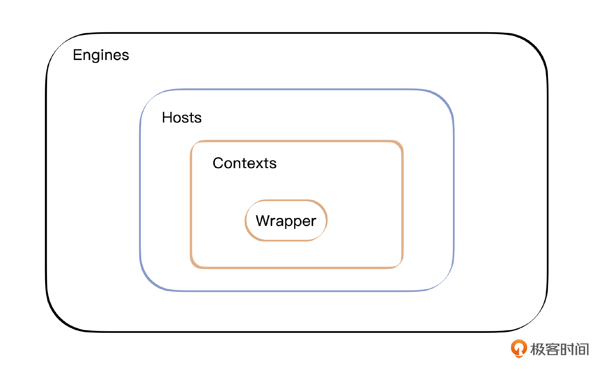

# 11 | 多层容器：如何通过实现Context与Wrapper形成多层容器？

你好，我是郭屹。今天我们继续手写 MiniTomcat。

上一节课结束后，我们引入了 Container 对 Servlet 进行管理，将原本的 Connector 功能职责进行拆分，让它专门负责通信的管理。并且在第二个部分中，把 Container 进一步封装成Wrapper，实现 Servlet 更加精确、完善的管理。

事实上，Tomcat 把 Wrapper 也看作一种容器，也就是隶属于 Context 之下的子容器（ChildContainer），所以在原理上是存在多层容器的。一个 Server 对外提供 HTTP 服务，它的内部支持管理多个虚拟主机，而每个虚拟主机下又有多个应用，在每个应用内又包含多个Servlet。因此 Container 存在多个，属于层层嵌套的关系。



按照 Tomcat 官方的定义，自外向内分别分为 Engine 层、Host 层、Context 层与 Wrapper层。我们也参考这个思路，把 ServletContainer 改成 Context，但是我们不打算实现 Engine和 Host，只用两层 Container。

不考虑使用这么多层 Container 的主要原因在于，Engine 与 Host 本身的结构复杂，而且其思想已经不再符合现在的主流，现在我们使用了容器技术之后，Engine 和 Host 的概念已经弱化很多了。实际上，当我们部署的时候，一个 Tomcat 一般就只用一个 Engine 和一个 Host，如果需要多个，就用多个容器。用 Context 和 Wrapper 两层容器也可以明白地说明 Tomcat 的多层容器的概念。

实现了这些功能之后，我们的 MiniTomcat 也变得有模有样了。但是如果所有的类全部都放在Server 包下，显然是不合适的，所以我们还会参考实际的 Tomcat 项目结构，把各部分代码文件分门别类地整理好。

接下来我们一起来动手实现。

## 项目结构

这节课的项目结构中我们新增 Container 接口和 ContainerBase 两个文件，把原来的ServletContainer 改名为 ServletContext，其他的暂时没有什么变化。

```
MiniTomcat
├─ src
│  ├─ main
│  │  ├─ java
│  │  │  ├─ server
│  │  │  │  ├─ Container.java
│  │  │  │  ├─ ContainerBase.java
│  │  │  │  ├─ CookieTools.java
│  │  │  │  ├─ DefaultHeaders.java
│  │  │  │  ├─ HttpConnector.java
│  │  │  │  ├─ HttpHeader.java
│  │  │  │  ├─ HttpProcessor.java
│  │  │  │  ├─ HttpRequest.java
│  │  │  │  ├─ HttpRequestFacade.java
│  │  │  │  ├─ HttpRequestLine.java
│  │  │  │  ├─ HttpResponse.java
│  │  │  │  ├─ HttpResponseFacade.java
│  │  │  │  ├─ HttpServer.java
│  │  │  │  ├─ Request.java
│  │  │  │  ├─ Response.java
│  │  │  │  ├─ ServletContext.java
│  │  │  │  ├─ ServletProcessor.java
│  │  │  │  ├─ ServletWrapper.java
│  │  │  │  ├─ Session.java
│  │  │  │  ├─ SessionFacade.java
│  │  │  │  ├─ SocketInputStream.java
│  │  │  │  ├─ StatisResourceProcessor.java
│  │  ├─ resources
│  ├─ test
│  │  ├─ java
│  │  │  ├─ test
│  │  │  │  ├─ HelloServlet.java
│  │  │  │  ├─ TestServlet.java
│  │  ├─ resources
├─ webroot
│  ├─ test
│  │  ├─ HelloServlet.class
│  │  ├─ TestServlet.class
│  ├─ hello.txt
├─ pom.xml
```

## Context 结构改造

基于之前的积累，我们先进行一层抽象，定义一个 Container 类。

```java
package server;
public interface Container {
   public static final String ADD_CHILD_EVENT = "addChild";
   public static final String REMOVE_CHILD_EVENT = "removeChild";
   public String getInfo();
   public ClassLoader getLoader();
   public void setLoader(ClassLoader loader);
   public String getName();
   public void setName(String name);
   public Container getParent();
   public void setParent(Container container);
   public void addChild(Container child);
   public Container findChild(String name);
   public Container[] findChildren();
   public void invoke(HttpServletRequest request, HttpServletResponse response)
           throws IOException, ServletException;
   public void removeChild(Container child);
}
```

可以看到有 Classloader 的操作方法、Child 和 Parent 的操作方法，还有 invoke 等基础方法。

因为存在多层 Container，很多特性是共有的，所以我们再定义 ContainerBase 作为基础类，你可以看一下 ContainerBase 的定义。

```java
package server;
import java.util.Map;
import java.util.concurrent.ConcurrentHashMap;
public abstract class ContainerBase implements Container {
   //子容器
   protected Map<String, Container> children = new ConcurrentHashMap<>();
   //类加载器
   protected ClassLoader loader = null;
   protected String name = null;
   //父容器
   protected Container parent = null;
   //下面是基本的get和set方法
   public abstract String getInfo();
   public ClassLoader getLoader() {
       if (loader != null)
           return (loader);
       if (parent != null)
           return (parent.getLoader());
       return (null);
   }
   public synchronized void setLoader(ClassLoader loader) {
       ClassLoader oldLoader = this.loader;
       if (oldLoader == loader) {
           return;
       }
       this.loader = loader;
   }
   public String getName() {
       return (name);
   }
   public void setName(String name) {
       this.name = name;
   }
   public Container getParent() {
       return (parent);
   }
   public void setParent(Container container) {
       Container oldParent = this.parent;
       this.parent = container;
   }
   //下面是对children map的增删改查操作
   public void addChild(Container child) {
       addChildInternal(child);
   }
   private void addChildInternal(Container child) {
       synchronized(children) {
           if (children.get(child.getName()) != null)
               throw new IllegalArgumentException("addChild:  Child name '" +
                       child.getName() +
                       "' is not unique");
           child.setParent((Container) this);
           children.put(child.getName(), child);
       }
   }
   public Container findChild(String name) {
       if (name == null)
           return (null);
       synchronized (children) {       // Required by post-start changes
           return ((Container) children.get(name));
       }
   }
   public Container[] findChildren() {
       synchronized (children) {
           Container results[] = new Container[children.size()];
           return ((Container[]) children.values().toArray(results));
       }
   }
   public void removeChild(Container child) {
       synchronized(children) {
           if (children.get(child.getName()) == null)
               return;
           children.remove(child.getName());
       }
       child.setParent(null);
   }
}
```

通过上面这段代码，我们实现了 Container 接口，提供了部分方法的通用实现。

接下来要做的，就是把 ServletContainer 更名为 ServletContext，我们需要改动几处内容。

第一处：HttpServer.java

```java
public class HttpServer {
   public static final String WEB_ROOT =
           System.getProperty("user.dir") + File.separator + "webroot";
   public static void main(String[] args) {
       HttpConnector connector = new HttpConnector();
       ServletContext container = new ServletContext();
       connector.setContainer(container);
       container.setConnector(connector);
       connector.start();
   }
}
```

这里的 Container 替换为 ServletContext 类了。

第二处：HttpConnector.java

```java
public class HttpConnector implements Runnable {
   ServletContext container = null;
   public ServletContext getContainer() {
       return container;
   }
   public void setContainer(ServletContext container) {
       this.container = container;
   }
}
```

第三处：ServletWrapper.java

```java
public class ServletWrapper extends ContainerBase{
   private Servlet instance = null;
   private String servletClass;
   public ServletWrapper(String servletClass,ServletContext parent) {
       this.parent = parent;
       this.servletClass = servletClass;
       try {
           loadServlet();
       } catch (ServletException e) {
           e.printStackTrace();
       }
   }
}
```

ServletContext 是 Wrapper 的 parent。

调整完类名之后，我们让 ServletContext 继承 ContainerBase 基类，ServletWrapper 也可以算作 Container，所以也继承 ContainerBase 基类。

首先是 ServletContext.java，你可以看一下我们调整的部分。

```java
package server;
import javax.servlet.ServletException;
import javax.servlet.http.HttpServletRequest;
import javax.servlet.http.HttpServletResponse;
import java.io.File;
import java.io.IOException;
import java.net.URL;
import java.net.URLClassLoader;
import java.net.URLStreamHandler;
import java.util.Map;
import java.util.concurrent.ConcurrentHashMap;
public class ServletContext extends ContainerBase{
   //与本容器关联的connector
   HttpConnector connector = null;
   //内部管理的servlet类和实例
   Map<String,String> servletClsMap = new ConcurrentHashMap<>(); //servletName -
   Map<String,ServletWrapper> servletInstanceMap = new ConcurrentHashMap<>();//s
   public ServletContext() {
       try {
           // create a URLClassLoader
           URL[] urls = new URL[1];
           URLStreamHandler streamHandler = null;
           File classPath = new File(HttpServer.WEB_ROOT);
           String repository = (new URL("file", null, classPath.getCanonicalPath
           urls[0] = new URL(null, repository, streamHandler);
           loader = new URLClassLoader(urls);
       } catch (IOException e) {
           System.out.println(e.toString() );
       }
   }
   public String getInfo() {
       return "Minit Servlet Context, vesion 0.1";
   }
   public HttpConnector getConnector() {
       return connector;
   }
   public void setConnector(HttpConnector connector) {
       this.connector = connector;
   }
   //调用servlet的方法
   public void invoke(HttpServletRequest request, HttpServletResponse response)
           throws IOException, ServletException {
       ServletWrapper servletWrapper = null;
       String uri = ((HttpRequest)request).getUri();
       String servletName = uri.substring(uri.lastIndexOf("/") + 1);
       String servletClassName = servletName;
       //从容器中获取servlet wrapper
       servletWrapper = servletInstanceMap.get(servletName);
       if ( servletWrapper == null) {
           servletWrapper = new ServletWrapper(servletClassName,this);
           //servletWrapper.setParent(this);
           this.servletClsMap.put(servletName, servletClassName);
           this.servletInstanceMap.put(servletName, servletWrapper);
       }
       //将调用传递到下层容器即wrapper中
       try {
           HttpServletRequest requestFacade = new HttpRequestFacade(request);
           HttpServletResponse responseFacade = new HttpResponseFacade(response)
           System.out.println("Call service()");
           servletWrapper.invoke(requestFacade, responseFacade);
       }
       catch (Exception e) {
           System.out.println(e.toString());
       }
       catch (Throwable e) {
           System.out.println(e.toString());
       }
   }
}
```

上述代码中，HttpRequestFacade 和 HttpResponseFacade 两个类的构造函数的入参和invoke 方法保持一致，也需要对应地做一些调整。

```java
package server;
public class HttpRequestFacade implements HttpServletRequest {
   public HttpRequestFacade(HttpServletRequest request) {
       this.request = request;
   }
}
package server;
public class HttpResponseFacade implements HttpServletResponse {
   public HttpResponseFacade(HttpServletResponse response) {
       this.response = response;
   }
}
```

接下来我们关注一下 ServletWrapper 类的调整。

```java
package server;
public class ServletWrapper extends ContainerBase{
   //wrapper内含了一个servlet实例和类
   private Servlet instance = null;
   private String servletClass;
   public ServletWrapper(String servletClass,ServletContext parent) {
       //以ServletContext为parent
       this.parent = parent;
       this.servletClass = servletClass;
       try {
           loadServlet();
       } catch (ServletException e) {
           e.printStackTrace();
       }
   }
   public String getServletClass() {
       return servletClass;
   }
   public void setServletClass(String servletClass) {
       this.servletClass = servletClass;
   }
   public Servlet getServlet(){
       return this.instance;
   }
   //load servlet类，创建新实例，并调用init()方法
   public Servlet loadServlet() throws ServletException {
       if (instance!=null)
           return instance;
       Servlet servlet = null;
       String actualClass = servletClass;
       if (actualClass == null) {
           throw new ServletException("servlet class has not been specified");
       }
       ClassLoader classLoader = getLoader();
       Class classClass = null;
       try {
           if (classLoader!=null) {
               classClass = classLoader.loadClass(actualClass);
           }
       }
       catch (ClassNotFoundException e) {
           throw new ServletException("Servlet class not found");
       }
       try {
           servlet = (Servlet) classClass.newInstance();
       }
       catch (Throwable e) {
           throw new ServletException("Failed to instantiate servlet");
       }
       try {
           servlet.init(null);
       }
       catch (Throwable f) {
           throw new ServletException("Failed initialize servlet.");
       }
       instance =servlet;
       return servlet;
   }
   //wrapper是最底层容器，调用将转化为service()方法
   public void invoke(HttpServletRequest request, HttpServletResponse response)
           throws IOException, ServletException {
       if (instance != null) {
           instance.service(request, response);
       }
   }
   @Override
   public String getInfo() {
       return "Minit Servlet Wrapper, version 0.1";
   }
   public void addChild(Container child) {}
   public Container findChild(String name) {return null;}
   public Container[] findChildren() {return null;}
   public void removeChild(Container child) {}
}
```

ServletWrapper 继承了 ContainerBase 抽象类，主要有两个变化。

1. 原本定义的 loader、name、parent 域直接使用 ContainerBase 里的定义。

2. 实现 getInfo、addChild、findChild、findChildren、removeChild 方法。

到这里我们就改造完了。

## 向 Tomcat 目录对齐

在这一部分我们开始参考 Tomcat 的目录结构，来梳理 MiniTomcat 的程序结构。在 Tomcat 的项目结构中，主要的类都放在 org.apache.catalina 包里，基本的子包有 startup、core、connector、loader、logger、session 和 util 等等。

我们也参考这个结构，把大的包命名为 com.minit，在这个包下构建 startup、core、connector、loader、logger、session、util 多个子包。

为了更加规范，我们在 com.minit 包下新增几个接口：Connector、Context、Wrapper、Request、Response、Session、Container。其中 Container 直接复用之前定义的同名接口，原本定义的 Request 与 Response 两个类不再需要使用，可以直接删除。

同时，修改下面这些类的名字并实现上述接口，尽可能和 Tomcat 保持一致。

```
ServletContext改为StandardContext
ServletWrapper改为StandardWrapper
Session改为StandardSession
SessionFacade改为StandardSessionFacade
HttpRequest改为HttpRequestImpl
HttpResponse改为HttpResponseImpl
HttpServer改为Bootstrap
```

改造后的项目结构如下：

```
MiniTomcat
├─ src
│  ├─ main
│  │  ├─ java
│  │  │  ├─ com
│  │  │  │  ├─ minit
│  │  │  │  │  ├─ connector
│  │  │  │  │  │  ├─ http
│  │  │  │  │  │  │  ├─ DefaultHeaders.java
│  │  │  │  │  │  │  ├─ HttpConnector.java
│  │  │  │  │  │  │  ├─ HttpHeader.java
│  │  │  │  │  │  │  ├─ HttpProcessor.java
│  │  │  │  │  │  │  ├─ HttpRequestImpl.java
│  │  │  │  │  │  │  ├─ HttpRequestLine.java
│  │  │  │  │  │  │  ├─ HttpResponseImpl.java
│  │  │  │  │  │  │  ├─ ServletProcessor.java
│  │  │  │  │  │  │  ├─ SocketInputStream.java
│  │  │  │  │  │  │  ├─ StatisResourceProcessor.java
│  │  │  │  │  │  ├─ HttpRequestFacade.java
│  │  │  │  │  │  ├─ HttpResponseFacade.java
│  │  │  │  │  ├─ core
│  │  │  │  │  │  ├─ ContainerBase.java
│  │  │  │  │  │  ├─ StandardContext.java
│  │  │  │  │  │  ├─ StandardWrapper.java
│  │  │  │  │  ├─ logger
│  │  │  │  │  ├─ session
│  │  │  │  │  │  ├─ StandardSession.java
│  │  │  │  │  │  ├─ StandardSessionFacade.java
│  │  │  │  │  ├─ startup
│  │  │  │  │  │  ├─ Bootstrap.java
│  │  │  │  │  ├─ util
│  │  │  │  │  │  ├─ CookieTools.java
│  │  │  │  ├─ Connector.java
│  │  │  │  ├─ Container.java
│  │  │  │  ├─ Contexts.java
│  │  │  │  ├─ Request.java
│  │  │  │  ├─ Responses.java
│  │  │  │  ├─ Session.java
│  │  │  │  ├─ Wrapper.java
│  │  ├─ resources
│  ├─ test
│  │  ├─ java
│  │  │  ├─ test
│  │  │  │  ├─ HelloServlet.java
│  │  │  │  ├─ TestServlet.java
│  │  ├─ resources
├─ webroot
│  ├─ test
│  │  ├─ HelloServlet.class
│  │  ├─ TestServlet.class
│  ├─ hello.txt
├─ pom.xml
```

接下来我们分别定义 Connector、Context、Wrapper、Request、Response、Session 这几个接口。

Connector.java：

```java
package com.minit;
public interface Connector {
   public Container getContainer();
   public void setContainer(Container container);
   public String getInfo();
   public String getScheme();
   public void setScheme(String scheme);
   public Request createRequest();
   public Response createResponse();
   public void initialize();
}
```

Context.java：

```java
package com.minit;
public interface Context extends Container {
   public static final String RELOAD_EVENT = "reload";
   public String getDisplayName();
   public void setDisplayName(String displayName);
   public String getDocBase();
   public void setDocBase(String docBase);
   public String getPath();
   public void setPath(String path);
   public ServletContext getServletContext();
   public int getSessionTimeout();
   public void setSessionTimeout(int timeout);
   public String getWrapperClass();
   public void setWrapperClass(String wrapperClass);
   public Wrapper createWrapper();
   public String findServletMapping(String pattern);
   public String[] findServletMappings();
   public void reload();
}
```

Wrapper.java：

```java
package com.minit;
public interface Wrapper {
   public int getLoadOnStartup();
   public void setLoadOnStartup(int value);
   public String getServletClass();
   public void setServletClass(String servletClass);
   public void addInitParameter(String name, String value);
   public Servlet allocate() throws ServletException;
   public String findInitParameter(String name);
   public String[] findInitParameters();
   public void load() throws ServletException;
   public void removeInitParameter(String name);
}
```

Request.java：

```java
package com.minit;
public interface Request {
   public Connector getConnector();
   public void setConnector(Connector connector);
   public Context getContext();
   public void setContext(Context context);
   public String getInfo();
   public ServletRequest getRequest();
   public Response getResponse();
   public void setResponse(Response response);
   public Socket getSocket();
   public void setSocket(Socket socket);
   public InputStream getStream();
   public void setStream(InputStream stream);
   public Wrapper getWrapper();
   public void setWrapper(Wrapper wrapper);
   public ServletInputStream createInputStream() throws IOException;
   public void finishRequest() throws IOException;
   public void recycle();
   public void setContentLength(int length);
   public void setContentType(String type);
   public void setProtocol(String protocol);
   public void setRemoteAddr(String remote);
   public void setScheme(String scheme);
   public void setServerPort(int port);
}
```

Response.java：

```java
package com.minit;
public interface Response {
   public Connector getConnector();
   public void setConnector(Connector connector);
   public int getContentCount();
   public Context getContext();
   public void setContext(Context context);
   public String getInfo();
   public Request getRequest();
   public void setRequest(Request request);
   public ServletResponse getResponse();
   public OutputStream getStream();
   public void setStream(OutputStream stream);
   public void setError();
   public boolean isError();
   public ServletOutputStream createOutputStream() throws IOException;
   public void finishResponse() throws IOException;
   public int getContentLength();
   public String getContentType();
   public PrintWriter getReporter();
   public void recycle();
   public void resetBuffer();
   public void sendAcknowledgement() throws IOException;
}
```

Session.java：

```java
package com.minit;
public interface Session {
   public static final String SESSION_CREATED_EVENT = "createSession";
   public static final String SESSION_DESTROYED_EVENT = "destroySession";
   public long getCreationTime();
   public void setCreationTime(long time);
   public String getId();
   public void setId(String id);
   public String getInfo();
   public long getLastAccessedTime();
   public int getMaxInactiveInterval();
   public void setMaxInactiveInterval(int interval);
   public void setNew(boolean isNew);
   public HttpSession getSession();
   public void setValid(boolean isValid);
   public boolean isValid();
   public void access();
   public void expire();
   public void recycle();
}
```

最后再给 StandardContext、StandardWrapper 和 StandardSession 分别实现 Context、Wrapper 与 Session 接口，这节课的改造就实现完了。最后我们再来看一下调整后需要新增的实现方法。

StandardContext.java：

```java
package com.minit.core;
public class StandardContext extends ContainerBase implements Context {
   @Override
   public String getDisplayName() {
       return null;
   }
   @Override
   public void setDisplayName(String displayName) {
   }
   @Override
   public String getDocBase() {
       return null;
   }
   @Override
   public void setDocBase(String docBase) {
   }
   @Override
   public String getPath() {
       return null;
   }
   @Override
   public void setPath(String path) {
   }
   @Override
   public ServletContext getServletContext() {
       return null;
   }
   @Override
   public int getSessionTimeout() {
       return 0;
   }
   @Override
   public void setSessionTimeout(int timeout) {
   }
   @Override
   public String getWrapperClass() {
       return null;
   }
   @Override
   public void setWrapperClass(String wrapperClass) {
   }
   @Override
   public Wrapper createWrapper() {
       return null;
   }
   @Override
   public String findServletMapping(String pattern) {
       return null;
   }
   @Override
   public String[] findServletMappings() {
       return null;
   }
   @Override
   public void reload() {
   }
}
```

StandardWrapper.java：

```java
package com.minit.core;
public class StandardWrapper extends ContainerBase implements Wrapper {
  @Override
   public int getLoadOnStartup() {
       return 0;
   }
   @Override
   public void setLoadOnStartup(int value) {
   }
   @Override
   public void addInitParameter(String name, String value) {
   }
   @Override
   public Servlet allocate() throws ServletException {
       return null;
   }
   @Override
   public String findInitParameter(String name) {
       return null;
   }
   @Override
   public String[] findInitParameters() {
       return null;
   }
   @Override
   public void load() throws ServletException {
   }
   @Override
   public void removeInitParameter(String name) {
   }
}
```

StandardSession.java：

```java
package com.minit.session;
public class StandardSession implements HttpSession, Session {
  @Override
   public String getInfo() {
       return null;
   }
   @Override
   public void setNew(boolean isNew) {
   }
   @Override
   public HttpSession getSession() {
       return null;
   }
   @Override
   public boolean isValid() {
       return false;
   }
   @Override
   public void access() {
   }
   @Override
   public void expire() {
   }
   @Override
   public void recycle() {
   }
}
```

到这里我们就完成了项目结构的改造，可以看出，MiniTomcat 和 Tomcat 已经长得比较像了。

## 测试

这节课没有新增什么对外的功能，所以测试还是和之前的测试方式一样。

## 小结

这节课我们把项目结构进一步抽象成了两层 Container，分别是 Context 和 Wrapper，Context对应于我们平常所说的一个应用，Wrapper 是对应的一个 Servlet 的包装。在 Context 这个容器中有一个 map 包含了多个 Wrapper，这样构成了父子容器的两层结构。

然后我们进一步通用化，提出 ContainerBase，只要一个类基于 base，就可以当成一个新的容器。通过这些手段实现了一个服务器管理多个容器，而容器又可以管理多个 Servlet，层层嵌套，实现系统结构的扩展和管理清晰化。然后在此基础上，参考 Tomcat 的项目结构，进行对应调整，让它更贴近 Tomcat 源码本身。这样一来，你去阅读 Tomcat 源码，难度就会大大降低。

这节课代码参见：https://gitee.com/yaleguo1/minit-learning-demo/tree/geek_chapter11

## 思考题

学完了这节课的内容，我们来思考一个问题：我们现在的代码中，servletContext 的 invoke()方法仅仅只是简单地调用了子容器 Wrapper 的 invoke()，但是原则上每一层的容器的 invoke()可以另外加入本层容器特殊的逻辑，有没有合适的设计方案？

欢迎你把你想到的方案分享到评论区，也欢迎你把这节课的内容分享给其他朋友，我们下节课再见！
