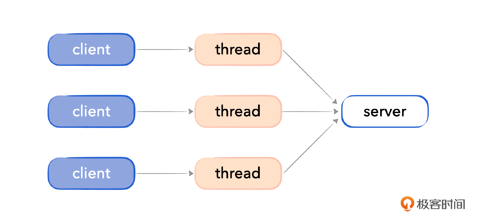
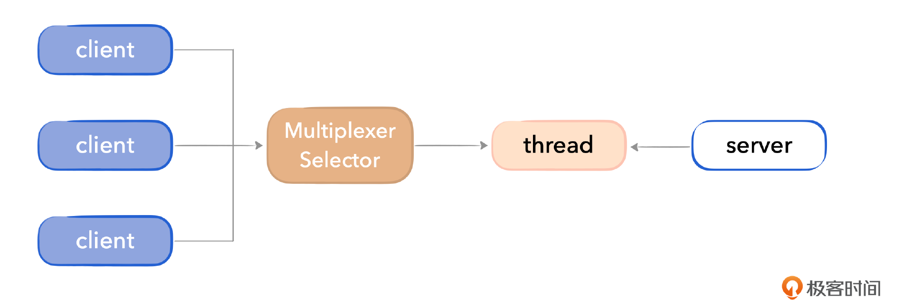
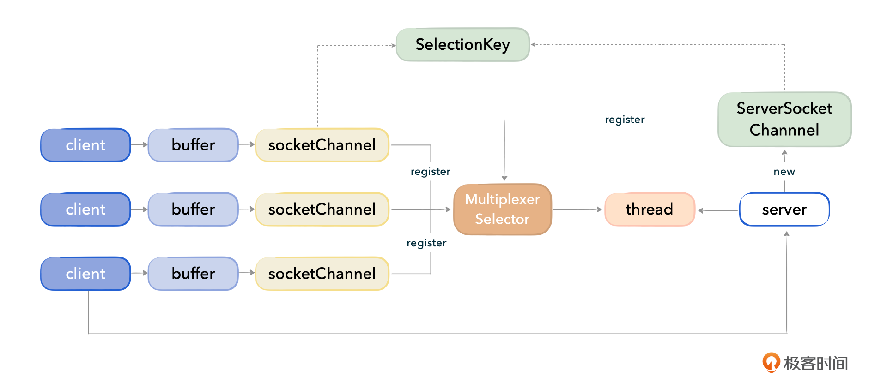
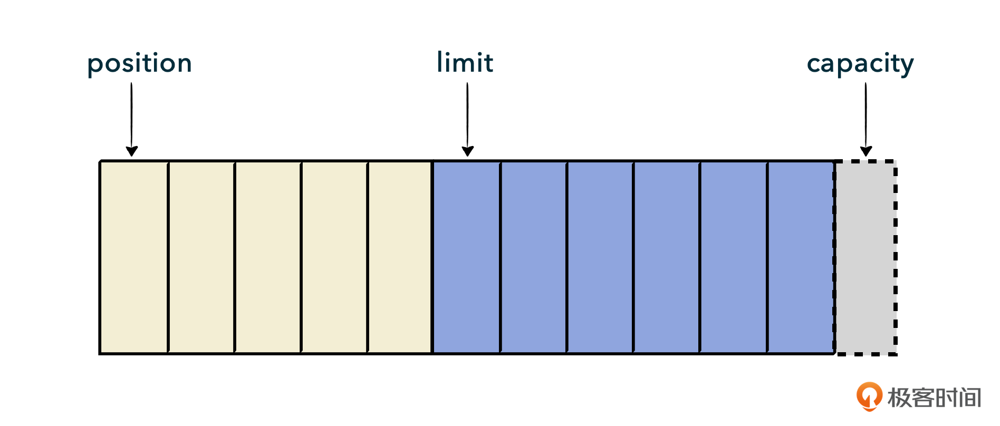
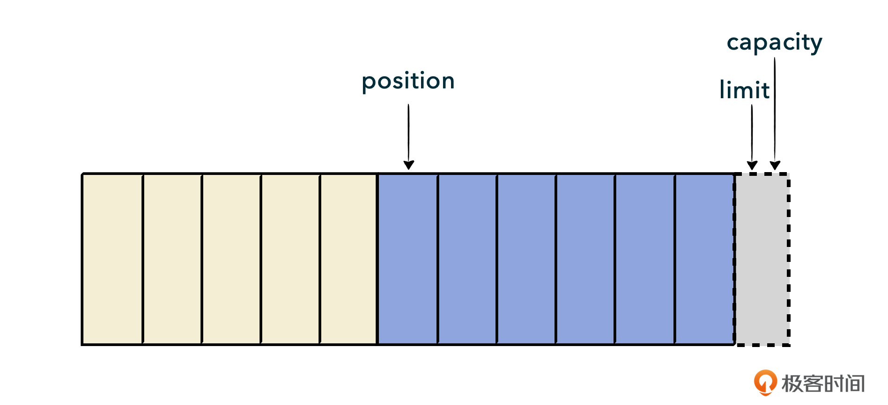
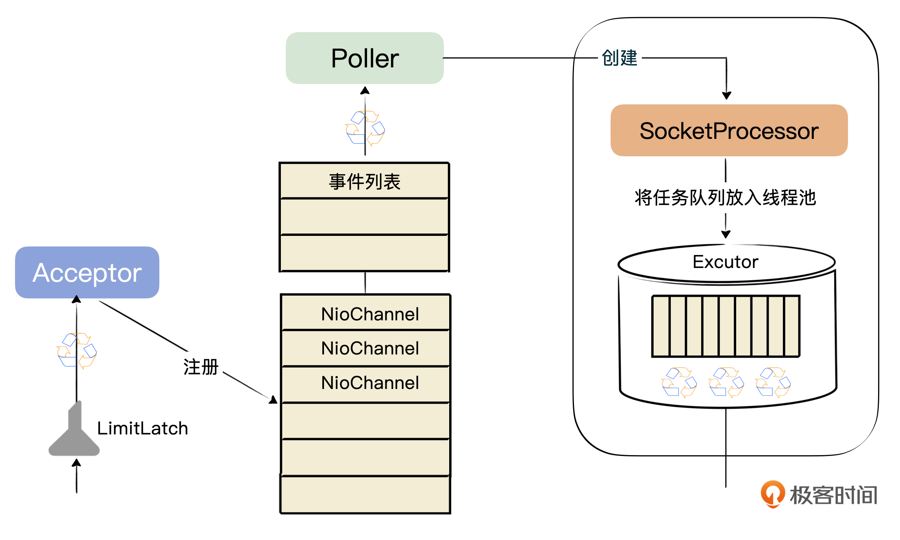

# 18 | 高并发探讨：如何支持NIO？

你好，我是郭屹。今天我们继续手写 MiniTomcat。

上节课，我们已经构造出了 MiniTomcat + MiniSpring 的核心环境。但是我们知道，到目前为止，我们的 MiniTomcat 只实现了 BIO 模式，因此在高并发的情况下它的性能是不高的。我们能想到的一个解决办法就是把网络 BIO 换成 NIO，作为 MiniTomcat 的扩展部分，同时我们也会探讨一下怎么用 NIO 实现网络接口。

## Java 中的 BIO 与 NIO

Java 网络访问的传统模式是 BIO（即在 java.io 包下的类），也就是线程要访问网络的时候，是等着网络 I/O 完成后，才接着运行线程后面的任务，你可以想象成几个任务串行的样子。从线程本身来看，就是在网络 I/O 这里阻塞住了，这也是 BIO 这个词的字面含义。因为线程阻塞住了，意味着一个线程只能响应一个网络请求，如果有多个网络请求就要开多个线程来处理。你可以看一下示意图。



在 BIO 模型下，accept 和 read 都是阻塞的。没有网络连接请求的时候，accept 方法死等，没有数据的时候，read 方法死等。

从处理线程的角度来看，网络 I/O 很耗费时间，而线程还要无所事事地死等着，这是很浪费资源的。我们希望在等待网络 I/O 的过程中可以干点别的，然后回头看看网络 I/O 的结果。这个思路就像我们日常生活中在烧开水的时候，一般是去看看书、看看电视，等到某个时刻再回头看看水烧开了没有。

所以 NIO 就出现了。NIO 叫做 New I/O（在 java.nio 包下），也有人叫它 Non-Blocking I/O，也就是非阻塞式的 I/O。当有网络请求或者读取数据的时候，它获取到目前可用的数据，如果没有数据可用，就什么都不会获取，也不会保持线程阻塞，所以直到数据变得可以读取之前，这个线程都可以继续做其他的事情。这样，一个线程可以处理多个网络操作，反映出来的就是提高了并发度。

图示如下：



在 NIO 模式下，一个线程可以处理多个请求，网络连接请求注册在一个多路选择器上，服务器线程从多路选择器中检查是否有 I/O 事件过来，如果有就处理它。

对比这两种模式，NIO 主要的特征就是让一个线程能支持多个网络请求。NIO 性能一定比 BIO高吗？这个问题没有统一的答案。很多的经验之谈告诉我们，当用户量小的时候，NIO 并没有为系统带来更高的性能。因此，如果我们的目标是构造一个小型系统，直接使用 BIO 可能是一个明智的选择，毕竟 BIO 编程更简单。但是当用户量比较大的时候，BIO 模式响应时间明显变长，这个时候就该发挥 NIO 的优势了。

## BIO 和 NIO 的机制

典型的 BIO 编程流程是这样的：

1. 服务器启动 ServerSocket，调用 accpet() 方法在某个端口监听 Socket 请求。

2. 客户端发起 Socket 连接，服务器对每个请求建立一个线程进行处理。

服务器端 accept 阻塞等待。

```
ServerSocket serverSocket = new ServerSocket(8080);
while(true){
   //accept阻塞，等待网络连接
   Socket socket = serverSocket.accept();
   Thread thread = new ProcessThread(socket);
   thread.start();
}
```

接收数据的时候，read 阻塞死等，直到流结束。

```
InputStream serverInput = socket.getInputStream();
BufferedReader reader = new BufferedReader(new InputStreamReader(serverInput));
String line;
for (; (line = reader.readLine()) != null;) { //read阻塞
   ...
}
```

现在我们的 MiniTomcat 就是这个结构。

典型的 NIO 编程流程是这样的：

1. 服务器启动 ServerSocketChannel，绑定在某个监听端口上。

2. 把 Channel 设置成非阻塞式。

3. 注册 selector。

4. 循环从 selector 中查找网络事件（读写连接），有就进行处理。

你可以看一个细化后的结构图。



典型的服务器启动代码：

```
selector = Selector.open();
serverSocketChannel = ServerSocketChannel.open();
serverSocketChannel.socket().bind(new InetSocketAddress(address,port));
serverSocketChannel.configureBlocking(false); //设置为非阻塞模式
serverSocketChannel.register(selector, SelectionKey.OP_ACCEPT);
```

然后循环等待网络事件处理：

```sql
while (!stop) {
   selector.select(1000); //每秒轮询检查
   //找到所有准备就绪的key
   Set<SelectionKey> selectionKeys = selector.selectedKeys();
   Iterator<SelectionKey> it = selectionKeys.iterator();
   SelectionKey key = null;
   while (it.hasNext()) {
       key = it.next();
       it.remove();
       handle(key); //处理
   }
}
```

当来了一个网络连接的时候，需要这么处理。

```java
public void doAccept(SelectionKey key) throws IOException {
   ServerSocketChannel ssc = (ServerSocketChannel) key.channel();
   SocketChannel sc = (SocketChannel) ssc.accept();
   sc.configureBlocking(false);
   sc.register(selector, SelectionKey.OP_READ);
}
```

accpet 这个网络连接，创建一个 SocketChannel，设置成非阻塞模式，然后注册到 selector上，准备数据读写。

我们用拟人化的方法来理解这个场景。一个银行营业厅有一排服务窗口，开始的时候每个窗口后面都安排了一个服务人员，这个银行经理仔细统计了顾客数量，发现每一个服务窗口大部分时候是空闲的，人员浪费极大，于是经理想办法改进效率。他安装了一个服务灯系统，每个窗口后都有一个服务灯，有顾客就会亮灯，经理让一个巡检员时时巡视服务灯，每巡视一遍就记住哪几个灯亮着，然后交给后台服务人员处理。

```
服务器程序就相当于这个营业厅，ServerSocketChannel.open() 这条语句相当于银行开
门营业，serverSocketChannel.socket().bind(new
InetSocketAddress(address,port)) 这条语句相当于银行选在某个地址某个大楼的某
个房间里营业，serverSocketChannel.register(selector,
SelectionKey.OP_ACCEPT) 这条语句就是开启服务灯系统，用 OP_ACCEPT 等着迎接客
```

户的到来，这个时候营业厅就准备就绪了。

开门营业期间，就是不停地巡检处理。这个 while 循环程序就相当于银行的巡检员，selector相当于为窗口设置的服务灯系统。巡检员巡检的时候，其核心工作就是语句

```
Set<SelectionKey> selectionKeys = selector.selectedKeys()，他看到那些
```

亮着的灯（key），就知道这个窗口需要为顾客服务了。

里面还有一个循环，就是巡检员先把这些亮着的灯手工灭掉，再将这个窗口的服务交给后台服务人员处理，这个模型也叫 Reactor 模型。

```
   while (it.hasNext()) {
       key = it.next();
       it.remove();
       handle(key);
   }
```

## NIO 的数据读取

NIO 的数据读取和 BIO 差别比较大，Java NIO 使用 Channel 和 Buffer 进行数据读写。你可以看一下 NIO 通过 buffer 读写数据的标准步骤。

1. 把数据读到 buffer 中。

2. 执行 flip()。

3. 从 Buffer 中读取数据进行处理。

4. 执行 buffer.clear() 或者 buffer.compact()。

基本的程序结构：

```
ByteBuffer buf = ByteBuffer.allocate(1024);
int len = 0;
while((len = sChannel.read(buf)) > 0 ){
    buf.flip();
    ...
    buf.compact();
}
```

取数据用 read() 方法，从 channel 中读到 buffer 中，返回值是获取到的字节数。While 循环里是通过 read(buf) 不断地从外部读取数据到 buffer 中，拿到数据后要先 flip() 一下，这个步骤刚开始你可能会觉得莫名其妙，不知道要翻转什么东西。了解了 buffer 的结构之后，你就明白了。

Buffer 就是一片内存区域，可写可读，还可以来回操作。其中 capacity 表示缓冲区的大小、position 是当前的读写位置、limit 是无效数据位置，也就是说 limit 之前的数据才是有效数据。看到下面这个图示就明白它们之间的关系了。



图里显示，buffer 的前五个位置写了数据，position 指向第一个位置准备好供人读取了。

我们设想通过 Channel 把五个字节从外部写入缓冲区后，buffer 变成下面这个样子。



读写指针指到了第六个位置，这个指针位置我们是拿不到数据的，通过 flip() 操作，buffer 就变成了前一幅图的样子，position 归零了，limit 也指向第一个无效位置了，那就可以读到position 和 limit 之间的有效数据了。所以有些人把 flip() 解释成将 buffer 设置为读数据模式。

```
然后就可以读取数据进行处理了，读取之后再执行一句话 buf.compact()，之后再开始下
```

一个循环从外部通过 Channel 读取数据。这个 compact() 操作在干什么？它负责清空已读取的数据，未被读取的数据会被移动到 buffer 的开始位置，写入位置则紧跟在未读数据之后，也

```
就是调整位置 position = limit -position，而 limit = capacity。
```

为什么要用一种看起来很不好理解的办法读写数据呢？

这是因为 buffer 是可读可写的，同时 channel 是非阻塞的。也就是说，上面的程序循环中间从buffer 读数据不一定会一次读完，就会执行下一次从外部获取数据写入 buffer，按照规定，写完之后，position 就变成了 limit 的位置，而 limit 就设置成了 capacity 最后那个位置，也就是

```
position = limit,limit = capacity，这个时候再次读取 buffer 数据会把第一次没有
```

读完的数据冲掉。

这就是设计 compact() 操作的原因，让第一次没有读取完的数据挪到 buffer 最开头，把position 指向有效数据后头。compact 或者 clear 之后就可以再次写入 buffer 了，所以有些人解释为将 buffer 设置为写数据模式。

## Tomcat 的 NIO 结构

Tomcat 作为一个通用服务器，它同时支持几种模式。我们这里探讨 Tomcat 是如何实现 NIO模式的。

Tomcat 提出了一个 NioEndPoint 的组件，是实现 NIO 的核心部件。NioEndpoint 一共包含LimitLatch、Acceptor、Poller、SocketProcessor、Executor 5 个部分。

- LimitLatch：连接控制器，它负责维护连接数的计算，NIO 模式下默认是 10000，达到这个阈值后，就会拒绝连接请求。

- Acceptor：负责接收连接，是 1 个线程来执行的。Tomcat 这一部分设计有反复，开始是多个线程，后来发现太复杂而且实际性能不一定高，后期的 Tomcat 把它改成了一个线程。

- Poller：来负责轮询，是 1 个线程来执行的。Tomcat 这一部分设计也有反复，开始是多个线程，Poller 线程数量是 CPU 的核数

```
Math.min(2,Runtime.getRuntime().availableProcessors())，后期的
```

- Tomcat 把 Poller 改成了一个线程来执行。

- SocketProcessor：由 Poller 将就绪的事件生成 SocketProcessor，同时交给 Excutor 去执行。

- Excutor：一个线程池，用于执行任务。

《Tomcat 内核设计剖析》中的 NioEndPoint 结构图：



我们来简化看一下 Tomcat NioEndPoint 的代码。在 start() 方法中，简单来讲就是执行 bind()和 startInternal() 两条语句。根据我们以前学过的知识，可以想象出 bind() 方法就是将ServerSocketChannel 打开，绑定到某个地址和端口上，等待客户端的网络连接。

startInternal() 完成了几个任务：

```
   //创建线程池
   createExecutor();
   // 启动 poller 线程
   poller = new Poller();
   Thread pollerThread = new Thread(poller, getName() + "-Poller");
   pollerThread.start();
   //启动 Acceptor 线程
   startAcceptorThread();
```

Acceptor 做的事情是我们熟悉的过程，无限循环中接收 Socket，并设置它。

```
  while (!stopCalled) {
      U socket = null;
      socket = endpoint.serverSocketAccept();
      // Configure the socket
      endpoint.setSocketOptions(socket);
  }
```

关键的语句是 setSocketOptions()，我们看看它做了什么。

```
   NioSocketWrapper socketWrapper = null;
   SocketBufferHandler bufhandler = new SocketBufferHandler(
                   socketProperties.getAppReadBufSize(),
                   socketProperties.getAppWriteBufSize(),
                   socketProperties.getDirectBuffer());
   channel = new NioChannel(bufhandler);
   NioSocketWrapper newWrapper = new NioSocketWrapper(channel, this);
   channel.reset(socket, newWrapper);
   connections.put(socket, newWrapper);
   socketWrapper = newWrapper;
   socket.configureBlocking(false);
   socketProperties.setProperties(socket.socket());
   poller.register(socketWrapper);
```

我们看到其实这一部分就是 NIO 的常规思路，使用了 Channel，将连接设置为非阻塞，并注册到轮询器。

我们继续往下看，Poller 注册时做了什么。

```java
public void register(final NioSocketWrapper socketWrapper) {
   socketWrapper.interestOps(SelectionKey.OP_READ);//this is what OP_REGISTER tu
   PollerEvent pollerEvent = createPollerEvent(socketWrapper, OP_REGISTER);
   addEvent(pollerEvent);
}
```

注册事件为 OP_READ，将事件添加到 event 队列，然后轮询。

```
while (true) {
   boolean hasEvents = false;
   hasEvents = events();
   keyCount = selector.selectNow();
   Iterator<SelectionKey> iterator =
                  keyCount > 0 ? selector.selectedKeys().iterator() : null;
   while (iterator != null && iterator.hasNext()) {
       SelectionKey sk = iterator.next();
       iterator.remove();
       NioSocketWrapper socketWrapper = (NioSocketWrapper) sk.attachment();
       processKey(sk, socketWrapper);
   }
}
```

在轮询过程中，Poller 通过 select() 方法获取发生的网络事件，然后根据事件的 key 值进行相应的处理。这其实就是我们已经知道的 NIO 编程模式。

最后要处理这个 Socket，我们看 processSocket() 方法。

```
SocketProcessorBase<S> sc = null;
sc = createSocketProcessor(socketWrapper, event);
Executor executor = getExecutor();
executor.execute(sc);
就是把 Processor 提交给线程池去运行，它的 doRun() 中主要是执行 state =
getHandler().process(socketWrapper, SocketEvent.OPEN_READ);，这句话的
```

意思是说 SocketProcessor 寻找合适的 Handler 处理器做最终的 Socket 数据交互。

## 小结

这节课我们介绍了 Java NIO 的概念和程序流程，了解到了 NIO 以一种非阻塞的方式进行网络通信。当网络资源准备就绪的时候，就会激活一个 key，相当于信号灯亮了。服务器这边有一个轮询程序，不停地检查有哪些 key，然后一个一个进行处理。

之后我们简要分析了 Tomcat 如何实现的 NIO。Tomcat 通过 Acceptor 和 Poller 完成网络连接和轮询。Tomcat 这一部分的设计有过反复，刚开头是多个 Acceptor 和多个 Poller，后面的版本只有一个，猜测是因为多个并没有带来本质上的性能提升并且过于复杂。

这节课是初步的原理性的技术探讨，没有相应的源代码。

注：本节课属于技术探讨，所以无源码。

## 思考题

学完了这节课的内容，你来思考一个问题：如果我们把 MiniTomcat 的网络连接改造成了支持NIO 模式，其他的不变，就可以成功地调用到 Servlet 了吗？

欢迎你把你思考后的结果分享到评论区，也欢迎你把这节课的内容分享给其他朋友，我们下节课再见！
