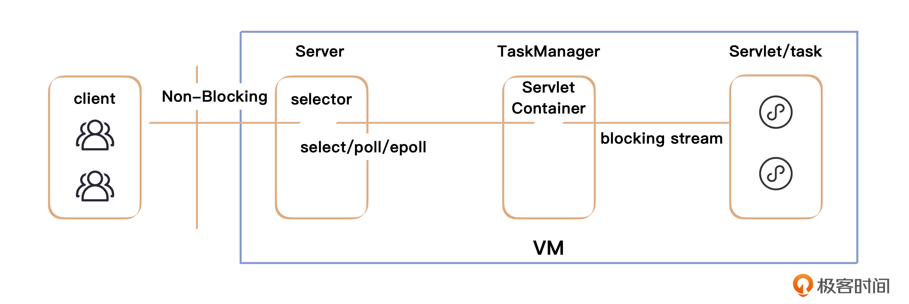
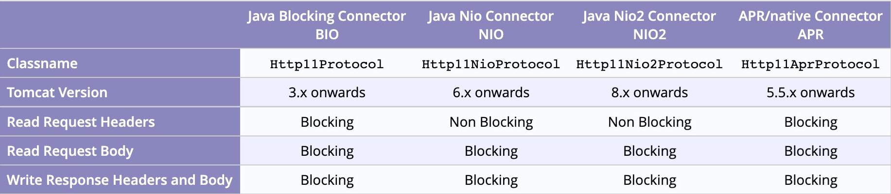

# 19 | Servlet与NIO的协同：如何在NIO模式下调用Servlet？

你好，我是郭屹。今天我们继续手写 MiniTomcat。

上节课我们从原理出发探讨了 Java 的 NIO 模式，以及 Tomcat 如何实现 NIO 的。我们知道把Socket 设置为 NIO 模式，通过注册事件的方法来进行读写处理，就相当于有一排信号灯，来了请求就会亮灯，还可以用不同的颜色区分不同的请求，比如连接、读、写等等，然后有一个Poller 程序轮询，对不同的信号进行不同的处理。

这节课我们继续聊这个话题，看一下在 NIO 模式下如何调用 Servlet。我们最后再来探讨一下MiniTomcat 如何支持 NIO。同样的，这节课也是对思路和原理的讨论，并没有对应的源码。

## NIO 与 Servlet 的协同

我们来探讨支持 NIO 的另一件事情：Servlet 协同。我们得先描述一下，前面说了，改成 NIO模式之后，网络连接这一部分现在是非阻塞的模式了，主线程不用阻塞等待网络返回，而是可以接着做别的工作了。反映在程序上，我们现在拿到的不再是一个普通的 Java socket 了，而是 SocketChannel。

但是 Servlet 的行为呢？按照通常的理解，是要阻塞地对数据进行读取，也就是说 Servlet 程序员写程序的时候，头脑里总是想象数据同步读写完成。这样我们就了解到了，现在网络连接和 Servlet 调用之间存在一个模式的差别。你可以结合我给出的示意图来理解。



这个差别根本上来自于哪里呢？在发布的 Servlet 规范中有要求同步阻塞读写吗？并没有，没有任何一段文本表明这一点。但是我们看 API，输入输出是用的 InputStream 和OutputStream，这就表明了在实际的实现中，Servlet 的行为是同步阻塞的。

所以为了将 NIO 模式与 Servlet 的阻塞读写行为协调起来，我们需要模拟同步阻塞：在一个非阻塞的网络连接上，数据读取的行为看起来又得是同步阻塞的。

我们编程的时候，碰到这类同步异步结合的问题，常用一个编程“技巧”：死循环等待。一方通过一个死循环不停地尝试从另一方获取数据，直到取得全部数据。这个死循环就是在模拟同步过程，我们是可以考虑这个办法的，比较简单，所以后面你会看到我们的 MiniTomcat 借鉴了这个办法。

## Tomcat 如何模拟阻塞式读写?

Tomcat 一样要考虑这个事情，所以我们要学习 Tomcat 自身是怎么处理这个问题的，它的办法也就是我们的办法。以前我就说过，MiniTomcat 不是创造新东西，而是为了学习 Tomcat 而抽取出来的简化版的 Tomcat。

你可以看一下我从 Tomcat 的主页里截取的一张图。



可以看出，对 Request 和 Response 的 body 进行读写，Tomcat 一律采用的阻塞模式。那么Tomcat 是如何做到的呢？它也是用的模拟方式。我们一点一点来看。

Servlet 永远在使用 HttpServletRequest，而对于 Tomcat 来说，在这里用的是RequestFacade。程序要从这里面获得 Inputstream，如果我们直接使用 JDK 的ServletInputStream，肯定是不行的，那还是默认的 blocking 通道，所以这里要偷梁换柱一下，我们看到 Tomcat 使用了 CoyoteInputStream，这个类它继承了 ServletInputStream。这个 CoyoteInputStream 重新实现了 read()。具体来讲，就是用里面的 InputBuffer 来读的，而最后一步步追下去，就会落在一个 NIOSocketWrapper 的读操作上。

我们通过主体代码来看看 Tomcat 怎么用 NIO 来读数据的。

NioSocketWrapper 类：

```
volatile boolean readBlocking = false;
fillReadBuffer():
       do {
           n = socketChannel.read(buffer);
           if (n == 0) {
               if (!readBlocking) {
                   readBlocking = true;
                   registerReadInterest();
               }
               synchronized (readLock) {
                   if (readBlocking) {
                       readLock.wait();
                   }
               }
           }
       } while (n == 0);
```

上面的代码是由工作线程执行的，实际通过 SocketChannel 读取数据。关键是后面的代码，没有读到数据的时候把 readBlocking 的值设为 true。这段程序是如何进行阻塞的呢？首先是一个 do{} 循环，你可以理解为死等，然后这里用了一个锁 readLock，通过 wait() 操作进行等待，并且在此之前向 Poller 注册了读事件。死循环 + wait()，这个思路其实很简单。

这个工作线程的等待由 Poller 来唤醒，你可以看一下主体代码。

Poller 类：

```
   processkey():
       unreg(sk, socketWrapper, sk.readyOps());
     if (sk.isReadable()) {
           if (socketWrapper.readBlocking) {
               synchronized (socketWrapper.readLock) {
                   socketWrapper.readBlocking = false;
                   socketWrapper.readLock.notify();
               }
           }
       }
```

通过上面这段代码可以知道，Poller 中处理 key 的时候，在读就绪的情况下，如果判断是readBlocking 标志，就使用工作线程里的同一把锁，唤醒工作线程，工作线程继续去读。

NIOSocketWrapper 和 Poller 两者互相配合，就保证了工作线程一直等待直到读取到数据，客观上就是阻塞方式了。这就是 Tomcat 在 NIO 通道上模拟阻塞式的实现方案。

而处理写数据的时候也是同样的办法。

NioSocketWrapper 类：

```
 volatile boolean writeBlocking = false;
 doWrite():
   do {
         n = socketChannel.write(buffer);
         if (n == 0 && (buffer.hasRemaining())) {
             writeBlocking = true;
             registerWriteInterest();
             synchronized (writeLock) {
                 if (writeBlocking) {
                       writeLock.wait();
                     writeBlocking = false;
                 }
             }
         }
     } while (buffer.hasRemaining());
```

Poller 类：

```
   processkey():
       unreg(sk, socketWrapper, sk.readyOps());
     if (sk.isWritable()) {
           if (socketWrapper.writeBlocking) {
               synchronized (socketWrapper.writeLock) {
                   socketWrapper.writeBlocking = false;
                   socketWrapper.writeLock.notify();
               }
       }
       }
```

那这个 NIOSocketWrapper 是怎么来的呢？回到上一节课我们讲的，当接收到一个网络连接的时候就产生了一个 SocketChannel，然后它被包装成了 NIOChannel 和NIOSocketWrapper，最后给到 Servlet 的 InputStream 和 OutputStream 内部的就是这个NIOSocketWrapper。

这里的关键是 NIOSocketWrapper 这个类，它包装了 SocketChannel，通过模拟的方式将非阻塞式的读写变成了阻塞式的读写。

## MiniTomcat 如何支持 NIO？

探讨到现在，我们已经了解了 NIO 原理以及 Tomcat 是如何支持 NIO 的。可以感觉到，NIO是一个比较复杂的话题，编写程序的难度比较高，规模也比较大。这也是我们这门课程只讲到这里的原因，真正的 NIO 和异步处理的实现，需要单开一门课程来讲述。

正好说到这里，我还想多说几句。在 Java 体系中，非阻塞和异步等特性，整个社区一直支持得不简洁，这些从根本上来说是 Java 内核带来的，应该在 JDK 这个层级简洁而有效地解决问题。当然我不是怪发明和推动 Java 的那些大师们，我这是事后诸葛亮。我们要明白，产品要考虑历史，一个体系的核心一旦确定下来，是不能轻易修改的，发展到最后都可以看到最原始的一段段代码作为整个体系的基因永远流传。好消息是 Java 21 这个版本引入虚拟线程 VirtualThread 为我们带来了希望，让程序员能够简洁地处理异步编程。

根据这些知识和参考，我们自己在将 MiniTomcat 改造为 NIO 模式的时候，可以这么考虑：我们现在的程序结构是比较简单的，就是 Bootstrap 启动服务器，而服务器由 Connector +Processor + Container 组成。为了整体支持 NIO，我们需要把 Connector 改成 NIO 模式进行连接，传给 Processor 的 Socket 是需要在 NIO 之上模拟 Servlet 阻塞式数据读写的。

按照这个思路，我们可以设计一个大概的修改方案。

1. Bootstrap 依然是启动器。

2. 将 Connector 分拆成三块：NIOEndpoint、Acceptor 和 Poller。NIOEndpoint 将实现一个NIO 服务端，绑定 IP 地址及端口。NIOEndpoint 还需要启动 Acceptor 线程和 Poller 线程，分别负责接收连接和轮询。之前的 processor 连接池结构可以不变，但是要把ServletProcessor 类修改成支持 SocketChannel 的 SocketProcessor。

3. Acceptor 的 accept() 接收新连接，这个连接是 SocketChannel，把接收到的连接通道设置为非阻塞的 NIO 模式。

4. 用上面的 SocketChannel 构造一个包装对象 NIOSocketWrapper，上层程序用这个包装类，而不是直接使用 SocketChannel（因为我们需要在这里模拟阻塞式读写），注册到轮询线程，生成事件添加到事件队列。我们后面的数据读写都是在这个 NIOSocketWrapper 上进行的，因此这里也要加上无限循环等待数据读写，注册读写事件，用 readLock 和writeLock 进行等待 wait。通过这种方式，SocketChannel 上的非阻塞读写到了NIOSocketWrapper 层面就是模拟阻塞式读写了。

5. Poller 进行轮询，先取出队列里新增的 PollerEvent 并注册到 Selector，然后调用Selector.select() 方法来等待就绪的事件，再根据选择的 Key 构造 SocketProcessor 提交到请求处理线程。最后 Poller 还需要唤醒工作线程在 readLock/writeLock 上的等待，这样来配合模拟 Servlet 的同步阻塞式读写。

6. SocketProcessor 要支持 SocketChannel，它带上了 NIOSocketWrapper 参数，以它为基础构造我们自己的 MinitNIOInputStream，所以以前的 RequestFacade 里面，getInputStream 要返回新的 MinitNIOInputStream。这样，网络连接这一块和 Servlet 这一块底下就是用的同一个 SocketChannel。

7. Servlet 的读写是基于 MiniTomcat 实现的 stream 的，最后落实在 NIOSocketWrapper 上，所以数据的读写是模拟的同步阻塞方式。

经过这样的修改，原则上就能让 MiniTomcat 支持 NIO 模式了。

## 小结

我们这节课了解了 Tomcat 如何在 NIO 模式下模拟 Servlet 的阻塞式读写，基本的做法就是给SocketChannel 包装一下变成一个 NIOSocketWrapper，在这个 Wrapper 里，用死循环 + 读写锁的 wait 方式进行模拟阻塞式读写，锁的唤醒则是在 Poller 里面进行的，达到了轮询器和处理器两者之间的协调。

然后我们结合上节课的知识，探讨了怎么把 MiniTomcat 修改成支持 NIO 模式的方案。总的来讲也是两大块内容，第一部分是网络连接，通过一个 NIOEndpoint 把网络连接变成 NIO 模式，获取到 SocketChannel，并基于它包装出 NIOSocketWrapper，第二部分就是构造自己的InputStream，内部使用 NIOSocketWrapper，这个 stream 会被 RequestFacade 包含并传递给 Servlet。

不过我们要注意，这个还只是大致的设计，原理上行得通，而参照 Tomcat 实际的代码，你会发现还有大量的细节要处理，程序规模也是很大的。

## 思考题

学完了这节课的内容，你来思考一个问题：我们现在的 MiniTomcat 是只支持 HTTP 协议的，如果要支持别的协议，需要怎么改造？

欢迎你把你思考后的结果分享到评论区，也欢迎你把这节课的内容分享给其他朋友，我们下节课再见！
