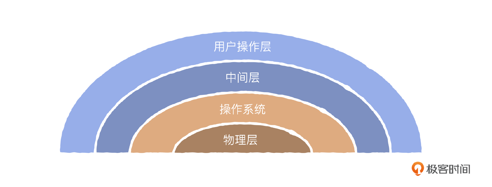
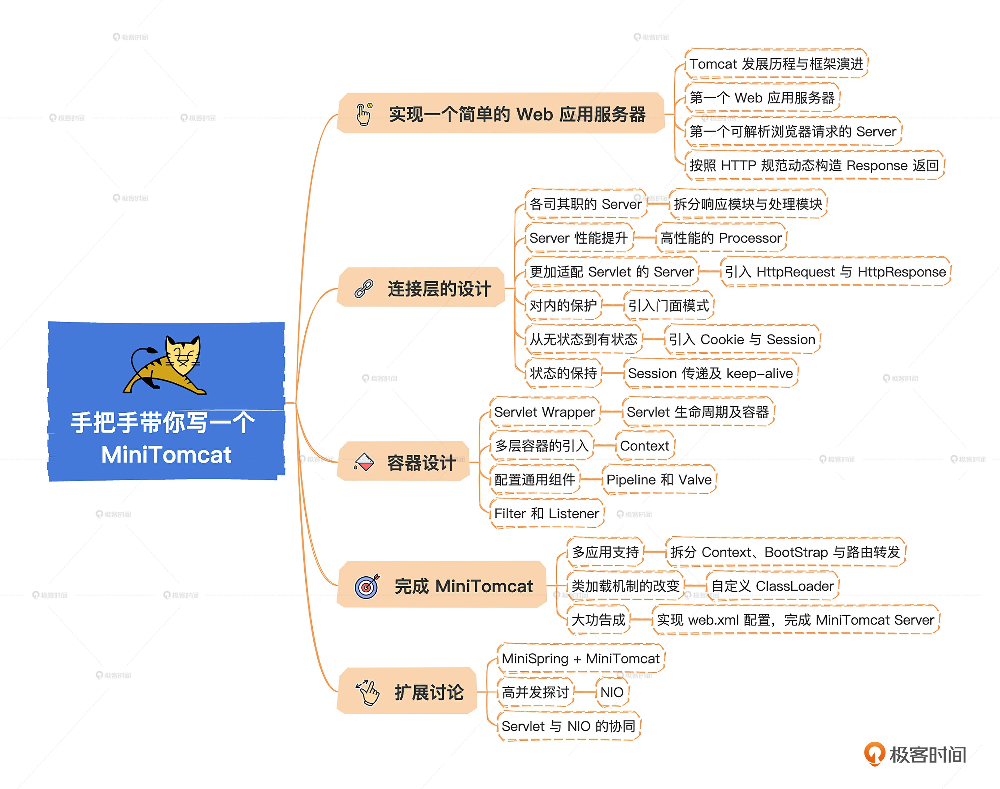

# 开篇词 | 重造轮子，探究Tomcat的秘密

你好，我是郭屹，一名热爱编程的老兵。欢迎你跟我一起手写 MiniTomcat，一个 mini 版的Tomcat。

在开始学习之前，我还是先介绍下我自己。我九十年代从南开大学毕业后就开始了自己的编程职业生涯，幸运地进入到了这个有趣而充满挑战的领域。人到五十，我心依旧澎湃，直到如今我仍会习惯性地键盘不离手语言不离口。

1996 年工作开始，我就碰巧去了一趟硅谷，了解到了 Internet 和 Java，从此和 Java、中间件结下了不解之缘。到了 1998 年我就加入了 Sun Microsystems 的 Java 团队，担任 J2EE 研发工程师，并在那里耳闻目睹了业界大神的作品，其中就包括 James Duncan Davidson 的Tomcat。

在工作之余，我也很喜欢分享知识心得，所以一直坚持写作输出，先后出了《认识编程》《Java 编程十五讲》《三字经注解》几本书，同时很荣幸地成为了机械工业出版社专家委员会委员，也带过十来个大学生和研究生。后面我的学生建议我在极客时间上出一门课，希望我把知识传播得更广，所以今年春天经过几个月的筹备，我就在极客时间上出了手写系列的第一门课《手把手带你写一个 MiniSpring》。

课程结束后很多用户直呼不过瘾，希望能再和我一起手写一个 MiniTomcat，所以响应大家的需求，我就带着 MiniTomcat 来了。我的本心是希望把这些知识传递给更多的人，更希望有一群人能一起加入分享的行列，像硅谷的程序员共同体一样有经常性的技术交流，那种感觉一定很棒！所以也欢迎你在学习过程中多在留言区留言，参与讨论，我相信在交流中学习的效果也是不容小觑的。

这个课程的形式其实和第一季的 MiniSpring 是一样的，我也会带你重造轮子，从一个极简的HttpServer 开始，一步步深入，直到完成一个属于自己的 MiniTomcat。希望你坚持下去，深入底层，掌握 Tomcat 的运行原理。在不断往下挖的过程中，像一个地质学家一样不断获得惊喜。

## 为什么要学习 Tomcat 底层原理？

软件是一个地质学堆积过程，这是我们进入软件专业需要牢牢记住的一个大图景。软件体系的构建是一层一层往上堆积出来的，最底下是物理层，看得见摸得着的硬件，硬件之上就是操作系统，管理硬件执行任务，再往上就是中间层，比如框架层、服务层，最后到了用户操作层。

普通人平时使用计算机系统，实际接触的是最上层的用户操作层，比如浏览器、应用程序界面，来完成生活和工作所需的各种功能。

我们程序员的工作大部分最终也是为用户提供各种各样的应用工具。这些应用程序的构建，并不是在操作系统这一层之上直接编写的，而是使用了很多基础服务，比如数据库、文件系统、网络通信、HTTP Server、中间框架，这一层基础服务程序为应用程序员提供了丰富的工具。

我们看到，这些年各种应用层出不穷，界面操作体验经常翻新，各种语言和工具也是频繁迭代，让我们应接不暇，于是许多人感叹软件行业升级换代太快，跟不上。但是我们仔细分析软件体系，会了解到任何一个新事物都会在“软件地层”中有一个相对固定的生态位。在这个地层堆积结构中，越是底层的越稳定越基本。底层恒久不动稳如磐石，才有上层精彩的大千世界自然景观。正是因为这些中间层的基础服务，我们才能快速构建出应用程序。

因此作为专业程序员，深入地层，理解中间层是很必要的。对这些基础服务的理解，能让我们以不变应万变，把握住技术快速流变中相对稳定的内核。理解了底层运行原理，你就知道了所以然，工作过程中会更加高效准确地使用中间件提供的服务，提高应用程序的质量。长期来讲，让你的事业更成功。

跳出功利心，我们从更高的角度来看。作为一个专业人士，能将自己的专业从头到尾融会贯通，这是很大的喜悦，也是对自己定下志向一生选择这个专业的一个交代。而作为一个人，对这个世界的某个方面有了一个透彻的理解，会感到不虚此生之行，这更是一种深层的幸福。

成功是没有止境的，但是幸福有其更深刻的含义。

## 如何高效地掌握 Tomcat 原理？

今天，我们在学习 Tomcat 的过程中，面对的一个问题是它已经是一个庞大而复杂的体系了，虽然它是开源的，俗话说“代码之下了无秘密”，但是面对源代码的丛林，很多程序员往往会迷失其中，因一次次的挫败而导致最后望而却步。

这是我们作为后来者的劣势，生晚了时代。我们的问题是只见到了成熟后的 Tomcat，没有了解到它是怎么成长起来的。对这个过程不了解，就会让我们学习的路径变得很艰难。

因此，我用重造轮子的方法，采用迭代的开发模式，从一个最简单的程序开始，一步步迭代，每写一小段代码，都是一个可运行的程序。在不断迭代中完善服务器功能，最终实现 Tomcat核心。代码结构有意对照 Tomcat 的结构，让原理理解起来不再困难。

我们在工作中，总是有前辈谆谆教导我们不要重新造轮子。这句话是对的，对于要快速搭建交付给客户的项目来讲，尽量采用第三方来搭建项目是明智的选择。然而，一物有二柄，选择就意味着取舍，我们要明白不重新造轮子，失去的就是对软件基础的透彻理解，技术流于表面，软件工程师变成了码农。为了弄清楚软件系统如何运行起来的，成为专家，我们必须学会重新造轮子。

因此我尽量少用现成的第三方包，以刀耕火种的方式进行低级编程，这可以让我们彻底地理解底层原理。学习者要从一开始就一起动手编写，编程说到底是一个手艺活，就是动手去写，不断地练习，拳不离手曲不离口。相信总会有那么一刻，你顿悟或者渐悟软件之道，开怀不已，拈花一笑存真义。

这里我再强调一遍，我们学习 MiniTomcat 的目标是掌握 Tomcat，所以我们不会自己创新什么，而是老老实实按照 Tomcat 的样子模仿着手写。因此我们的目录结构、包名、类名、接口名、继承体系、类中的主要方法名都是参照 Tomcat 本身的。

## 课程设计

我们 MiniTomcat 的课程大体上分成四大块：HttpServer、Connector、Container 和扩展部分。

熟悉 Tomcat 的人也知道，Connector + Container 就是 Tomcat 的核心了。学习这些，会为进一步的研究打下良好的基础。

第一章 实现一个简单的 Web 应用服务器

Web 应用的核心是对 HTTP 协议的支持，接收浏览器发送的 HTTP 请求，解析 URL，找到资源返回内容，显示在客户浏览器上。这一部分，我们先不引进任何规范，而是自己简单地实现Request 请求与 Response 响应。虽然它很简单，但是也是一个地道的 Web 应用服务器，不仅支持静态资源，还能运行程序动态返回内容。我们后面的改造都会基于这个简单服务器。

第二章 实现专业的 Connector

基于简单的应用服务器，我们来重点实现 MiniTomcat 连接层，并且按照 Servlet 规范进行改造。优化代码结构，将第一部分的 Server 拆分为 Connector 与 Processor。之后初步优化性能，引入 Processor 池化技术，支持 Processor 并发执行，提高 Server 的高并发能力。然后，我们就要按照规范行事，实现 Servlet 对请求和响应的接口规范。

这一部分的改造过后，MiniTomcat 的连接层就有模有样了。

第三章 实现专业的 Container

连接层解决后，我们再重点设计实现容器。先引入 Container，实现 Context 与 Wrapper，形成两层容器，将整个框架按照功能进一步拆分成不同模块，每一部分各司其职。最后引入日志、过滤器、监听器等通用组件。这一部分之后，Tomcat 的核心就模仿出来了。

第四章 完成 MiniTomcat 及扩展讨论

我们将考虑多应用支持，进一步拆分功能，BootStrap 只负责启动服务器，业务代码都在Context 内运行，支持不同路由转发到不同应用之中，而应用之间相互隔离。这个需求就要求我们改变标准的 Java 类加载机制，自定义加载过程。最后通过 web.xml、Server.xml 进行各项配置，启动 Server，实现完整而基本的 Tomcat。

作为扩展，我们会探讨如何把 MiniSpring 打包放在 MiniTomcat 中运行，形成 Mini 系列的核心环境，还会将网络 IO 扩展为支持 NIO，以支持高并发场景的方案。

通过这一步步的迭代，你会看到 MiniTomcat 逐渐成型，越来越像真正的 Tomcat 了。我尽量做到每次迭代都是一小步，不会造成大的学习障碍。但是我们也要知道软件技术越往下挖越难，因此整个过程中还是需要反复琢磨，最后才能成功。虽然中途会遇到困难，但我希望你可以坚持学习，跑完全程！
