# 04 | MongoDB：如何安装和使用MongoDB数据库？

你好，我是黄鸿波。

上节课，我们主要了解了数据库的来源和形式，但凡是数据都离不开存储。说到数据库，我们最常用到的就是 MongoDB 和 Redis。

推荐系统中的原始数据一般分成两大类，用户数据和内容数据。这两类数据服务于推荐算法，最终我们会得到用户特征与画像。对于用户画像这类的信息，最好使用字段可变的文档型数据库，比较常见的就是 MongoDB 数据库。

这节课我们就来详细地介绍一下 MongoDB 数据库。看看它是什么、有什么特点、应该如何安装。

## 什么是 MongoDB 数据库？

MongoDB 是一个开源的基于分布式文件存储的数据库（C++ 语言编写），最初是为 Web 应用提供可扩展的高性能数据存储解决方案。MongoDB 最大的优点是可扩展性强、高效的查询方式和非常出色的安全性。


### MongoDB 数据库的特性

由于 MongoDB 开源且分布式，因此，它在可扩展性方面一直是所有 NoSQL 数据库中的佼佼者。MongoDB 数据库可以通过分片数据来提高整个数据库的吞吐量，并且由于它以文档结构来存储数据，所以在编写和使用查询语句时非常容易。

我们这里所说的文档结构，是一种类似于 JSON 类型的 BSON 文档。在实际使用过程中，我们可以把它当作 JSON 的形式使用，因为这二者从使用和长相上来看基本没有区别，而我们在日常开发中也比较喜欢使用 JSON 对象作为传输格式，因此，MongoDB 数据库与程序的对接就变得容易多了。

此外，BSON 数据类型还使得安全性变得非常高。因为 MongoDB 在进行查询时使用的是BSON 对象，不是像 SQL 一样可解析的字符串，这可以大幅度降低由 SQL 注入带来的风险。

### MongoDB 数据库的基本概念

像 MySQL 或者 Oracle 数据库等关系型数据库一样，MongoDB 也有一套完整的基本模型和概念，并且它在某些方面也与关系型数据库类似。我们可以对比一下这两类数据库，以此更好地了解 MongoDB 数据库。

首先在关系型数据库中比较常见的几个概念：数据库、数据库表、行（也叫记录）、列（也叫字段），在 MongoDB 数据库中也有几个类似的概念，我们一一来看看。

Database：数据库，这个概念和关系型数据库中的概念相同，它装载着所有的数据内容。

Collection：集合，可以将其理解为关系型数据库中的表。在关系型数据库中，我们将所有的数据按字段顺序逐行存到数据表中。在 MongoDB 中也是类似，我们可以将我们需要的数据以文档（Document）为单位存储在集合中。但与关系型数据库不同的是，MongoDB 数据库不需要事先定义好列的名字，而是可以随时变化。也就是说，你可以在一个 Collection 中存储完全不一样的 Document，只要这个 Document 符合 BSON 的格式要求即可。

Document：文档，可以将其理解为关系型数据库中的行。与关系型数据库不同的是，Document 是由多个字段组成的，这个字段我们可以理解为 JSON 中的 Key，而值则可以理解为 JSON 中的 Value，因此，我们可以先粗略地理解为，Document 就是一个 JSON 字符串。

Field：字段，可以将其理解为关系型数据库中的列。与关系型数据库不同的是，Field 可以支持更多的数据类型，甚至还可以像 JSON 中嵌套 JSON 一样，在 Document 中嵌套Document 等，因此，它的 Field 类型更加灵活。

这些是 MongoDB 数据库最主要的概念，我们也对应地讲解了它们和关系型数据库的差异，MongoDB 数据库的概念并不止这些，其他的我们遇到再做讲解。

## 如何安装和使用 MongoDB 数据库？

在对 MongoDB 数据库有了一个初步的了解之后，接下来我们来看看如何安装和使用MongoDB 数据库。

### MongoDB 数据库的安装

第一步，进入 MongoDB 的官网。

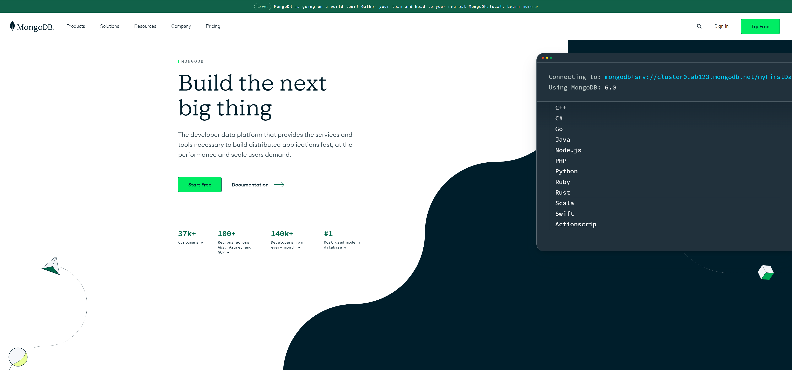

第二步，我们在最上面的菜单栏依次找到 Product→Community Edition→CommunityServer。

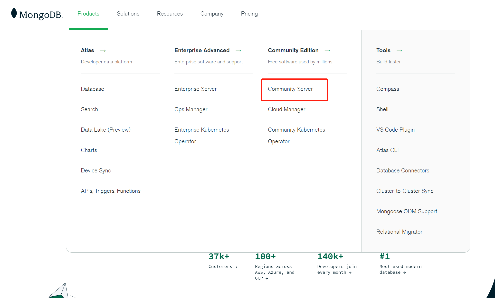

第三步，在弹出的页面中，选择自己需要的版本、平台和包。这里我使用的是 4.0.28 版本，平台使用 Windows 平台，用 msi 安装包的形式进行安装，点击 download 按钮开始下载。


第四步，下载完成后，双击我们下载的安装包进行安装，然后可以看到下面这个界面。

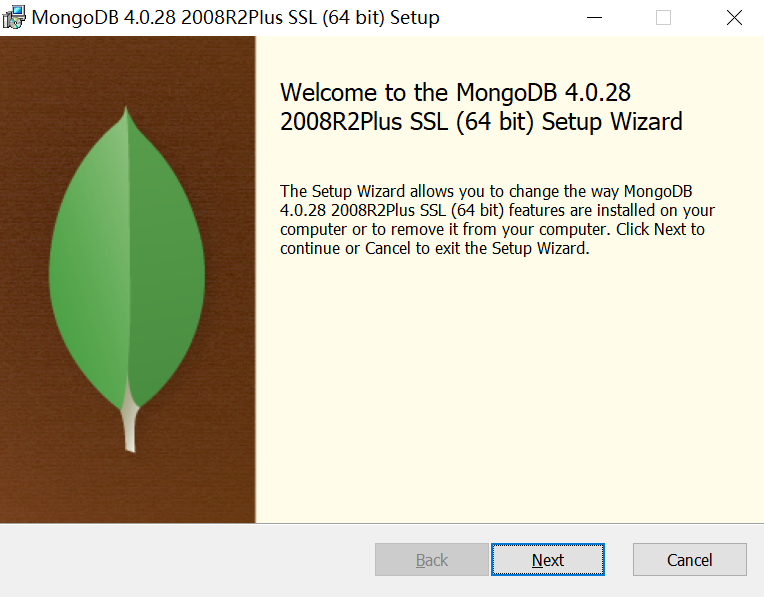

第五步，在这个界面下，一路 Next 到选择安装方式界面，在这个界面中，上面是完全安装（Complete），下面是自定义安装（Custom），我建议使用自定义安装，因为这个时候你可以清楚地了解你都安装了什么，并且安装到了哪个目录。

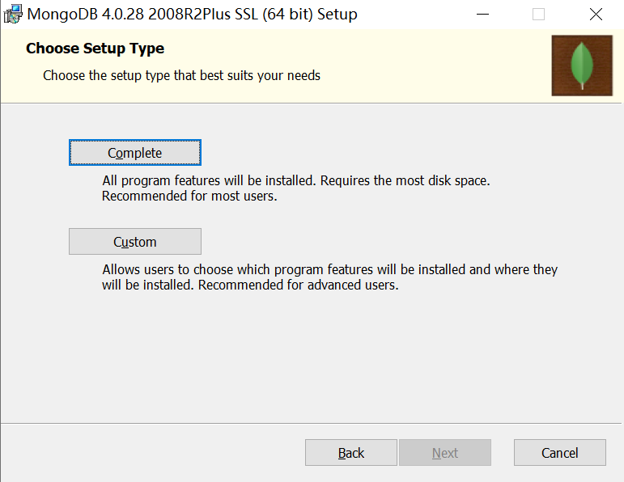

第六步，接下来会让你选择要安装的程序以及安装的位置。一般来讲，安装的程序我们默认就可以了，安装的位置我建议选择一个非 C 盘的磁盘，最好空间大一点，这里我把它安装到了 I盘。在更改目录时，我也建议你只更改目录前面的盘符，不更改后面安装位置的具体目录，因为使用原目录结构在进行环境变量等信息配置的时候，更加方便。

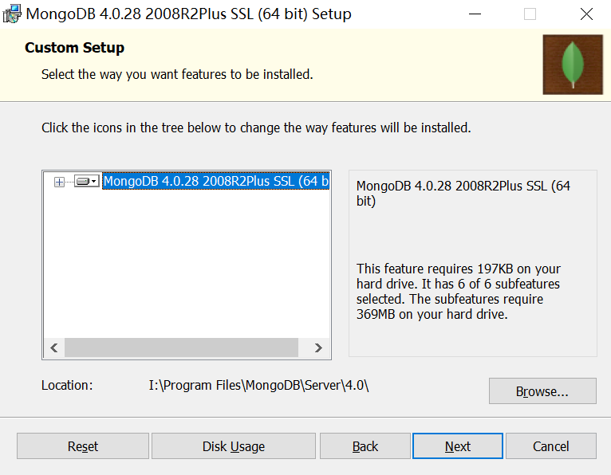

第七步，点击 Next，这个时候安装程序让我们选择服务的配置，这里直接默认就好。然后我们一路 Next 到最后，安装完成之后会弹出完成界面。

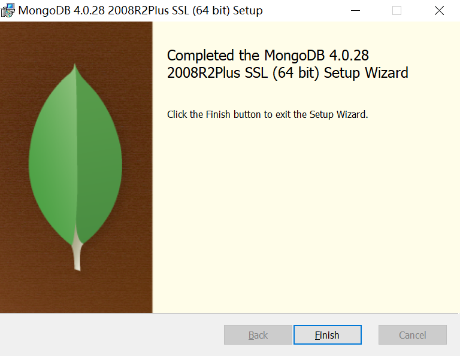

与此同时还会弹出一个 Compass 的窗口，这个我们暂时用不上。

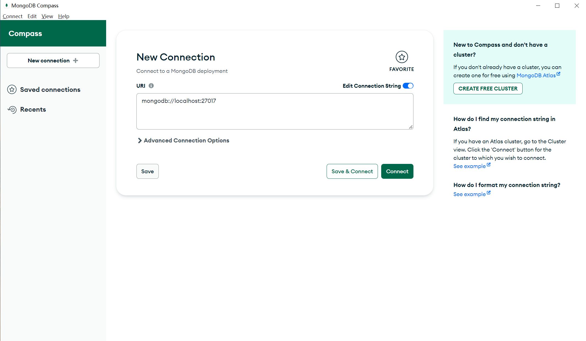

不过，完成上面这些步骤之后，我们只能说完成了全流程的 50%，这时候我们的 MongoDB数据库还是不可用的。接下来我们要配置环境变量、配置相关目录并启动数据库。

首先，我们要把 MongoDB 相关的命令配置到环境变量中，方便我们后面的开发和操作。

具体做法是，先找到我们刚刚安装 MongoDB 的目录，比如我的目录是：I:\ProgramFiles\MongoDB\Server\4.0。然后我们把它加入到系统的环境变量中，我们需要在系统的环境变量中新建一个 Key 为 MONGO_HOME，如下图所示。

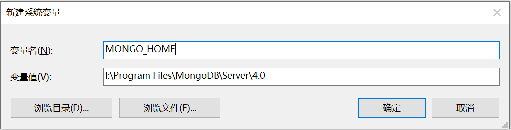

```
接下来，我们在 Path 中新建一个变量 %MONGO_HOME%\bin，这里包含了运行 MongoDB 的
```

相关命令。

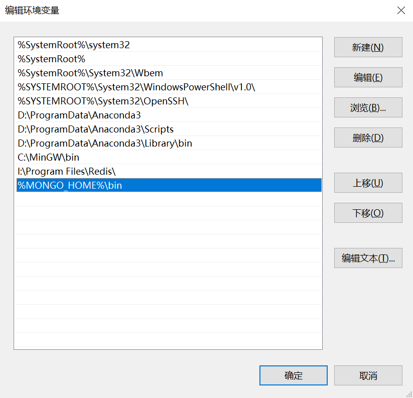

点击确定，然后点击环境变量窗口的确定，此时，我们就可以在命令行中使用 MongoDB 的相关命令了。例如，我们可以在命令行中输入 mongo，这时如果弹出下图这样的信息，就说明环境变量配置好了。

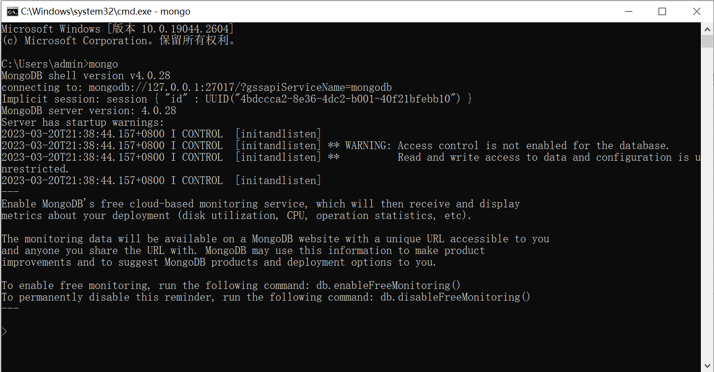

到这里，实际上我们的 MongoDB 数据库就已经安装成功，也可以正常使用了。接下来，我们要把 MongoDB 添加成为一个系统服务，这样每次启动的时候，就不需要重新运行命令了。

首先，我们要在 MongoDB 的安装目录的 data 文件夹下创建两个目录，分别是 db 目录和 log目录，如图所示。

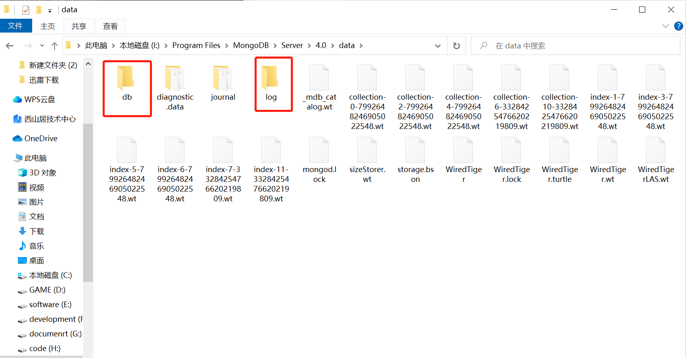

然后在 log 目录下，创建一个名为 mongodb.log 的文件。

接下来，在 MongoDB 的主目录下（我这里的主目录是 I:\ProgramFiles\MongoDB\Server\4.0）创建一个 mongod.cfg 文件，用记事本编辑文件，在文件中输入下面内容。

```
systemLog:
   destination: file
   path: I:\Program Files\MongoDB\Server\4.0\data\log\mongod.log
storage:
 dbPath: I:\Program Files\MongoDB\Server\4.0\data\db
```

接着，以管理员身份打开 cmd 命令，如下图所示。

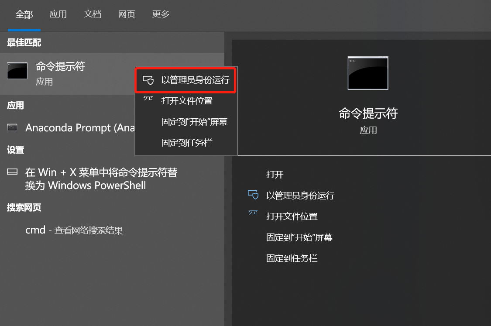

然后输入如下命令。

```
mongod --config"I:\Program Files\MongoDB\Server\4.0\mongod.cfg"--install
```

接下来输入下面这个命令。

```
net start MongoDB
```

如果出现下面的截图，说明服务已经启动了。

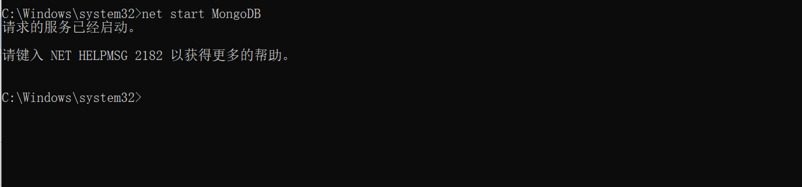

我们在计算机上点击右键选择管理，然后在服务和应用程序中找到服务，并在服务选项中找到MongoDB Server。

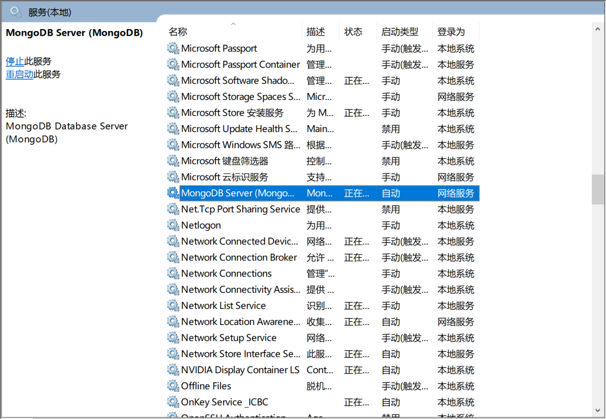

此时，我们的 MongoDB 数据库已经完全安装完成了。我们可以通过 cmd 控制台输入 mongo命令，如果得到下面这个截图，说明安装成功了。

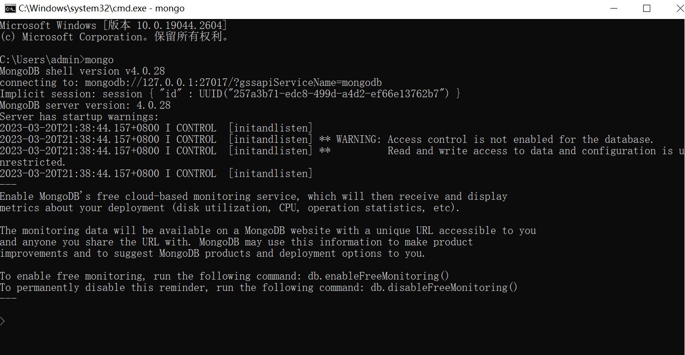

### MongoDB 数据库的简单使用

接下来，我们写一个简单的 demo 来测试一下我们的数据库，需要完成下面几个操作。

1. 创建一个数据库 DB。

2. 创建一个 Collection。

3. 在 Collection 中插入一条数据。

4. 使用查询语句将这条数据查询出来。

```
在 MongoDB 中，创建数据库的命令是  use + 数据库名，这个时候，MongoDB 会查询系统
```

中是否有这个数据库，如果有，则直接使用，如果没有就会自动创建。为了验证我们的想法，我们先使用 DB 命令来查询一下目前使用的是哪个数据库。

```
db
```

得到下图。

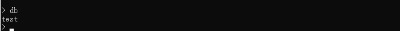

通过这张图我们可以看到，目前我们的 MongoDB 系统中只有一个 test 数据库。接下来，我们

```
使用下面的命令创建一个  recommendation_demo  数据库。
use recommendation_demo
```

然后再使用 DB 命令进行查询，得到结果如图。

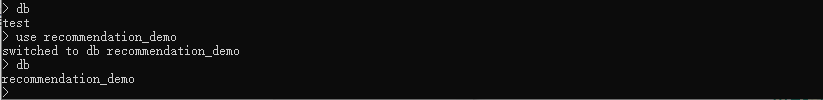

我们可以随意往里面插入一条数据，比如我们插入一条 Key 为“name”，值为“welcome torecommendation system class”的数据，然后我们再使用 find 命令来查询数据是否存在。

```sql
db.recommendation_demo.insert({"name":"welcome to recommendation system class"})
```

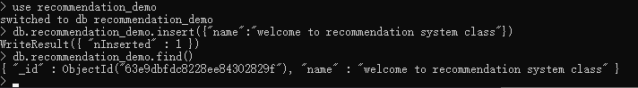

如果能够看到上面的信息，说明我们的 MongoDB 数据库已经能够正常运行，并且你已经往里面插入了一条真实的数据。

到这里你可能还有一个疑问，我们这里只创建了 DB 并插入了数据，但是并没有特意创建Collection 呀。实际上，在 MongoDB 中，如果没有指定创建 Collection 的话，就会默认创建一个与数据库同名的 Collection，我们可以通过 show tables 命令来验证下。

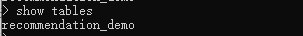

到现在为止，我们 MongoDB 的安装和最基本的使用已经学习完成了。在后面的课程中，我们会利用 MongoDB 数据库来完成我们推荐系统中的部分数据存储工作。

## 总结

学完这节课，希望你记住下面这些知识点。

1. MongoDB 是一个开源的基于分布式文件存储的数据库，它是使用 C++ 语言编写的。

2. MongoDB 最突出的优势是可扩展性强，同时它还具有高效的查询方式和很高的安全性。

3. MongoDB 数据库在很多方面与结构化数据库有异曲同工之处，数据库、集合、文档、字段等概念都与关系型数据库有所对应，我们应该了解他们的区别和联系。

4. MongoDB 数据库的安装方法，以及安装之后如何把它变成一个 Windows 自带的服务。

5. 使用 MongoDB 数据库创建一个 Collection 并插入数据。

## 课后题

学完这节课，给你留两道课后题。

1. 请你动手在自己的电脑上搭建一套 MongoDB 数据库的开发环境。

2. 请你尝试自学 API 的形式，创建一个数据库和集合，并在库中随意插入一条数据。

欢迎你把代码上传到 GitHub 并在评论区留下你的代码链接，我会选择有代表性的代码进行点评。我们下节课见！
