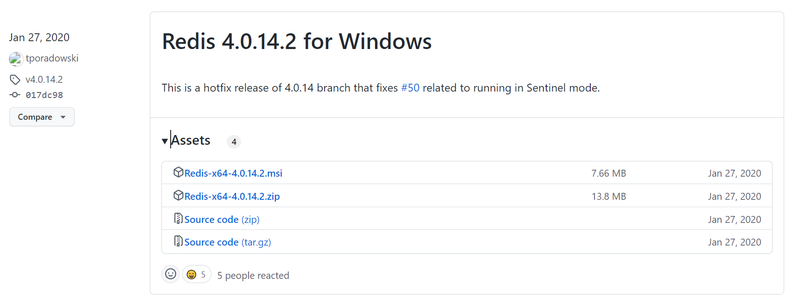
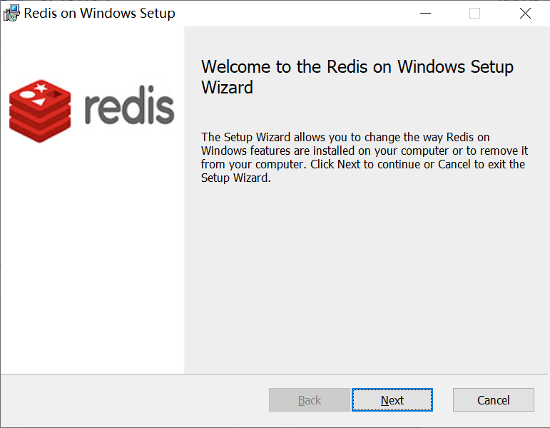
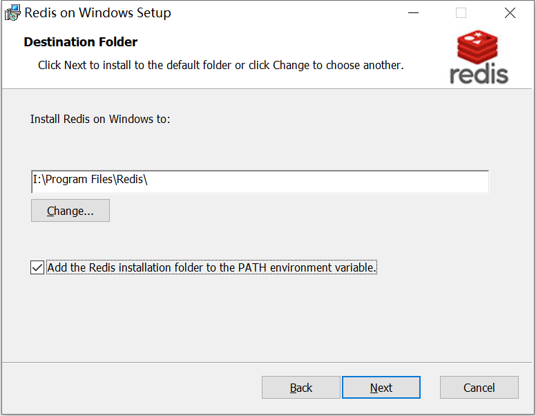
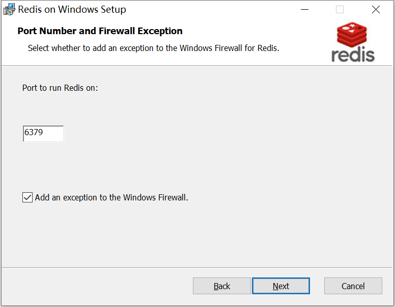
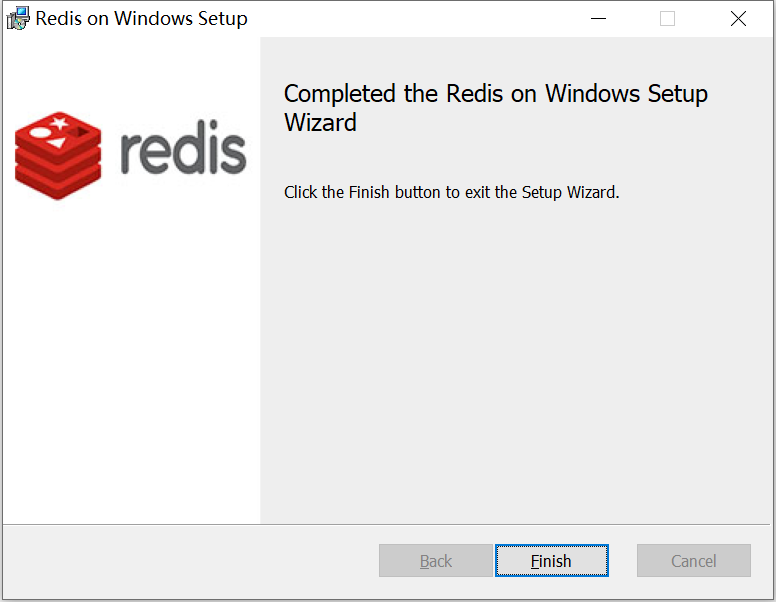
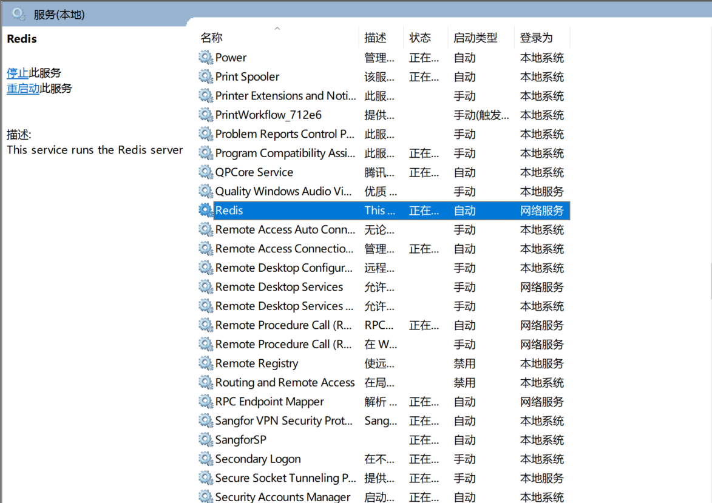
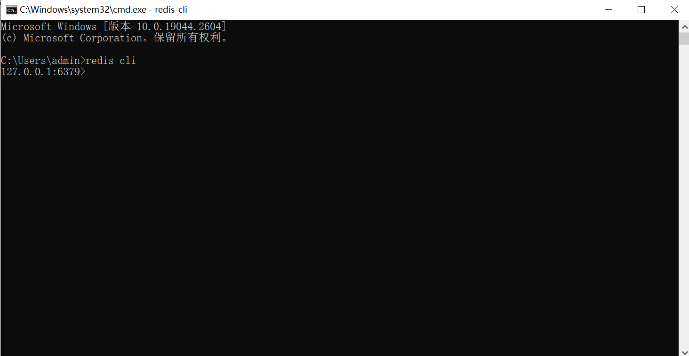
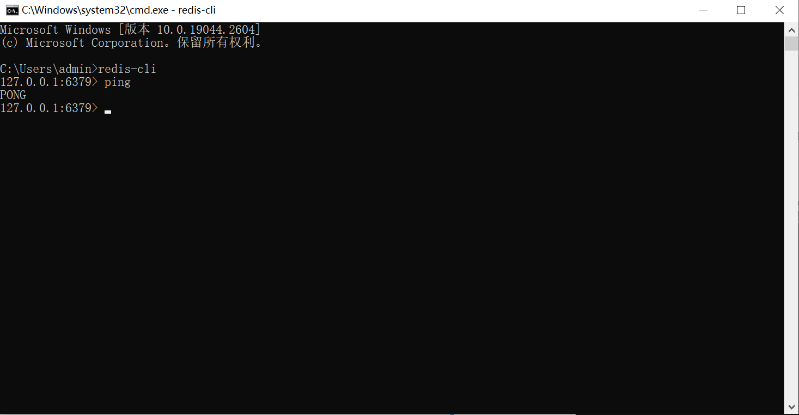
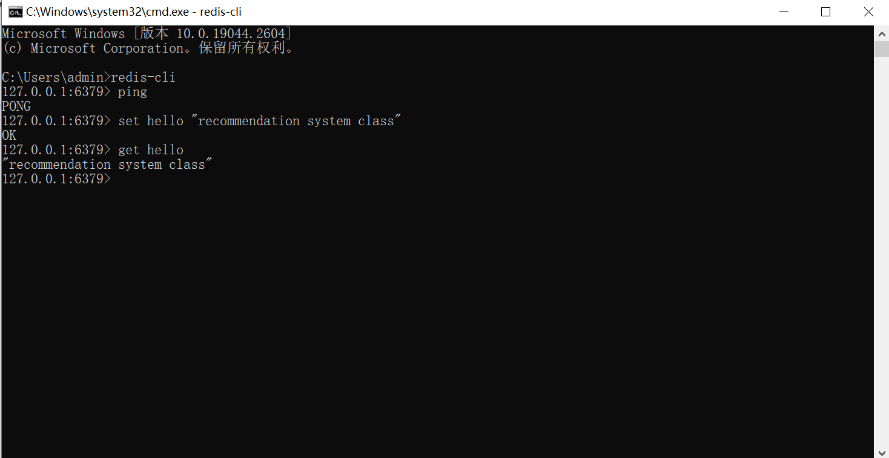

# 05 | Redis：如何安装和使用Redis数据库？

你好，我是黄鸿波。

上节课，我们了解了 MongoDB 数据库的概念，并学习了 MongoDB 数据库的搭建和基础使用方法。

这节课，我们来学习另一个常用到的数据库：Redis 数据库。我们会从 Redis 数据库的概念入手，为你讲解 Redis 数据库的特性、应用场景以及安装和使用方法。

## 什么是 Redis 数据库？

Redis（Remote Dictionary Server）是一个开源的日志型 Key-Value 数据库。它由 ANSI C 语言编写，支持网络，可基于内存亦可持久化，还可以提供多种语言的 API。它的读写速度快、性能好，支持久化，具有丰富的数据类型，并且使用起来非常简单。我们来详细看一下。


Redis 数据库的最大特点就是它是一个内存数据库。Redis 主要是使用内存存储的，当用户需要提取数据时，Redis 可以直接将数据从内存中提取出来，不必再经过磁盘的 IO 操作，这就让它的读取效率非常高，可以达到毫秒级别。一般来讲，像 Redis 这样基于内存存储的数据库，通常用于缓存常用且需要快速检索到的数据进行存储，让效率最大化。

Redis 数据库还支持多种计算机编程语言。例如 Java、Python、C、C++ 等，因此，几乎所有的编程语言都能很轻易地操作它。

另外，Redis 数据库也对多种数据结构进行了很好的支持。例如哈希、集合、位图、字符串等，我们可以根据实际的需要选择不同的数据。

例如，在推荐系统中，我们经常需要存储一些已经排好序的内容 ID 和它们所对应的打分，这个时候，Redis 数据库就提供了一种叫 zset 的数据结构。它可以很方便地帮助我们把 ID 和得分放在一起存储，并用用户的 ID 作为 Key 进行索引，这样在我们需要数据的时候，就可以用毫秒级的速度取出相应的数据了。当然，除了 zset，Redis 支持的数据类型还有很多，我们会在后面的课程中逐一讲解。

除了数据结构之外，Redis 还支持分布式存储，可以实现高可用的主从复制和分布式集群。相比于结构化数据库和文档型数据库，Redis 数据库对于结构的要求更加宽松，它没有了表和Collection 的概念，直接使用类似于 Key-Value 的形式存储数据，这样可以使我们的数据内容更加灵活，也更加方便我们存取数据。

## Redis 数据库有什么特性？

对 Redis 数据库有了一个基本的了解之后，接下来我们来说说 Redis 数据库的一些特性，以及在这些特性下的应用场景。

Redis 数据库的第一个特性就是速度快，这也是 Redis 一直以来都被用作线上实时数据库的原因。官方资料中称，Redis 数据库可以承载高达每秒 10 万次的并发请求。实际上，我们前面也在说，Redis 是一个内存数据库，Redis 中的数据都是存在内存中的，这非常有利于提高读取效率。另外，Redis 数据库采用单线程模型，最大程度避免了频繁切换上下文的问题，让存取效率变得非常高。

Redis 的第二个特性是持久化。我们都知道，如果将数据长时间存储在内存中，机器一旦断电，就会导致整个数据无法恢复，这是 RAM 的结构所导致的。但是，Redis 虽然是一个内存型数据库，却也支持持久化。Redis 的持久化方案以异步的方式将数据的更新保存在磁盘上。

在 Redis 中，持久化的方式有两种，一种是 RDB 的方式，另外一种是 AOF 的方式。RDB 持久化方式也叫作快照持久化，这种持久化方式会在指定的时间间隔内，将内存中的数据集快照写入磁盘。创建磁盘快照之后，用户可以对这个磁盘快照进行备份，当服务器宕机或重启恢复后，可以从其他的服务器上获取相同的数据。这也是 Redis 默认的持久化方式。

Redis 的另一种持久化方式是 AOF。它会把被执行的命令写入到 AOF 文件中，这样虽然可能会降低一部分性能，但是在大部分情况下，这样的性能损耗是可以接受的。

Redis 的第三个特性就是高可用和分布式。我们知道，Redis 是一个开源的基于内存的分布式数据库，因此，分布式和高可用也是 Redis 的一大特点。Redis 中提供了分布式集群的实现，通过配置命令，我们可以轻松地进行分布式的扩展。

## 如何安装和使用 Redis 数据库？

了解了 Redis 数据库，接下来我们来学习一下 Redis 数据库的安装和使用方法。

实际上，在 Windows 系统下安装 Redis 的方法有两种。

第一种方法是使用官方的 tar.gz 包，由于官方没有提供 Windows 版本的安装包，所以如果你想使用官方的版本，只能通过源码进行安装。这样安装的好处是能够和 Linux 相通，当你学会了怎么在 Windows 上安装之后，在 Linux 上也能很快上手。

第二种方式是使用第三方提供的 MSI 版本的安装包。这个包从原则上来讲是非官方提供的，但好处是非常方便，不需要那么多的配置。我们目前的开发环境是在 Windows 系统上的，所以我们先使用第二种方式来安装 Redis。

我们首先进入第三方的 GitHub首页，然后选择一个我们需要的版本。为了和企业的大部分版本以及代码匹配，在这里我选择使用 4.0.14.2 for Windows 版本作为我们的开发版本。



然后点击“Redis-x64-4.0.14.2.msi”进行下载，之后双击安装包来安装。



接下来，我们点击 Next 同意相关协议，再点击 Next，这个时候会弹出路径选择界面，我将路径选择为 I 盘，这里我们要勾选“添加 Redis 安装目录到 PATH 环境变量”，如下图所示。



然后点击 Next，这时会让你设置 Redis 的运行端口，在这里我们使用默认值 6379 即可。但是如果是在生产环境，我建议你换一个端口，防止被黑客攻击。同样，我们勾选“添加防火墙例外”，然后点击 Next，如图所示。



接下来我们一直选择 Next，直到安装完成即可。当弹出如下界面时表示安装已经完成了。



我们可以在计算机服务选项中找到 Redis。可以看到，Redis 已经启动了，这也说明 Redis 已经安装成功了。



我们再来验证一下。打开 cmd，输入 redis-cli，这时会启动 Redis 客户端，如图所示。



我们输入 ping，如果返回 PONG，说明安装成功。



我们尝试向里面插入一条键为“hello”值为“recommendation system class”的数据，输入如下命令。

```
set hello “recommendation system class”
```

接着，我们用 get hello 命令查看一下是否 set 成功。当出现如下界面时，表示我们已经成功向 Redis 插入了数据并查询成功了。



## 总结

这节课就讲到这里，学完这节课你应该了解下面这些问题。

1. Redis 数据库是一种基于内存的、开源的分布式数据库，它的特性非常多，其中最主要的三个就是基于内存存储、可持久化和分布式。

2. 我们还一起安装了 Redis 数据库并使用 Redis 数据库进行了简单的数据插入操作。在Redis 安装的过程中，我们最需要注意的点就是，在安装时需要勾选“添加 Redis 安装目录到 PATH 环境变量”，以及在安装完成后，我们要在系统服务中确认 Redis 服务已经正常启动。

3. 我们可以在 cmd 命令行中，通过 set/get 命令，来进行一些简单的数据存储和查询，来验证数据库的正确性。

## 课后题

学完本节课，给你留两道课后题。

1. 请你自己搭建一个 Redis 数据库，可以是在 Windows 上，也可以是在 Linux 上。

2. 使用 Redis 数据库创建一个 DB，并插入一条数据，数据格式可以是一个 JSON 字符串。

你可以把你的问题写在留言区，我们一起交流讨论。我们下节课见！
