# 07 | 数据获取：什么是Scrapy框架？

你好，我是黄鸿波。

上一节课我们讲解了什么是爬虫以及爬虫的基本原理，从这节课开始，我们就要实际地去爬取一些网络上的内容，为后续推荐系统的使用做准备。

这节课我们来深入了解一下 Python 中的常见爬虫框架：Scrapy 框架。我们将学习什么是Scrapy 框架、它的特点是什么以及如何安装和使用它。

## Scrapy 框架概览

Scrapy 是一个适用于 Python 的快速、高层次的屏幕抓取和 Web 抓取框架，用于抓取 Web站点并从页面中提取结构化的数据。它也提供了多种类型爬虫的基类，如 BaseSpider、Sitemap 爬虫等。我们可以很方便地通过 Scrapy 框架实现一个爬虫程序，抓取指定网站的内容或图片。


下面是 Scrapy 框架的架构图。

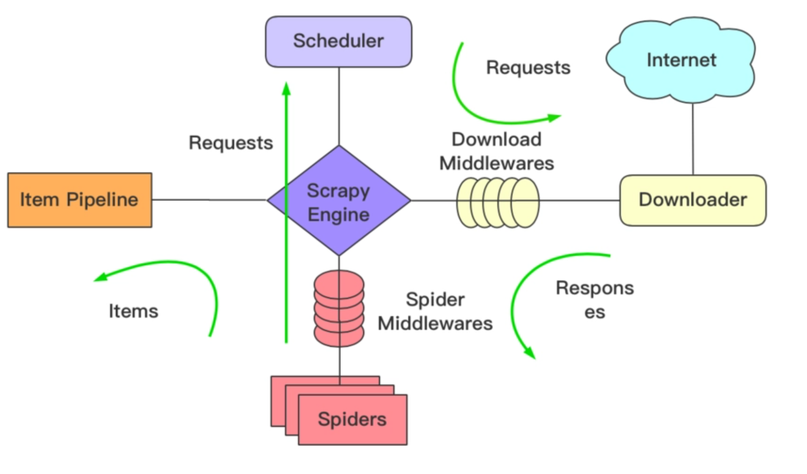

通过这张图我们可以看到，Scrapy 框架总共分成了下面七个部分。

1. Scrapy Engine（Scrapy 引擎）。

2. Scheduler（调度器）。

3. Downloader（下载器）。

4. Spiders（爬虫）。

5. Item Pipline（管道）。

6. Downloader Middlewares（下载中间件）。

7. Spider Middlewares（Spider 中间件）。

接下来，我们来看看这七个部分的具体含义，以及它们是如何协作的。

Scrapy Engine：Scrapy 引擎是整个 Scrapy 框架的核心，负责所有子模块间的调度、通信和数据传递等，我们可以把它看作整个 Scrapy 框架的总指挥。

Spider：它负责处理所有的 responses。也就是说，当爬虫程序获取到服务器端的 response响应之后，接下来就会交由 Spider 去处理，它会根据需求提取数据和相应的 URL 信息，并交给引擎。值得注意的是，Spider 模块虽然是 Scrapy 框架自带的模块，但是它仍然需要开发者自己手写代码实现。

Scheduler：调度器负责接收引擎发送过来的 requests 请求，并将它们放入到队列当中，在后续引擎有需要的时候再将请求返回给引擎。我们可以理解为下一步要抓取的网址由它决定，同时，在调度器里还会自动去掉重复的网址。

Downloader：下载器主要负责下载 Scrapy Engine 发送过来的所有 requests 请求，并将获取到的 responses 信息经 Scrapy Engine 返回给 Spider 处理。

Item Pipeline：管道，主要负责处理 Spider 中获取到的 item 并进行后期处理，比如对数据进行分析、过滤、存储等。

Downloader Middlewares：下载中间件，开发者可以在这里自定义扩展下载功能的组件。

Spider Middlewares：Spider 中间件，可以自定义 request 请求和进行 response 过滤的组件。

了解了这七个组件的功能之后，我们来看看各组件的工作流程。在上面这张图中，我们可以看到核心的位置是引擎。也就是说基本所有的流程都和引擎相关，借助 Scrapy 框架爬取信息大致可以分为下面六步。

1. 爬虫程序工作的时候会经由引擎向 Spider 提出申请，索要第一个待爬取的 URL。待引擎拿到 URL 之后，就将这个 URL 传入调度程序 Scheduler。

2. Scheduler 会将需要下载的 URL 加入到队列中，形成一个 URL 队列。当 Scheduler 完成请求后，会取出队列中的第一个 URL，将其返回给引擎。

3. 引擎拿到 URL 之后，会将这个 URL 经由 Downloader Middlewares 交给 Downloader。完成下载后，我们会得到服务端返回来的 response 对象。

4. 当 Downloader 拿到了 response 对象之后，接下来要做的就是把它交给引擎，然后引擎再经由 Spider Middlewares 将 response 结果交给 Spider 文件。

5. Spider 文件处理和分析 response 的结果，在此基础上拿到我们想要的数据，这里一般要做的就是标签解析、内容提取等工作。

6. 解析完数据之后，我们要把这些数据经由 Item Pipeline 存储起来。无论是存文件还是存数据库，理论上都是由这一个组件来完成。

完成上面六个步骤之后，我们的第一个链接爬虫工作就结束了。紧接着，我们会循环这个操作，直至拿到我们要爬取的所有文件为止（也就是直到 URL 列表空了），这时我们就完成了一整套爬虫工作。

## Scrapy 框架的安装和使用

了解了 Scrapy 框架的工作原理，我们就可以更好地安装和使用 Scrapy 。

Scrapy 在 Python 中被当作一个库来使用，要想在 Python 中使用 Scrapy，首先我们要安装Scrapy。而要在 Python 中安装各种各样的库，我推荐使用 Anaconda 来进行 Python 环境的管理。

### 安装 Anaconda 环境

Anaconda 是一个开源的 Python 发行版本，它包括 Conda、Python 以及一大堆安装好的工具包，比如：Numpy、Pandas 等。我们可以把 Anaconda 看作是一个常用的扩展库的集合，我们可以使用 Anaconda 很轻松地管理我们的扩展库，还可以使用 Anaconda 创建多个虚拟环境。每个虚拟环境都是独立的，我们可以在各个环境上分别安装独立的包。

Anaconda 安装包的获取方式有很多，我们首先想到的肯定是从官网下载。不过，我个人建议从清华源下载，因为在国内访问清华源速度相对较快，下载起来比较容易。我们直接百度搜索Anaconda 清华源，或者输入以下网址即可。

```
https://mirrors.bfsu.edu.cn/anaconda/archive/
```

在这里，我们下载的版本为 2022.05-Windows-x86_64。

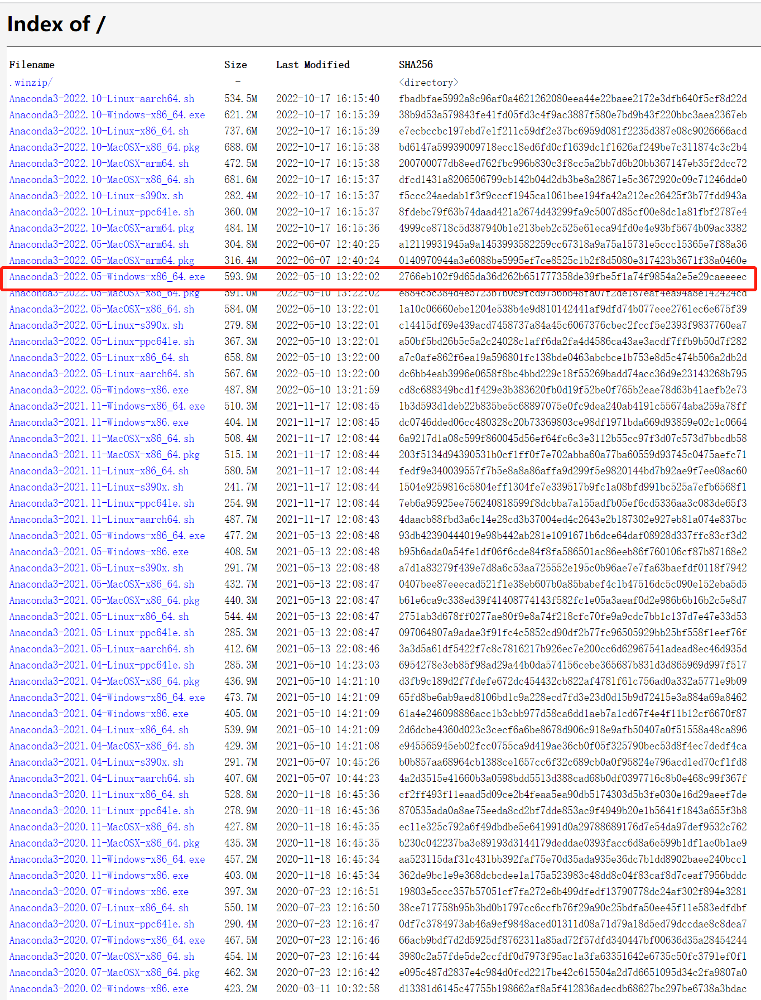

下载完成之后，我们双击安装包进行安装。

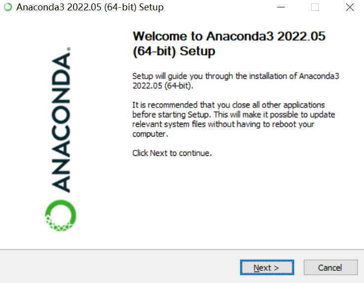

然后一路点击 Next，直到选择目录那一步，你可以根据习惯选择目录，然后点击 Next，出现下面的界面。

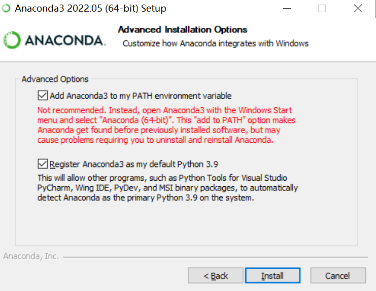

这里我建议把两个复选框都选中，上面的复选框是说要把 Anaconda3 加入到系统的环境变量中，下面的选项大意是使用 Anaconda3 作为默认的 Python3.9，然后点击 Install。安装完成后，我们在命令控制台输入 conda，如果出现以下界面，说明安装完成了。

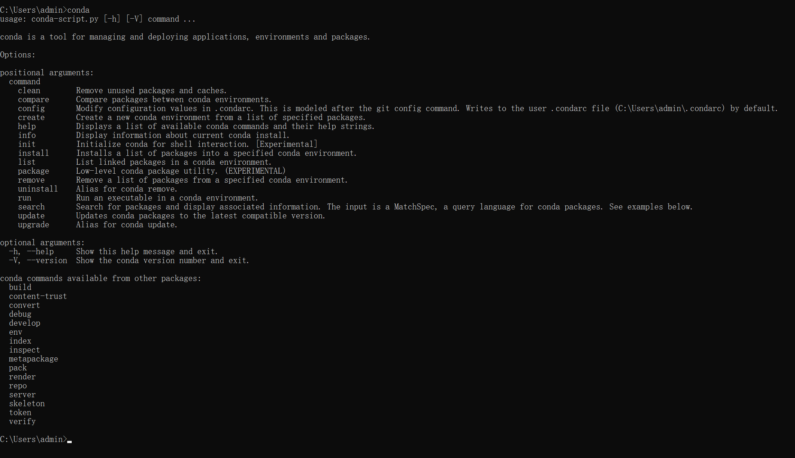

接下来，我们要创建一个虚拟环境。因为我们这个虚拟环境主要是用来做爬虫的，所以我们可以创建一个名为 scrapy_recommendation 的虚拟环境，并指定我们使用的 Python 版本为 3.7版本。具体做法是输入如下命令。

```
conda create -n scrapy_recommendation python==3.7
```

稍等片刻，会出现下面的界面。

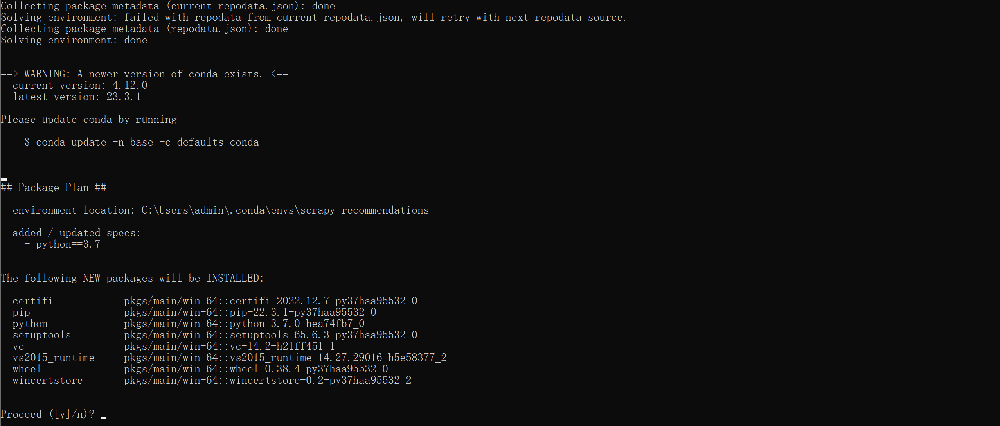

我们输入 Y，开始安装，安装结束后，会弹出如下提示。

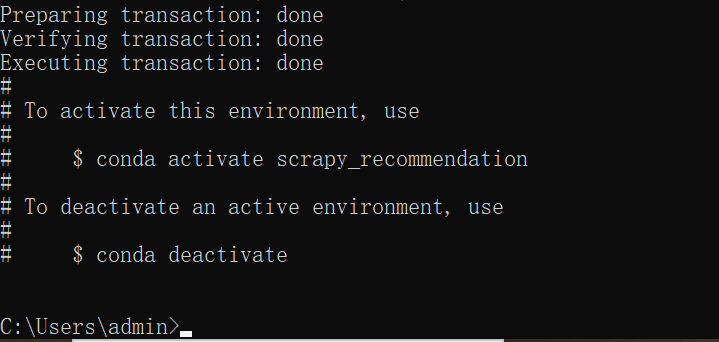

但是这里要注意的是，它会告诉你如果要激活你的环境，需要输入 conda activatescrapy_recommendation，但是实际上在 Windows 中，这样输入会产生报错。

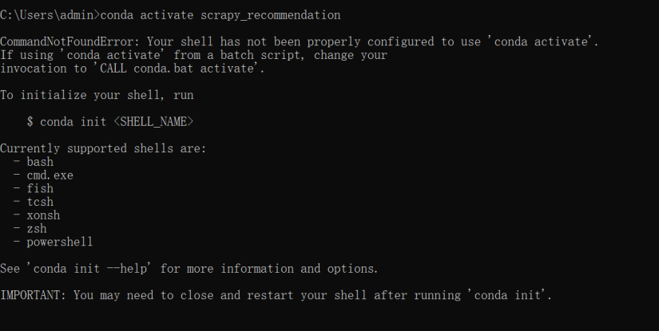

这个应该属于 Anaconda 的一个小 Bug，因为这实际上是在 Linux 和 Mac 环境下的命令，在Windows 环境下，我们直接输入 activate scrapy_recommendation 即可。这个时候会有如下显示。

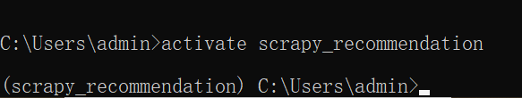

### 安装 Scrapy 环境

现在，我们的 Anaconda 环境就已经安装好了，下一步是安装 Scrapy 环境。实际上要在Anaconda 环境中安装 Scrapy 很简单，只需要执行 pip install scrapy 即可。

等到出现如下界面时，安装就完成了。

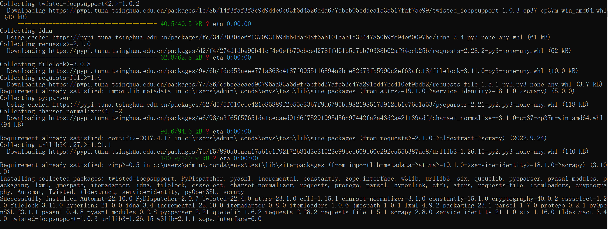

我们可以通过 conda list 来查看我们已有的包。

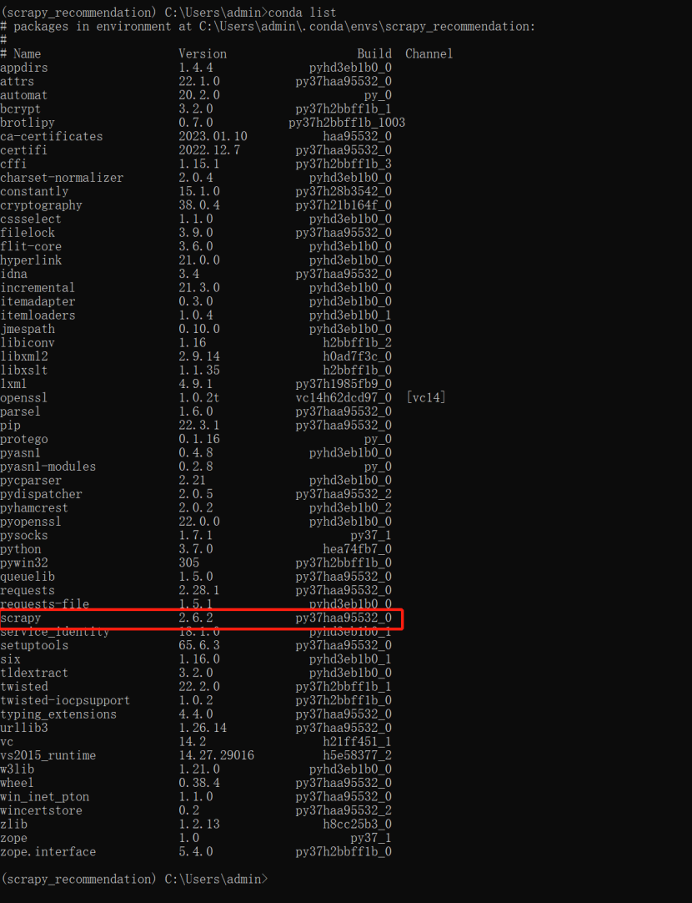

### 使用 Scrapy 创建爬虫开发环境

接下来，我们就尝试使用 Scrapy 创建一个爬虫开发环境。

首先，我们要确定好一个我们要搭建环境的目录，我选择了 I 盘的 geekbang 作为我要搭建环境的根目录。所以我首先要做的就是切换到这个目录下。具体做法是输入如下指令。

```bash
cd I:\geekbang
```

切换到指定目录下之后，我们就可以创建我们的 Scrapy 工程了。要注意的是，我们可以直接通过 Scrapy 的相关命令来创建爬虫工程。因为我们准备爬取新浪新闻里的新闻数据，把它作为我们后面推荐系统的原始数据。所以我们可以创建一个工程名为 sina 的爬虫项目，输入如下命令。

```
scrapy startproject sina
```

创建完成项目之后，会是下图的样子。

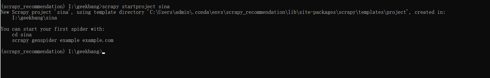

这个时候，我们进入到 I:\geekbang 目录下，会发现 Scrapy 帮我们创建了一个名为“sina”的目录。

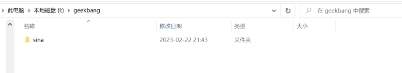

我们进入到这个目录之后会发现，这个目录里，已经帮我们创建好了一个基础的 Scrapy 工程，如图所示。

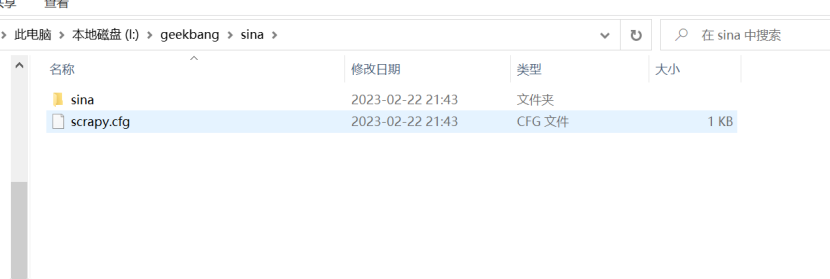

接下来我们将项目导入到 IDE 环境中，然后在 IDE 环境里查看整体的目录结构。这里我选择了 PyCharm 作为我们后续所有开发的 IDE。我们在 PyCharm 中依次点击 File->open，弹出一个文件目录选择框，我们选择 I:\geekbang\sina 作为我们的项目根目录，如下图所示。

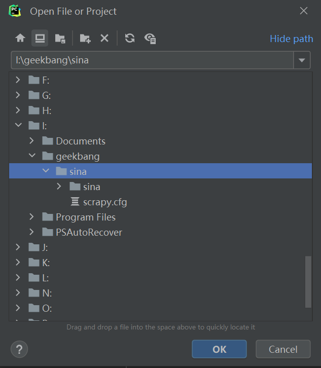

然后点击 OK，导入我们的项目。

需要注意的是，这个时候，我们 PyCharm 的开发环境是默认的，我们需要将其切换到我们所创建的 Anaconda 的“scrapy_recommendation”环境下。

因此，我们要依次点击：

File->Settings->Project:sina->Python Interpreter，然后将 Python Interpreter 的目录选择为我们的 Anaconda 创建的 scrapy_recommendation 环境下的 python.exe 文件。然后点击 OK，切换环境成功。

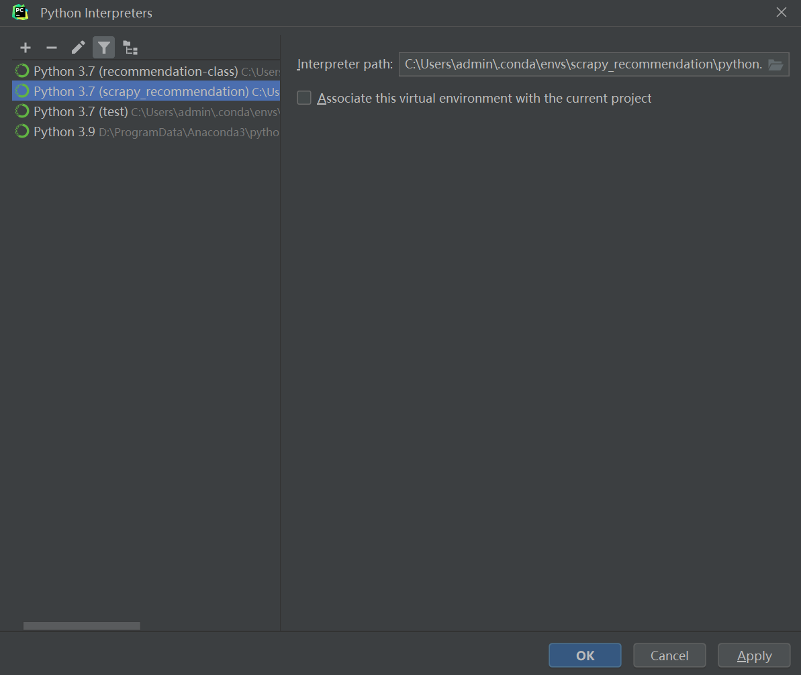

接下来，我们在主界面的左侧把所有的目录展开，我们来分别看一下 Scrapy 的各个目录以及它们的功能。

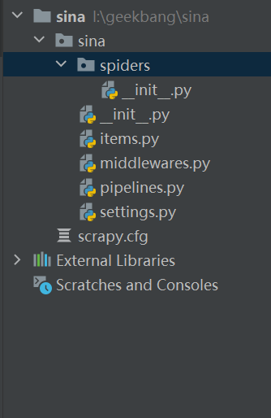

我们首先可以看到，在 sina 工程下面有一个同名的目录“sina”，和这个目录同一级的还有一个叫做 scrapy.cfg 的文件。你可以对照下面这个表格，看看这些文件的作用。

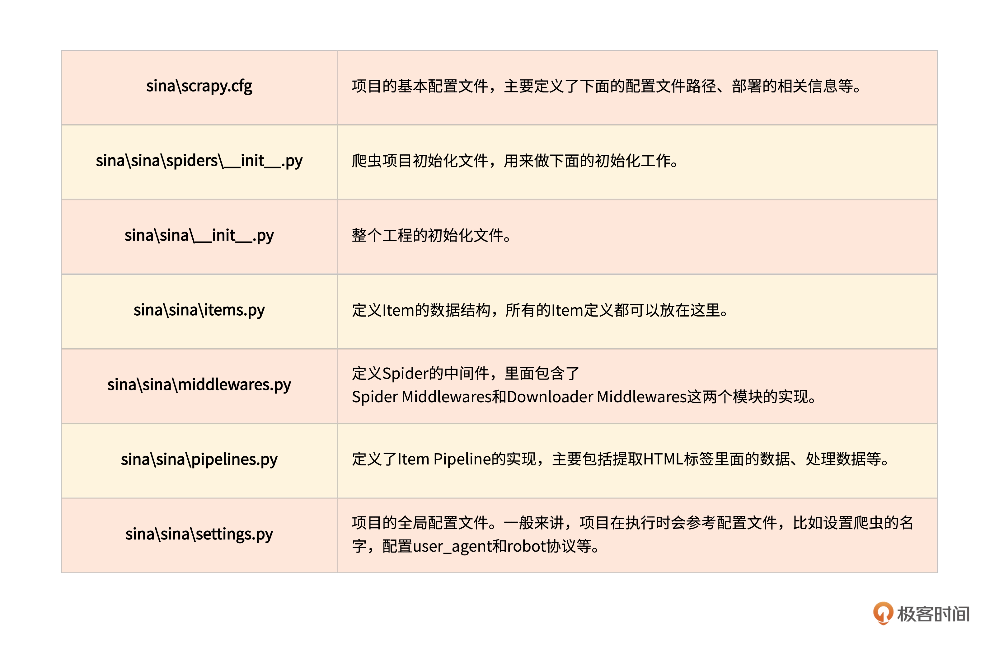

现在我们的 Scrapy 工程就创建完了。接下来我们再来创建一个爬虫程序，爬虫主要功能是爬取网站的数据。我们可以在 I:\geekbang\sina 目录下创建它，我们还是在 cmd 中切换到这个目录下，然后使用如下命令创建一个名为 sina_spider 的爬虫程序。

```
scrapy genspider sina_spider sina.com.cn
```

这时候命令行中显示如下。

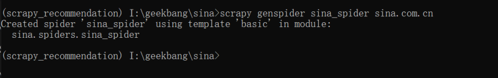

然后我们切换到 IDE 中，会发现在 sina\sina\spiders 下面出现了一个名为 sina_spider.py 的文件，如图所示。

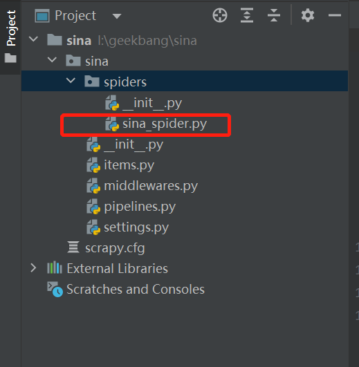

我们打开这个文件，如果出现如下代码，说明我们这个爬虫文件创建成功了。

```python
import scrapy
class SinaSpiderSpider(scrapy.Spider):
   name = 'sina_spider'
   allowed_domains = ['sina.com.cn']
   start_urls = ['http://sina.com.cn/']
   def parse(self, response):
       pass
```

进行到这里，一个基本的爬虫程序就创建完成了。但是现在离可以爬取数据还差一步，我们需要让我们的爬虫程序可以模拟人的操作来浏览网页。也就是说，我们要装一个插件来连接我们的 Scrapy 框架和浏览器界面，这里我推荐使用 Chrome 浏览器，我们需要下载的插件名称就是 ChromeDriver，ChromeDriver 插件的下载地址如下。

```
http://chromedriver.storage.googleapis.com/index.html
```

这个插件有很多版本，那我们是不是随便下载一个版本就可以了呢？当然不是，我们下载的版本一定要和 Chrome 浏览器的版本对应上。我们可以在 Chrome 浏览器中输入下面的命令进入设置界面。

```
chrome://settings/help
```

这时候会弹出一个关于 Chrome 的界面，在这个界面里可以看到我们浏览器的版本。

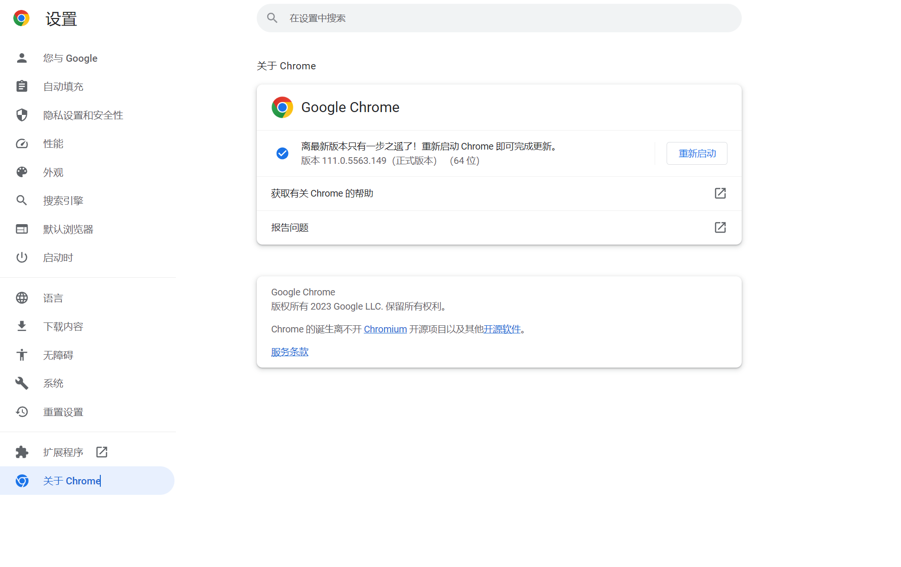

可以看到，我的版本为 111.0.5563.149，所以我们回到 ChromeDriver 的下载界面找到110.0.5563 版本进行下载，如果小版本找不到的话，就找前一个级别的版本中最后一个版本即可。

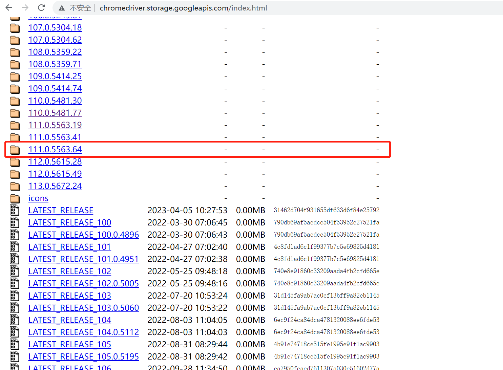

这里要注意的是，我们可能找不到完全一样的版本。如果遇到这种情况，找到上一级版本号一样的插件中的最后一个版本即可。我这里对应的是 110.0.5563.64，点击下载。这里适配Windows 的插件只有 32 位的版本，但它其实没什么影响，我们即使是 64 位的操作系统也可以使用，正常下载即可。

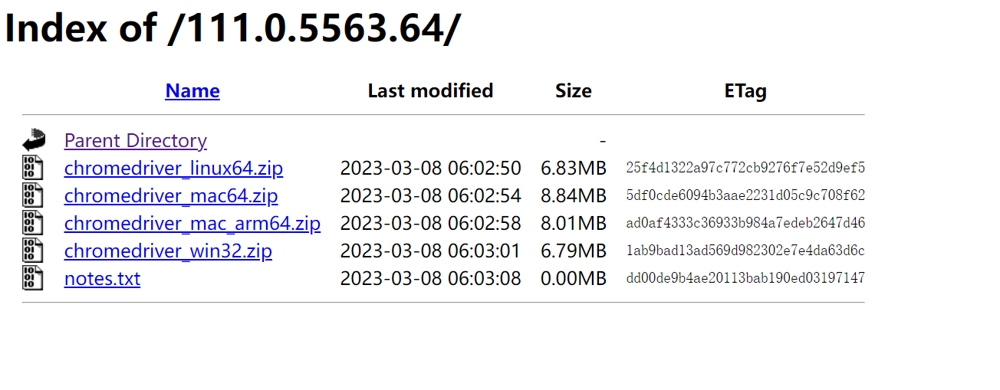

下载完成之后，解压会得到一个 chromedriver.exe 的文件，要把这个文件分别复制到我们的Anaconda 的 scrapy_recommendation 环境和 Rhrome 的浏览器中，如图所示。

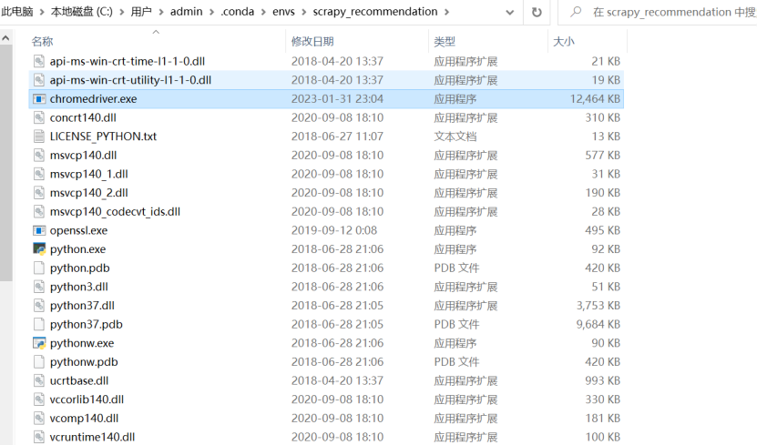

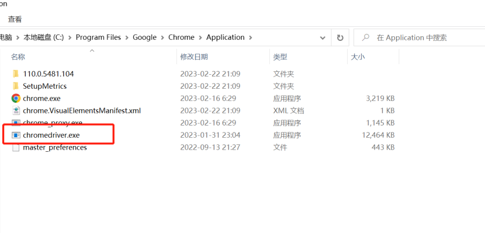

到这里，我们的 ChromDriver 插件就安装好了，只有安装好这个插件，我们在爬取数据的时候才能连接上浏览器。

我们知道，要运行一个程序就要写一个主文件。一般来说这个主文件是 main.py 文件，所以我们在项目的根目录下创建一个名为 main.py 的文件，然后输入如下代码。

```python
from scrapy import cmdline
cmdline.execute('scrapy crawl sina_spider'.split())
```

简单解释一下这段程序。在这段程序里，我们首先从 Scrapy 的包里导入了 cmdline 这个库，然后使用 cmdline.execute 执行了 scrapy crawl sina_spider。这里 scrapy crawl 是一个Scrapy 的基础命令，表示启动爬虫程序，后面跟的是爬虫的名字。所以上面代码合起来的意思就是使用 cmd 命令启动名为“sina_spider”的爬虫程序。

如果出现如下界面，说明 Scrapy 的基础程序是正确的。

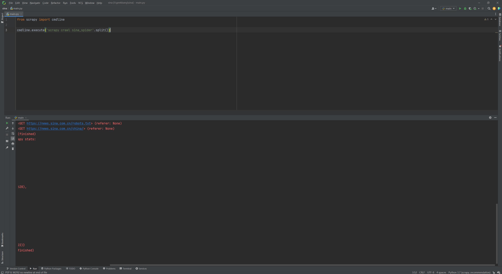

到这一步，虽然程序已经知道了要爬取的网站是 sina.com.cn，现在运行也没有报错，但是似乎并没有什么结果，而且马上就关闭了。这是因为我们目前只是启动了这个爬虫程序，并没有写具体的爬虫代码，所以程序只是对 sina.com.cn 做了个链接，并返回了响应码 200。接下来，我们就要开始正式踏上爬虫程序的编写之路了。

## 总结

我们来回顾一下本节课的主要知识点。

1. Scrapy 是一个适用于 Python 的快速、高层次的屏幕抓取和 Web 抓取框架，它可以抓取Web 站点并从页面中提取结构化的数据。

2. 你还应该知道 Scrapy 框架的原理和主要模块（Scrapy 引擎、调度器、下载器、爬虫、管道、下载中间件、Spider 中间件），以及它们是如何协作的。

3. 最后，我们应该有能力在 Anaconda 环境中创建一个 Scrapy 环境，搭建一个最简单的Scrapy 框架并把它跑起来。

## 课后题

学完这节课，给你留两道思考题。

1. 请你自己尝试搭建一个 Anaconda 环境，并安装 Scrapy 框架相关的库。

2. 请你创建一个 Scrapy 的框架程序并运行它。

欢迎你在留言区与我交流讨论，我们下节课再见。
