# 08 | 数据获取：如何使用Scrapy框架爬取新闻数据？

你好，我是黄鸿波。

上一节课，我们对 Scrapy 框架有了一个整体的了解，也实际地安装了 Scrapy 库并搭建了一个基础的 Scrapy 工程。这节课，我们就继续在这个工程的基础上爬取新浪新闻中的数据，并对爬取到的数据进行解析。

## 使用 Scrapy 框架抓取数据

我们首先打开 sina\sina\spider 下面的 sina_spider.py 文件，在这个文件中，Scrapy 框架给我们写了一个基础的框架代码。

```python
import scrapy
class SinaSpiderSpider(scrapy.Spider):
   name = 'sina_spider'
   allowed_domains = ['sina.com.cn']
   start_urls = ['http://sina.com.cn/']
   def parse(self, response):
       pass
```

这段代码主要是对整个爬虫程序做了一个简单的定义，定义了爬虫的名字为“sina_spider”，爬取的域名为“sina.com.cn”，爬取的 URL 是“http://sina.com.cn/”。最后它还贴心地帮我们定义了一个解析函数，这个解析函数的入参就是服务器返回的 response 值。现在，我们要开始分析我们要爬取的内容，并对这个函数进行改写。

### 页面分析

我们先以网易的国内新闻为例来分析一下。我们先看下面这个界面。

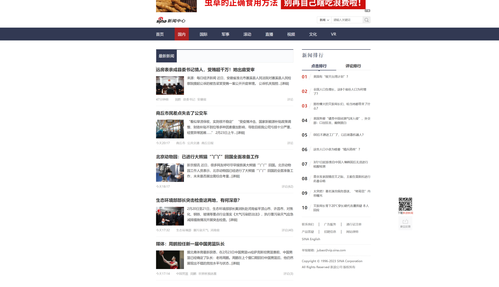

我们要分析的是界面里最新新闻这个部分。可以看到这个新闻列表中一共包含了下面这几部分：标题、摘要、时间、关键词。我们还可以看到，时间在 1 小时之内的会显示为“XX 分钟前”，在 1 小时以上的会显示今天具体的某个时间点。

接着我们把页面拉到最下面。

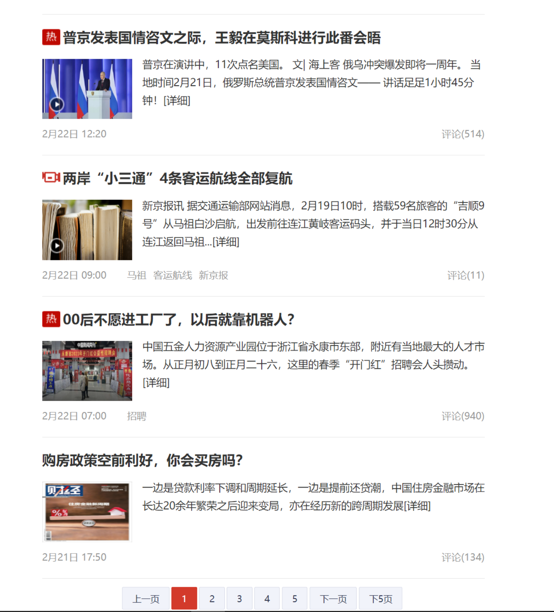

可以看到，今天之前的新闻会显示出具体的日期，并且最下面有一个导航条用来翻页。

我们随便点击一条新闻进入详情页看一下。可以看到里面包含了图片和文字，其中文字部分最上面有标题，下面有日期和时间，再下面是正文。当然，还充斥着广告和我们不需要的信息，这些我们暂时不用管。


接下来我们分析一下前面的列表以及这个详情页的内容，抓取我们想要的信息。

我们知道，所有的页面从根本上来说都是由 HTML 页面构成的，爬虫想要爬取的内容就藏在这些 HTML 页面中。在 Chrome 浏览器中，我们按下键盘上的 F12 键就能够打开开发者工具模式。我们可以利用这个模式查看网页的 HTML 源文件、请求的信息文件以及网络返回等。我们选择上面的 Element 选项卡，就能看到网页的 HTML 源文件，如下图所示。

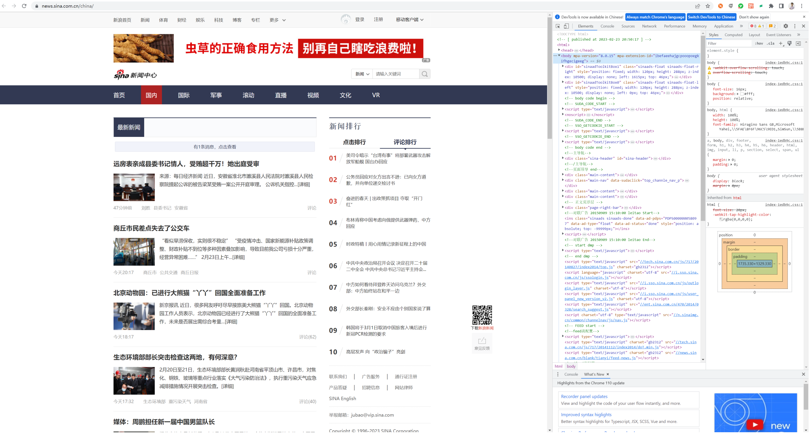

因为我们要找的是我们需要的列表，所以我们可以点击开发者工具左上角的小箭头，如下图所示。

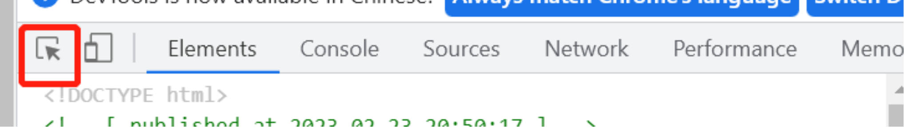

然后用鼠标点击我们想要的列表，右侧的 HTML 代码就会跟着跳转到相应的部分。

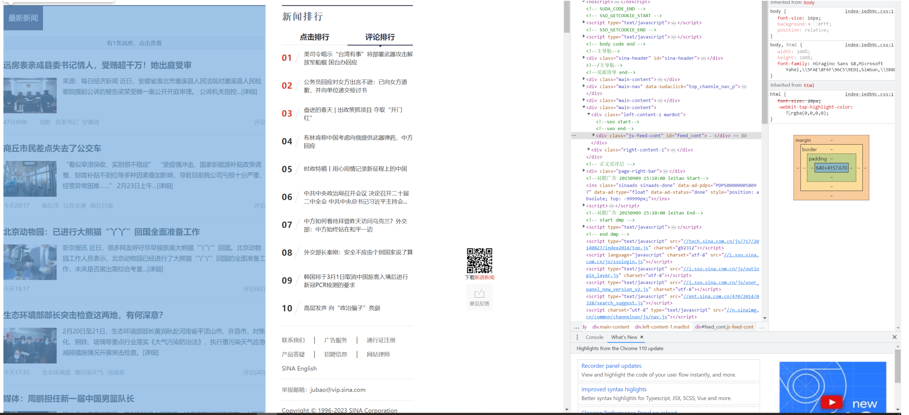

那么这个时候，我们需要找到这里面的其中一条，然后查看右面的 HTML 源文件。

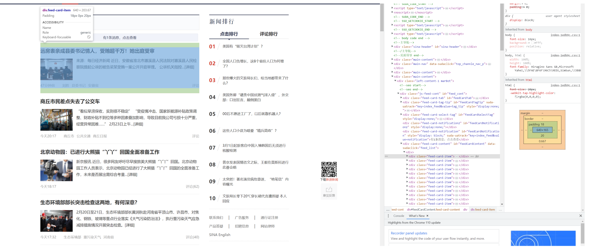

我们可以发现，实际上，在这个列表中，每一条内容都会被包含在 class 为“feed-card-item”的标签中，我们把这个标签展开来详细地分析一下。

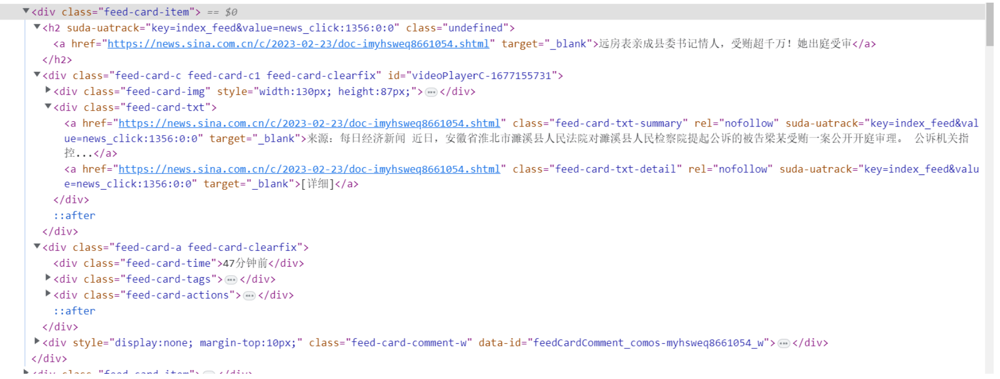

可以看到，标题被包含在 h2 标签里的 a 标签中，时间被包含在 h2 标签里 class 为 feed-card-a feed-card-clearfix 下面的 feed-card-time 中，然后这条内容的链接就是 h2 标签里的 a 标签的链接。

好了，知道了我们要的标题、时间以及对应的链接，接下来，我们就可以通过爬虫把它们拿下来了。

### 爬取列表

使用 Scrapy 拿标签，比较方便的一种方法是使用 Selenium 库。

Selenium 是一个用于测试 Web 应用程序的工具，Selenium 测试可以直接运行在浏览器中，就像真正的用户在操作一样。也就是说，我们可以使用 Selenium 库来模拟点击、上滑和下滑等操作。

要想使用这个库，首先要在开发环境中安装它。安装方法也比较简单，直接在我们的Anaconda 环境中使用 pip 安装就好。具体做法是切换到 scrapy_recommendation 环境中，执行下面的命令。

```
pip install selenium
```

安装完成后如图所示。

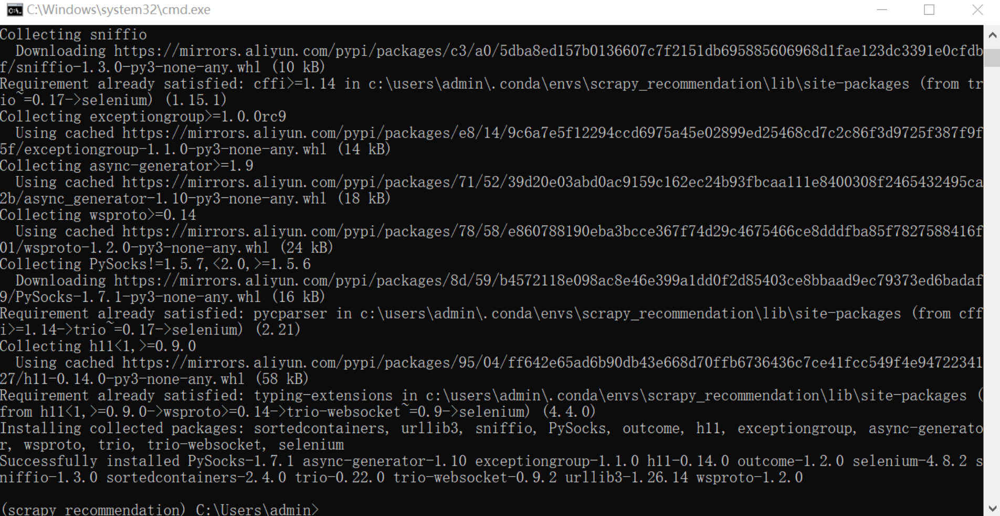

接下来我们就可以使用 Selenium 来进行浏览器页面访问工作了，我们把上面的代码改写如下。

```python
import scrapy
from scrapy.http import Request
from selenium import webdriver
class SinaSpiderSpider(scrapy.Spider):
   name = 'sina_spider'
   def __init__(self):
       self.start_urls = ['https://news.sina.com.cn/china/']
       self.option = webdriver.ChromeOptions()
       self.option.add_argument('no=sandbox')
       self.option.add_argument('--blink-setting=imagesEnable=false')
   def start_requests(self):
       for url in self.start_urls:
           yield Request(url=url, callback=self.parse)
   def parse(self, response):
       driver = webdriver.Chrome(chrome_options=self.option)
       driver.set_page_load_timeout(30)
       driver.get(response.url)
       title = driver.find_elements_by_xpath("//h2[@class='undefined']/a[@target
       time = driver.find_elements_by_xpath("//h2[@class='undefined']/../div[@cl
                                            "feed-card-clearfix']/div[@class='fe
       for i in range(len(title)):
           print(title[i].text)
           print(time[i].text)
```

可以看到，这段代码相比上面那段代码有了非常大的改变。首先，在最上面，我们多导入了两个包。

```python
from scrapy.http import Request
from selenium import webdriver
```

这段代码第一行的意思是从 Scrapy 的 http 模块导入 Request 这个包，第二行的意思是从Selenium 库导入 Webdriver 这个包。

Request 包顾名思义，就是用来做 HTTP 请求。也就是说，我们在向网站服务器请求数据时，就是 Request 包在起作用。而 Selenium 下面的 webdriver 包是一组开源的 API，用于自动化测试 Web 应用程序。在我们的程序中，主要是利用它来打开浏览器，以及设置打开时的一些信息。

接着，我们把这个 class 进行了重构，加入了 __init__ 这个构造函数。我们可以先粗略地理解为，当我们运行这个 Python 文件时，就会先去执行 __init__ 函数里面的内容。

我们将之前的 start_urls 加入到了 __init__ 中，并在前面加上 self。接着，我们定义了webdriver 中关于 Chrome 浏览器的一些参数。

```
self.option = webdriver.ChromeOptions()
self.option.add_argument('no=sandbox')
self.option.add_argument('--blink-setting=imagesEnable=false')
```

我在这里加了两个参数，一个是“no=sandbox”，它表示取消沙盒模式，也就是说让它在 root权限下执行。另一个参数是“–blink-setting=imagesEnable=false”，它表示不加载图片，因为我们只想要文字部分，加上这一句可以提升爬取速度和效率。

接下来，我们增加了一个 start_requests() 函数，这实际上也是 Scrapy 自带的函数，它的主要作用是定义 Scrapy 框架的起始请求，如果在这个起始请求中有重复的 URL，它会自动进行去重操作。

```python
def start_requests(self):
       for url in self.start_urls:
           yield Request(url=url, callback=self.parse)
```

然后在解析函数中，我们定义了一个 driver，它调用了 webdriver 的 chrome 函数，代表这是使用 Chrome 浏览器来爬取的。我们还把加载页面的超时时间设置为了 30 秒，也就是说如果30 秒还加载不出来，就去请求下一个页面，而这下一个页面就是从 start_requests() 函数中获得的。然后我们调用 driver.get 来获取 response 的 URL，就可以拿到 response 信息了。

```python
def parse(self, response):
   driver = webdriver.Chrome(chrome_options=self.option)
   driver.set_page_load_timeout(30)
   driver.get(response.url)
   title = driver.find_elements_by_xpath("//h2[@class='undefined']/a[@target='_b
   time = driver.find_elements_by_xpath("//h2[@class='undefined']/../div[@class=
                                        "feed-card-clearfix']/div[@class='feed-c
   for i in range(len(title)):
       print(title[i].text)
       print(time[i].text)
```

在后面的代码中，我们主要又做了两件事。一个是获取 title 信息，一个是获取 time 信息。

我们使用 driver.find_elements_by_xpath() 函数获取 HTML 标签中的内容，根据我们在最前面的分析，title 被存在“//h2[@class=‘undefined’]/a[@target=‘_blank’]”中，而 time 被存在“//h2[@class=‘undefined’]/…/div[@class=‘feed-card-a feed-card-clearfix’]/div[@class=‘feed-card-time’]”中，因此，我们可以通过driver.find_elements_by_xpath() 获取到里面的内容。

要注意的是，我们获取到的内容一般是以一个 list 的形式存放，所以我们还需要使用 for 循环拿到里面的信息。

正常来讲，完成上面这段代码之后，运行 main.py 文件，就会得到如下图所示的结果。

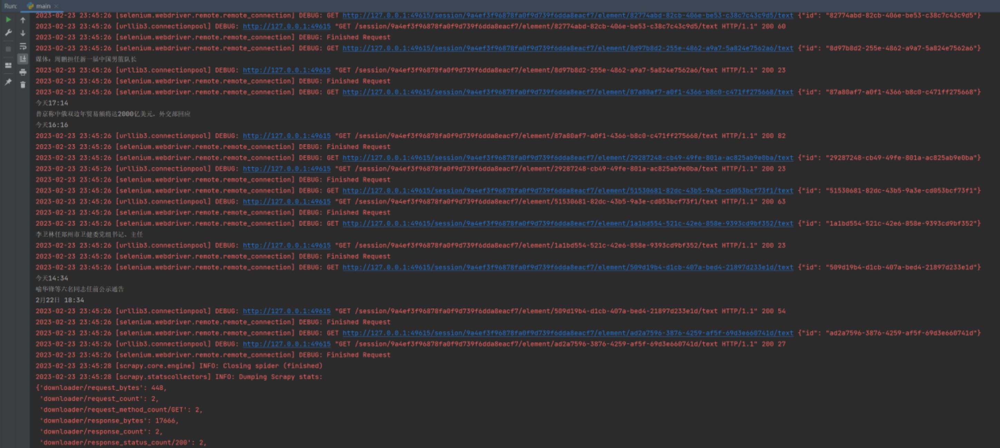

可以看到，我们想要的时间和标题都已经输出出来了。

不过，虽然我们现在已经得到了时间，但是输出的格式却不统一：有的显示的是今天的某个时间，有的显示的是日期加时间。所以我们要对时间做进一步处理，可以在刚刚的 for 循环代码下面加上处理代码。

```
 today = datetime.datetime.now()
           eachtime = time[i].text
           eachtime = eachtime.replace('今天', str(today.month) + '月' + str(toda
           if '分钟前' in eachtime:
               minute = int(eachtime.split('分钟前')[0])
               t = datetime.datetime.now() - datetime.timedelta(minutes=minute)
               t2 = datetime.datetime(year=t.year, month=t.month, day=t.day, hou
           else:
               if '年' not in eachtime:
                   eachtime = str(today.year) + '年' + eachtime
               t1 = re.split('[年月日:]', eachtime)
               t2 = datetime.datetime(year=int(t1[0]), month=int(t1[1]), day=int
                                      minute=int(t1[4]))
           print(t2)
```

我们再运行一下程序，得到如下结果。

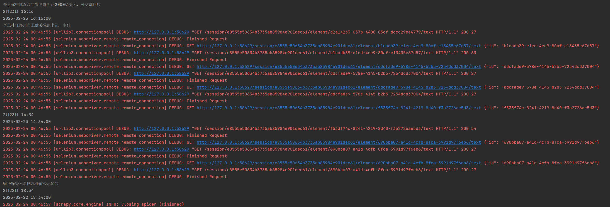

可以看到，现在时间已经变成了我们想要的样子。到这里我们的列表爬取工作就完成了，接下来开始爬取详情页的信息。

### 爬取详情页

我们知道，如果是人为操作，需要点击相应标题进入详情页。对于爬虫程序来说也是一样的，我们需要从 HTML 文件中提取标题对应的链接，然后再传给爬虫程序进行数据的爬取，最后处理对应的 response。

我们先来看看怎么获取我们所需要的链接。

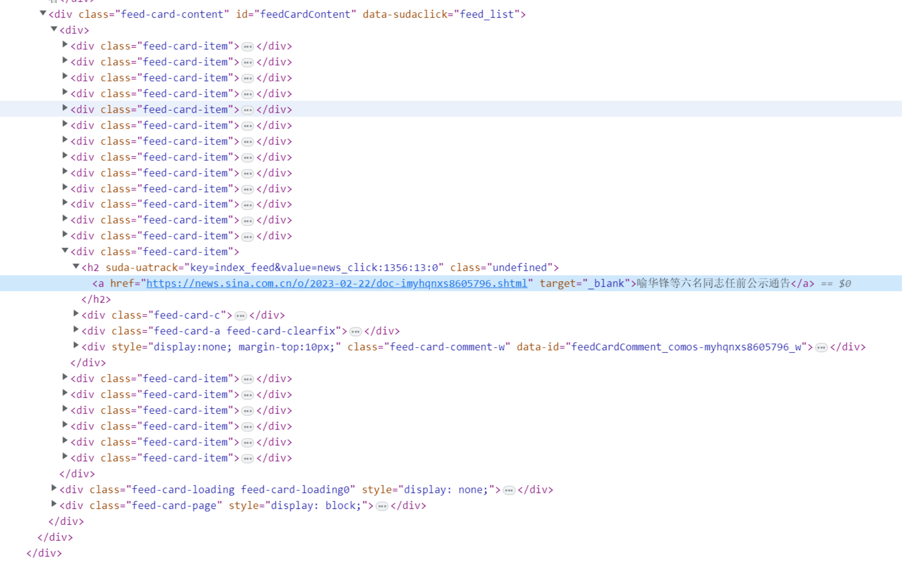

通过分析 HTML 源文件我们可以看到，每一个标题都在 a 标签中，而 a 标签里面的 href 就是它所对应的链接。所以，我们只需要取出 href，就可以取出详情页的链接了。

要实现这一点，我们只需要在解析 title 后面加上下面这条代码。

```
href = title[i].get_attribute('href')
```

接下来，为了获取正文信息，在 Scrapy 中，我们需要把 request 请求给 yield 出去，在里面放上链接。

首先，我们把需要的内容 yield 到下一页，传递它最好的方式就是使用 ItemPipeline。可以看到我们创建 Scrapy 工程之后，工程目录下会自动创建一个 items.py。我们打开这个文件，会发现它自带了一些代码。

```python
# Define here the models for your scraped items
#
# See documentation in:
# https://docs.scrapy.org/en/latest/topics/items.html
import scrapy
class SinaItem(scrapy.Item):
   # define the fields for your item here like:
   # name = scrapy.Field()
   pass
```

这段代码里导入了 scrapy 包，并自动帮我们创建了一个 SinaItem 类，这里还通过注释的方法告诉了我们这个类里面应该怎么写。我们就来照葫芦画瓢，把我们想要的字段加入进来。

代码会变成如下形式。

```python
class SinaItem(scrapy.Item):
   # define the fields for your item here like:
   # name = scrapy.Field()
   title = scrapy.Field()
   desc = scrapy.Field()
   times = scrapy.Field()
 type = scrapy.Field()
```

我们在里面定义了四个字段，分别是 title、desc、times 和 type，分别用来表示标题、内容、时间和类型。这里的标题和时间通过列表来获取，内容是详情页里的。而类型我们默认为国内，如果后面我们需要爬取其他的类别，比如综艺、体育等，我们就不需要新建 class 了，只要重新在这个 type 字段中赋值即可。

好了，进行到这里，我们就可以回到我们的爬虫代码去引入这部分内容了。首先我们要在第一行引入我们的 item 文件，加入下面的代码。

```
from sina.items import SinaItem
```

然后，我们在爬虫文件的 parse 函数中引入 SinaItem 类，并在函数的末尾对其赋值我们想要的内容。

```
item = SinaItem()
item['type'] = 'news'
item['title'] = title[i].text
item['times'] = t2
```

接着，我们可以在最后把 item 给 yield 出去，在代码的最后加入如下内容。

```
yield Request(url=response.urljoin(href), meta={'name': item}, callback=self.pars
```

这样我们就可以顺利地把 item 信息和 URL 给 yield 出去了。

我们来看这个 yield 的写法。我们 yield 出去的内容有两个，分别是 URL 信息和 item。item 用Key-Value 的形式传输，我们把它赋值到了 Key 为“name”的键值对中。

然后我们在这里还用到了一个 callback 函数，它实际上是回调了一个名为 parse_namedetail的函数。所以，我们需要在下面建立这个函数解析我们的详情页信息。我们在 parse 函数的下面新建一个函数 parse_namedeatal 并实现它，代码如下。

```python
def parse_namedetail(self, response):
 selector = Selector(response)
 desc = selector.xpath("//div[@class='article']/p/text()").extract()
 item = response.meta['name']
 desc = list(map(str.strip, desc))
 item['desc'] = ''.join(desc)
 print(item)
yield item
```

在这个函数中，我们首先建立了一个 Selector，它主要是 Response 用来提取数据的。当Spider 的 Request 得到 Response 之后，Spider 可以使用 Selector 提取 Response 中的有用的数据。因此，这里我们传入的是上面的 Response 信息，也就是详情页的 Response。

然后，我们使用 XPath 语法解析 response 中的 HTML 代码。我们先来看下有哪些 XPath 表达式，以便后续我们更好地使用它。

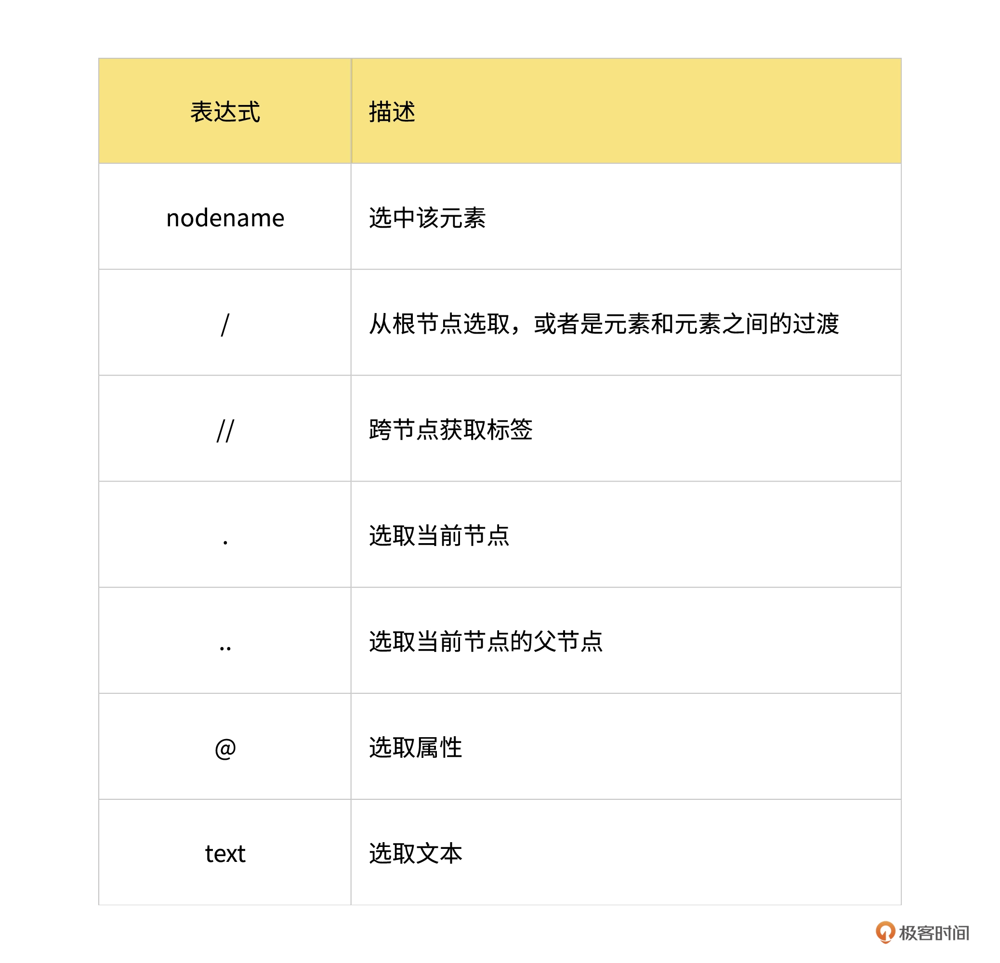

然后我们再来看一下详情页的正文部分在 Chrome 的开发者工具中的源代码。

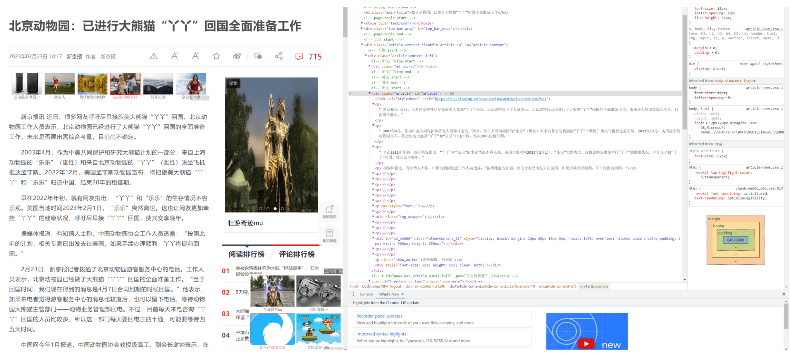

放大代码部分得到如下结果。

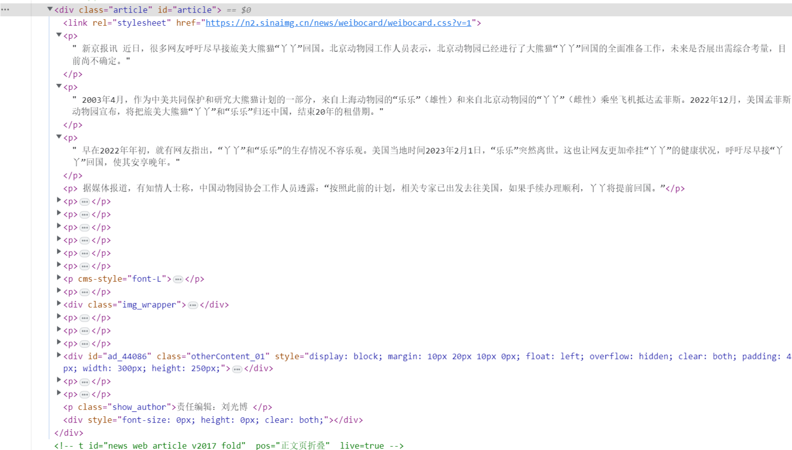

```
可以看到，所有的正文部分都在 class 为 article 和 id 为 article 的<div>标签中，并且每个段
落都用<p>标签包裹着。也就是说，我们只需要拿到 class 和 id 的标签，并且拿到所有的 p
```

标签，就可以拿出所有的内容。因此我们可以使用下面这行代码来获取所有的正文内容。

```
desc = selector.xpath("//div[@class='article']/p/text()").extract()
简单解释一下，我们使用  //  标志跨节点获取到了 class 为 article 的段落下面所有 p 标签中
```

的内容，并把它们提取了出来。接着，我们使用下面的代码拿到了前面传入的 item 信息，并把 desc 加入到了 item 中。

```
item = response.meta['name']
desc = list(map(str.strip, desc))
item['desc'] = ''.join(desc)
```

最后，我们再把这个 item 给 yield 出去就可以了。现在我们再运行一下代码会得到如下输出。

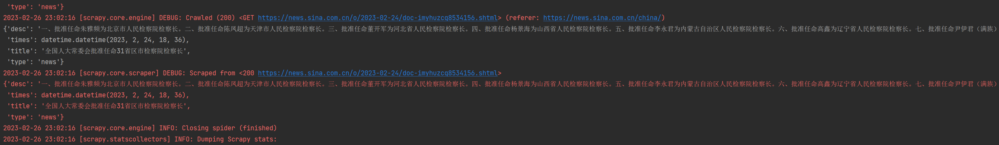

到这里，我们的数据爬取工作看起来就已经完成了。

但是等一等，你有没有发现一个问题，现在虽然已经能够爬取到数据，但是只能爬取一页的内容。这是远远不够的，接下来我们就用程序来实现翻页按钮的点击功能。

实际上，我们只需要在 parse 函数中加入如下代码即可。

```
try:
 driver.find_element_by_xpath("//div[@class='feed-card-page']/span[@class='pageb
except:
 Break
```

```
这段代码也不难理解，就是找到翻页导航条的 HTML 标签，然后找到它的<a>链接，执行点
```

击。

最后，我们要在最上面加上一个翻页操作，假设我们只需要翻 5 页，此时 parse 函数的代码如下。

```python
def parse(self, response):
 driver = webdriver.Chrome(chrome_options=self.option)
 driver.set_page_load_timeout(30)
 driver.get(response.url)
 for i in range(5):
   while not driver.find_element_by_xpath("//div[@class='feed-card-page']").text
     driver.execute_script("window.scrollTo(0, document.body.scrollHeight);")
   title = driver.find_elements_by_xpath("//h2[@class='undefined']/a[@target='_b
   time = driver.find_elements_by_xpath(
     "//h2[@class='undefined']/../div[@class='feed-card-a feed-card-clearfix']/d
   for i in range(len(title)):
     print(title[i].text)
     print(time[i].text)
     today = datetime.datetime.now()
     eachtime = time[i].text
     eachtime = eachtime.replace('今天', str(today.month) + '月' + str(today.day)
     href = title[i].get_attribute('href')
     if '分钟前' in eachtime:
       minute = int(eachtime.split('分钟前')[0])
       t = datetime.datetime.now() - datetime.timedelta(minutes=minute)
       t2 = datetime.datetime(year=t.year, month=t.month, day=t.day, hour=t.hour
     else:
       if '年' not in eachtime:
         eachtime = str(today.year) + '年' + eachtime
       t1 = re.split('[年月日:]', eachtime)
       t2 = datetime.datetime(year=int(t1[0]), month=int(t1[1]), day=int(t1[2]),
                    minute=int(t1[4]))
     print(t2)
     item = SinaItem()
     item['type'] = 'news'
     item['title'] = title[i].text
     item['times'] = t2
     yield Request(url=response.urljoin(href), meta={'name': item}, callback=sel
   try:
     driver.find_element_by_xpath("//div[@class='feed-card-page']/span[@class='p
   except:
     Break
```

我们再运行程序，这时我们就可以爬取 5 页的内容了，在此之后，爬虫会自动停止。

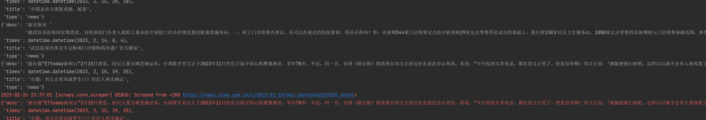

这样，我们已经能够针对一个栏目来爬取数据了。在后面的课程中，我们会延续这个思路，然后把数据存储起来并做相应的处理。

## 总结

这节课到这里也就接近尾声了，我来给你梳理一下这节课的主要内容。

1. 在 Chrome 浏览器中，我们可以使用 Chrome 开发者工具来查看页面上的元素、标记和属性，以及查看网络请求、响应和其他诊断信息。

2. Scrapy 提供了许多内置的解析器，包括 XPath 和 CSS 选择器等，这些解析器可以帮助我们轻松地从 HTML 页面中提取所需数据。

3. 在 Scrapy 中，callback 函数可以返回多个请求，并在结果返回时使用 yield 关键字传递给Scrapy 引擎。

4. item.py 文件是 Scrapy 中用于解析和存储数据的 Python 类。在 item.py 文件中，你可以定义数据模型，确定要提取的字段，并定义数据的类型和格式。

5. 在爬取包含多个页面的网站时，可以使用 next_page() 方法来模拟用户操作，调用 click(）函数进行点击。

## 课后题

学完这节课，请你试着完成下面两项任务。

1. 跟着我的讲解，自己实现一遍这节课所讲的内容。

2. 爬取新浪网站电影板块的内容。

欢迎你在留言区与我交流讨论，你也可以把代码链接附在评论区，我会选取有代表性的代码进行点评，我们下节课见！
