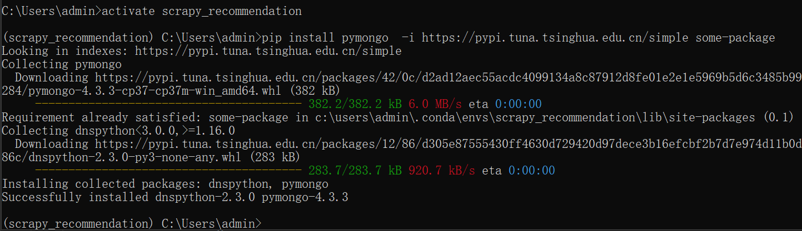
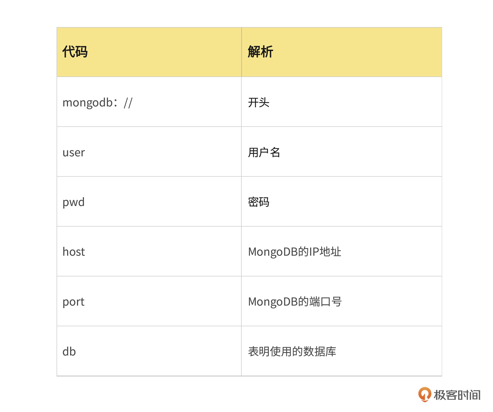
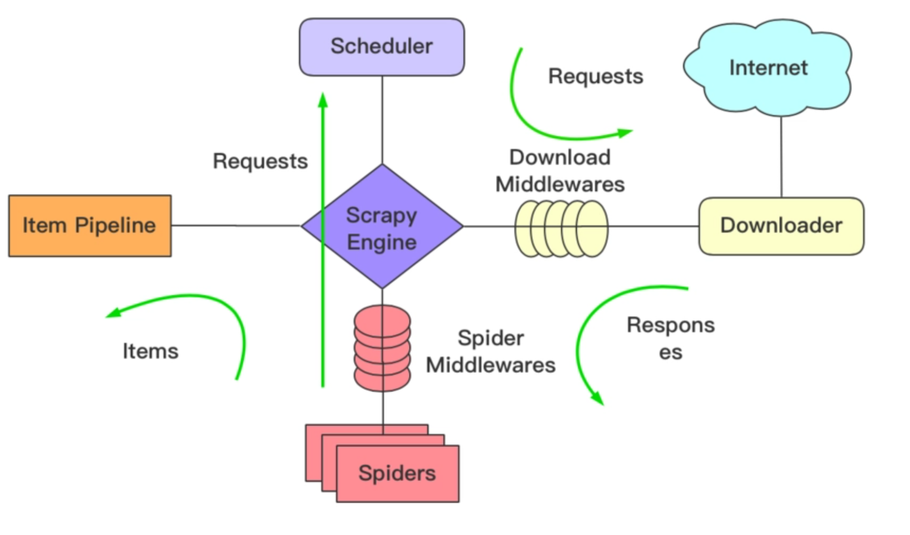
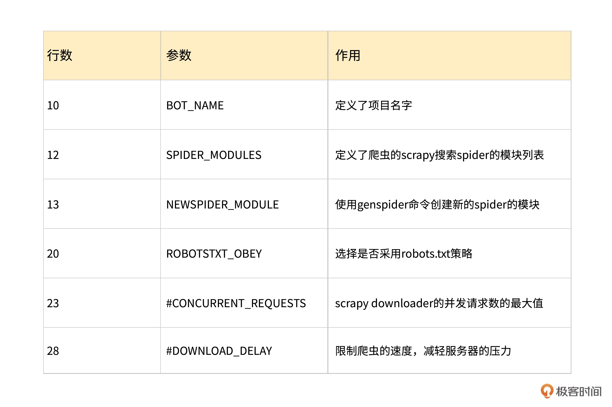
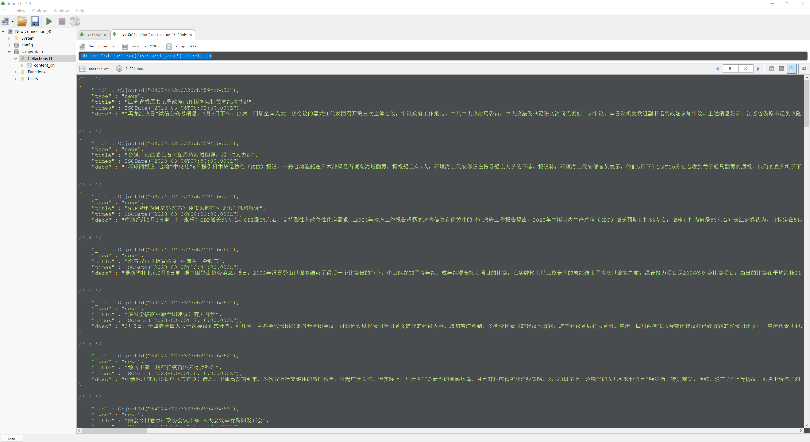

# 09 | 数据存储：如何将爬取到的数据存入数据库中？

你好，我是黄鸿波。

上节课，我们使用 Scrapy 框架已经能够爬取了新浪网的新闻数据，并且，我们也做了相应的翻页爬取功能。

这节课，我们就在上一节课的程序中做一个补充，加入参数传递和数据库存储相关功能（使用MongoDB 数据库进行存储）。

## Python 中的 pymongo 库

如果要想在 Python 中操作 MongoDB 数据库，首先我们要了解一下 pymongo 这个库。

pymongo 准确来讲是一个连接 Python 和 MongoDB 数据库的一个中间的驱动程序，这个程序可以使 Python 能够非常方便地使用和操作 MongoDB 数据库。在 Python 中，我们可以使用pip install pymongo 的方式来安装。

接下来，我们就在我们的 cmd 环境中来安装我们的 pymongo 库。首先，我们使用下面的命令切换到我们的 anaconda 环境中。

```
activate scrapy_recommendation
```

如果你是 Linux 或者 Mac 用户，则需要把命令改成下面这样。

```
conda activate scrapy_recommendation
```

紧接着，我们使用下面的命令来安装 pymongo。

```
pip install pymongo
```

安装完成之后，如下图所示。



接着，我们就可以尝试着在我们的 Python 环境中使用它。

想要在 Python 环境中使用 pymongo 库，我们需要经过下面四个步骤。

1. 导入 pymongo 库。

2. 连接 MongoDB 数据库。

3. 选择数据表。

4. 对数据表进行增删改查的操作。

接下来我们就从上面四个步骤入手，写一个简单的例子。

首先是导入 pymongo 这个库，在导入这个库的时候，我们直接使用 import 进行导入即可。接下来，我们正式对 MongoDB 数据库进行连接和操作。

一般来讲对于任何 Python 程序，如果我们想要做成工程化的形式都会先建立一个类，然后再在类中重写它的 __init__ 函数，将我们需要初始化的内容在这里进行初始化。对于数据库来说，一般我们需要初始化的部分就是数据库的连接、选择，以及对于数据表的选择。

如果我们想要连接数据库就需要一系列的参数，包括数据库所在的服务器 IP 地址、端口号、用户名、密码以及数据库名。需要注意的是，MongoDB 可以设置用户名密码，也可以使用默认的用户名密码。当使用默认的用户名密码时，我们就不需要输入它们，因此这里会分成有用户名密码和无用户名密码两种方式。

另外，MongoDB 数据库的连接需要遵循 MongoDB 的通讯协议，格式如下，我给你画了一个表格简要解析了这行代码，你可以对照着进行学习。

```
client = 'mongodb://' + user + ':' + pwd + '@' + host + ":" + str(port) + "/" + d
```



在上面的代码中可以有 user 和 pwd 也可以没有。因此，整个 MongoDB 连接的拼接程序就可以写成以下函数。这个函数我们需要放到连接数据库的函数中，作为数据库连接的一部分。

```python
def _splicing(host, port, user, pwd, db):
 client = 'mongodb://' + host + ":" + str(port) + "/"
 if user != '':
   client = 'mongodb://' + user + ':' + pwd + '@' + host + ":" + str(port) + "/"
   if db != '':
     client += db
 return client
```

在使用 pymongo 进行数据库连接时，我们使用 pymongo 中的 MongoClient 类，这时需要创建一个 MongoDB 的客户端，然后用客户端来连接 MongoDB 数据库，整个类就会变成下面这个样子。

```python
import pymongo
class MongoDB(object):
   def __init__(self, db):
       mongo_client = self._connect('127.0.0.1', 27017, '', '', db)
       self.db_scrapy = mongo_client['scrapy_data']
       self.collection_test = self.db_scrapy['test_collections']
   def _connect(self, host, port, user, pwd, db):
       mongo_info = self._splicing(host, port, user, pwd, db)
       mongo_client = pymongo.MongoClient(mongo_info, connectTimeoutMS=12000, co
       return mongo_client
   @staticmethod
   def _splicing(host, port, user, pwd, db):
       client = 'mongodb://' + host + ":" + str(port) + "/"
       if user != '':
           client = 'mongodb://' + user + ':' + pwd + '@' + host + ":" + str(por
           if db != '':
               client += db
       return client
```

我们再来整体解读一下这段代码。实际上这段代码就是一段 MongoDB 的连接类，一般为了方便使用会把它单独拿出来，并在我们项目的目录中新建一个名为 dao 的目录，并且文件命名为 mongo_db.py，在这里我的目录结构就是 sina\sina\dao\mongo_db.py。

在这段代码中，我们在 __init__ 函数中初始化了几个变量，分别是用于连接的mongo_client、初始化数据库 scrapy_data 以及一个测试 collection 为 test_collection。

## 在 Scrapy 中对数据进行处理和保存

现在我们已经写了一个简单的 MongoDB 数据库的连接类，接下来，我们要在 Scrapy 中使用它来进行数据的存取工作。在 Scrapy 中，管道的功能是负责处理 Spider 中获取到的 Item，并进行后期处理（比如对数据进行分析、过滤、存储等）。因此，我们在做数据存储和处理的部分就应该写在 Scrapy 框架的 pipelines.py 文件中，这个文件的初始代码如下。

```python
from itemadapter import ItemAdapter
class SinaPipeline:
   def process_item(self, item, spider):
       return item
```

这段代码非常简单，就是定义了一个默认的 pipeline，然后默认带了一个 process_item 函数，我们处理数据就是在这个函数中来进行处理。

接下来我们就要来这个文件进行改造，将 pymongo 加入到这个文件中，并把爬虫爬取到的数据存入进去。

在改造之前我们先来看一下上面的 process_item 这个函数，我们可以看到在这个函数的参数传递部分一共传入了 2 个值，分别是 Item 和 spider，这个 Item 实际上就是我们爬取的数据。



我们还是先来看看这张经典的流程图。在上一节课中，我们在爬虫代码的 parse_namedetail()函数中 yield 出去了一个 Item，这个 yield 出去的 Item 实际上会被传入到 Item Pipeline 中，而这个 Item Pipeline 实际上就是对应着我们刚刚的 pipelines.py 文件。

在 pipelines.py 文件中有一个函数 process_item()，这里所传入的 Item 参数，实际上就是从爬虫文件中 yield 出来的 Item。清楚了这个逻辑之后你会发现，实际上这里我们所拿到的数据就是爬虫爬取回来的数据。这个时候要做的就是接收这个数据，然后将这个数据给存入MongoDB 数据库中。

如果想在 pipelines.py 文件中使用 MongoDB 数据库，我们首先要做的就是导入我们写好的pymongo 连接的类，并选择 collection 然后将我们需要的数据插入进去。 因此在顶部我们需要使用 import 来导入我们的类。

```
from .dao.mongo_db import MongoDB
```

在这里，我们在包的前面加了个“.”，说明这个是在当前目录下的。导入 MongoDB 数据库之后，我们就可以去重写我们的 SinaPipeline 这个类了。因为代码比较简单，因此我们直接上代码。

```python
from .dao.mongo_db import MongoDB
class SinaPipeline:
   def __init__(self):
       self.mongo = MongoDB(db='scrapy_data')
       self.collection = self.mongo.db_scrapy['content_ori']
   def process_item(self, item, spider):
       result_item = dict(item)
       self.collection.insert_one(result_item)
       return item
```

对于比较好的写法，任何一个类最好都有一个 __init__ 函数，把我们需要初始化的内容都放在这里。因此，在这里我们重写了 __init__ 函数，并把 MongoDB 的连接以及把要插入的collection 进行了定义。

这里我们选择的数据库为 scrapy_data，并且选择一个 collection 为“content_ori”。之前我们讲过，在 MongoDB 中如果已经有一个 collection 了，选择的时候就会直接去用。如果没有这个collection，则会自动创建 collection。目前在我们的数据库中并没有名为“content_ori”这个collection，会自动创建。

接下来做的事情就是把 process_item() 这个函数进行重写，重写这个函数很简单，只需把数据转换成 MongoDB 所需要的 bson 类型，然后插入即可。

MongoDB 中的 bson 类型实际上和 Python 中的 dict 格式一样，因此，我们就将 Item 转换成dict 类型，并赋值给 result_item 这个变量，然后调用 self.collection.insert_one() 这个函数来进行数据的插入。

## 将 pipeline 与爬虫程序进行关联

这个时候是不是就可以将数据插入到数据库中了呢？理论上是的，但是实际上还差了一步。目前我们需要的代码都已经完成了，但是我们还缺少最重要的一步，那就是将 pipeline 和我们的爬虫程序进行关联，这个关联的操作在 settings.py 文件中进行。

我们打开 settings 文件，发现这里面有很多已经写好的代码，并且都是配置文件，并且都加了注释，我们挑一些重要的来对这个文件做一个简单的解析。

```
# Scrapy settings for sina project
#
# For simplicity, this file contains only settings considered important or
# commonly used. You can find more settings consulting the documentation:
#
#     https://docs.scrapy.org/en/latest/topics/settings.html
#     https://docs.scrapy.org/en/latest/topics/downloader-middleware.html
#     https://docs.scrapy.org/en/latest/topics/spider-middleware.html
BOT_NAME = 'sina'
SPIDER_MODULES = ['sina.spiders']
NEWSPIDER_MODULE = 'sina.spiders'
# Crawl responsibly by identifying yourself (and your website) on the user-agent
#USER_AGENT = 'sina (+http://www.yourdomain.com)'
# Obey robots.txt rules
ROBOTSTXT_OBEY = True
# Configure maximum concurrent requests performed by Scrapy (default: 16)
#CONCURRENT_REQUESTS = 32
# Configure a delay for requests for the same website (default: 0)
# See https://docs.scrapy.org/en/latest/topics/settings.html#download-delay
# See also autothrottle settings and docs
#DOWNLOAD_DELAY = 3
# The download delay setting will honor only one of:
#CONCURRENT_REQUESTS_PER_DOMAIN = 16
#CONCURRENT_REQUESTS_PER_IP = 16
# Disable cookies (enabled by default)
#COOKIES_ENABLED = False
# Disable Telnet Console (enabled by default)
#TELNETCONSOLE_ENABLED = False
# Override the default request headers:
#DEFAULT_REQUEST_HEADERS = {
#   'Accept': 'text/html,application/xhtml+xml,application/xml;q=0.9,*/*;q=0.8',
#   'Accept-Language': 'en',
#}
# Enable or disable spider middlewares
# See https://docs.scrapy.org/en/latest/topics/spider-middleware.html
#SPIDER_MIDDLEWARES = {
#    'sina.middlewares.SinaSpiderMiddleware': 543,
#}
# Enable or disable downloader middlewares
# See https://docs.scrapy.org/en/latest/topics/downloader-middleware.html
#DOWNLOADER_MIDDLEWARES = {
#    'sina.middlewares.SinaDownloaderMiddleware': 543,
#}
# Enable or disable extensions
# See https://docs.scrapy.org/en/latest/topics/extensions.html
#EXTENSIONS = {
#    'scrapy.extensions.telnet.TelnetConsole': None,
#}
# Configure item pipelines
# See https://docs.scrapy.org/en/latest/topics/item-pipeline.html
#ITEM_PIPELINES = {
#    'sina.pipelines.SinaPipeline': 300,
#}
# Enable and configure the AutoThrottle extension (disabled by default)
# See https://docs.scrapy.org/en/latest/topics/autothrottle.html
#AUTOTHROTTLE_ENABLED = True
# The initial download delay
#AUTOTHROTTLE_START_DELAY = 5
# The maximum download delay to be set in case of high latencies
#AUTOTHROTTLE_MAX_DELAY = 60
# The average number of requests Scrapy should be sending in parallel to
# each remote server
#AUTOTHROTTLE_TARGET_CONCURRENCY = 1.0
# Enable showing throttling stats for every response received:
#AUTOTHROTTLE_DEBUG = False
# Enable and configure HTTP caching (disabled by default)
# See https://docs.scrapy.org/en/latest/topics/downloader-middleware.html#httpcac
#HTTPCACHE_ENABLED = True
#HTTPCACHE_EXPIRATION_SECS = 0
#HTTPCACHE_DIR = 'httpcache'
#HTTPCACHE_IGNORE_HTTP_CODES = []
#HTTPCACHE_STORAGE = 'scrapy.extensions.httpcache.FilesystemCacheStorage'
```

在这个文件中，第 10 行的 BOT_NAME 定义了我们项目的名字。第 12 行定义了爬虫的Scrapy 搜索 spider 的模块列表，在我们这里的列表中只有一个内容，那就是“sina.spiders”，说明目前我们只有这个一个爬虫文件。而第 13 行则是使用 genspider 命令创建新的 spider 的模块。

在第 20 行中，我们可以看到有一个 ROBOTSTXT_OBEY 参数，这个参数选择是否采用robots.txt 策略，还记得 robots 协议吗？实际上就是在这里配置的。如果这里为 True，那么爬虫就会遵守 robots.txt 的规则。

在第 23 行中，我们会发现一个已经被注释掉的 CONCURRENT_REQUESTS 这个参数，这个参数实际上指的是我们的爬虫的下载器，也就是 scrapy downloader 并发请求数的最大值。

这个参数开启了之后，我们就可以利用多线程进行爬取，这个值一般建议设置为 cpu 的核心数。

在第 28 行中，我们可以看到一个 DOWNLOAD_DELAY 参数，这个参数实际上是告诉爬虫，我们的下载器在下载页面时，两个页面之间的等待间隔。这个参数主要是为了限制爬虫的速度，减轻服务器的压力。



上面这些就是相对比较重要的一些参数。但在这个设置文件中，并没有默认把爬虫和 pipeline绑定在一起的参数。没关系，我们可以自己来加。我们可以在 NEWSPIDER_MODULE 参数下面增加一个 ITEM_PIPELINES 参数，并把我们的 pipeline 的路径赋值上去，这个时候我们的前后文就变成了这样。

```
BOT_NAME = 'sina'
SPIDER_MODULES = ['sina.spiders']
NEWSPIDER_MODULE = 'sina.spiders'
ITEM_PIPELINES = {
   'sina.pipelines.SinaPipeline': 300
}
```

然后我们再运行 main.py 这个文件，然后等待爬虫的结束。

当爬虫结束爬取工作之后，我们来验证一下数据是否已经存入到 MongoDB 数据库中。这个时候，我们可以在 cmd 命令中输入 mongo，进入到 MongoDB 的控制台，然后输入下面的代码。

```
use scrapy_data
```

再输入下面这行代码。

```
db.content_ori.find()
```

然后你会发现，我们已经将爬取到的数据存入到了我们的数据库中。


不过这样进行数据的查询起来太费劲了，我推荐你去下载一个名叫 robo3T 的软件（一款免费的专门针对 MongoDB 的数据库可视化软件）。安装之后创建一个默认的数据库连接，就可以看到我们的数据了。



到这里，我们就已经完成了数据的爬取和存储工作。

## 总结

到现在为止，我们本节课的代码已经学完了，关于爬虫的部分也已经完成，我来对这节课的内容做一个简单的总结。

1. 我们应该知道什么是 pymongo 库，以及如何安装和使用它。

2. 你需要了解如何在 scrapy 中对数据进行处理和保存（一般是在 pipelines 文件中操作）。

3. 一定要记住，最后还要在 settings.py 文件下加入我们的 pipelines 相关的内容。

4. 我们也要熟悉 settings.py 文件下的各个配置。

明天就是五一假期了，在这里提前祝你五一假期玩得开心！我们的课程将会在五一期间停更（5.8 日更新），一方面是希望你在这段时间里整体过一遍数据篇的内容，为接下来的召回篇做准备；另一方面这段时间看到了很多关于课程的认真反馈，我会在这期间整体盘一盘接下来的内容，做一些正文或者后续加餐的补充。如果你对于这个课程有任何进一步的建议，欢迎留言，你的建议是我不断改进的动力。

## 课后题

最后给你布置两个小作业。

1. 自己使用 Scrapy 爬取新浪网的数据，并存入到数据库中。

2. 改造 spider 中的输入部分，增加翻页和增量爬取的内容（重难点）。
