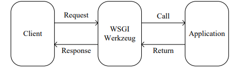
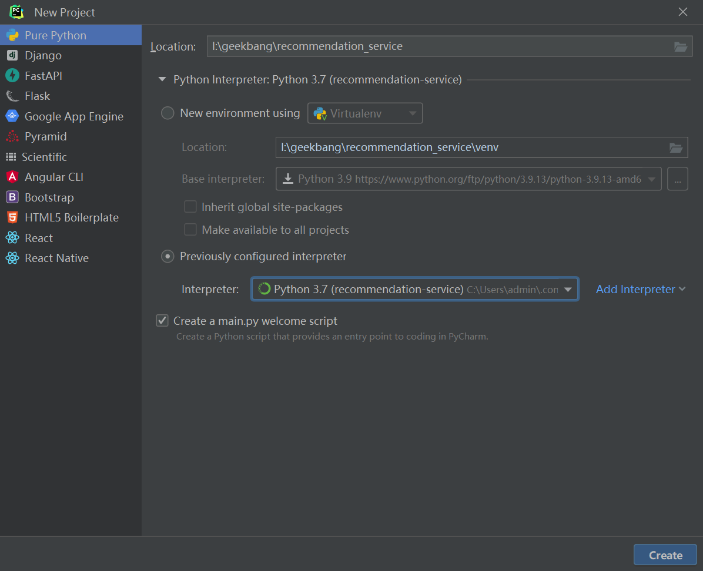
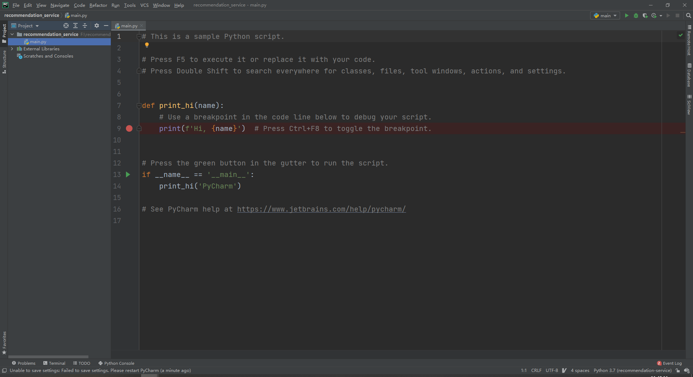
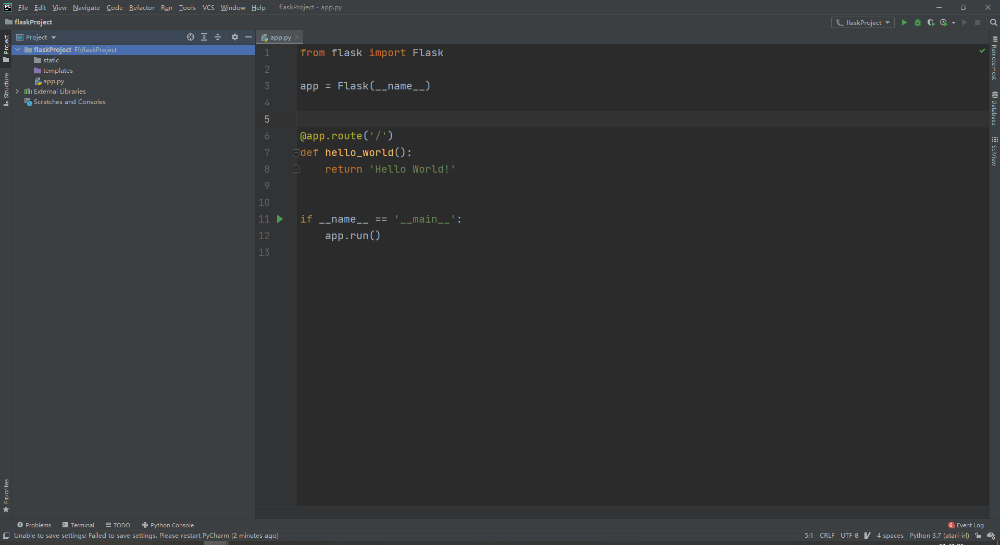
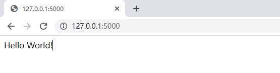
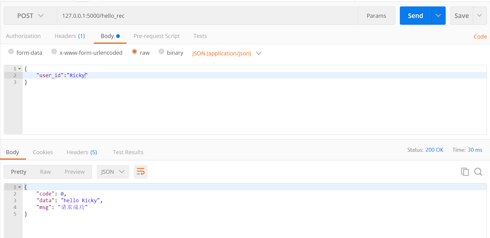
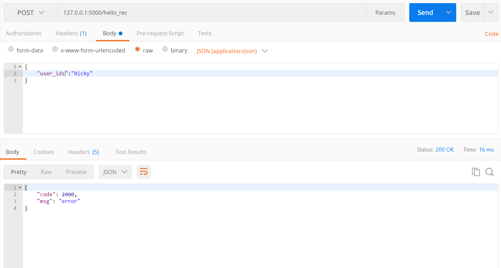

# 14 | 基于Flask的推荐服务：搭建基础的Flask服务

你好，我是黄鸿波。

在前面的课程中，我们已经对推荐系统的基本架构以及各个模块有了一个比较清晰的认识，也能够自己动手处理在推荐系统中用到的各种数据和简单的画像系统了。通过上一章的学习，我们也能够使用一些简单的基于规则的方法找到用户喜欢的内容。有了这些储备，从本章起，我们就可以开始搭建一个简单的推荐系统服务了。

这节课我们先来用 Flask 搭建一个简单的推荐服务。我们会深入地认识 Flask，学习如何使用Flask 框架来搭建一个简单的 Web 服务。我们会用它提供一个 POST 接口，再用相应的工具进行调用。

## 我们可以用Flask来做什么

要搭建一个推荐系统，我们首先要对 Web 服务有一个简单的了解。

我们上线一个推荐系统，最终的目的就是给到用户访问，所以我们首先需要一个载体，比如网页、App 等。这些载体会通过 Web 服务调用服务端提供的接口，然后服务端再去请求模型，并根据输入的特征将模型的结果返回并进行组装，拿到相应的推荐数据后再返回给用户，形成一个完整的流程。

我们可以发现，Web 服务在整个推荐系统中起到了一个承上启下的作用，它相当于是用户与推荐系统的一个中间件，而这个中间件对于一个完整的企业级推荐系统来说是至关重要的。所以，对于现阶段的我们来说，最重要的一件事就是搭建一套Web 服务。

常见的 Web 服务应用框架有很多，基于 Python 的常见的 Web 框架有 Flask、Django、Sanic 等，基于 Java 的 Web 框架有 Spring、SpringBoot 等，你可以根据自己熟悉的开发语言来按需选择。我们这门课程主要是使用基于 Python 的Flask 框架来搭建 HTTP服务。

Flask 是一个轻量级的可定制框架，使用 Python 语言编写，较其他同类型框架更为灵活、轻便、安全且容易上手。它的基本模式是在程序里将一个视图函数分配给一个 URL，每当用户访问这个 URL 时，系统就会执行给该 URL 分配好的视图函数，获取函数的返回值并将它显示到浏览器上。在 Python 中，这个工作过程可以参考下图。



客户端（Client）的最终目的是向应用程序（Application）请求内容。这个请求首先需要经过WSGI Werkzeug，这里的 WSGI 就是 Web 服务器网关接口（Python Web Server GatewayInterface，缩写为 WSGI）。它是由 Python 语言定义的，Web 服务器和 Web 应用程序 / 框架之间的一种简单而通用的接口，我们可以简单地将 WSGI 视为客户端与应用程序之间的中间层。

当 WSGI 收到客户端的请求之后，会把这个请求内容处理成符合 WSGI 规范的格式，然后传给应用程序。这个时候，应用程序接收到的请求不仅包含了客户端发来的请求参数，还包含一些其他的环境信息，应用程序可以用这些环境信息来进行下一步的处理。

当应用程序接收到请求的内容后，就会进行下一步操作，例如请求模型进行预测、请求数据库获取需要的数据等，然后将得到的结果返回给 WSGI 程序。WSGI 程序通过处理后，会将最终的结果返回给客户端，从而完成一整套 Flask 工作流。

对于推荐系统来说，我们要做的就是写一个 API 接口，然后通过 WSGI 程序接收客户端发送的请求。得到请求之后，我们要进一步处理采集到的数据。其中一部分数据我们会送入数据库，将其作为日志行为数据。另一部分数据我们会用来分析用户特征，帮助模型进行在线

推理和预测，然后将推理得到的结果返回（这里返回的一般是文章或者视频等内容的 ID）。接下来我们要做的就是对这些 ID 进行组装，从数据库中实时拿到对应的数据，然后再映射到界面上，最终呈现给用户。

## 搭建Flask 开发环境

理解了 Flask 的概念和用途，接下来我们就使用 Flask 框架来搭建一个最简单的 Web 服务。

一般来讲，在推荐系统工程中，我们的推荐系统服务和推荐系统的模型训练会使用两个不同的工程。所以，为了避免 Python 库的依赖冲突，我也建议你使用 Anaconda 再新建一个虚拟环境，这样比较方便后续的模型部署和管理。

我们可以使用下面的命令建立一个名为 recommendation-service 的 Anaconda 环境。

```
conda create -n recommendation-service python==3.7
```

创建完虚拟环境之后，使用下面的命令进入虚拟环境。

Linux or Mac。

```
conda activate recommendation-service
```

Windows。

```
activate recommendation-service
```

接下来，我们要在我们的 Ancona 环境下安装 Flask 的库。一般来讲，无论是在 Windows 系统还是 Linux 系统上，我们都可以直接使用 pip install 或者 conda install 命令来安装我们需要的库。这里我使用 pip install 命令来安装 Flask 库。

```
pip install flask
```

安装完成之后，我们就可以在我们的 IDE 里通过 import 方法来使用相应的库了。

接下来，我们开始搭建我们的第一个服务。

首先，我们需要在 Pycharm 里建立一个 Python 的应用，如果你是 professional 版本的用户，也可以直接建立一个 Flask 应用。我们将项目命名为 recommendation_service，在 PythonInterpreter 里选择我们已经存在的 Interpreter，如下图所示。



如果你建立的是一个空的 Python 应用，那么创建好之后，你的项目就是这样的。



如果你建立的是一个 Flask 应用，那么你的项目就是这样的。



不过要注意的是，在我们以往的 Python 项目中，一个项目的启动文件是 main.py 文件，但是对于一个 Flask 工程而言，它的启动文件应该是 app.py，这个区别一定要记住。

另外，我们还可以看到，如果使用 Flask 工程模板创建项目，在项目里面还会带有 2 个目录，分别是 static 和 templates，这两个目录是 Flask 工程默认的目录，分别用来存放静态文件和模板文件（或者 HTML 文件）。但是我们目前只需要 Flask 作为我们的服务，所以这两个目录可以暂且不用管，或者直接删除掉就好。

接下来，我们通过 Flask 的初始化代码来让你对 Flask 的框架结构有一个简单的认识，代码如下。

```python
from flask import Flask
app = Flask(__name__)
@app.route('/')
def hello_world():
   return 'Hello World!'
if __name__ == '__main__':
   app.run()
```

我们先简单地看一下这份代码。

代码的第 1 行是导入 Flask 库，这可以方便我们后面使用 Flask 库的相关接口进行开发。

在第 3 行，我们使用 Flask() 类创建了一个 App 实例，后续我们使用 Flask 也全都是基于这个App 实例来进行的。

第 6 到 8 行，这里实际上就是一个很简单的函数，函数的名称为 hello_world。当它被调用之后，会返回一个字符串“Hello World!”。在 Flask 中有一个路由的概念，我们将路由可以理解为外部通过什么样的路径可以触发我们的这个函数，在这个小例子中，通过根路径就可以访问到我们的 hello_world 函数，因此，这里 app.route() 装饰器传入的就是“/”。

第 11 到 12 行，这是 Python 里一个简单的 main 函数，也就是执行程序的主函数。在这个函数中，我们调用了 app.run() 函数，用 run 函数来让应用运行在本地服务器上。

这时，我们运行这个程序，控制台将会打印如下信息。

```
FLASK_APP = app.py
FLASK_ENV = development
FLASK_DEBUG = 0
In folder F:/flaskProject
H:\anaconda3\envs\atari-irl\python.exe -m flask run
* Serving Flask app 'app.py' (lazy loading)
* Environment: development
* Debug mode: off
* Running on http://127.0.0.1:5000 (Press CTRL+C to quit)
```

到这里，一个最简单的 Flask 程序就已经跑起来了。这时，我们打开浏览器，输入下面这行代码。

```
http://127.0.0.1:5000
```

可以得到如下界面，这代表我们的 Flask 程序已经能够正常运行了。



## 搭建第一个 Flask 接口服务

我们搭建好一个最基础的 Flask 框架之后，接下来，我们可以利用它来完成一个 demo 级别的接口。

我们暂且给这个接口命名：hello_rec，函数名就叫 hello_recommendation。我们把这个接口定义成一个 post 接口，然后再接收 1 个参数 user_id，最后我们再返回一个 JSON 字符串：“hello”+user_id。

接下来我们来看代码。

```python
from flask import Flask, request, jsonify
import json
app = Flask(__name__)
@app.route('/')
def hello_world():
   return 'Hello World!'
@app.route('/hello_rec', methods=["POST"])
def hello_recommendation():
   try:
       if request.method == 'POST':
           req_json = request.get_data()
           rec_obj = json.loads(req_json)
           user_id = rec_obj["user_id"]
           return jsonify({"code": 0, "msg": "请求成功", "data": "hello " + user_
   except:
       return jsonify({"code": 2000, "msg": "error"})
if __name__ == '__main__':
   app.run()
```

这份代码实际上是在上一份代码的基础上增加了一些内容。首先在最上面的导入部分，我增加了我们所需要的 request 请求的包和 JSON 返回的包，并在第 2 行增加了一个用来解析 JSON的包。

第 11 行到 20 行是我们实现这个功能的主体部分。在这里我们定义了一个路由，路由地址为“/hello_rec”，然后指定接收的请求为 Post 请求。在函数体部分，我使用了一个 try 函数，当请求的内容有问题时，为了让用户体验更友好，我直接使用 jsonify 返回一个编码为 2000 的错误，如果请求的内容是正确的，就去接收请求过来的 user_id，然后返回 hello 加上user_id，最终使用 jsonify 包装后返回给用户。

作为用户，我们可以使用 Postman 或者其他工具对这个接口进行请求，如果请求正确，就得到下面的结果。



如果请求错误，比如我们这里把参数“user_id”不小心打成了 users_id，则返回错误。



如果你能够得到和我一样的结果，就说明你的 Flask 服务搭建成功了。

这里再强调几个细节。

1. 就像上面代码的第 15 到 17 行显示的那样，我们使用的方法是接收 Post 请求之后，在接收的请求体中获取请求的内容。这个请求体的内容我们使用 Python 的 request 自带的get_data() 函数获取。获取到内容之后，我们又通过 json.loads 将其转换成了一个 JSON对象，并将“user_id”取出，对其进行加工处理后返回。

2. 我们在这里做了一个容错判断，就是如果请求的内容有错，我们不会将异常抛出，而是定义了一个错误码，并将其转换成了 JSON 的格式友好输出，这样做的好处一方面是能够给用户带来比较友好的体验，另一方面也有利于程序的安全。因为一旦原始的错误信息暴露给用户，用户就很容易抓住这些错误信息来攻击我们的系统。

3. 我们把输出的内容全部标准化了。也就是都使用 JSON 的形式来返回，并规定了一些自定义的状态码和数据格式。这有利于我们以后将推荐系统进行工程化开发和部署时，与同事合作和交流。一般来讲，我们在做数据处理，以及各种格式转换的时候，都会先将其转换成JSON 格式，这样能够使各种程序更好地协作。

4. 我们发送的请求使用的是 Raw 请求方式，并使用 JSON 的方式发送请求，这样做可以方便我们在企业中与其他语言对接。

到目前为止，一个最简单的 Flask 接口就已经完成了。

## 总结

总结一下。这节课，我们先是简单认识了一下 Flask 框架和 HTTP 服务。

1. Flask 是一个轻量级的、易上手的 Web 服务框架，我们可以用它来搭建我们的推荐系统服务。

2. 另外，Flask 框架传输一般是通过 HTTP 协议来传输的，为了方便传输双方的协作，我们一般将 JSON 作为中间传输格式。

3. 在 Flask 框架中的 Web 传输主要使用的是 WSGI，WSGI 就是 Web 服务器的网关接口，它是连接 Python 与 Web 服务的桥梁。也就是说，要想搭建一个推荐系统服务，至少需要对 Web 服务、接口、模型的调用、数据的流转有着整体的认识。

接着，我们在 Python 环境下使用 Flask 框架，搭建了一个简单的接口，并使用 Postman 来进行调用，最后得到了一个正确的输出。

希望通过这节课的学习，你能对 Flask 服务拥有基本的认识。接下来的课程中，我们会基于这个项目继续拓展，增加关于数据库、推荐模型以及 Gunicorn 等和企业级推荐系统相关的更多知识，从而形成一套整体的企业级推荐系统框架，让我们拭目以待吧！

## 课后题

学完这节课，给你留两道课后题。

1. 搭建好 Anaconda 和 Pycharm 开发环境。

2. 搭建 Flask 开发环境，并实现这样一个 web 接口：输入两个数字，就可以输出这两个数字的乘积。

欢迎你把代码上传到 GitHub 中，留下你的代码链接，我会选择一些有代表性的代码在评论区进行点评。
