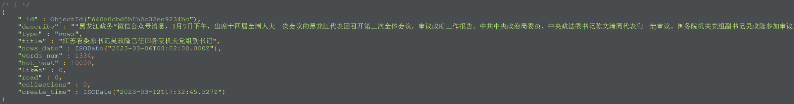
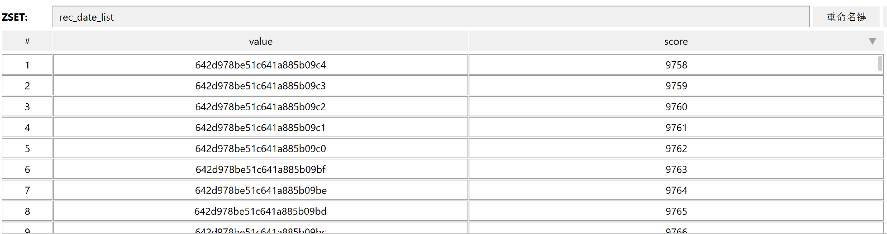
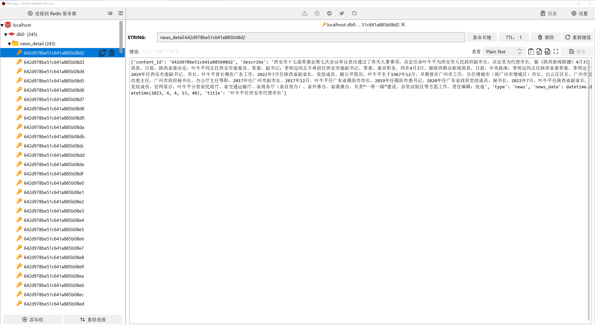
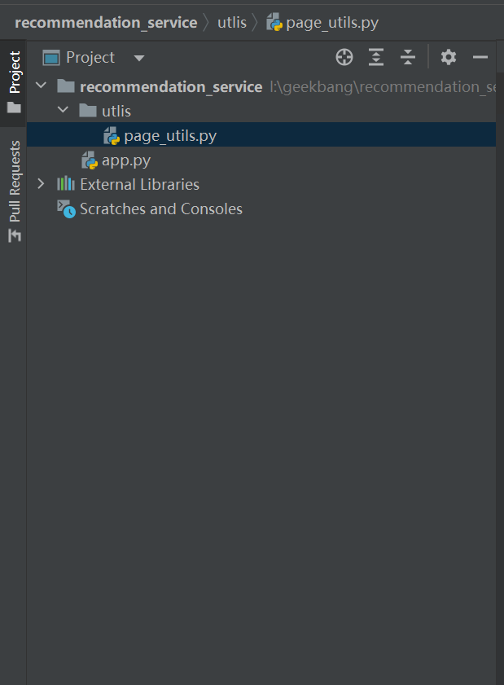
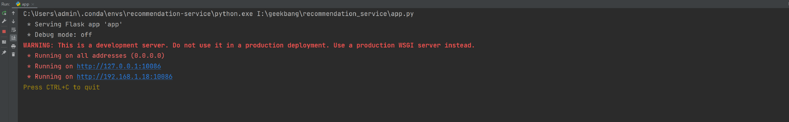
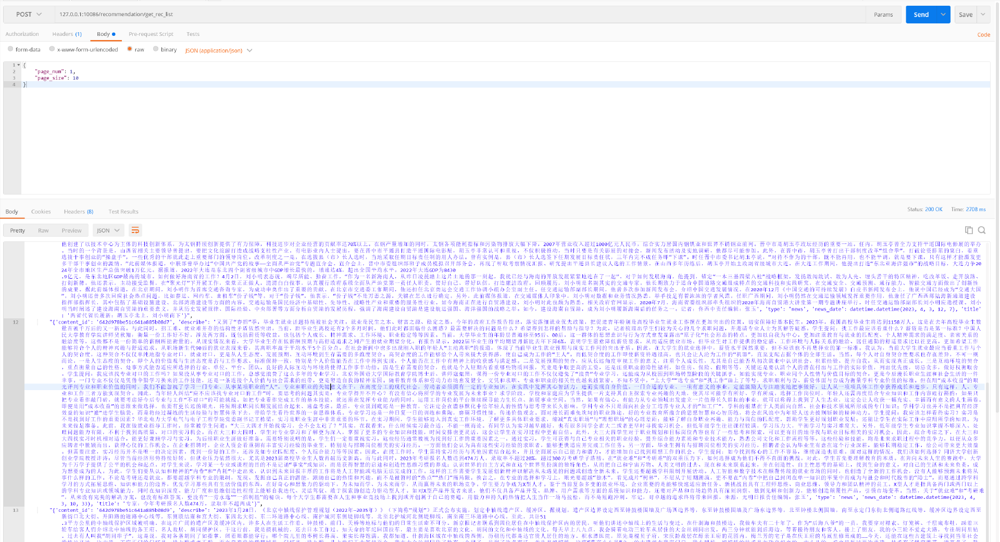

# 15 | 基于Flask的推荐服务：如何把召回集推荐出去？

你好，我是黄鸿波。

在前面的课程中，我们搭建了一个简单的 Flask 服务，并且已经可以通过 Postman 来进行调用，这节课我们将在此基础上，把基于规则的召回集成进来并推荐给用户。这节课你会学到下面的内容。

1. 写一个基于时间的召回，并存储到 Redis 数据库中。

2. 编写一个翻页查询服务，能够进行翻页查询。

3. 编写 Service 服务，将基于时间的召回推荐给用户。

## 编写基于时间的召回

推荐系统如果想要将内容推荐给用户，首先要做的就是要找到合适的内容，然后将这些内容通过一定的整理和排序，按照一定的规则推荐给用户。这些规则可能是时间、热度、相似度以及一些用于特征的评分，也可以是这些中一个或者多个算法的结合。在这节课里，我们就先用简单的基于时间的召回算法来做。

首先，我们来回顾一下我们之前的内容画像，下图是内容画像其中的一条数据。



我们可以看到，我们的用户画像实际上是由 10 个字段组成，在这 10 个字段中，第一个字段_id 是 MongoDB 数据库为我们生成的一个唯一的 id 值，我们可以用其作为索引，来标记其唯一性。

与时间相关的字段有 2 个，一个是 news_date，另一个是 create_time。在这两个字段中，news_date 表示的是新闻发布的时间，create_time 指的是这个新闻的入库时间（也就是爬虫爬取的时间），这两个时间作为特征数据在不同的算法中有不同的用处。我们目前是想要基于时间来进行召回，这个时间最好使用新闻的发布时间，因为新闻发布时间属于新闻本身的一个特征，可以防止“时间穿越”事件的发生。

“时间穿越”是指在现在的时间点出现了未来的内容。比如说，我们在 2023 年 3 月 16 日爬取了一批 3 月 1 号之前的新闻，按理来说爬取的内容都是在 3 月 1 日之前的数据，这时突然出现了一个 3 月 15 号的新闻事件，虽然 3 月 15 日在现实生活中已经过去，但是在数据库里是一个未发生的数据，我们就称之为“时间穿越”。在推荐系统中，要尤其注意避免“时间穿越”问题。

我们再来想另外一个问题，既然我们要将内容推荐给用户，什么方法是最高效的呢？

如果我们直接从 MongoDB 中查询我们想要的数据，然后再组装到用户界面上，效率就会变得非常低。因为首先 MongoDB 是文档型数据库，对于这种快速存取本身不是特别擅长，此外我们还要对 MongoDB 做按时间的倒序排序，本身也会有比较大的时间开销。所以在这里最好的解决办法就是使用 Redis 数据库来进行存取，这样能够使用户更加快速地得到内容。

总结一下，我们第一步是将我们的数据从 MongoDB 数据库中取出，然后按照时间的倒序进行排序存入到 Redis 数据库中。当需要给用户进行推荐的时候，我们直接从 Redis 数据库中读取数据，然后进行组装后推荐。

接下来我们来看看怎么实现这一步。

首先，在我们的 recommendation_class 项目中，有一个名为 scheduler 的目录。这个目录一般用来存放需要定时运行的任务，比如定时进行离线的召回、定时清除数据库中的无用数据、定时更新推荐列表等等。

随着时间的变更，爬虫新爬取出来的数据应该被及时加到里面，因此我们需要在里面新建一个Python 文件，我们将其命名为 date_recall.py，然后在这个文件中做基于时间的召回。我们在做基于时间召回的时候需要设置一个时间范围，不需要对过于久远的内容进行召回。比如说超过一周的内容，我们认为就没有了时间的时效性。

还记得我们在讲爬虫的时候给你留的一个小作业吗？我们将数据重新爬取一遍并重新制作一下我们的内容画像，此时，你需要参考之前的课程完成以下 2 个步骤。

1. 将之前 MongoDB 数据库中 scrapy_data 数据库的 Collection 删掉，重新跑一遍爬虫程序，爬取更多的分类和更多的数据。

2. 将之前 MongoDB 数据库中 recommendation 数据库的 Collection 删掉，重新跑一遍内容画像中的数据。

我先来说一下我的新版代码（作业的拓展版）。在新版代码中我一共爬取了 3 个类别的数据，分别是国内新闻、电影、娱乐，并在 main.py 文件中设置了 1 个叫 page 的参数，目的是指定我爬取多少页的内容。这个时候，在爬虫页也会有对应爬取的页数设置。

经过 10 页数据的爬取，目前数据库总条数有 243 条，并将其制作成了内容画像。接下来，我们要将这一批数据按照时间顺序存入到数据库中。

由于我们所爬取的类别较少，并且娱乐和电影类别更新得又不是特别频繁，因此我们取国内新闻 20 天内的数据，娱乐和电影我们取 3 个月内的数据存入到 Redis 数据库中。

我们首先在项目中新建一个 Redis 数据库的连接工具类，用作连接 Redis 数据库。我们在 dao目录下新建一个名为 redis_db.py 的 Python 文件，并编写如下代码。

```python
#!/usr/bin/env python
# -*- coding: utf-8 -*-
import redis
class Redis(object):
   def __init__(self):
       self.redis = redis.StrictRedis(host= '127.0.0.1',
                                       port= 6379,
                                       password= '',
                                       decode_responses=True)
```

这段代码非常简单，就是导入了 Redis 库，然后建立了一个数据库连接的变量连接到了本机，端口为 6379。

然后，我们再来编写 scheduler 目录下的 date_recall.py 文件。这个文件要从 MongoDB 中获取数据，然后按照时间的倒序插入到 Redis 数据库中。在这里，我们介绍一个 Redis 数据库中常用的数据结构 ZADD。

ZADD 命令用于将一个或多个成员元素及其分数值加入到有序集当中。如果某个成员已经是有序集的成员，更新这个成员的分数值，并通过重新插入这个成员元素来保证该成员在正确的位置上。分数值可以是整数值或双精度浮点数。如果有序集合 key 不存在，则创建一个空的有序集并执行 ZADD 操作。

在推荐系统中 ZADD 命令非常常用，我们可以将最外面的 key 用用户 id 或者推荐列表的类型（比如基于时间的召回、基于热度的召回）来代替，里面的 key 作为推荐内容的 content_id，value（也就是分数）作为相关度评分或者排序的顺序倒序。

当有用户需要推荐的时候，我们就从这里拿出相应的数据来进行推荐，比如一次取 10 个content_id 作为推荐列表，我们来编写一下这个文件的代码。

```python
from dao import redis_db
from dao.mongo_db import MongoDB
class DateRecList(object):
   def __init__(self):
       self._redis = redis_db.Redis()
       self.mongo = MongoDB(db='recommendation')
       self.db_content = self.mongo.db_recommendation
       self.collection_test = self.db_content['content_label']
   def get_news_order_by_time(self):
       ids = list()
       data = self.collection_test.find().sort([{"$news_date", -1}])
       count = 10000
       for news in data:
           self._redis.redis.zadd("rec_date_list", {str(news['_id']): count})
           count -= 1
           print(count)
if __name__ == '__main__':
   date_rec = DateRecList()
   date_rec.get_news_order_by_time()
```

这段代码也相对比较简单，首先我们从 MongoDB 数据库中读取数据，并按照新闻的时间进行降序排序，把它赋值给一个变量 data。然后我们再把数据插入到 Redis 数据库中，在插入到Redis 数据库中的时候，我们使用的是 ZADD 方法。

- ZADD 的优势是能够按照一定的顺序进行排序，这个顺序可以是升序也可以是降序。一般来讲，我们会以降序的方式排序，无论是时间还是分数都是如此。如果是时间降序的时候，就会将最新的内容排在前面，用户会看到比较新鲜的内容；如果是按照分数降序，就是将用户最感兴趣的内容放在前面，增加用户的点击率和用户的黏性。

- 在往 Redis 数据库中插入数据的时候，我们将 key 设置为 rec_date_list，这样的话所有使用时间召回算法的用户都会共用这一个列表，从而进行推荐。

除此之外，这里面我还设置了一个 count 值。在 ZADD 命令中以 score 作为排序依据，但是时间并不是一个 score。所以我在这里预先设置了一个比较大的值，然后按照这个值的降序给内容赋予分值，这样最高分代表了时间最靠前的内容，我们再进行推荐的时候，就可以按照这个方式进行推荐了。

运行上面的代码之后，我们在 Redis 数据库中查看一下结果。



可以看到，我们的内容已经插入进去了。

到了现在，我们是不是就可以写 Service 的代码，然后将数据推送给用户了呢？当然可以，但是按照企业级的推荐方式，我不建议这么做。

首先，如果用这种方式我们需要从 Redis 中拿完每一个 id，然后再跑去 MongoDB 中查询相对应的内容，这样做实在是太慢了。用户量和内容量比较少的话还行，一旦我们的用户量以及数据库中的内容比较多，用这种方法就会导致推送的速度非常慢，从而影响用户体验。

比较好的一种方式就是将我们需要的内容存储到 Redis 数据库中，当列表需要查询数据时就直接从 Redis 中进行数据的调用，这样效率就会非常高。因此，我们在 scheduler 目录下新建一个 mongo_to_redis_content.py 文件，用来将 MongoDB 中的内容存到 Redis 数据库中，我们可以在里面编写如下代码。

```python
from dao import redis_db
from dao.mongo_db import MongoDB
class mongo_to_redis_content(object):
   def __init__(self):
       self._redis = redis_db.Redis()
       self.mongo = MongoDB(db='recommendation')
       self.db_recommendation = self.mongo.db_recommendation
       self.collection_content = self.db_recommendation['content_label']
   def get_from_mongoDB(self):
       pipelines = [{
           '$group': {
               '_id': "$type"
           }
       }]
       types = self.collection_content.aggregate(pipelines)
       for type in types:
           collection = {"type": type['_id']}
           data = self.collection_content.find(collection)
           for x in data:
               result = dict()
               result['content_id'] = str(x['_id'])
               result['describe'] = x['describe']
               result['type'] = x['type']
               result['news_date'] = x['news_date']
               result['title'] = x['title']
               self._redis.redis.set("news_detail:" + str(x['_id']), str(result)
if __name__ == '__main__':
   write_to_redis = mongo_to_redis_content()
   write_to_redis.get_from_mongoDB()
```

这段代码就是从 MongoDB 中获取内容，然后存储到 Redis 数据库中。只不过在这里，我们使用了一个新的 Redis 命令，叫做 SET。

Redis 的 Set 命令用于在 Redis 键中设置一些字符串值，在这里我们一个 key 可以对应一个字符串，也就是说我们可以将内容作为 value 传入进去。因此，我设置了 key 的值为“news_detail:” 加上 content_id，这样就可以保证 key 的唯一性。然后再将 value 设置为内容，当有需要取内容的时候，我们就去取 “news_detail:content_id”。这样的话，整个效率会有质的提升。

我们运行上面的代码，可以得到下面的结果。



我们可以看到，现在 Redis 数据库中就是按照我们的设想来的，已经能够把每一个文章的详细信息都写入了进去。在这里，我们只需要内容的 id、内容本身、标题、类型和时间这 5 个字段即可。

## 将基于时间的召回推荐给用户

在前面的课程中，我们已经建立了一个最基本的 Flask 项目，接下来我们就要在这个 Flask 项目的基础上，开发我们第一个基于时间的推荐服务。

1. 一个简单的翻页功能，因为不可能每次都把所有的 id 传过去，所以加上一个翻页功能，能够让用户有更好的体验。

2. 将基于时间的召回集推荐给用户。

我们首先打开之前的 recommendation-service 这个项目，切换到我们的 recommendation-service 的 Anaconda 环境下，安装一些我们所需要的库，这里我们执行如下命令来安装Redis 库。

```
pip install redis
```

然后在这个项目中新建一个叫 utils 的目录，主要是放置一些工具类。比如说我们的这个分页，实际上也可以看做是一个工具。然后我们在这个 utils 目录下，新建一个分页工具，名为page_utils.py。然后我们新建一个 dao 目录，将我们的 Redis 数据库连接工具从其他项目中复制过来，命名为 redis_db.py，此时目录结构如下。



接下来我们来写这两个文件的代码，首先是 redis_db.py 文件的代码。

```python
import redis
class Redis(object):
   def __init__(self):
       self.redis = redis.StrictRedis(host='localhost',
                                      port=6379,
                                      db=10,
                                      password='',
                                      decode_responses=True)
```

上面这段代码我们前面多次用到，这里我们重点看一下 page_utils.py 文件的代码。

```bash
from dao import redis_db
class page_utils(object):
   def __init__(self):
       self._redis = redis_db.Redis()
   def get_data_with_page(self, page, page_size):
       start = (page - 1) * page_size
       end = start + page_size
       data = self._redis.redis.zrevrange("rec_date_list", start, end)
       lst = list()
       for x in data:
           info = self._redis.redis.get("news_detail:" + x)
           lst.append(info)
       return lst
if __name__ == '__main__':
   page_size = page_utils()
   print(page_size.get_data_with_page(1, 20))
```

这段代码主要是实现一个翻页的功能，我在里面实现了一个名字叫做 get_data_with_page()的函数。在这里需要传入 page 和 page_size 两个参数，page 表示当前需要请求第几页，page_size 表示每一页有多少条内容。使用这种方法，对于前端界面的翻页和用户体验都有极大的帮助。

有了翻页功能之后，就可以正式写我们的接口程序了。接口程序在 app.py 这个文件里，原本的 app.py 是一个非常简单的程序，现在我们来对这个程序做一个改写。

```python
from flask import Flask, request, jsonify
import json
from utlis.page_utils import page_utils
page_query = page_utils()
app = Flask(__name__)
@app.route('/')
def hello_world():
   return 'Hello World!'
@app.route('/hello_rec', methods=["POST"])
def hello_recommendation():
   try:
       if request.method == 'POST':
           req_json = request.get_data()
           rec_obj = json.loads(req_json)
           user_id = rec_obj["user_id"]
           return jsonify({"code": 0, "msg": "请求成功", "data": "hello " + user_
   except:
       return jsonify({"code": 2000, "msg": "error"})
@app.route("/recommendation/get_rec_list", methods=['POST'])
def get_rec_list():
   if request.method == 'POST':
       req_json = request.get_data()
       rec_obj = json.loads(req_json)
       page_num = rec_obj['page_num']
       page_size = rec_obj['page_size']
       try:
           data = page_query.get_data_with_page(page_num, page_size)
           return jsonify({"code": 0, "msg": "请求成功", "data": data})
       except Exception as e:
           print(str(e))
           return jsonify({"code": 2000, "msg": "error"})
if __name__ == '__main__':
 app.run(port=10086)
```

这段代码是一段 WebService 代码，就是把我们的服务提供成一个 API 接口进行调用，接收用户前端的请求。请求的参数有以下两个。

- page_num，表示当前请求的是第几页的内容。

- page_size，表示当前请求的每一页有多少条数据。

当用户从客户端发送请求之后，在 WebService 端就会使用 POST 接收这两参数，然后传递到 page_query 的 get_data_with_page() 函数中，这个时候，函数内部就会根据请求的参数去数据库查询，然后返回相应的结果。

下面，我们来运行一下我们的 app.py 程序，此时会得到如下结果。



现在我们的程序已经运行成功了，接下来我们使用 Postman 来尝试调用一下它。



我们可以发现，现在我们输出的内容就是按照时间倒序排序的，并且，我们调用时请求的参数为 page_num 和 page_size。

## 总结

现在我们已经能够把按照时间召回的内容推送出去了，今天我们主要讲了下面五个要点。

1. 基于时间召回可以和用户画像相结合进行召回。

2. 基于时间召回需要特别注意“时间穿越”的问题。

3. 你应该熟悉如何将 MongoDB 里面的数据按照时间顺序插入到 Redis。

4. 在推荐系统进行推荐的时候，知道如何做能够使推荐的效率更高、速度更快。

5. 我们可以使用翻页请求的方式来提高用户体验。

## 思考题

学完今天的课程，给你留两个小作业。

1. 复现今天的课程内容。

2. 给推荐过的内容存储在 Redis 已推荐列表中，并且下次推荐时候去除这一部分内容。

期待你的分享，如果今天的内容让你有所收获，也欢迎你推荐给有需要的朋友！
