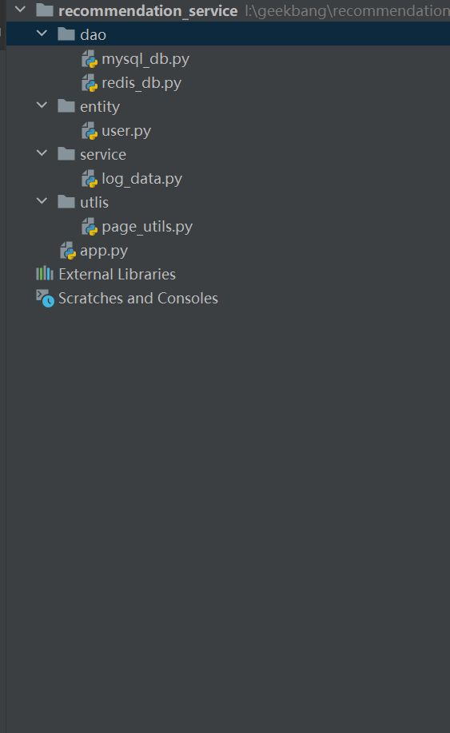
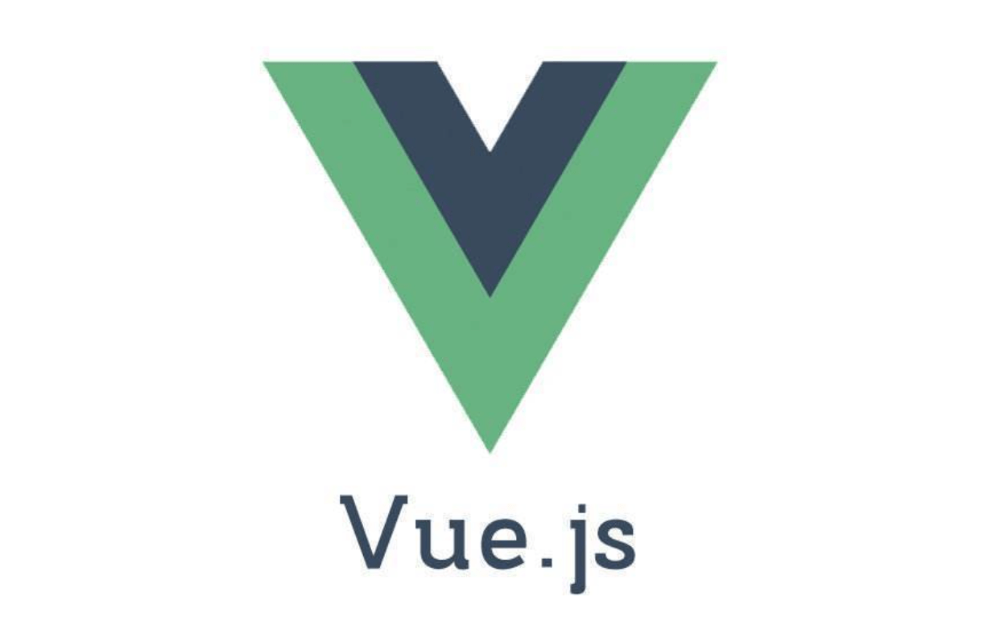
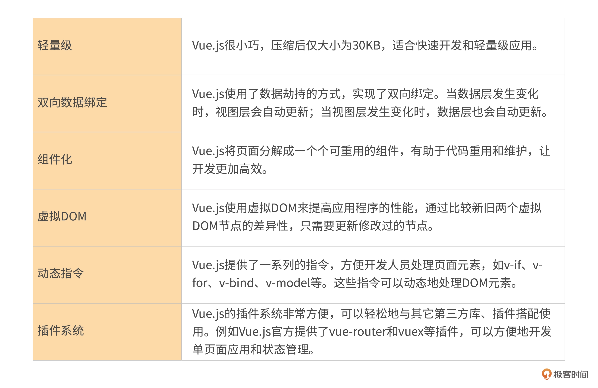
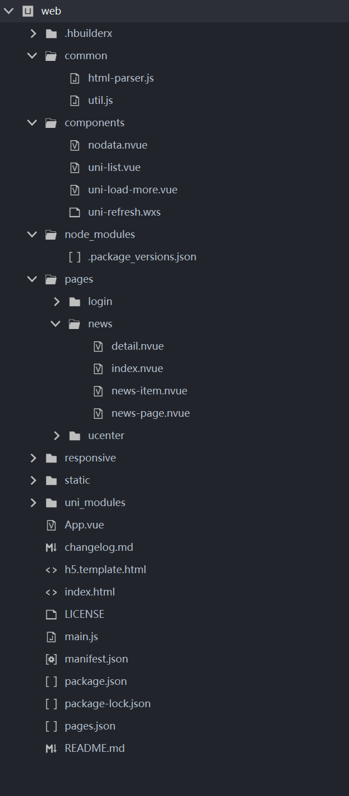
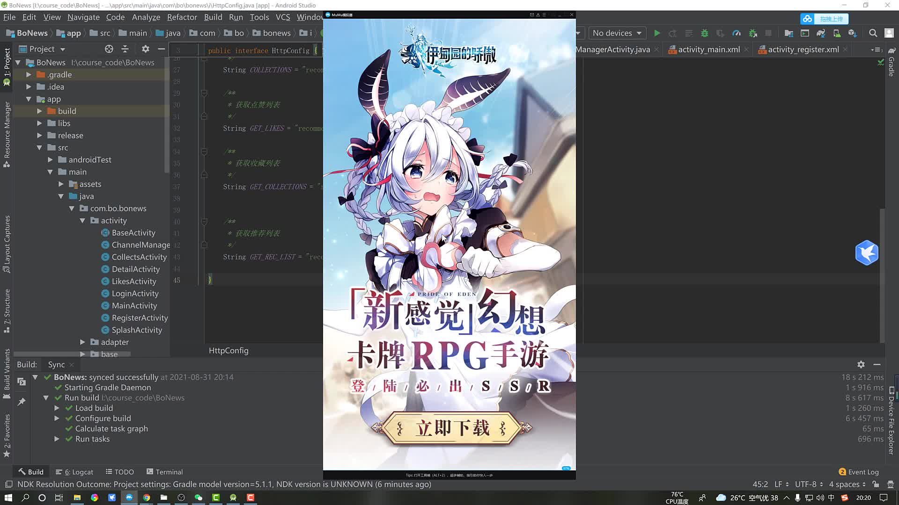
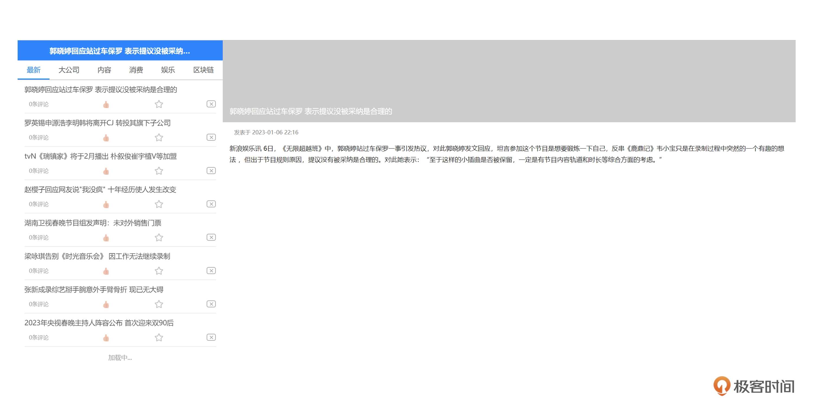

# 17 | 推荐系统前端：如何用一个界面展示我们的成果？

你好，我是黄鸿波。

在前面的课程中，我们使用 Flask 搭建了一个非常简单的 HTTP 服务，也提供了推荐列表和注册登录相关的接口。本节课我们将继续沿着这条思路，将它们用前端界面的形式展现出来。

我把本节课分为了以下三个部分。

1. 在服务端代码中增加点赞、收藏等交互信息。

2. 什么是 Vue.js。

3. 如何使用 Vue.js 对接我们的 HTTP 服务进行展示。

## 在服务端代码中增加点赞、收藏等交互信息

我们前面基于 Flask 已经写了一个简单的分页请求、用户的登录和注册功能，接下来，我们基于服务框架完成点赞、收藏的接口的交互。

先来整体过一遍流程。

首先，用户在进入到推荐列表，或者说任意一个列表的时候，我们都需要请求这个列表的内容然后进行展示。这个请求的接口就是之前写的 /recommendation/get_rec_list。

当用户拿到这个接口之后，就会去请求到每一个标题以及里面的内容。当用户点击内容请求详情页时，我们就需要将点赞数和收藏数展示给前端（这个数据在获取列表时已经获取，不需要单独进行请求）。

当前端点击一个页面进行点赞或收藏的操作时，前端需要通知后端有人进行了这些操作，后端接收到前端的通知后，就需要将数据库中的数字取出来然后再加上 1，并返回用户请求成功的标志。这时，整个操作就完成了。

对于点赞、收藏和阅读来说，实际上都是同样的操作模式。我们先写一个接口，然后再举一反三，扩展到所有的接口程序。

在写接口之前，要清楚我们需要的就是以下两点。

1. 不管是点赞还是收藏，都要插入相关的记录到 MongoDB 数据库，这个相当于用户行为记录。

2. 我们同时也要向 Redis 数据库插入一份数据，主要是用作用户读取内容信息，也就是在请求列表时所用。

有了这两个前提就可以写一个最简单的接口了。第一步，我们要先把这两个记录信息搞定，首先先在 recommendation-service 项目中增加叫 service 的一个目录，然后再在目录中新建一个叫 log_data.py 的 Python 文件，此时目录结构如下。



接着，在 log_data.py 文件下编写代码。

```sql
from dao import redis_db
from datetime import datetime
from dao import mongo_db
import random
class LogData(object):
   def __init__(self):
       self._mongo = mongo_db.MongoDB(db='recommendation')
       self._redis = redis_db.Redis()
   def insert_log(self, user_id, content_id, title, tables):
       collection = self._mongo.db_client[tables]
       info = {}
       info['user_id'] = user_id
       info['content_id'] = content_id
       info['title'] = title
       info['date'] = datetime.utcnow()
       collection.insert(info)
       return True
   def modify_article_detail(self, key, ops):
       try:
           info = self._redis.redis.get(key)
           info = eval(info)
           info[ops] += 1
           self._redis.redis.set(key, str(info))
           return True
       except:
           return False
```

我们来解释一下这段代码。这段代码实际上非常简单，首先定义了一个名为 LogData 的类，并初始化了两个实例，一个用于连接 MongoDB 数据库，另一个用于连接 Redis 数据库。

然后我们在这个类里定义了两个函数，分别是 insert_log() 和 modify_article_detail()。

insert_log() 方法用于向 MongoDB 中插入日志。它接受四个参数，分别是用户 ID、内容 ID、标题和表名。在方法内部，通过 mongo_db 库中的 MongoDB 对象建立了一个连接到指定表名的 MongoDB 集合。然后创建一个包含用户 ID、内容 ID、标题和 UTC 时间戳的字典。最后，向数据库中插入这个字典，并返回 True。这里的表名主要是前面传过来用来区分是点赞还是收藏的字段，当前端传过来的是 likes 时，我们就会向 likes 表里插入一条记录点赞信息的记录，同理如果前端传过来的是 collections，就会向 collections 表里增加一条收藏的记录。

modify_article_detail() 方法用于修改 Redis 中的一些日志信息。它接受两个参数，分别是键名和操作。在方法内部，首先使用 Redis 对象的 get() 方法获取指定键名对应的值。然后，将获取到的值使用 eval() 函数转化为 Python 中的字典类型。接着根据传入的操作，对字典中的某个值进行加操作。最后，将修改后的字典重新转换为字符串类型，并使用 Redis 对象的 set()方法重新设置键名对应的值。如果操作成功，返回 True，否则返回 False。在这里的 Ops 和前面方法里的 Tables 实际上是一样的操作，都是指的点赞、收藏等操作。

有了这两个记录，接下来我们就可以开始写 app.py 文件中与点赞和收藏相关的接口内容。同样，我们先来写点赞相关的接口。

我们直接看代码。

```python
@app.route("/recommendation/likes", methods=['POST'])
def likes():
   if request.method == 'POST':
       try:
           req_json = request.get_data()
           rec_obj = json.loads(req_json)
           user_id = rec_obj['user_id']
           content_id = rec_obj['content_id']
           title = rec_obj['title']
           mysql = Mysql()
           sess = mysql._DBSession()
           if sess.query(User.id).filter(User.id == user_id).count() > 0:
               if log_data.insert_log(user_id, content_id, title, "likes") \
                   and log_data.modify_article_detail("news_detail:" + content_i
                   result = {"code": 0, "msg": "点赞成功", "data":[]}
                   return jsonify(result)
               else:
                   return jsonify({"code": 1001, "msg": "点赞失败", "data": []})
           else:
               return jsonify({"code": 1000, "msg": "用户名不存在", "data": []})
       except Exception as e:
           print(e)
           return jsonify({"code": 2000, "msg": str(e), "data": []})
```

我来对这段代码进行一下解析。首先这段代码在最上面定义了一个 Flask 路由，并设置路由的访问地址为 /recommendation/likes，也就是说，当前端通过这个接口进行请求并且请求方法为 POST 时，我们就会调用下面的 likes() 函数，完成相应的操作。

在 likes() 函数内部，我们先去判断是不是 POST 请求，如果是的话，再去接收参数和完成相应的操作。如果不是 POST 请求，就返回一个错误码给前端。

在接收参数的部分主要接收 3 个参数，即用户 ID、内容 ID 和标题，并将它们分别赋值给user_id、content_id、title 这三个变量。

当参数接收完之后，要对这些参数做进一步验证。首先，把 user_id 放到 MySQL 数据库中进行查询，看看是否存在这个用户。如果不存在就返回相应的错误码，如果存在，就调用与数据库相关的信息进行数据的插入。在插入数据部分，用的是一个双表同时插入的字段。当同时插入成功之后才算成功，然后返回给前端点赞成功，否则点赞失败。

我们也可以如法炮制，把收藏的代码实现出来。

```python
@app.route("/recommendation/collections", methods=['POST'])
def likes():
   if request.method == 'POST':
       try:
           req_json = request.get_data()
           rec_obj = json.loads(req_json)
           user_id = rec_obj['user_id']
           content_id = rec_obj['content_id']
           title = rec_obj['title']
           mysql = Mysql()
           sess = mysql._DBSession()
           if sess.query(User.id).filter(User.id == user_id).count() > 0:
               if log_data.insert_log(user_id, content_id, title, "collections")
                   and log_data.modify_article_detail("news_detail:" + content_i
                   kafka_producer.main("recommendation-logs", bytes(content_id +
                   result = {"code": 0, "msg": "点赞成功", "data":[]}
                   return jsonify(result)
               else:
                   return jsonify({"code": 1001, "msg": "点赞失败", "data": []})
           else:
               return jsonify({"code": 1000, "msg": "用户名不存在", "data": []})
       except Exception as e:
           print(e)
           return jsonify({"code": 2000, "msg": str(e), "data": []})
```

## Vue.js 简介

Vue.js 是一个用于创建用户界面的动态JavaScript 框架，也是一款流行的 JavaScript 前端框架，旨在更好地组织与简化 Web 开发和创建单页应用的 Web 应用。



Vue 所关注的核心是 MVC 模式中的视图层，同时，它也能方便地获取数据更新，并通过组件内部特定的方法实现视图与模型的交互。

Vue.js 可以轻松地与第三方库、插件搭配使用，并且还有以下特点。



总之，Vue.js 是一个非常优秀的前端框架，具有易学易用、高度可定制、灵活轻便、性能出色等特点，是现代 Web 应用开发中不可或缺的工具之一。

## 使用 Vue.js 对接 HTTP 服务进行展示

现在我们已经写完了接口，也对 Vue.js 有了一定的了解。接下来，我们就来基于 Vue.js 来实现需要的功能。先看下项目结构。



前端的整套代码我统一放在了GitHub上。

特别说明：目前 GitHub 上的代码使用的是 Android 代码，这套代码相比 HTML 的代码信息更全，要使用 Android Studio 运行。你可以参考安卓环境的安装视频，跟着视频一步步做，就可以把代码跑起来了。



这里我们主要来讲讲这段代码里面的重点内容。

这段代码主要分成这么几个部分：登录、新闻列表、新闻的详情页。

登录相关的界面主要放在 pages/login/login.vue 代码中。这段代码很简单，就是拿到用户的用户名和密码，然后请求我们的后端，这时就会进入到 recommendation-service 中的 login() 函数，对应着 /recommendation/login 这个接口。

新闻列表和新闻详情页在界面展示上实际上是一个页面，即左侧是列表右侧是详情。在这里，实际上就是左侧请求到 recommendation-service 的 /recommendation/get_rec_list 这个接口，右侧就是拿到这个接口里面的内容进行显示（也就是详情页）。因此在 Web 端的代码中，左侧实际上是在 pages/news/news-page.vue 中，请求相关的列表也是在这个页面中进行请求，然后将获得的结果传入到右侧。

在 Vue.js 中，所有的请求都可以使用 uni.request() 方法来进行实现，例如可以使用如下代码来获取一段 request 请求。

```
uni.request({
         // url: this.$host + 'api/news',
         url: 'HTTP://localhost/recommendation/get_rec_list',
         data: this.requestParams,
         success: (result) => {
     }
     })
对于点赞和收藏相关的内容，实际上就是在 news-items.nvue 文件下面的 <script> 标签
```

中，这里我为你展示一下框架代码。

```bash
<script>
 export default {
   data() {
         return {
           collect: false, //判断是否已收藏
         }
       },
   props: {
     newsItem: {
       type: Object,
       default: function(e) {
         return {}
       }
     }
   },
   methods: {
     click() {
       this.$emit('click');
     },
     close(e) {
       e.stopPropagation();
       this.$emit('close');
     },
     like(e) {
       e.stopPropagation();
       this.$emit('like');
       // 在这里加
     },
     collectwin(e) {
       e.stopPropagation();
       this.$emit('collectwin');
       // 在这里加
     },
     changeImg() {
             var that = this;
             //收藏
             if (that.collect == false) {
               that.collect = true;
             } else {
               //取消收藏
               that.collect = false;
             }
           },
   }
 }
</script>
```

在上面的代码中，主要是对点赞、收藏等操作的实现，以及关闭按钮的实现等。

- export default 表示定义了一个默认的 Vue 组件。

- data() 是 Vue 中的一个选项，用来定义组件的初始数据。

- props 是 Vue 中的另一个选项，用来定义组件的参数。

- methods 是一个选项，包含了组件中的函数。

- this.$emit() 是一个方法，用来触发指定事件，从而通知其他组件。

具体来说，这个组件包含有一个 collect 属性，用来表示是否已经收藏了某篇新闻。 然后组件接受一个 newsItem 参数，该参数是一个对象，包含有新闻的信息。 组件中定义了以下四个方法。

- click()：在单击时触发某个事件。

- close()：在关闭时触发某个事件。

- like()：在点赞时触发某个事件。

- collectwin()：在收藏时触发某个事件。

最后，组件中包含一个 changeImg() 方法用来改变图片。在该方法中，如果当前没有收藏，就将 collect 属性设置为 True，否则就设置为 False，实现切换收藏的状态。在代码里我注释的部分，都需要请求我们的服务器端获取数据。

当项目正常运行后，效果如下。



## 总结

到这里，这节课也就接近尾声了，我们对今天的课程做一个总结，今天这节课一共有以下四个要点。

1. 你可以使用 Flask 的方式完成一个 HTTP 服务，这个服务我们实现了登录、注册、点赞、收藏、获取列表和内容等信息。

2. 了解 Vue.js 是一个构建用户界面的渐进式框架，也可看作 MVVM 框架。其核心库只关注视图层。其它一些周边的库，如 vue-router、vuex、axios 等等，都是以插件的形式加入到项目中，从而形成了一个全面的生态系统。

3. Vue.js 提供了声明式渲染、组件系统、客户端路由、大量的工具和插件，这些特性使得开发者在构建用户界面方面更加容易和高效。Vue.js 设计非常灵活，因此在小型到中型的单页面应用中得到了广泛的应用。

4. 熟悉如何在 Vue.js 中进行网络请求，从而实现我们的需求。

## 课后题

学完本节课，给你留两个小作业。

1. 学习 Vue 的整体使用方法，并试着读懂 GitHub 上的代码。

2. 试着在上面添加功能和修改界面。

欢迎你在留言区与我交流讨论，如果这节课对你有帮助，也欢迎你推荐给朋友一起学习。
