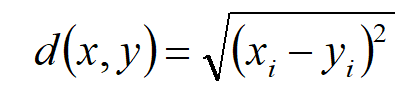
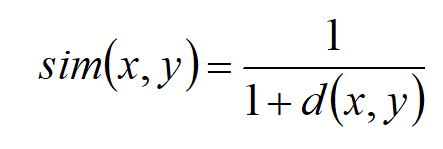
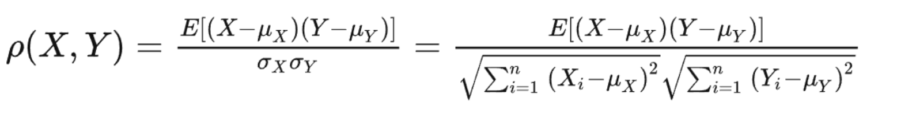
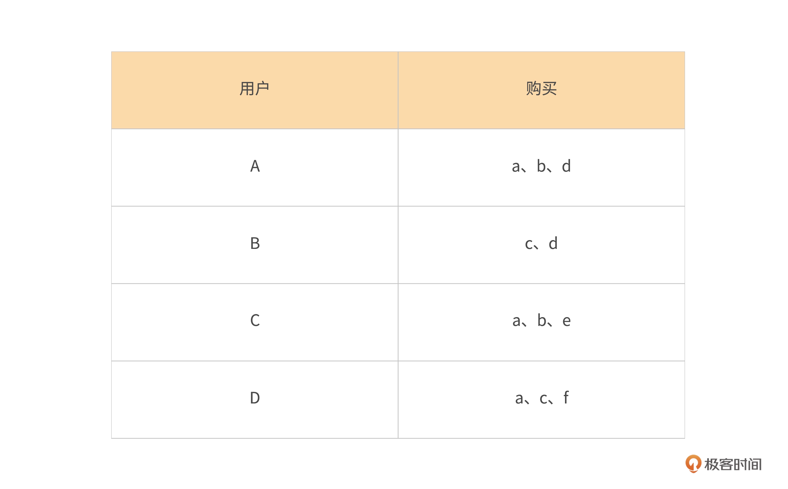
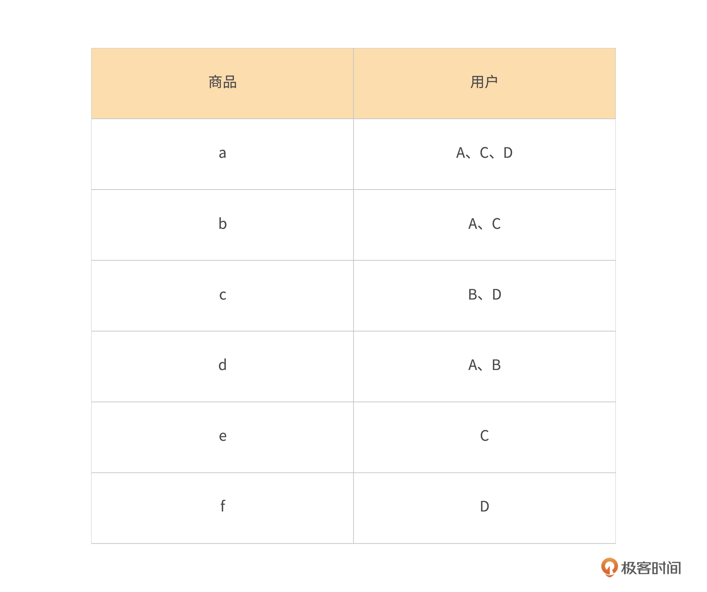
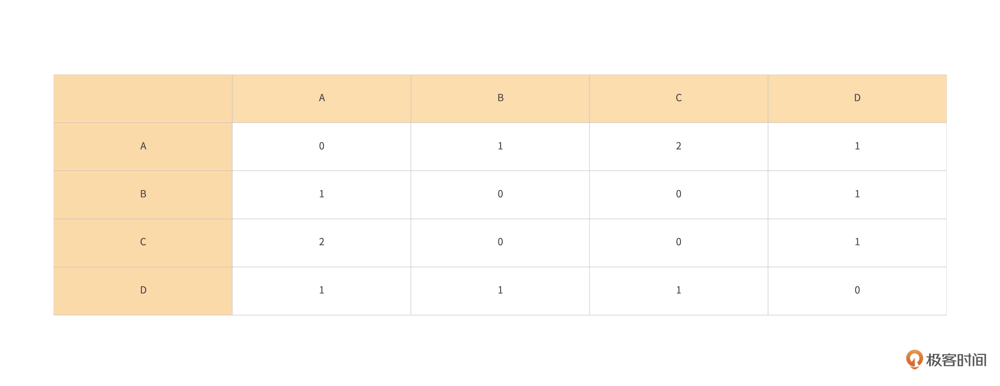
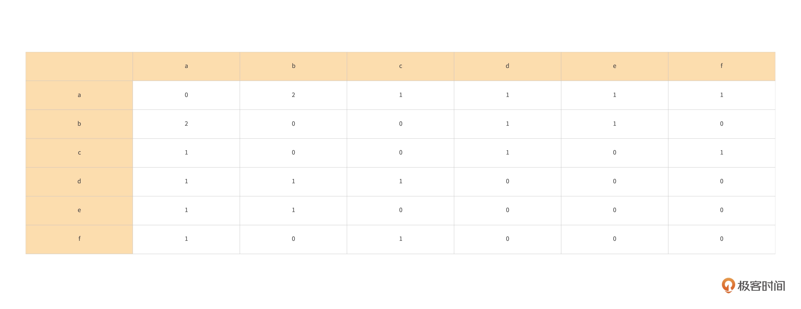

# 19 | 协同过滤：召回算法中永远不落幕的经典

你好，我是黄鸿波。

在前面的章节中，我们讲解了数据、算法以及简单的推荐服务，从本章开始，我们将开启一个全新的篇章：算法。本章我们会围绕算法和模型进行展开。

这节课我们先来讲解协同过滤算法，我将其分为了下面三个部分。

1. 什么是协同过滤算法、协同过滤算法的基本原理是什么？

2. 协同过滤算法中的常见问题和弊端。

3. 搭建一个简单的协同过滤算法。

## 协同过滤算法的基本原理

在实际的工程项目中，拿到用户的行为信息对一个线上产品来说非常容易，而如何利用好用户的行为数据才是重中之重。

在众多捕捉用户行为的推荐算法中，协同过滤算法是最基础也是最重要的算法之一，其核心思想就是对用户历史行为进行处理和挖掘，从而找到用户的喜好，并通过用户所喜好的内容进行召回、推荐。

我们经常会看到“猜你喜欢”“购买此商品的人也购买了某商品”等功能，这些功能常常就是使用协同过滤算法作为其最基础的召回算法，进行内容信息的召回。

一般我们可以将协同过滤算法分为两种类型：基于邻域的协同过滤算法和基于模型的协同过滤算法。其中基于邻域的协同过滤算法又包括基于用户的协同过滤算法和基于内容的协同过滤算法。无论采用哪种协同过滤算法，核心思想都一样：收集用户的行为记录，找到用户的偏好并找到与偏好相似的内容，计算比重再推荐给用户。

本质上，协同过滤算法通过计算用户之间的相似度来预测用户对未知内容的兴趣，相似度计算是协同过滤算法的核心。

### 相似度计算

在推荐算法中，常见的相似度计算有以下五种。

1. 欧氏距离（欧几里得距离）。

2. 余弦相似度。

3. 皮尔逊相关系数。

4. 修正余弦相似度

5. Jaccard 相似系数。

欧氏距离

欧氏距离是最常用的相似度计算方法，最初用于计算欧几里得空间中两个点之间的距离，当然，我们也可以用它来计算平面之间或空间向量中的两点距离。

一般来讲，每个向量都可以认为是高维空间中的一个点，欧氏距离实际上就是衡量这两个点之间的距离。因为两个点一般都是用坐标来表示，因此我们可以给向量一个相对明确的横坐标和纵坐标。

假设和是 n 维空间中的两个点，他们之间的欧式距离如下。



一般来讲，我们都是将这些点映射到 2 维平面进行计算。也就是说在实际过程中，我们通常考虑的是 n=2 时的距离。当 n=2 时，欧氏距离就是平面上两个点之间的距离，但是根据上面的公式我们可以发现，得到的结果是一个非负数，最大值是正无穷，而在实际过程中，相似度的取值范围通常在[-1,1]之间，我们可以对他进行求导数将结果转化到 (0,1]之间，其相似度计算公式如下。



我们在推荐系统中做用户画像、分析用户能力模型之间的差异时，使用欧氏距离比较合适。

余弦相似度

余弦相似度使用向量空间中的两个向量夹角的余弦值衡量两个个体之间差异的大小，余弦值越接近 1，说明两个向量之间的夹角就越小（也就是说明两个向量越相似），我们可以以此来作为度量两个向量之间的相似度，余弦相似度的计算公式如下。

- n​×B∑i=1​ AA⋅B

## similarity = cos(θ) =

- ​ =ii​∣∣A∣∣∣∣B∣∣i 2i 2nn​ (A​)​ (B​)​×∑i=1∑i=1​​

皮尔逊相关系数

皮尔逊相关系数通过计算两个用户之间的共同评分来衡量它们之间的相似度，它的取值范围在-1 到 1 之间，值越接近 1 表示两个用户越相似，越接近 -1 则表示两个用户越不相似。



修正余弦相似度

修正余弦相似度在计算相似度时加入了用户的偏好偏差，它通过调整评分矩阵每个用户的平均值来计算用户之间的相似度。

- ​iˉ​jˉ​ (R​−​)(R​−​)∑c∈IRRi,cj,c

## sim =

- ij​​iˉ​jˉ22​ (R​−​)​ (R​−​)​∑c∈I∑c∈IRRi,cj,c​​​i​j

修正的余弦相似度计算就是用用户均值中心化后的向量进行余弦相似度计算，因为中心化后的值才相对真实反映用户的喜好（即把矩阵中的分数减去对应用户分数的均值）。

你可以分别看看公式中这些符号的含义。

## I

- ：用户 i 与 j 的公共评分集。ij​

## I

- ：被用户 i 评分的物品集合。​i

## I

- ：被用户 j 评分的物品集合。​j

## R

- ：用户 i 对物品 c 的评分。i,c​

## R

- ：用户 j 对物品 c 的评分。j,c​​iˉ

## R

- ：用户 i 所有评分的均值。​

- ​jˉ

## R

- ：用户 j 所有评分的均值。​

Jaccard 相似系数

Jaccard 相似系数是一种适用于二元评分数据的相似度计算方法，它通过计算两个用户评分交集与评分并集的比值来衡量它们之间的相似度。它的取值范围在 0 到 1 之间，值越接近 1 表示两个用户越相似，越接近 0 则表示两个用户越不相似。Jaccard 相似系数的计算公式如下。

- ∣A∩B∣∣A∩B∣​ =

## J(A, B) =

- ∣A∪B∣∣A∣+∣B∣−∣A∩B∣​

### 基于用户的协同过滤

我们学习相似度计算实际上就是要学习协同过滤，因为协同过滤中所有计算两两相似的部分，都会用到上面的其中一种方法。

典型的协同过滤有两种，一种是基于用户的协同过滤，另外一种是基于内容的协同过滤（也叫基于 Item 的协同过滤），我们首先来看基于用户的协同过滤。

基于用户的协同过滤（User-Based Collaborative Filtering）通过分析用户之间的相似性来实现推荐。简单来说，就是根据用户的历史行为（比如浏览、购买、评分等）来找到与其兴趣相似的其他用户，然后向该用户推荐这些相似用户喜欢的商品或内容。

具体的推荐步骤如下。

1. 为每个用户创建一个兴趣向量，向量中包含该用户浏览、购买、评分等行为对应的商品或内容。

2. 通过计算用户之间的相似度，找到与目标用户相似度最高的一些用户。

3. 根据这些相似用户对商品或内容做出的行为，将对应商品或内容推荐给目标用户。

简单来说，基于用户的协同过滤就是找相似的用户，比如说现在有 A、B、C、D 四个人，同时有 a、b、c、d、e、f 这六个物品，这时我们可以做如下假设。



我们以商品的角度，会出现以下结果。



这时，我们就可以给它再转化成一个用户喜欢物品的共现矩阵。



这里简单解释一下，A 和 B 有 1 个同时喜欢的物品，所以这里是 1 分。同样 A 和 C 有 2 个同时喜欢的物品，所以这里记了 2 分，以此类推，就可以把所有的得分记录出来。

这个时候我们可以发现，A 和 C 有 2 个共同喜欢的物品，所以他们的相似度最高。A 和 B、A和 D、B 和 D、C 和 D 都有相同喜欢的物品，所以他们的相似度一样。我们再使用一些相似度计算方法，就可以得出 A、B、C、D 四个用户的相似度关系，从而进行推荐。

基于用户的协同过滤算法的优点在于能够捕捉用户的偏好和行为模式，同时也比较容易实现和解释。但该算法也存在一些缺点，如用户数量较多时计算量大、推荐结果容易出现重复等。

### 基于内容的协同过滤

基于内容的协同过滤（Item-Based Collaborative Filtering）与基于用户的协同过滤类似，但是其推荐的对象不是与目标用户相似的其他用户，而是与该用户曾经感兴趣的内容相似的其他内容。

该算法具体的推荐步骤如下。

1. 为每个内容创建一个分类向量，向量中包含了该内容与其他内容的相似度。

2. 根据用户曾经感兴趣的内容，找到这些内容与哪些其他内容相似度比较高。

3. 将这些相似度高的内容推荐给目标用户。

我们再拿上面的表格来举例。

实际上我们只需要在计算维度上变化一下，结果就会发生改变。上面的表格可以变成下面这样。



这个时候我们可以发现，如果站在内容的角度上，我们就能够知道内容之间被喜欢的共现矩阵，这样，我们以此来计算出内容的相似度。

我们用 a 和 b 之间的相似度计算来举例。a 和 b 的共现次数为 2，喜欢 a 的用户数是 3，喜欢b 的用户数是 2，那么我们可以计算出 ab 的相似度如下。

- C[a][b]2​ =​ =​ =

## 0.33

## W

- ab6N(a)∗N(b)​

基于内容的协同过滤算法优点在于能够充分利用内容之间的相似性，同时也较为高效。该算法还可以解决基于用户的协同过滤算法存在的“冷启动”问题——当新用户加入系统时，由于其历史行为较少，基于用户的协同过滤算法的准确性可能不高。

## 协同过滤算法的优点和常见问题

了解协同过滤算法的基本原理后，我们来整体看看它的优缺点。

### 协同过滤算法优点

1.个性化推荐

协同过滤算法基于用户历史行为数据或者评分数据来推荐内容，在这里，实际上我们找的就是用户与用户、内容与内容之间的交叉的矩阵信息，通过交叉的矩阵信息再结合相似度计算，就能够拿到各种用户可能喜欢的内容，因此在一定程度上可以满足用户的个性化需求。

2.没有约束条件

协同过滤算法没有固定的约束条件，可以应用于各种形式的数据，包括评分数据、行为数据和社交网络数据。比如目前特征相对较少，只有用户浏览过的新闻内容，这个时候我们可以用协同过滤来做。

3.灵活性较高

协同过滤算法可以适应不同的数据集和算法改进，可以通过调整相似度计算方法、加入时间衰减因素、增加用户 / 内容属性等方式来提升推荐效果。

4.可扩展性较好协同过滤算法不需要事先对数据进行分类或者标签，适用于大规模数据处理，也便于在以后增加新数据进行模型的更新和扩展。

5.算法效果较好

对于评分数据而言，协同过滤算法具有较高的准确性和预测能力，在实际推荐中能够取得应用效果，可以满足大多数的推荐需求。

### 协同过滤算法的缺点

1.稀疏性问题

协同过滤算法需要构建用户评分或者行为矩阵，而实际上很多用户只会对部分内容进行评分或者行为，这会导致评分矩阵很稀疏，很难找到具有高度相关性的用户或内容来做准确预测。

2.冷启动问题

当新增用户或者内容时，协同过滤算法很难做出准确的推荐。因为新用户没有足够的历史行为数据，无法找到可以跟他们相关的其他用户或内容进行推荐。同样，新内容也没有足够的历史行为数据，很难找到具有相似特征的内容来做推荐。

3.数据稳定性问题

协同过滤算法基于历史行为数据来做推荐，而用户的兴趣会随着时间发生变化，这会带来数据的不稳定性，导致历史数据无法准确反映当前的用户兴趣，导致推荐结果不准确。

4.算法适用性问题

协同过滤算法基于人与人之间的相似性（或内容之间的相似性）做推荐，但并不是所有的推荐场景都适用于这种算法。比如当用户需要一些全局性的推荐时，基于局部相似性的协同过滤算法就无法很好地完成任务。

## 搭建一个简单的协同过滤算法

在对协同过滤算法有了一个基本的了解之后，接下来我们来搭建一个简单的基于 Item 的协调过滤算法。

回顾一下，到目前为止我们整个系统的工程有以下三个项目。

1. 爬虫项目，主要是用来爬取用户的数据。

2. 推荐算法的主项目，里面包含了各种数据处理、推荐算法等等。

3. 推荐服务项目，也就是如何将我们的数据推荐给用户，这里面就会涉及给前端的接口等。

接下来我们主要会用到前面的推荐算法主项目，也就是 recommendation-class 这个项目。

对于基于 Item 的协同过滤算法，我们要做的就是两件事，第一个是计算基于 Item 的相似度矩阵，第二个是给用户进行推荐结果的计算。

我们先来看计算协同过滤矩阵部分代码。

```python
def cf_item_train(self):
 """
 return:相似度矩阵：{content_id:{content_id:score}}
 """
 print("start train")
 self.item_to_item, self.item_count = dict(), dict()
 for user, items in self.train.items():
   for i in items.keys():
     self.item_count.setdefault(i, 0)
     self.item_count[i] += 1  # item i 出现一次就加1分
 for user, items in self.train.items():
   for i in items.keys():
     self.item_to_item.setdefault(i, {})
     for j in items.keys():
       if i == j:
         continue
       self.item_to_item[i].setdefault(j, 0)
       self.item_to_item[i][j] += 1 / (
         math.sqrt(self.item_count[i] + self.item_count[j])) # item i 和 j 共现一次
 # 计算相似度矩阵
 for _item in self.item_to_item:
   self.item_to_item[_item] = dict(sorted(self.item_to_item[_item].items(),
                        key=lambda x: x[1], reverse=True)[0:30])
```

简单解释下这段代码，它实现了一个协同过滤算法中的 Item-based 推荐算法的训练函数，代码主要流程如下。

1. 遍历每个用户和该用户对应的所有内容，统计每个内容被多少个用户使用。

2. 遍历每个用户和该用户对应的所有内容，对于每个内容 i，遍历该用户已阅读过的所有其它内容 j。如果 i 和 j 不相同，则将内容 i 和内容 j 之间的相似度计算出来，并存储在字典self.item_to_item 中。

3. 对于 self.item_to_item 中的每个内容 i，将其与其他所有内容的相似度按照从大到小的顺序排序，并只保留前 30 个最相似的内容。

具体来说，self.item_to_item 是一个字典，其中每个键值对表示一个内容及其相似的其他内容，如：{内容 1:{内容 2: 相似度, 内容 3: 相似度, …}, 内容 4:{内容 5: 相似度, 内容 6: 相似度,…}, …}。

而 self.item_count 是另一个字典，用于存储每个内容出现的次数。 该函数最终返回一个相似度矩阵 self.item_to_item，该矩阵将所有内容两两之间的相似度计算出来，并只保留每个内容与前 30 个最相似内容的相似度。这个相似度矩阵可以作为 item-based 推荐算法的依据，用于计算每个用户对未使用过内容的预测评分。

当我们需要推理的时候，则会传入 user_id，然后通过 user_id 来找对应的推荐的内容，具体代码如下。

```python
def cal_rec_item(self, user, N=5):
 """
 给用户user推荐前N个感兴趣的文章
 :param user:
 :param N:
 :return:  推荐的文章的列表
 """
 rank = dict()
 try:
   action_item = self.train[user]
   for item, score in action_item.items():
     for j, wj in self.item_to_item[item].items():
     if j in action_item.keys(): #如果文章j已经被阅读过了，那么我们就不会去推荐了
       continue
     rank.setdefault(j, 0)
     rank[j] += score * wj / 10000
   res = dict(sorted(rank.items(), key=lambda x:x[1], reverse=True)[0:N])
   print(res)
   return res
 except:
   return {}
```

简单解释下这一段代码，函数 cal_rec_item 实现的是给用户推荐感兴趣的文章，参数 user 表示用户，N 表示推荐的文章数目。

具体可以分为以下五步。

1. 将用户的历史浏览记录存储在 self.train 中，action_item 表示用户 user 的历史行为。

2. 遍历用户的历史行为，对于每个行为中浏览过的文章 Item，找到与该文章相关性较高的其他文章 j。

3. 计算文章 j 的推荐得分 rank[j]，得分为用户对文章 Item 的评分 score 与文章 Item 与文章 j的相关性 wj 的乘积。其中 wj 是 Item 和 j 的相似度，计算方式可以是基于协同过滤的相似度计算算法。

4. 将所有推荐文章的得分按照从大到小的顺序排序，取前 N 篇文章作为推荐结果。排序使用sorted 函数进行，其中的 key 参数表示以每个元素的第二个值（即文章得分）进行排序，reverse=True 表示从大到小排序。

5. 将推荐结果存储在字典 res 中，返回给用户。如果用户没有历史行为，返回空字典。

到这里，实际上我们已经把基于 Item 的协同过滤代码主逻辑部分写完了。在后面的课程中，我会把数据处理和整个流程串起来，形成一个完整的推荐系统流程。

## 总结

我们来做一个总结。学完本节课，你应该知道以下五个要点。

1. 协同过滤是一类基于用户行为的推荐算法，该算法的核心思想是利用用户的历史行为数据，推荐其可能会感兴趣的内容。

2. 基于用户的协同过滤算法是通过寻找和目标用户口味类似的其他用户，推荐这些用户喜欢的物品给目标用户。

3. 基于物品的协同过滤算法是通过寻找和目标物品相似的其他物品，推荐这些相似物品给目标用户。

4. 协同过滤算法是推荐系统中应用广泛的算法之一，其优点在于不需事先获知物品的内容和属性。缺点是当用户和物品都很多时算法复杂度会很高，且算法受数据稀疏性的影响较大。

5. 熟悉如何通过 Python 实现一个简单的协同过滤算法。

## 课后练习

学完本节课的内容，给你留两个小作业。

1. 实现基于 Item 的协调过滤算法。

2. 想一想，我们的数据集要怎么建立，并且怎么传入到这两个函数中。

欢迎你在留言区与我交流讨论，如果这节课对你有帮助，也欢迎你推荐给朋友一起学习。
