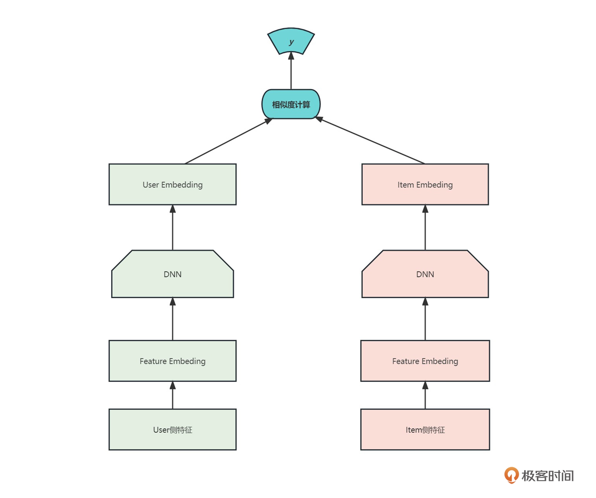
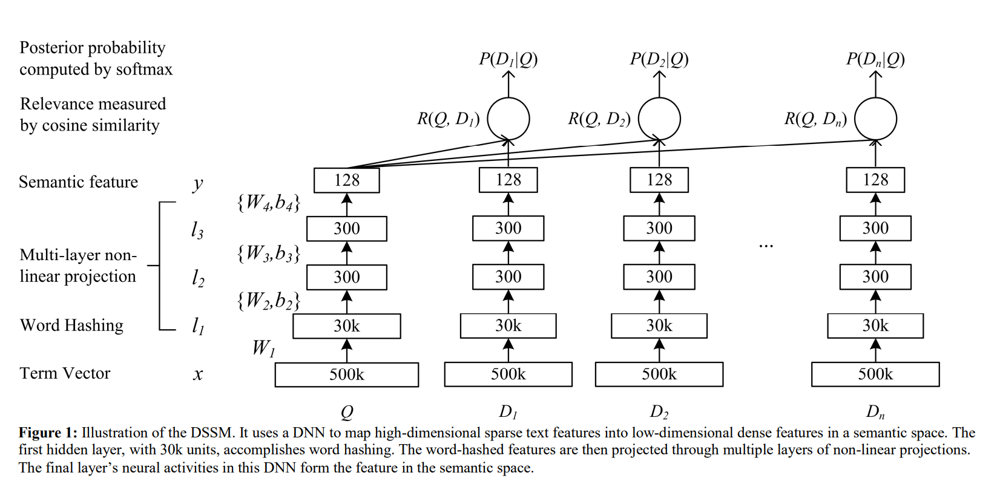
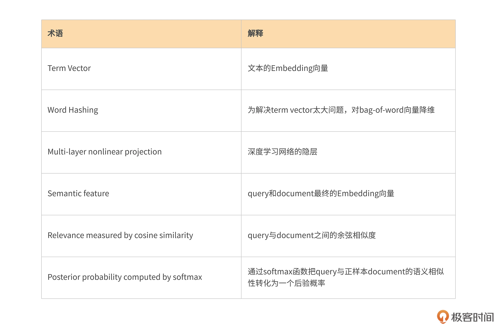

# 20 | Embedding：深入挖掘用户底层特征

你好，我是黄鸿波。

上节课我们讲解了基于协同过滤的召回算法，本节课我们来介绍另外一种召回算法：基于Embedding 的召回。

我把这节课分成了以下三个部分。

1. 什么是基于 Embedding 的召回。

2. 基于 Embedding 的召回算法都有哪几种。

3. DSSM 模型。

## 基于 Embedding 的召回

协同过滤算法是从内容和用户的角度出发，根据用户的历史行为来进行内容推荐。在基于用户的协同过滤中，会认为与用户历史记录相似的其他用户对同一商品也可能感兴趣。而在基于Item 的协同过滤中，则会考虑内容之间的相似度以及用户和内容之间的关系，从而计算出用户可能喜欢的内容进行推荐。但不管怎么样，这些内容实际上都是基于关系进行推荐的，并不关心内容的文本语义。

基于 Embedding 的算法与协同过滤最大的区别在于，它是从内容文本信息和用户查询的角度出发，利用预训练的词向量模型和深度学习模型，将文本信息转换成向量进行表示，通过计算两个向量之间的距离或者相似度来推荐内容。这种方式主要考虑商品文本信息的语义信息，使推荐的内容更加精准。

我来通过一个小例子说明下基于 Embedding 的召回是如何工作的。

假设我们要构建一个商品推荐系统，用户在平台上浏览了几个商品，比如一双运动鞋、一件 T恤和一条牛仔裤。系统基于这些商品信息构建商品的 Embedding 向量表示，以及用户的Embedding 向量表示。然后计算用户 Embedding 向量与所有商品 Embedding 向量之间的相似度，选取相似度最高的商品进行推荐。

假设如下。

- 用户的向量为[0.2, 0.3, 0.1]。

- 运动鞋的向量为[0.1, 0.5, 0.4]。

- T 恤的向量为[0.6, 0.2, 0.3]。

- 牛仔裤的向量为[0.3, 0.4, 0.2]。

那么我们可以计算出用户 Embedding 向量与每个商品 Embedding 向量之间的余弦相似度。

- 运动鞋相似度为 0.76。

- T 恤相似度为 0.29。

- 牛仔裤相似度为 0.55。

因此，推荐系统会优先推荐运动鞋，因为其与用户的相关性最高。当然，在实际情况下，还需要考虑其他因素，例如商品的热度、库存、价格等。

在实际的工程中，基于 Embedding 的召回有以下三大优点。

扩展性强：基于 Embedding 的召回算法可以学习大规模物品或用户的向量表示，因此对于超大规模推荐系统也可以进行有效召回。

表达能力强：基于 Embedding 的召回算法可以学习到物品或用户更为细致的特征表示，因此能够更好地捕捉物品或用户之间的相似性。

可解释性：基于 Embedding 的召回算法可以自然地将物品或用户表示为低维向量，这使得我们可以通过可视化等手段来更好地理解和解释推荐结果。

当然，它也有下面这些缺点。

需要大量数据：基于 Embedding 的算法通常需要大量数据来进行训练，因此在数据稀缺的场景中可能表现不佳。

训练周期长：训练基于 Embedding 的算法比较耗时，需要大量的计算资源和时间来完成。

只能表达物品或用户之间的关系：基于 Embedding 的算法只能表达物品或用户之间的关系，无法表达更高维度的结构关系，如时间序列或流程等。

限制于向量表示：基于 Embedding 的算法只能将物品或用户表示为向量，这会使得其表达能力受到较大限制。

需要调参：基于 Embedding 的算法中，对于参数的调整比较繁琐，需要较为丰富的经验和技巧。

## 基于 Embedding 的召回算法

在大致了解了什么是基于 Embedding 的召回之后，接下来我们再来说说基于 Embedding 的召回算法分类。

基于 Embedding 的召回，实际上就是拿用户和内容的向量去做各种相似度的计算，因此在基于 Embedding 的召回算法中，最核心的就是 I2I 和 U2I，我们下面分别来看。

### I2I 的召回

I2I 就是我们说的 Item-to-Item，实际上就是要将每一个 Item 用向量来表示。在 Item-to-Item召回中，系统会根据用户已经交互过的物品，找到这些物品的相似度，然后根据相似度来召回其他类似的物品作为推荐结果。这个向量的表示，我们就可以理解为 Embedding。

具体来说，Item-to-Item 召回通常分为两个步骤。

第一步，计算物品之间的相似度，这通常通过计算物品之间的相似度矩阵来实现。其中相似度可以是基于共现频率、用户喜好行为等等。第二步，当有用户请求推荐时，系统根据该用户的历史交互行为，找到该用户已交互过的物品并选取与之最相似的一些物品作为推荐结果。

那么，到底什么是 Item，Item 的 Embedding 是什么，又该怎么表示呢？我们继续往下讲。在推荐系统中，需要推荐的内容无非就是两种：图文和视频。

图文又可以拆分成图片和文字。对于图片来说，我们需要考虑的是图片本身和图片内所包含的文字内容。图片本身比较简单，一般都是 ResNet 这些算法的中间向量结果导出，作为这个图片的 Embedding 表示。对于文字来说，处理 Embedding 时有很多种方法，比如传统的Word2Vector、FastText、GloVe 等，或者是基于深度学习的 BERT、ELMo 等。

对于视频类 Item，需要考虑的因素就更多了。视频包含了图片、音频、文本等多种信息。在进行视频 Item 的 Embedding 时，不仅需要将这些信息都考虑进去，同时还需要考虑视频的时序信息。例如，视频中的某个场景可能只在视频的某个时间点出现，我们需要将这种时序信息考虑在内，才能更加准确地对视频进行 Embedding。

我们来简单说下上面所提到的几种方法。

1. Word2Vec：Word2Vec 是由 Google 提出的基于神经网络的词向量表示方法。该方法将每个单词表示为一个向量，通过学习单词的上下文来生成这些向量。Word2Vec 有两种模型，分别是 CBOW 模型和 Skip-gram 模型，它们在捕捉词汇关系上有所不同。

2. GloVe：GloVe 是一种全局向量表示法。与 Word2Vec 不同，它不仅关注单词与其他单词的共现频率，而且还通过对单词的共现矩阵进行分析，捕捉单词之间更加微妙的语义关系。

3. FastText：FastText 是 Facebook 提出的文本分类和词向量表示神器。它通过对单词的字符级别的 n-gram 进行学习，来捕捉单词内部的内在结构，并在此基础上生成单词的向量表示。

4. ELMo：ELMo 是一种结合了上下文的词向量表示方法。它从单词的字符级别信息和整个句子上下文中提取有关单词的散文表示，并且可以捕捉到多个语义层次的信息。

5. BERT：BERT 是 Google 提出的一种预训练语言模型。它在处理包括问答和性质预测在内的 NLP 任务时表现出色，将前面上下文和后面上下文一起考虑。BERT 基于 Transformer 模型，它引入了 Masked Language Model 和 Next Sentence Prediction 两种预训练任务，使得它可以学到更加通用的语言表示。

以上这些是 NLP 领域中常用的一些文字 Embedding 方法。无论哪种方法，它们都可以生成单词的向量表示，从而表达单词之间的语义关系和上下文信息。对于推荐系统中的文字Embedding，这些方法也可以作为参考，并且可以通过预训练的多种方法，从不同的层面来学习单词的语义信息和上下文关系，从而生成更好的向量表示。

### U2I 的召回

U2I 召回也就是 User-to-Item 召回，它基于用户的历史行为以及用户的一些个人信息，对系统中的候选物品进行筛选，挑选出一部分最有可能被用户喜欢的物品，送入推荐模型进行排序和推荐。

在 U2I 召回中，常用的策略包括以下三种。

1. 基于用户历史行为的召回：通过分析用户的历史行为记录，提取出用户对不同物品的偏好特征，通过计算相似度等方法找到与历史行为相似的物品，作为候选物品进行推荐。

2. 基于用户画像的召回：通过分析用户的个人信息（例如性别、年龄、职业等）构建用户画像，然后找到与画像匹配的物品，作为候选物品进行推荐。

3. 基于社交网络的召回：通过分析用户的社交网络，找到与用户有密切关系的其他用户，然后利用这些用户的行为记录或个人信息，找到用户有相似兴趣的物品，作为候选物品进行推荐。

在实际的工程中，我们也可以把 U2I 的召回分成离线和在线两个大部分。离线部分一般是根据用户的历史行为信息以及内容的画像来进行召回，我们可以拿到用户的行为信息（也就是用户画像）来做成用户的 Embedding，然后再拿内容画像的信息做成 Item 的 Embedding，然后将这两部分通过检索模块，快速检索出用户可能感兴趣的 TopN 内容。

## DSSM 模型

比较经典的基于 U2I 的召回模型有 DSSM 和 YoutubeDNN 模型。基于 YouTubeDNN 模型的召回会在下节课中着重讲解，这节课我们先来讲解 DSSM。

DSSM 模型又叫双塔模型（全称 Deep Structured Semantic Model），双塔模型上线很方便，User 塔在线计算 User Embedding，Item 塔离线计算 Item embeding，通过向量检索就可以快速进行召回。线上预测的时候，只需要在内存中计算相似度运算即可。

我们来看一下 DSSM 模型的结构。

这个结构非常简单，主要包含两个部分：User 塔和 Item 塔。

User 塔表示用户历史行为的信息（如用户的浏览记录、购买记录等）。它的输入是一个用户的历史行为序列，其目标是把这个序列映射为一个固定的用户向量表示，该向量表示用户的兴趣特征。

Item 塔表示所有的物品的信息（如物品的标题、描述、标签等）。它的输入是一个物品的特征序列或向量，其目标是把这个序列或向量映射为一个固定的物品向量表示，该向量表示物品的特征。

借助于用户历史行为和物品的特征向量表示，DSSM 可以计算用户特征向量和物品特征向量之间的相似度，预测哪些物品最符合用户的兴趣并产生最高的预测分数。这些物品可以按照预测分数的高低排序，推送给用户进行推荐。

因此，DSSM 模型的 User 塔和 Item 塔的作用在于，协同地基于用户历史行为和物品特征对用户兴趣进行建模，并基于这样的建模产生个性化推荐结果。

我们可以把上面的双塔模型分成下面三层。

输入层

最下面的 User 侧和 Item 侧特征是输入层。输入层主要的作用是把文本映射到低维向量空间，转化成向量提供给深度学习网络。

表示层

中间的 DNN 模型可以看成是表示层。DSSM 模型表示层使用的是 BOW（Bag Of Words）词袋模型，没有考虑词序的信息。不考虑词序其实存在明显的问题，因为一句话可能词相同，但是语义则相差十万八千里，下面这个是表示层的结构图。

图中涉及了几个术语，我为你整理了一个表格，你可以对照着进行学习。

匹配层

匹配层实际上就是针对于前面的 Query 和 Doc 进行相似度计算，这个过程实际上非常简单，就是把 Query 和 Doc 统一转换成了两个 128 维的语义向量，通过 cos 函数计算这两个向量的余弦相似度。

在实际工程中，DSSM 模型还有很多变种，比如 LSTM-DSSM、CNN-DSSM、MV-DSSM 等等，你如果感兴趣的话欢迎在评论区留言，我们一起交流讨论。

## 总结

到这里，本节课也就接近尾声了，我们来对这节课做一个简单的总结，本节课主要讲解了下面六个要点。

1. 基于 Embedding 的召回算法是将物品或用户表示为低维稠密向量的一种算法，其核心思想是通过神经网络等模型学习到物品或用户的向量表示，然后通过计算向量之间的相似度来完

- 成召回任务。

2. 基于 Embedding 召回的优点：扩展性强、表达能力强以及可解释性。

3. 基于 Embedding 召回的缺点：需要大量的数据进行训练、训练周期一般比较长、无法表达更高维度的关系、需要调参经验等。

4. Item-to-Item 召回是推荐系统中常用的一种召回算法，也称为基于物品的召回。其中，“物品”通常指的是推荐系统中的商品或内容。在 Item-to-Item 召回中，系统会根据用户已经交互过的物品，找到这些物品所具有的相似度，然后根据相似度来召回其他类似的物品作为推荐结果。

5. User-to-Item 基于用户的历史行为以及用户个人信息，对系统中的候选物品进行筛选，挑选出一部分最有可能被用户喜欢的物品，送入推荐模型进行排序和推荐。

6. DSSM 模型又叫双塔模型，主要包含 User 塔和 Item 塔。你需要对输入层、表示层和匹配层也有一定的了解。

## 课后练习

最后依旧是课后练习环节，给你布置了两个作业。

1. 了解下还有哪些基于 Embedding 的召回方法。

2. 预习一下基于 YouTubeDNN 的召回，因为这一部分确实比较难。

期待你的分享，如果今天的内容让你有所收获，也欢迎你推荐给有需要的朋友！
