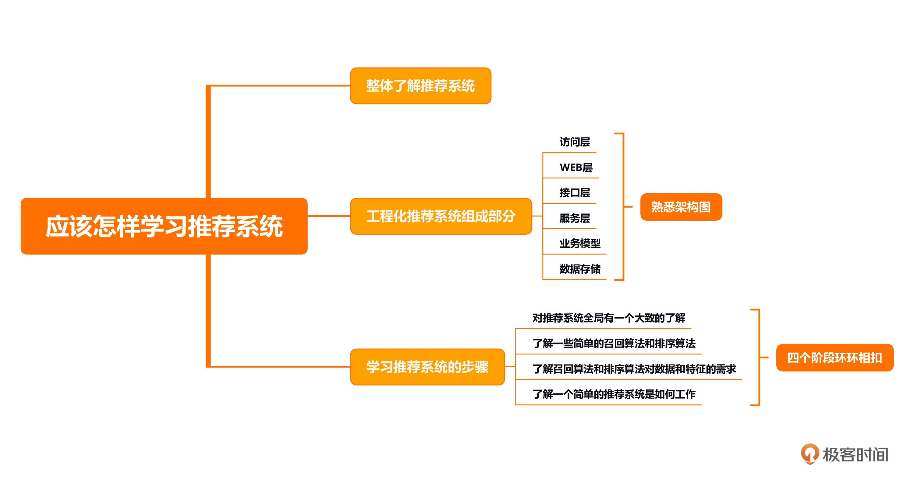
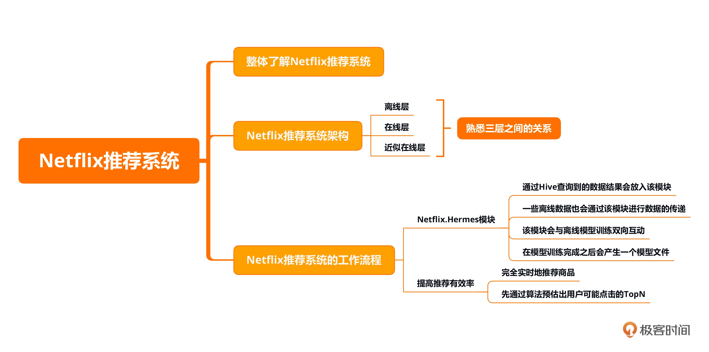
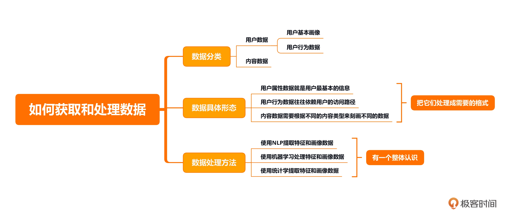
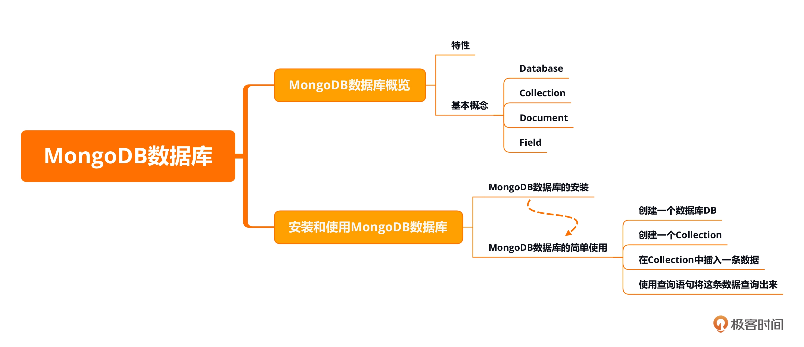
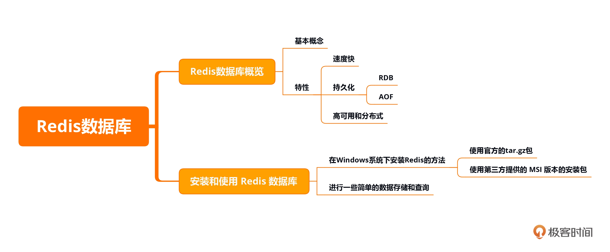
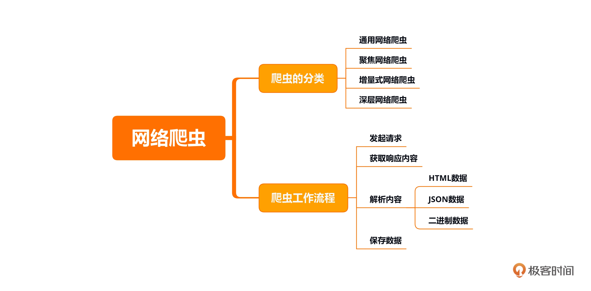
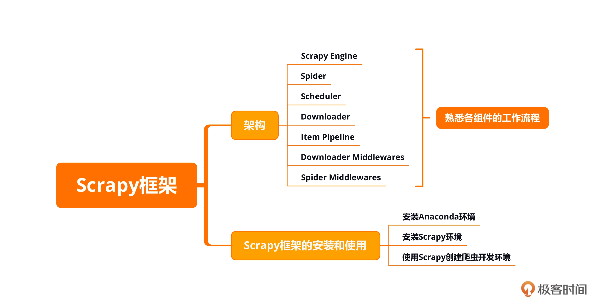
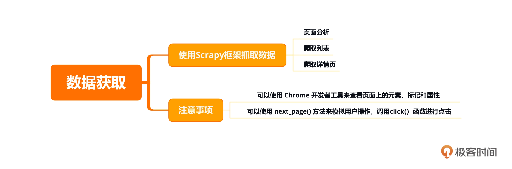
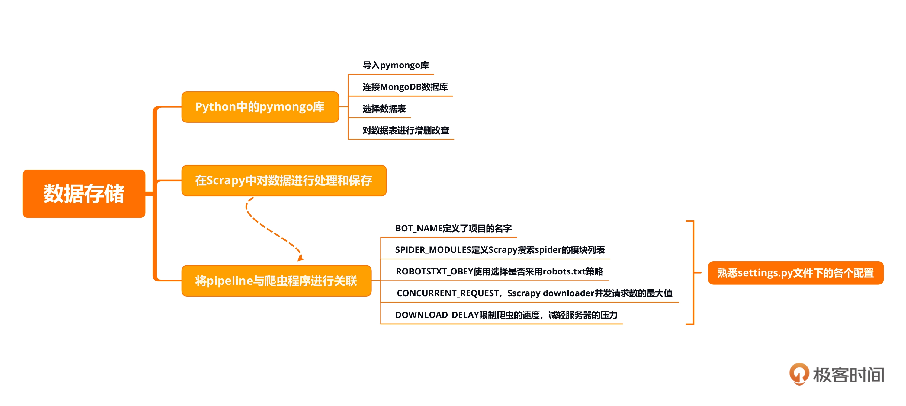
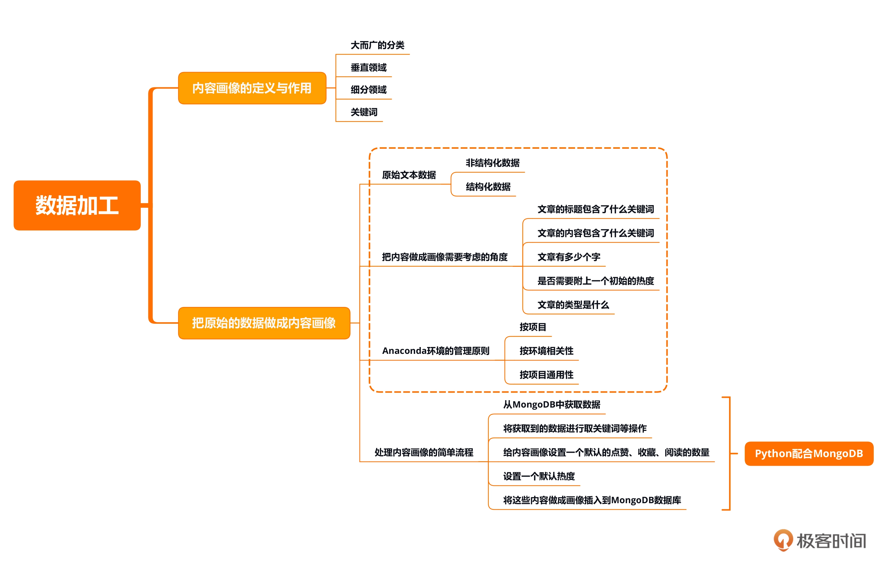

# 特别放送 | 知识回顾（上）

你好，我是黄鸿波。

不知不觉咱们的课程已经接近尾声了，这节课我来带你划下重点，一起复习一下架构篇以及数据篇的内容，话不多说，我们现在开始吧。

01｜推荐系统：我们应该怎样学习推荐系统？

本节课的重点在于了解推荐系统的整体概念，知道它整体运行的原理，此外，我还为你梳理了推荐系统的学习方法，为接下来数据篇的学习做准备。

02｜Netflix 推荐系统：企业级的推荐系统架构是怎样的？

本节课的重点在于掌握 Netflix 推荐系统在企业中的整体架构以及工作流程，同时熟悉在线层、近似在线层、离线层这几个层之间的关系。

03｜数据处理：我们应该如何获取和处理数据？

本节课的重点在于了解数据的获取方式以及具体形态，同时熟悉各类数据处理方法和它们对应的应用场景。

04｜MongoDB：如何安装和使用 MongoDB 数据库？

本节课的重点在于 MongoDB 数据库的大致了解以及安装，并能够简单使用它。我在目录的设计上重点突出了“手把手”搭建的过程，所以也看到有的同学反馈这节课太过于基础了。如果你有 MongoDB 数据库以及 Redis 数据库的安装经验，可以直接学习第六节课。

05｜Redis：如何安装和使用 Redis 数据库？

本节课和上节课的定位类似，也是在手把手带你安装和使用 Redis 数据库，如果你已经会了，直接跳过即可，这两节课是想照顾一下基础薄弱的同学。

06｜网络爬虫：爬取一个网站的流程是怎样的？

本节课的重点在于熟悉爬虫的主要工作流程，一共分为四步，即发起请求、获取相应内容、解析内容和保存数据。

07｜数据获取：什么是 Scrapy 框架？

本节课的重点在于了解 Scrapy 框架的原理和主要模块（Scrapy 引擎、调度器、下载器、爬虫、管道、下载中间件、Spider 中间件），以及它们是如何协作的。并且能够在 Anaconda 环境中创建一个 Scrapy 环境，搭建一个最简单的 Scrapy 框架跑起来。

08｜数据获取：如何使用 Scrapy 框架爬取新闻数据？

本节课的重点在于爬取新浪新闻中的数据，并对爬取到的数据进行解析。其中包括页面分析、爬取列表以及爬取详情页。

09｜数据存储：如何将爬取到的数据存入数据库中？

本节课的重点在于熟悉在 scrapy 中对数据进行处理和保存，并能够在 settings.py 文件下加入我们的 Pipelines 相关的内容。

10｜数据加工：如何将原始数据做成内容画像？

本节课的重点在于了解非结构化文本内容画像的生成处理方式，比如文本分类、文本聚类、关键词提取等等。同时，你也需要熟悉如何使用 Python 配合 MongoDB 来做一个简单的内容画像。

这次的复习课到这里也就结束了，下节课我将继续带你复习召回篇与服务搭建篇的内容，如果你觉得这节课对你有帮助，也欢迎分享给有需要的朋友！
