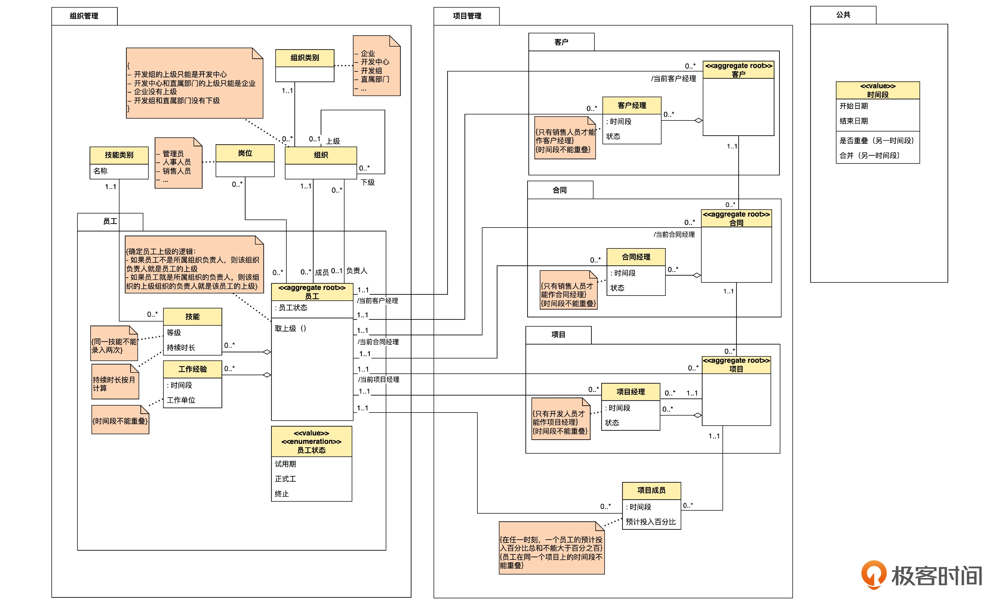
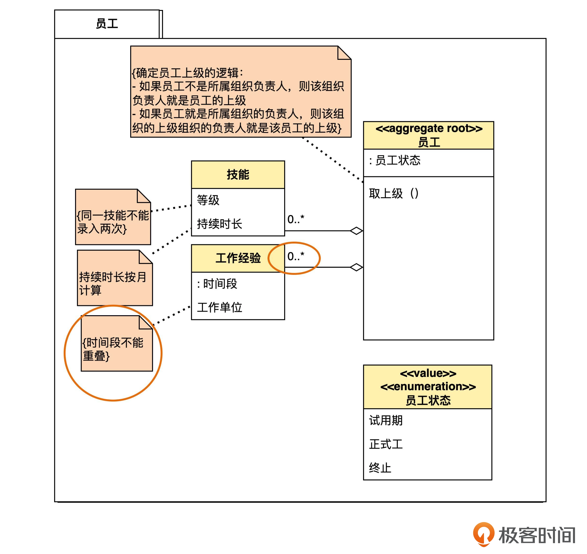
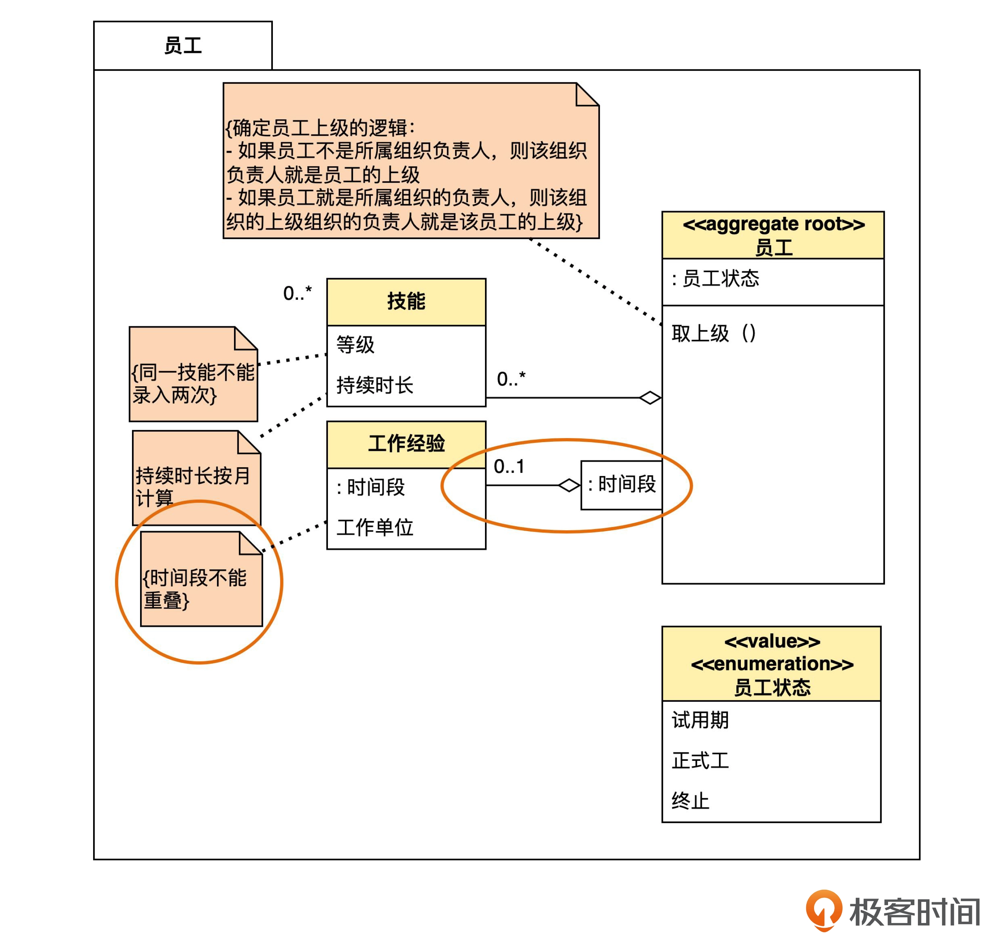
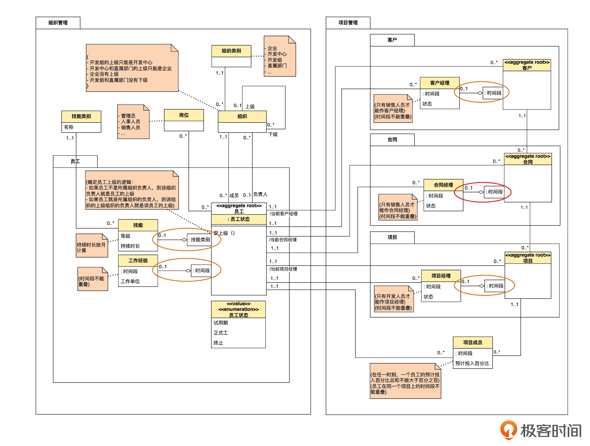
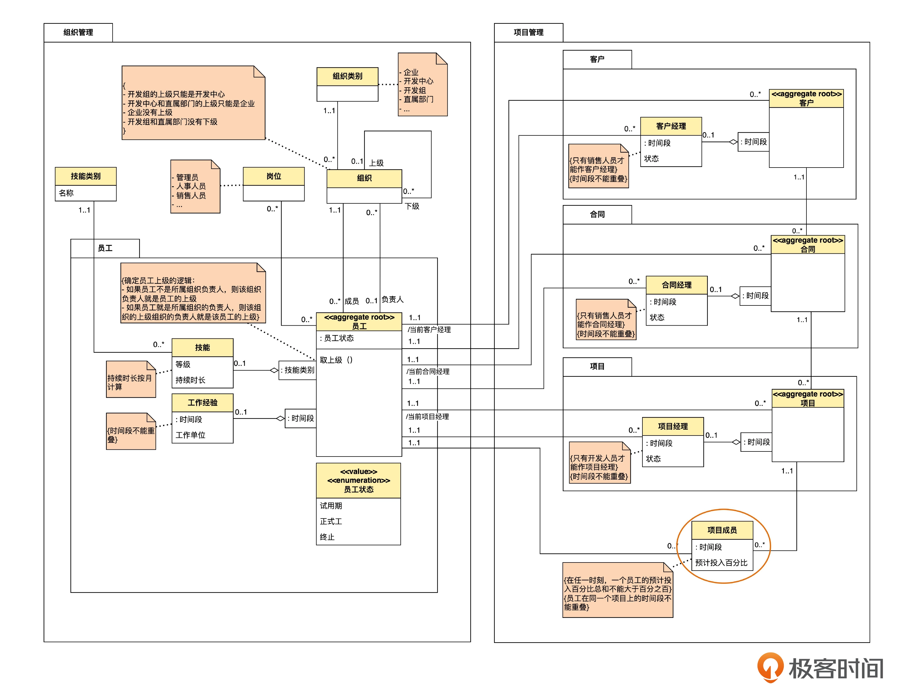
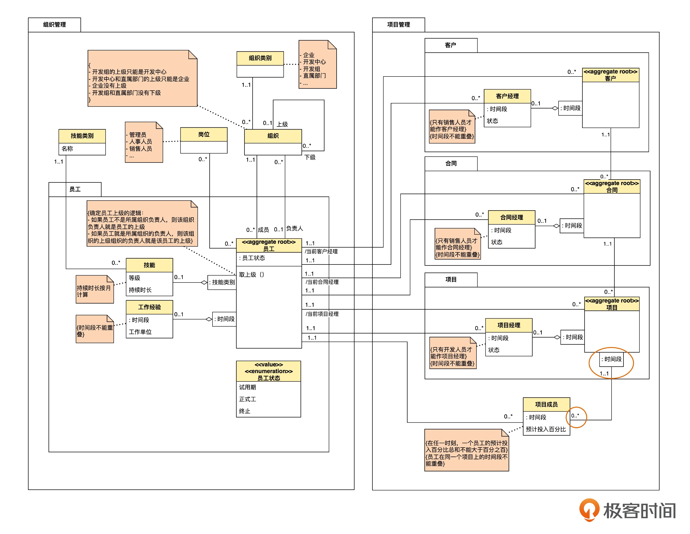
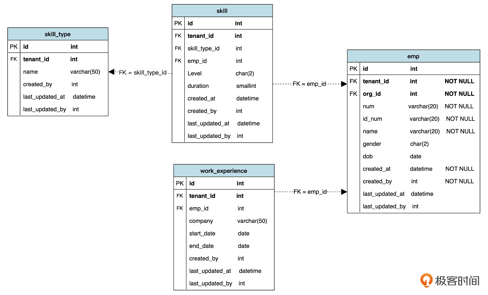
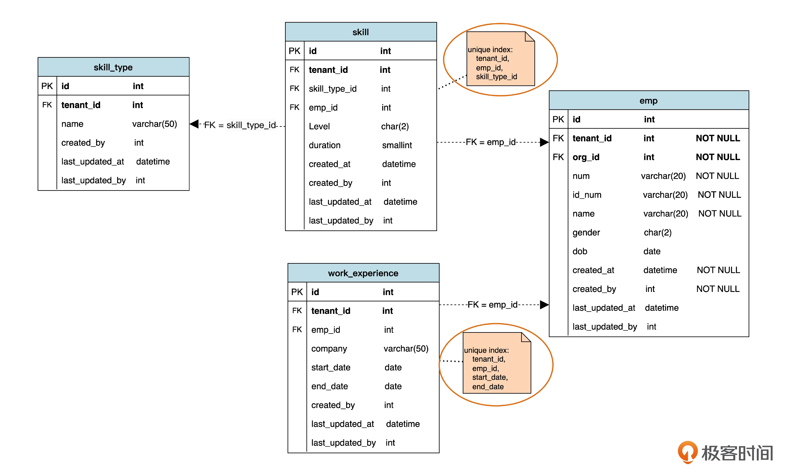

# 21 | 用“限定”建模：怎样简化一对多关联？

你好，我是钟敬。

在前几节课我们讲完了值对象。今天咱们学习另外一种建模技术——限定。

在《DDD》原书里讲关联的时候，专门强调了这个方法，因为限定可以起到丰富模型语义和简化关联的作用。

然而我发现，即便是一些 UML 老手，会用这个技术的也不多。这个技术掌握起来没有想象中那么难，而用起来的效果很好。如果你能掌握，那么就向建模专家的目标又迈进一步了。

## 什么是“限定”

我们可以先回忆一下上节课完成的模型图。



为了说明“限定”的概念我们可以从员工和工作经验的关系开始。



一个员工可以拥有多份工作经验，而各个工作经验的时间段不能相互重叠。那么，我们可以得出一个推论：对于一个员工而言，每个时间段只能有一条工作经验。

虽然这种关系在“时间段不能重叠”这个约束里已经隐含了，但是 UML 里还有一种专门的方式，可以表达这个规则中的部分含义。我先画出来给你看看。



之前，员工和工作经验之间有一个一对多关联。现在，在员工那一端加了一个小方框，里面写了“: 时间段”，而另一端的多重性，由原来的“0..*”神奇地变成了“0..1”。

这种方式所表达的意思是说，对于一个员工而言，任何一个时间段，要么没有工作经验，要么有一条工作经验，但不能有多条工作经验。换句话说，总体上看，一个员工可以有多条工作经验，但限定在一个时间段的话，那么最多就只能有一条工作经验了。

所以，这种机制就叫作“限定”(qualification)。而上面那个标有“: 时间段”的小方框，叫做“限定符”（qualifier）。

由于工作经验里的时间段属性省略了属性名，只写出了类型，所以限定符里也相应地写了类型。假如工作经验里写的是属性名，那么限定符里也应该写属性名，这样才对得上。

分析完这个例子，我们不难发现，限定机制起到了两个作用：第一，表达了更丰富的语义，把原来用注解说明的约束变成了更严格的符号；第二，简化了关联关系的多重性，把原来的一对多，在形式上，变成了一对一。

那么，原来的“时间段不能重叠”这个约束，还有必要专门写出来吗？

就这个例子而言，还是要写的，这是因为时间段是可以交叉的。即使限定了一个时间段只有一条经验，仍然无法避免重叠。例如，张三已经有一条发生在 2000 年 1 月 1 日至 2002 年 12月 1 日的工作经验，这时候又想增加一条 2001 年 1 月 1 日至 2023 年 12 月 1 日的经验。这是两个不同的时间段，虽然没有违反图里的“限定”关系，但还是违反了时间段不能重叠的规则。

在后面你会看到，多数情况下，类似的约束本来是可以被限定所取代的，而这里是由于时间段的特殊性，所以不行。

这里顺便说一下，上面我用自然语言解释了模型图里“限定”的含义。事实上，学习领域建模要掌握的一个重要技能，就是在模型和自然语言之间的双向转换。也就是说，别人指着模型中的任何一个符号，你都能马上翻译成自然语言。另一方面，你也能把业务人员的自然语言，快速翻译成模型图中的符号。对于建模的高手，会熟练得像条件反射一样。只有多加练习才能达到这个程度。

## 识别更多“限定”

理解了“限定”的概念，你能在模型图里找出更多可以使用限定的地方吗？先想一想，然后和下面我画的图对比一下。



项目管理中有关时间段的限定，估计你都找出来了。那么员工模块里有关技能类别的限定，不知你找出来没有？

注意，在技能实体上，原来有一个“同一技能不能录入两次”的约束。现在由于增加了对技能类别的限定，已经表达了相同的意思，所以原来的约束就可以不写了。这个约束就可以用限定取代，而前面关于时间段的约束却不能用限定取代，你可以再想想两者的区别。

另外，我们再看看项目管理模块中项目成员这个实体。对照后面的模型图，你可以思考一下，项目和项目成员之间的关联，是否应该使用限定呢？



虽然项目成员里面也有时间段属性，但是项目和项目成员之间的关联并没有被时间段所限定。这是因为，即使在同一个时间段，一个项目还是可以有多个成员。所以就不必用时间段来限定了。

我们看到，尽管项目经理和项目成员中都有时间段，但项目经理的关联被时间段所限定了，而项目成员则没有。现在的表示方法清楚地体现出了两者之间的这种区别，而之前只能通过注释中的文字来表达，就没有这么一目了然了。

这里再补充一下，上面说项目成员“不必”用时间段来限定，而不是“不能”限定。这是因为，理论上其实也可以在项目一端加一个时间段限定，像下面这样。



不过这时候，项目成员一端的多重性仍然是“0..*”而不是“0..1”。理由前面已经说过了。如果这么画的话，就是说明，业务上特别强调要按照时间段来给项目成员分组。如果没有这样的需求，我们就不必使用限定了。

你看，哪怕我们这个不太复杂的例子里，已经有不少地方用到限定了。所以限定是领域建模中一种比较常用的机制，学会它还是很有必要的。

## “限定”的实现

现在，相信你已经能充分理解“限定”在领域模型里的用法了。这里解决的还是模型和需求的一致性问题。我们之前说过，模型驱动设计还非常强调实现和模型要保持一致，也就是模型中的改变总能体现在代码和数据库设计里。

我们这就结合例子，分别看看“限定”的数据库实现和代码实现。

### 限定的数据库实现

先看看“限定”在数据库里的实现。就拿工作经验（work_experience）表和技能（skill）表来做例子。目前数据库设计是这样的。



现在你可以想一想，怎么在工作经验表上体现出时间段的限定，并且在技能表上体现出技能类别的限定呢？

其实，只要增加两个唯一索引就可以了。可以用下面的图示表达。



比如说，工作经验表上的租户 ID、员工 ID、开始日期和结束日期组成的唯一索引，就表达了一个员工在一个时间段只能有一条工作经验这个限定。

### 限定的代码实现

解决了数据库设计问题，下面我们再来看看代码的实现。在代码中，限定一般用 Map 来实现。让我们看看下面修改过的代码。

```java
package chapter21.unjuanable.domain.orgmng.emp;
//imports ...
public class Emp extends AggregateRoot {
   // other fields ...
   // protected List<Skill> skills = new ArrayList<>();
   protected Map<Long, Skill> skills = new HashMap<>();
   // protected List<WorkExperience> experiences;
   protected Map<Period, WorkExperience> experiences = new HashMap<>();
   // other methods...
   public Collection<Skill> getSkills() {
       // return Collections.unmodifiableList(skills);
       return Collections.unmodifiableCollection(skills.values());
   }
   public Optional<Skill> getSkill(Long skillTypeId) {
       // return skills.stream()
       //         .filter(s -> s.getSkillTypeId().equals(skillTypeId))
       //         .findAny();
       return Optional.ofNullable(skills.get(skillTypeId));
   }
   public void addSkill(Long skillTypeId, SkillLevel level
                                 , int duration, Long userId) {
       skillTypeShouldNotDuplicated(skillTypeId);
       Skill newSkill = new Skill(tenantId, skillTypeId, userId).setLevel(level)
       //skills.add(newSkill);
       skills.put(skillTypeId, newSkill);
   }
   private void skillTypeShouldNotDuplicated(Long newSkillTypeId) {
       // if (skills.stream().anyMatch(
       //            s -> s.getSkillTypeId().equals(newSkillTypeId))) {
       if (skills.get(newSkillTypeId) != null) {
           throw new BusinessException("同一技能不能录入两次！");
       }
   }
   //    public List<WorkExperience> getExperiences() {
   //        return Collections.unmodifiableList(experiences);
   //    }
   public Collection<WorkExperience> getExperiences() {
       return Collections.unmodifiableCollection(experiences.values());
   }
   public void addExperience(Period period, String company, Long userId) {
       durationShouldNotOverlap(period);
       WorkExperience newExperience = new WorkExperience(
               tenantId
               , period
               , LocalDateTime.now()
               , userId)
               .setCompany(company);
       //experiences.add(newExperience);
       experiences.put(period, newExperience);
   }
   private void durationShouldNotOverlap(Period newPeriod) {
       // if (experiences.stream().anyMatch(
       //                 e -> e.getPeriod().overlap(newPeriod))) {
       if (experiences.values().stream()
                   .anyMatch(e -> e.getPeriod().overlap(newPeriod))) {
           throw new BusinessException("工作经验的时间段不能重叠!");
       }
   }
   // other methods...
}
```

上面的代码里，注释掉的部分是原来的代码，可以对比着看。我们先来看和技能（skills）相关的代码，工作经验也是类似的。

首先，我们把 Emp 类的 skills 属性的类型由原来的 List 改成了 Map。Map 的 Key 实际就是技能类别 ID，这样，就保证了对技能类别所限定的唯一性。后面的代码都根据这一变化做了修改。

对于第 15 行的 getSkills() 方法，我们取了 Map 的 values()，并把方法的返回值类型改成了Collection。

对于第 21 行的 getSkill(Long skillTypeId) 方法，我们直接从 Map 里取值，而不是像以前那样通过遍历 List 来搜索。

让我们假想一下，当初写程序的时候，如果你发现从 List 里搜索比较麻烦，可能就已经想到可以改成 Map 了。这样，我们就可以“反推”出，模型中很可能应该使用限定。这其实是在编写代码的过程中，以优化代码结构为启发，反过来促使模型演进的一个例子。

在第 28 行的 addSkill() 方法里把对 List 的 add() 改成了对 Map 的 put()，这个比较简单。

在第 39 行的 skillTypeShouldNotDuplicated()，也就是技能类别不能重复的校验中，同样是把对 List 的搜索改成了从 Map 里直接取值来判断。

关于工作经验的代码修改也是类似的，就不重复了。

讲到这里，你应该对怎么保持代码和模型一致，更有感觉了吧？想要在代码实现环节里实践DDD，我的建议是写代码的同时一定要打开模型图，培养边看图边写代码的习惯。尤其是初学者更应该这么做，这样才能时刻提醒自己做到代码和模型的一致。

## 总结

好，这节课的主要内容就讲到这，我们来总结一下。

今天我们讲了 UML 中一个实用的技能——限定。假设有一个一对多的关联，如果表示“多”的一端的某一个属性被限定以后，可以变成一对一关联的话，那么就可以使用限定了。

“限定”在模型里的表示方法是用一个小方框，里面写上被限定的属性，然后放到关联里表示“1”的那一端。之后，原来的一对多，在形式上一般就可以变成一对一了。这里增加的小方框叫做“限定符”。

“限定”可以使模型的语义更加丰富，把原来只能用注释表达的约束，变成更严格的符号，并且一目了然地表达出这种约束。

在模型的实现层面，对于数据库设计来说，限定往往可以表现为数据表上的唯一索引。对于代码来说，限定一般是用 Map 来实现的。

## 思考题

下面我给你留了两道思考题：

1. 在你知道的项目中，可以举出更多限定的例子吗？

2. 课程中讲了一对多的限定，你觉得多对多是否也可以用限定呢？

好，今天的课程结束了，有什么问题欢迎在评论区留言，下节课，我们开始讲领域建模中的一个比较高级的技能——泛化。

【PS：这个分支“iteration-2-till-lesson21”已经完成了迭代 2 中直到 21 课的代码，链接：https://github.com/zhongjinggz/geekdemo/tree/iteration-2-till-lesson21。 】
