# 33 | 分析模式初探：怎样解决更复杂的问题？

你好，我是钟敬。

学习完前面的课程，再经过一定的练习，相信你就有能力运用 DDD 来开发中等难度的系统了。不过，如果遇到更复杂的业务领域，还需要更深入的建模技能。

这节课，我们就来探索一个能帮你加强领域建模技能的利器——分析模式。

《分析模式》是 Martin Fowler 写的一本领域建模的专著。《领域驱动设计》一书的第 11 章也介绍了怎样通过分析模式建立深层次的领域模型。

如果你对分析模式还不了解，也没关系，还是老办法，我们回到迭代三的需求场景里，从解决需求开始，一步一步地理解到底什么是分析模式。

## 组织层级模式

这个迭代有几个“人员和组织管理”方面的需求，我们就从这里开始吧。

先回顾一下之前组织管理相关的模型。

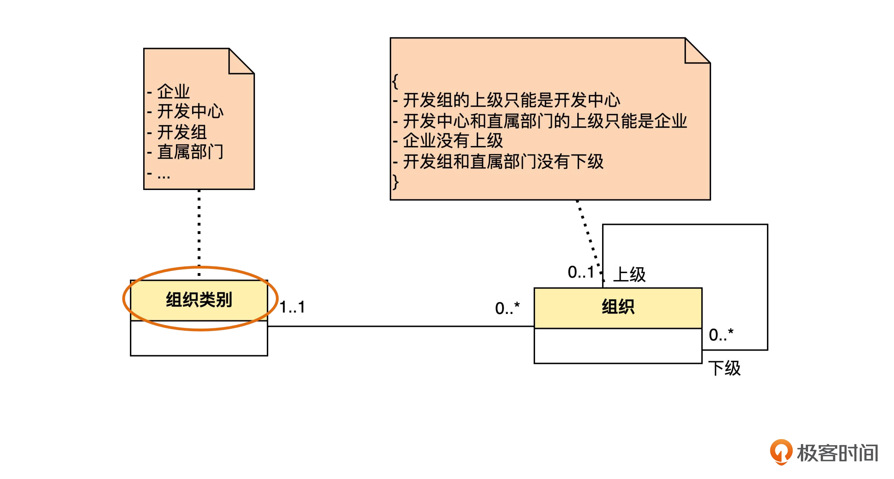

为了和《分析模式》中的提法吻合，我把原来的组织类别改成了组织类型，意思并没有变。组织类型是可以灵活定义的。这是因为，“企业”“开发中心”等等，都可以定义在组织类型表里。

其实，这种结构已经是一种比较简单的分析模式了，称为“组织层级”（OrganizationHierachies）模式，出自《分析模式》一书的 2.2 节。不过无法完全满足我们的需求。所以，我们来做一些进一步的扩展。

在这个模型里，有关组织层级的业务规则，比如说“开发组的上级只能是开发中心”，还不能通过表来定义，只能硬编码在程序里。这样的话，组织的层级关系仍然无法完全灵活定义，并不符合我们对 SaaS 应用的期望，所以，我们首先要解决的是灵活定义组织层级的关系。

为了说明这个问题，我们考虑一个更复杂的组织。假设有一家大型银行。下面是它的组织结构的一小部分。

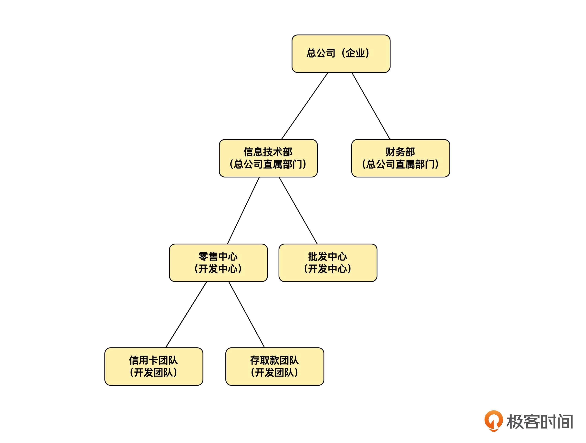

这并不是一张正规的 UML 图，而是我“自创”的一种非正式表示法，姑且称为“组织结构图”。目的是用比较形象的方式，辅助我们理解问题。图里的每个圆角矩形代表一个组织，里面有组织的名称，圆括号里是组织类型。

我们可以看到，总公司下面有信息技术部和财务部，这两个部门都是总公司一级部门。信息技术部下面有若干开发中心，一个开发中心下面有若干开发团队，一个开发团队下面有若干开发组。

从这个图里面，我们可以抽取出四条业务规则。

1. 企业没有上级。

2. 总公司一级部门的上级是企业。

3. 开发中心的上级是总公司信息技术部。

4. 开发团队的上级是开发中心。

那么，怎么在领域模型里为这些规则建模呢？首先我们考虑一下，这些规则是组织之间的关系，还是组织类型之间的关系？

答案是组织类型之间的关系。比如说，上面第三条规则里提到的是“开发中心”这个组织类型，而不是“零售中心”这个具体的组织。

在正式建立领域模型之前，我们还是先画一个非正式的模型图，深入理解一下组织类型的关系。

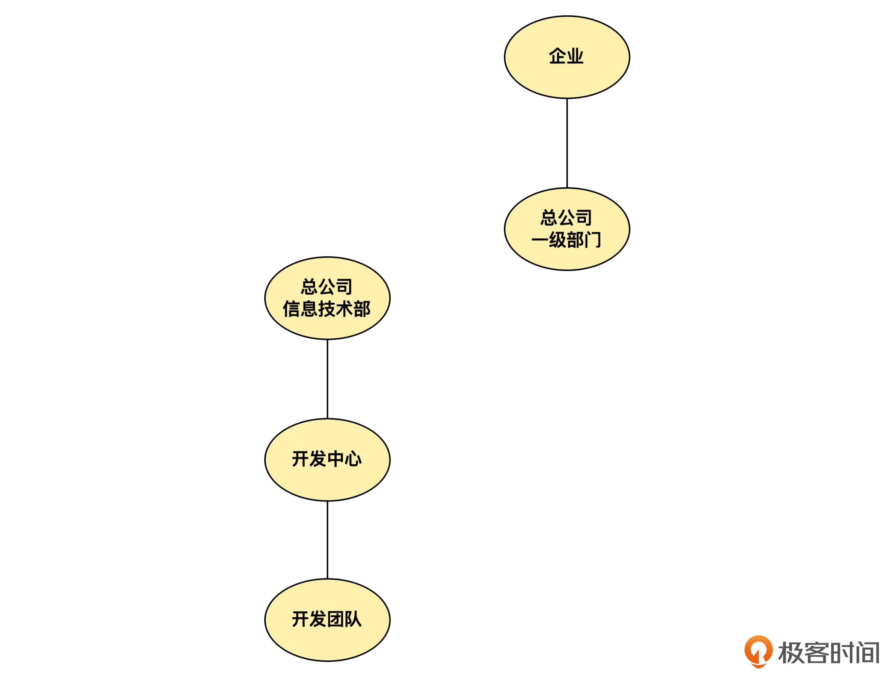

我们姑且把这个图称为“组织类型图”。椭圆表示组织类型。椭圆间的连线，反映了前面的业务规则所描述的不同组织类型间的约束关系。

但是，你可能已经发现这里出现了两个问题。

第一个问题是，“总公司信息技术部”到底是组织还是组织类型。在前面的组织结构图里，信息技术部显然是组织。但是现在我们想表达“开发中心上级是总公司信息技术部”，而“开发中心”是组织类型。

那么相应的，“总公司信息技术部”是不是也应该是一个组织类型呢？

其实两种理解都说得通，也就是说这里有两种可行的策略。

第一种，有一个叫“总公司信息技术部”的组织类型，这个类型下只有一个组织，也叫“总公司信息技术部”。

第二种，“总公司信息技术部”只是一个组织，不是组织类型，这时候，为了说明“开发中心上级是总公司信息技术部”，就要在“开发中心”这个组织类型和“总公司信息技术部”这个组织之间建立约束关系。

考虑到“类型对类型，组织对组织”可能更容易理解一些，所以这里我们选择第一种策略。

第二个问题是，仅仅按前面的四条规则的字面意思，企业和总公司信息技术部在图里就没有连上。这是因为这四条规则里没有直接规定“企业”和“总公司信息技术部”的关系。

比较完善的做法应该是描述出“总公司信息技术部是总公司一级部门”这一事实。不过现在我们先简化一点，“简单粗暴”地增加一条规则“总公司信息技术部的上级是企业”。至于更完美的做法，我们后面再讨论。

那么组织类型图就变成了后面这样。

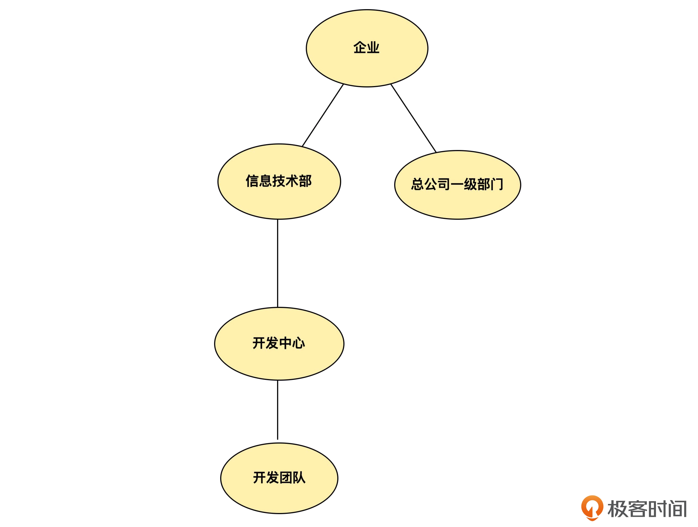

这时候我们发现，其实组织类型的上下级之间也是一对多关系。企业下面可以有两个组织类型，信息技术部和总公司一级部门，而每个组织类型的上级只能是一个组织类型。

好，现在，我们可以画出领域模型了。

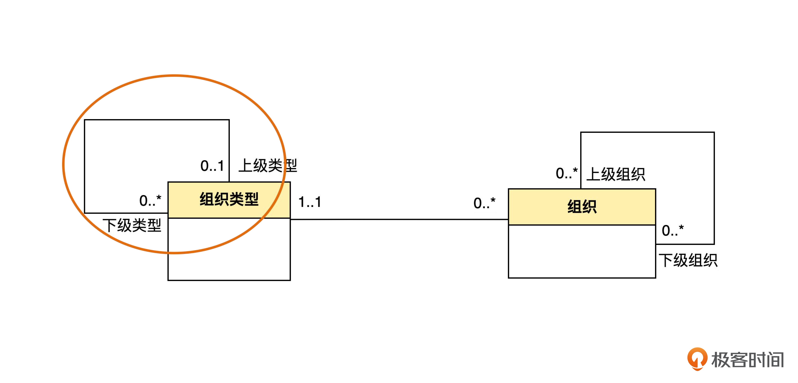

可以看到，我们在组织类型上加了一个一对多的自我关联，用来表示组织类型的上下级关系。准确地说，其实是组织类型下，组织之间的约束关系。这样，根据这个模型，可以在数据库里建一个组织类型表，这样就可以灵活定义组织层级关系，而不需要硬编码了。

让我们回味一下，假如我们一上来就用 UML 的类图进行领域建模，有些细微之处就不那么容易想清楚了。比如说，“总公司信息技术部”是组织还是组织类型的问题。所以，你可以再体会一下非正式模型的用处。

## 组织结构模式

我们接着讨论在本迭代引入的一个需求：一个组织可以处于多个组织结构里。比如说，总公司有信息技术部，分公司也有信息技术部。那么，分公司的信息技术部，既受到分公司的管理，也受到总公司信息技术部的管理。这时候，分公司信息技术部就处在两个组织结构，或者说两棵组织树里面了。

还是先用后面这个非正式的组织结构图来表达。

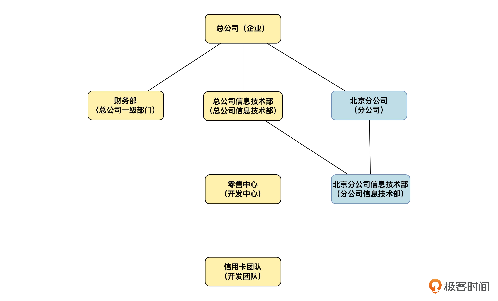

从图里可以看到，“北京分公司信息技术部”有两个上级组织。也就是说，组织之间的上下级关系不再是一对多的，而是多对多的。一个上级可以有多个下级，一个下级也可以有多个上级。但是不能存在循环关系。也就是如果 A 是 B 的上级，B 又是 C 的上级，那么 C 就不能是 A 的上级。这种关系，在图论里称为“有向无环图”。

类似地，组织类型之间的上下级关系也变成了多对多。

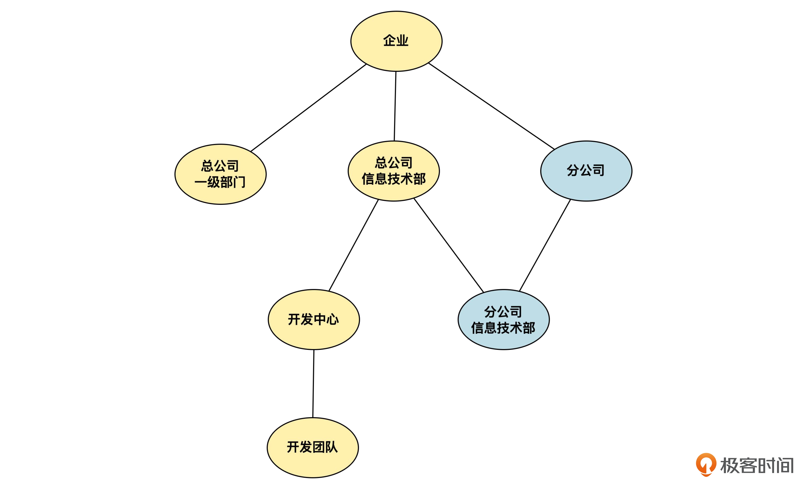

这两种多对多的关系，表现在领域模型图里就是后面这样。

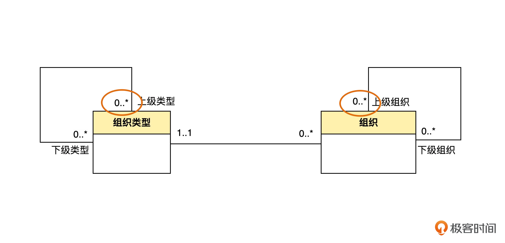

我们看到，上级类型和上级组织上面的多重性，原来是“0..1”，现在都变成了“0..*”。也就是由一对多关联变成了多对多关联。

现在我们再增加一个需求——保留组织上下级关系的变更历史。那么，就要保存上下级关系的时间段。这个时间段并不是组织的属性，而是上下级之间多对多关联的属性，这时候，我们就要把多对多关联拆成两个一对多关联了。

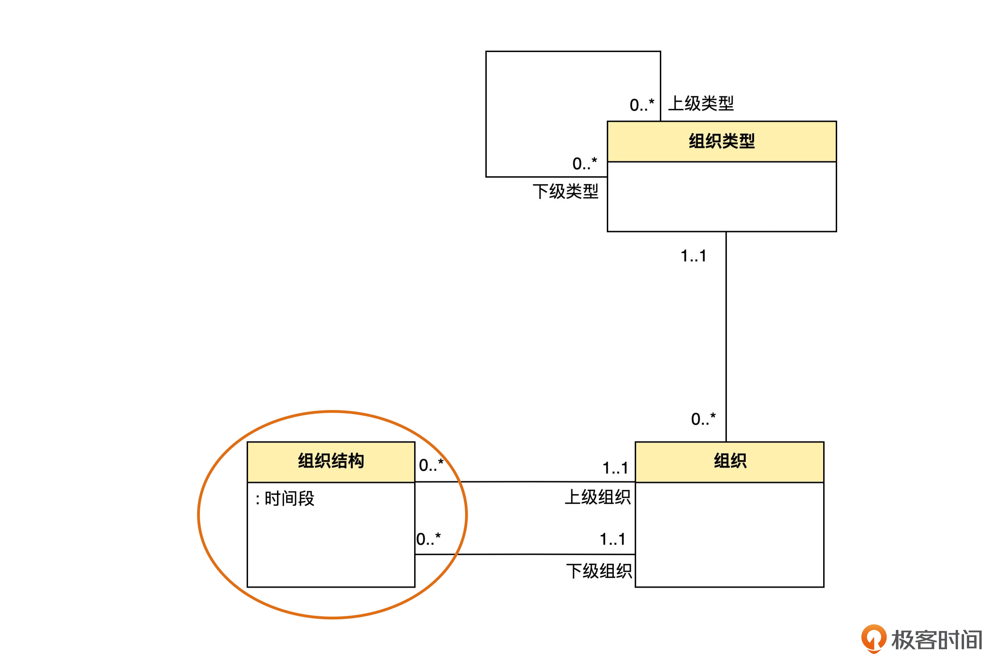

我们把表示组织间多对多关联的实体称为“组织结构”。这种表示组织间多对多关联的方法，就称为组织结构（organization structure）模式。

组织结构实体的每个实例，实际上就对应着组织结构图里的每一条线，你可以对照后面的示意图来理解。

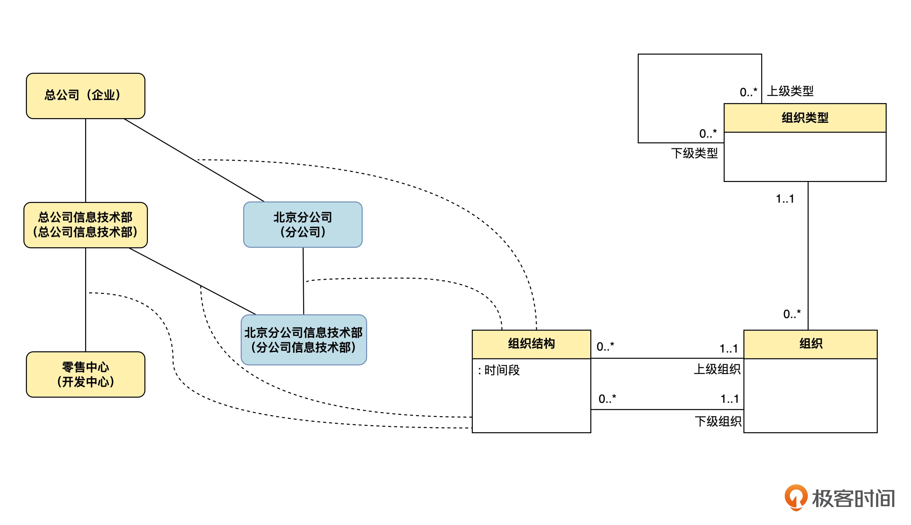

不过，这个模型还没有把“分公司信息技术部处在两个组织结构树里”这件事说清楚。

现在我们假定把“北京分公司信息技术部的上级是北京分公司，北京分公司的上级是总公司”这个组织结构树称为“公司线”，把“北京分公司信息技术部的上级是总公司信息技术部，总公司信息技术部的上级是总公司”这个组织结构树称为“职能线”。

然后，我们把这两个组织结构树的名称体现在组织结构图里，就成了后面这样。

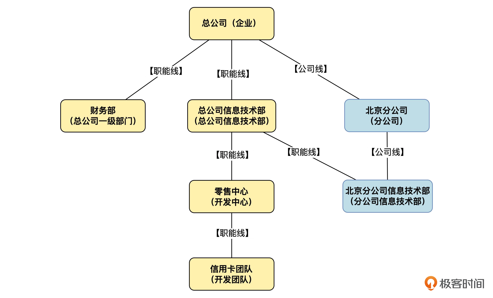

在这个图里面，我们把组织结构树的名称写在中括号里面。其中可以看到，“北京分公司信息技术部”和“总公司”都同时处在两棵树。

为了看清楚这一点，我们还可以把这个图拆成两张图。

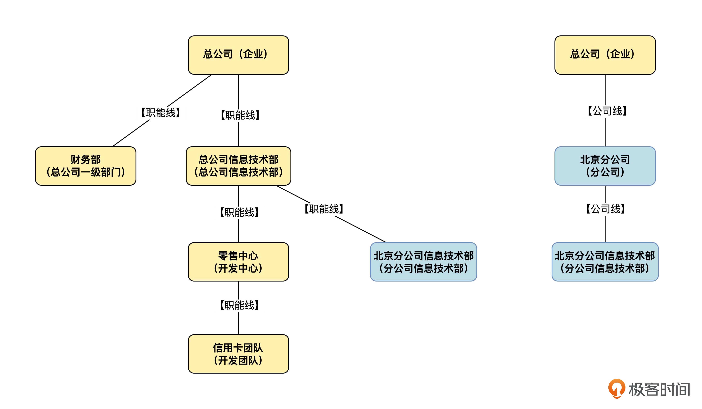

左边的图专门表示职能线，右边的图专门表示公司线。

现在，我们给“职能线”“公司线”这两个名词背后的概念起一个名字，就叫做组织结构类型吧。组织结构类型也是一个领域对象。为了更好地体现这一点，我们重新画一次组织结构图。

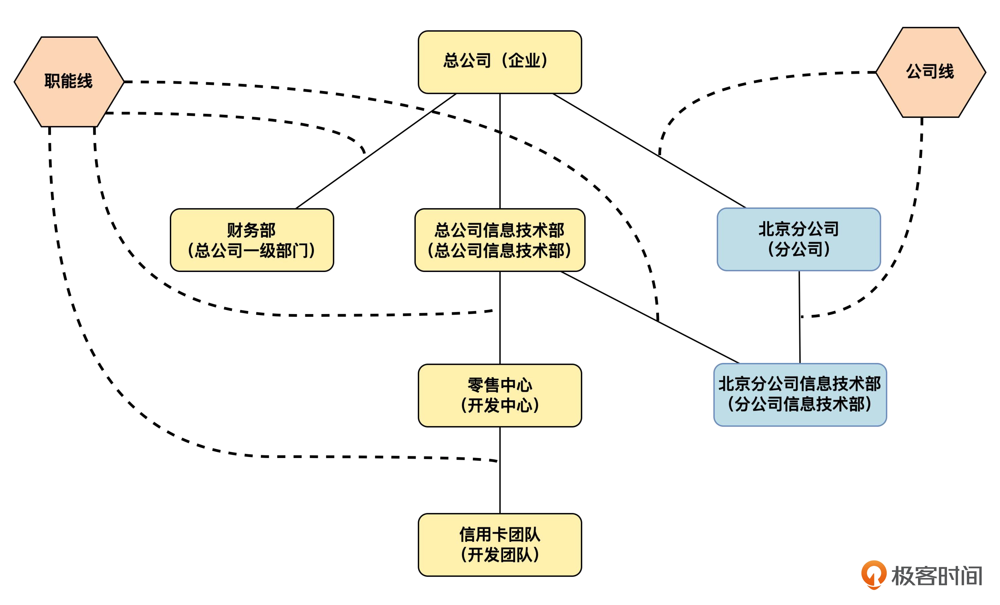

我们用六边形表示组织结构类型。前面已经讲过，这个图里的实线，代表了组织结构的实例。那么结合图片不难发现，组织结构类型和组织结构具有一对多的关联。把组织结构类型和这个一对多关联增加到领域模型图中，就是这样：

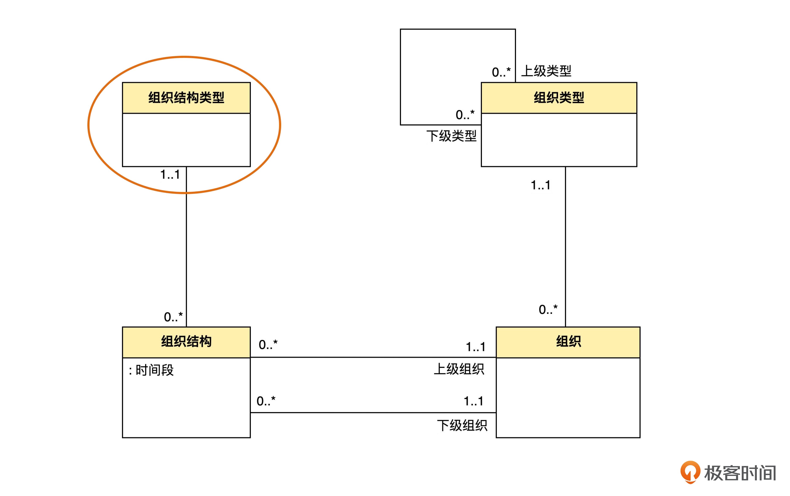

通过组织结构类型和组织结构，就可以表示一个组织处在多个组织结构树中的事实了。

那么，组织结构类型和组织类型之间有没有什么关系呢？我们再画一张示意图。

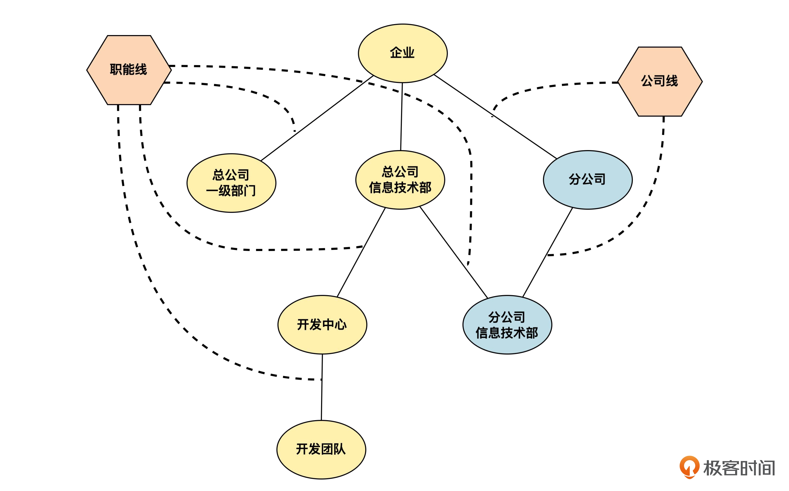

在理解了组织结构类型和组织结构之间的关系以后，这里的关系也就容易理解了。为了表达这种关联，在领域模型图里，我们也要把组织类型自身的多对多关联，拆成两个一对多关联，表示关联的实体可以叫做组织类型结构，对应的模型图是后面这样。

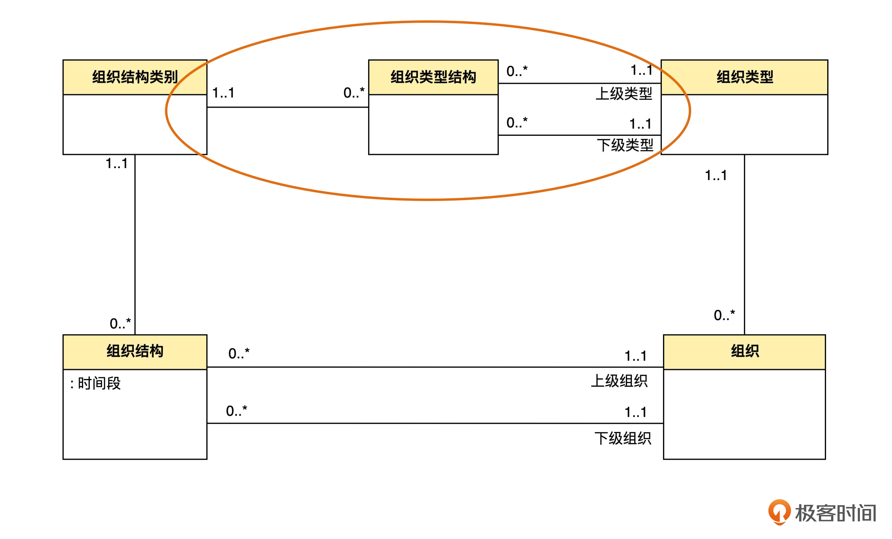

按照这个模型，“职能线”的组织结构将受到“职能线”对应的组织类型结构的约束；“公司线”的组织结构将受到“公司线”对应的组织类型结构的约束。这样就可以灵活地定义各种组织层级关系和相应的约束了。事实上，这个模型也用到了我们一会要讲的“分层责任”模式的思路，你先有个印象就可以了。

## 知识层模式

你有没有觉得，虽然上面模型图的领域对象并不多，但已经有一点不太好理解了。

其实，这张图实际上是组织人员管理模型图的一部分（后者要更大）。如果把这张图放回整个组织和人员管理模型，就更容易混乱了。这里我再介绍一个看起来简单，实际上很重要的方法，可以帮助我们提高模型的清晰程度。你可以结合后面的模型图来理解。

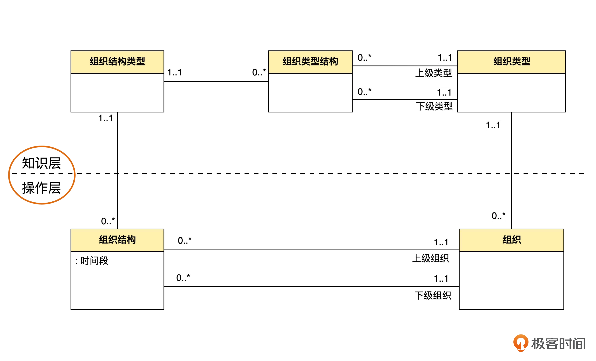

在这张图里，我们用一条虚线把这张图分成上下两部分。上面的部分叫做知识层（knowledgelevel），下面的部分叫操作层（operational level）。知识层里放的是定义性的对象，通常变化频率比较低。而操作层里的对象则用于日程业务操作，变化频率比知识层高得多。

“知识层”这个模式在《分析模式》2.5 节第一次引入。在《领域驱动设计》的 16.4 节也介绍过。由于这个模式用于处理比较复杂的模型，所以《领域驱动设计》把它归为一种战略设计模式。

## 参与方类型泛化模式

现在我们来解决刚才的一个遗留问题。我把讨论组织层级时的组织结构图再贴一遍。

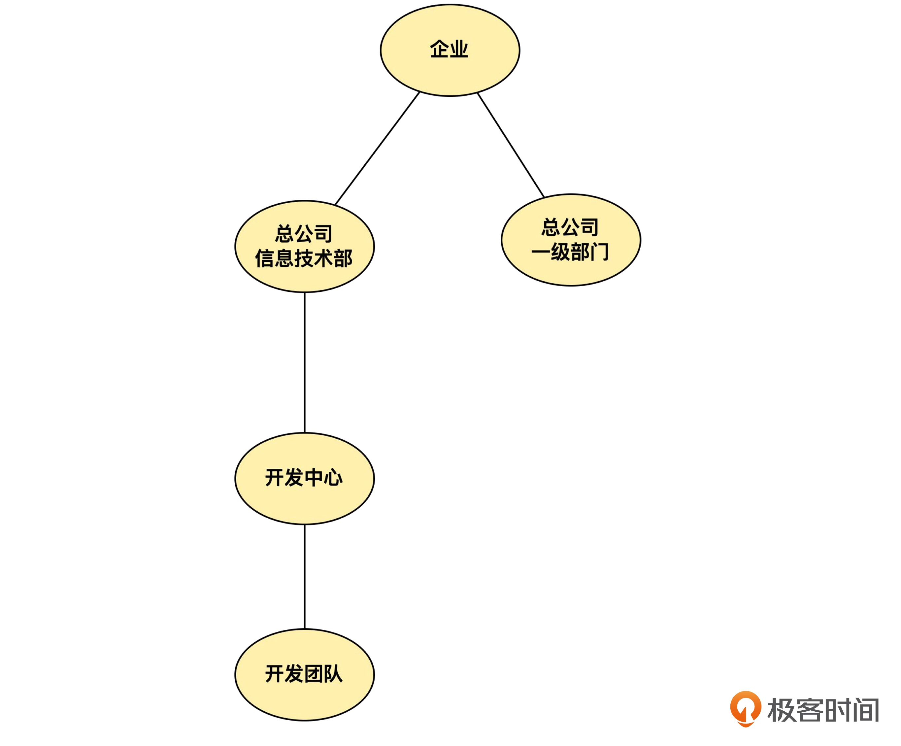

刚才，我们为了简化，暂时省略了“总公司信息技术部是总公司一级部门”这个领域知识。事实上财务部也有类似的情况，我们用下面的组织类型图表达出这种关系。

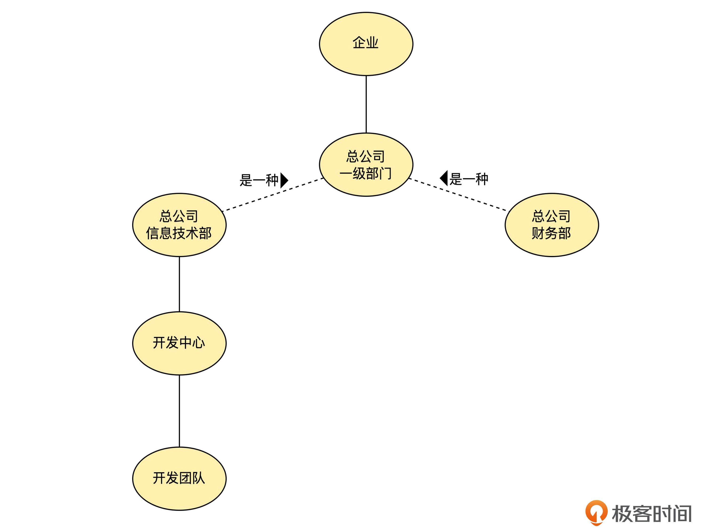

图里面组织类型之间的实线表示之前的上下级关系，而虚线表示“是一种”关系，实际上就是我们讲泛化时说的分类关系。也就是说，总公司一级部门分成了若干类，其中一类是“总公司信息技术部”，另一类是“总公司财务部”。这种分类，实际上是组织类型之间的一种一对多关联。

现在我们用领域模型图来表示出这种关系。

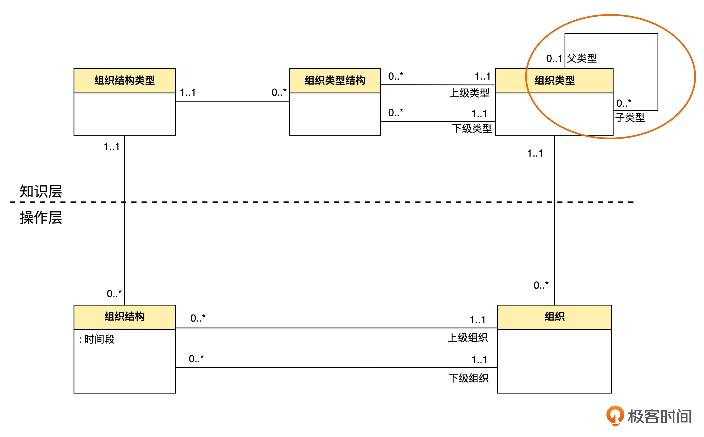

我们在组织类型上加了一个指向自身的一对多关联，来表示这种分类关系。Martin Fowler 把所有分类关系都称为“泛化”，他又把组织看作一种参与方（party），所以把这种模式称为“参与方类型泛化”（party type generalizations）。暂时不明白什么是参与方也不要担心，我们一会就会讲到。

## 一个员工属于多个组织

好，我们这就来解决迭代三里最后一个遗留的需求：员工可以属于多个组织。比如说对于一些矩阵式管理的企业，一个员工既属于他所在的行政组织，又属于某个临时组建的项目团队，还属于某个兴趣小组。

解决这个需求本身是比较简单的。像后面这样处理就可以了。

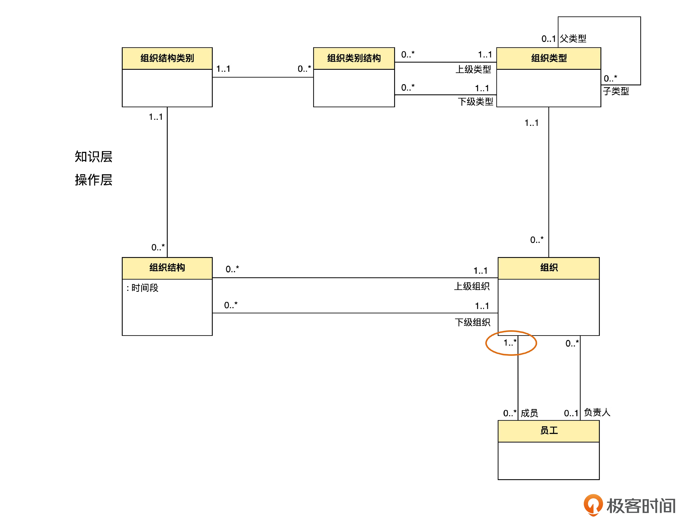

我们把组织和员工之间原来的一对多关联变成多对多关联就可以了。

## 参与方模式

为了拓宽你的视野，我们不妨按照分析模式，再往前摸索一下。Martin Folwer 认为，在某些场合，可以发现个人和组织具有共性，可以统称为参与方（party）。你可以对照后面的模型图来理解。

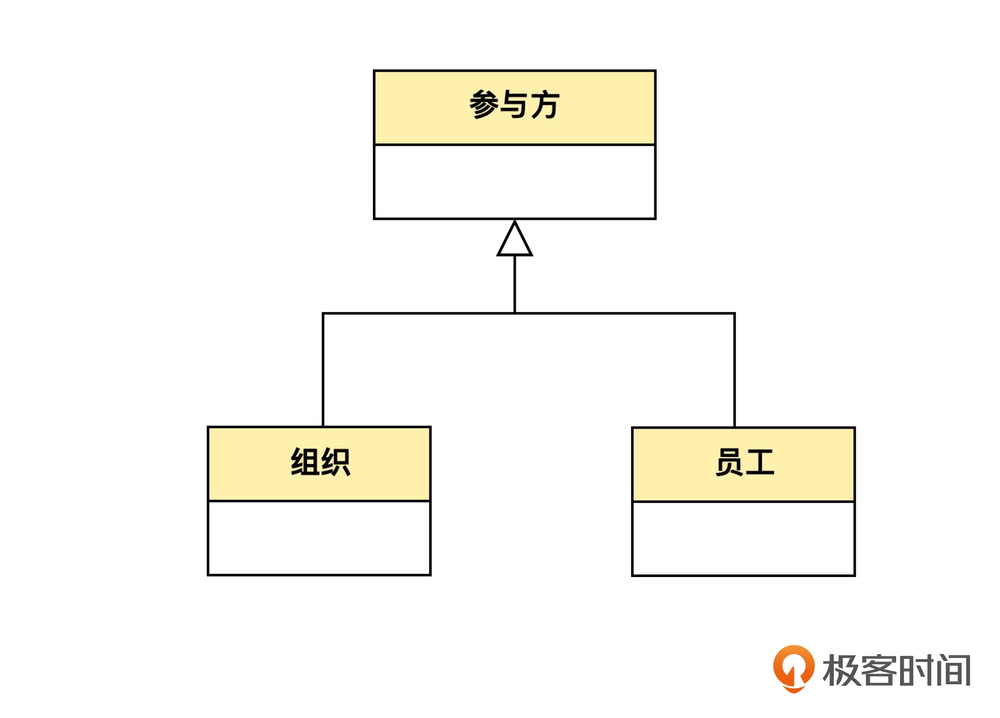

“参与方”模式是在《分析模式》2.1 节介绍的。其实我们在第 25 课讲泛化实现的时候，已经见过这个模式了。只不过在那时，我们是把个人客户和企业客户统称为客户，两者思路是一样的。

## 分层责任模式

Martin Fowler 进一步发现，人和组织的归属关系、组织和组织间的上下级关系，人与人之间的契约关系等等，可以统一看成是一种“责任”（accountability）关系。

比如说，员工属于一个部门，那么员工就对部门负有完成部门下达的任务的责任。部门是委托方，员工是责任方。开发中心的上级是信息技术部，那么开发中心对信息技术部也有完成上级部门目标的责任。信息技术部是委托方，开发中心是责任方。因此这些关系是同构的。

如果用参与方代替组织和员工，用责任代替组织结构，用委托方代替上级，用责任方代替下级，那么前面组织和人员的模型图就变成了这样。

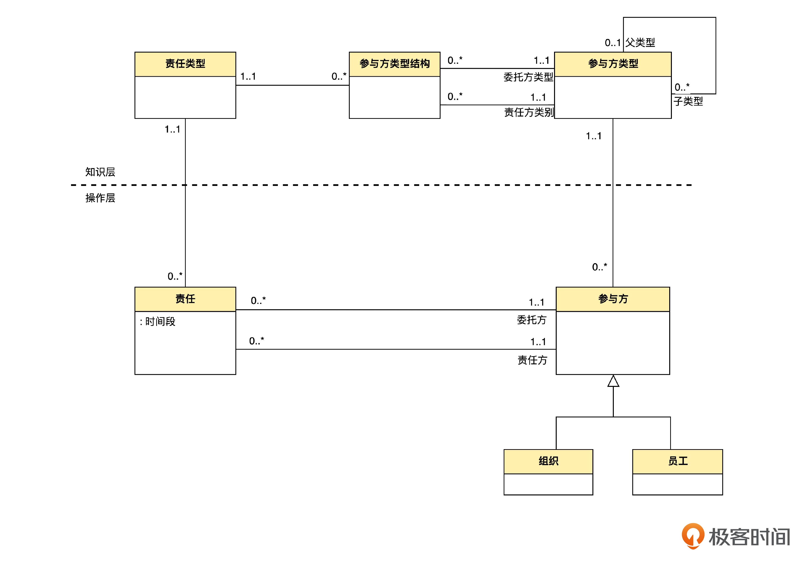

这就是“分层责任”（hierarchic accountability）模式，出自《分析模式》2.7 节。

课程里的这张图和原书里有少许出入，不过基本思路是一样的。今天的需求，其实都可以用这个模型表达，而且这个模型比这些需求普适性更强。如果你还不能完全理解这一点，可以课后再回味一下，我相信经过耐心的思考，你一定可以理解。

其实对于我们目前的需求，还用不到这么抽象的模型。这里只是从学习的角度，为你延伸一下。如果在我们目前的项目里直接用这个模式，反而有点过度设计了。

## 总结

《分析模式》是 Martin Fowler 把实践中复杂的领域模型进行了提炼，形成的一系列解决方案。通过学习分析模式，可以使我们掌握更高级的建模技能。

之所以叫做分析模式，是因为这些模式都是用来为业务概念建模的，在软件工程中属于“分析”层面。这和没有具体业务概念的“设计模式”形成了鲜明的对比。

这节课我们为了解决组织和人员管理方面更灵活的需求，分别采用了组织层级模式、组织结构模式和知识层模式。另外作为拓展，我也带你了解了参与方模式和分层责任模式。

这些模式都来自于分析模式第 2 章“责任”。而《领域驱动设计》第 11 章“应用分析模式”则是以《分析模式》第 6 章“存货与会计”为例来讲的。课后你可以对照阅读这些内容。

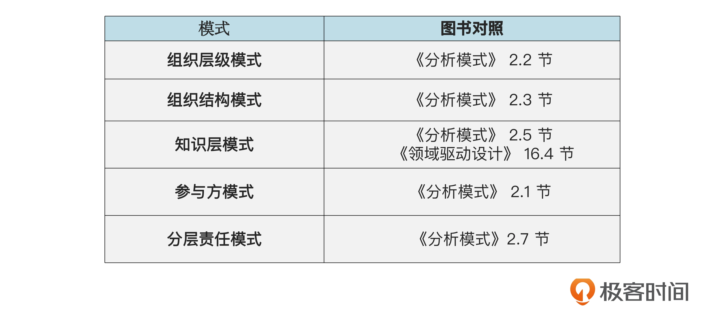

由于分析模式比较抽象，只靠领域模型的话，不容易理解。所以这节课用了几种非正式的模型图来辅助。非正式模型图没有什么专门的规定，你也可以设计自己的图。《领域驱动设计》一书也强调过非正式模型图的作用。它们和采用 UML 绘制的正规领域模型图的作用是互补的。

分析模式一书中给出了很多非常抽象的模型，但这并不意味着实际项目里的模型越抽象越好。应该根据实际需求把握抽象程度，避免过度设计。

最后我们再来探讨一个问题：《领域驱动设计》一书也介绍了大量模式，这和“分析模式”中的模式有什么区别呢？

其实，《领域驱动设计》侧重的是领域建模的普遍原理和通用模式，但对于不同业务领域中的具体模型介绍得还不多。我们想要掌握高级的建模技能，一个比较好的方式，就是看看前人已经处理过哪些复杂的领域，为这些领域建立的模型到底长什么样，建立这些模型的思考过程又是怎样的。这些正是《分析模式》的内容。

今天我们只是初步探索了分析模式。如果这些内容引起了你的兴趣，不妨课后找到原书钻研一下。

## 思考题

下面给你留两道思考题。

1. 学习分析模式的一个有效手段就是把它实现出来。你可以尝试为今天学到的领域模型设计数据库表，再写一些代码吗？

2. 可否为你所在的业务领域设计几种非正式的模型图？

好，今天的课程结束了，有什么问题欢迎你在评论区留言。下节课，我们聊一些技术之外的话题——如何在实践中推广 DDD。
