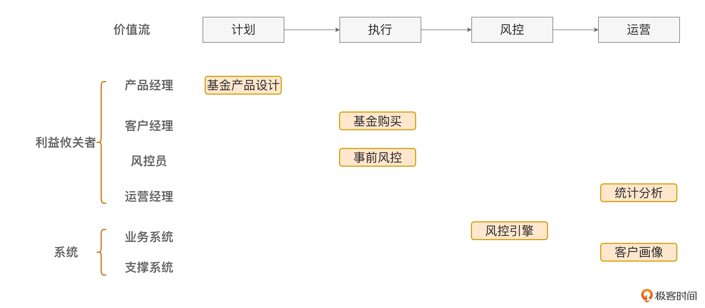
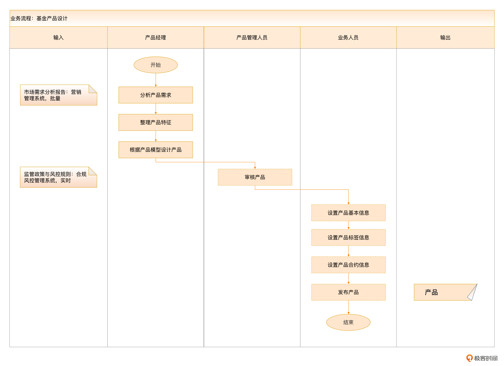
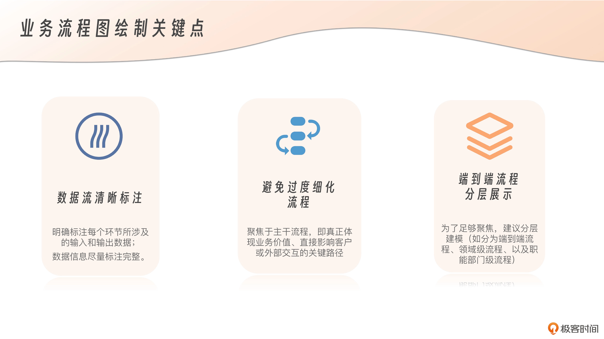
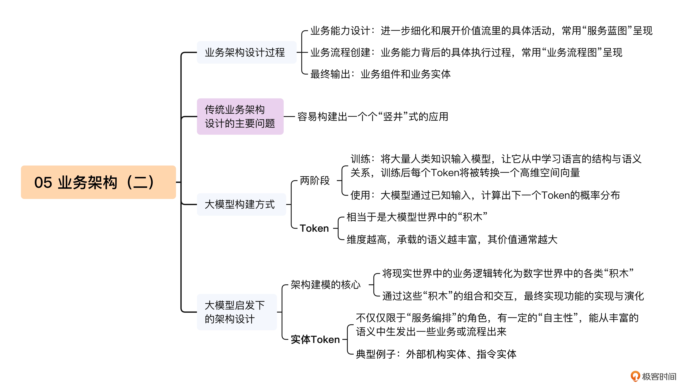

# 05 | 业务架构：如何融合Token思想？

你好，我是灵犀。

伟大的技术背后一定蕴含着伟大的思想，而伟大的思想一定是普适性的。因此，大模型中一定蕴含着许多“宝藏”等待我们去挖掘。

这节课，我将展开分享大模型的智能涌现方式带给我的启发，以及这种启发为中台建设所带来的新思路。

## 业务架构设计过程

首先，我们将接着上节课关于业务领域与价值流的设计理念，进一步分析能力层与组件层的设计思路。

一、业务能力设计

业务能力是对价值流中具体活动的进一步细化和展开。换句话说，为了实现价值流中每一个活动的“价值输出”，我们需要明确支撑这些活动的业务能力有哪些。

业务能力的呈现方式，通常可以采用“服务蓝图”来表达。我们知道，每一个业务能力的背后都对应着一个业务流程。在服务蓝图中，只需要将该流程的发起者（即流程的触发来源）作为利益攸关方（Stakeholder）列出来即可。

此外，在服务蓝图中，通常还会标注该业务能力所依赖的系统现状，以便后续评估系统关系和边界等。



二、业务流程创建

业务流程图是对服务蓝图中业务能力的进一步细化和展开。从业务视角来看，业务能力其实是业务流程运行起来之后的一种外在表现，而流程图则揭示了这个能力背后的具体执行过程。

在服务蓝图中，我们强调利益攸关方应是业务流程的发起者，而业务流程图的作用，正是清晰地展示出服务蓝图中每一个发起主体所对应的具体操作路径。它通常由一系列任务和流转关系组成，呈现出业务是如何一步步被推进和完成的。

以基金产品设计这个业务能力为例，对应的业务流程图如下。



业务流程图，是后续进行应用架构和数据架构设计的重要基础模型。在绘制业务流程图的过程中，还有以下几个关键点特别值得关注。



1. 数据流要清晰标注

业务流程的价值实现，很大程度上是通过数据的流动来体现的。因此，在流程图中，应明确标注每个环节所涉及的输入和输出数据，以体现数据的流转路径和使用方式。

此外，数据信息尽量标注完整，比如：数据来源于哪里，数据传输是实时交互还是批量处理等，为后续的数据架构设计、数据治理和分析等提供依据。

2. 避免过度细化流程

在业务架构设计中，流程建模的核心目标是识别和表达关键业务能力，而不是对每一个操作细节进行详尽描述。

因此，在绘制业务流程图时，应聚焦于主干流程，即那些真正体现业务价值、直接影响客户或外部交互的关键路径。而对于管理类流程，无需展开过多细节。

当前业务架构设计中存在的一个主要问题：也是流程图有时画的太详细，但由于其中混入了大量管理类或操作类的细颗粒流程，反而导致关键业务能力被掩盖，进而影响微服务划分或共享能力提炼等。

3. 端到端流程要分层展示

曾经有一段时间，由于“业务端到端一体化”这个概念比较流行，也催生了许多横跨多个业务领域的“端到端”长流程。

然而在实践中发现，这类流程的实际作用较为有限。试图一次性绘制出整个业务的全貌，反而可能导致重点不突出，分析价值不高。

因此，在绘制业务流程图时，建议聚焦于一个明确、边界清晰的业务能力上。端到端的视角并非不可，但更适合通过分层建模的方式进行表达。例如，可以划分为：端到端流程、领域级流程、以及职能部门级流程等。

在设计高阶流程时，可引用下一层级的具体流程，并通过业务事件作为流程之间的流转触发点。这样，确保在查看任一个层级的流程时，不会信息过载，精力可以集中在当前层级的流程上。

三、业务组件和业务实体分析

业务组件涉及微服务的模块化拆分，将在应用架构部分具体阐述。

关于业务实体，该阶段是从业务视角出发得到的实体模型。以上图中的“基金产品设计”业务流程为例，从中可以分析出来的业务实体主要包括产品需求、产品模版和产品信息等。

## 传统业务架构设计的主要问题

至此，我们基本完成了业务架构的一个自上而下的设计过程：从业务领域、价值流设计出发，到业务能力、业务流程的设计，最终识别出业务组件和业务实体。

业务架构的两个最终输出，业务组件和业务实体，它们也是后续应用架构和数据架构的重要输入。

上面这个业务架构的设计过程就是我们目前实践中最常用的一种方法。这种方法的抓手其实是流程。实际上，价值流也可看作是一种高阶的流程。

而微服务的划分通常基于业务流程中的操作“断点”进行切分，中台能力的提炼也依赖于在流程中识别并抽象出可复用的公共业务能力。

在实践中，我们发现这种以“业务流程为底座”来提取应用的方式，最大的问题是容易构建出一个个“竖井”式的应用。对于中台而言，这一问题显得尤为严重。

当然，这与业务流程中通常渗杂了大量管理类的职能有关，也和不同架构师的能力有关，但更根本的问题在于模式本身。模式，就相当于方向。如果方向不对，再努力也可能只是徒劳。

正如在开篇词中所提到的，这种模式非常类似于在大模型出现之前，我们构建和使用“小模型”的方式：即针对每一个具体的业务场景单独训练一个个专用模型。这些“小模型”之间缺乏通用性与迁移能力，很难复用或共享。

相比之下，大模型则采用了一种不同的思路实现了不同场景间的通用性。那它是如何做到这一点的呢？又能为架构设计带来哪些新的启示呢？

## 大模型为架构设计带来新思路

接下来，我先带你学习一下大模型的构建方式。

大模型的构建可以分为两个阶段：训练和使用。在训练阶段，我们将大量人类知识（书籍、网页文本等）输入模型，让它从中学习语言的结构与语义关系。训练完成后，每个 Token 将被转换为一个高维空间中的向量。

到了使用阶段，大模型的本质工作则是预测下一个词，也就是通过已知输入，计算出下一个Token 的概率分布。这一过程背后，是基于大量 Token 之间关系的矩阵运算。

这个 Token 本身的向量维度很高，到底有多高呢？我们可以看看 OpenAI 不同模型对外提供的接口，少的都有上千维，高的有上万维。

```
 embedding-ada：1536
 similarity-data：1024
 babbage-similarity：2048
 search-babbage-query：2048
 curie-similarity：4096
 davinci-similarity：12288
```

那么，为什么 Token 的维度要如此之高呢？因为每一维都承载了这个 Token 的丰富语义。举个简单例子，比如“打”这个字，可能出现在“打球”“打针”“打电话”等不同上下文中，它与前后词之间以及更大上下文空间中的关联关系，都会被模型学习并编码在向量中。

也就是说，“打”这个字本身只是一个符号，但“打”对应的 Token 中，包含了它在大量语料中学习到的丰富语义关系。正是这些语义连接，让大模型能够输出逻辑通顺、语义连贯的文本。

可以看出，Token 就相当于是大模型世界中的“积木”！

那么，这种思想对我们的架构设计有什么启发呢？

其实，不论是业务架构、还是后面的应用架构、数据架构、技术架构设计，架构建模的核心都在于：将现实世界中的业务逻辑转化为数字世界中的各类“积木”，并通过这些“积木”的组合和交互，最终实现功能的实现与演化。

同样，在企业中持续推进的“业务中台”建设，其目标也正是希望提炼出一些通用的业务模式和商业能力“积木”，以支撑上层应用地快速构建与持续创新。

看到这里，可能不少人会想：这不就和我们原来建中台或平台的思路一样嘛，都是从中抽象出通用的“积木”，再基于“积木”来进行组装式开发。

其中，组装式开发的思想的确是相同的。然而，中台或平台中的“能力积木”与大模型的“Token积木”，两者的内涵存在着很大的不同。

我们接着往下讲。传统中台或者平台中的“积木”，强调的是流程或实体能力的复用性。比如，当 A 流程和 B 流程中都存在一段相似的操作时，就将这段流程抽象出来，作为中台或平台能力复用。

或是，当 A 和 B 两个流程中，都用到一个重要的业务实体，于是将这个业务实体及相关操作抽象出来，也作为平台或中台能力复用。

而大模型中的“Token 积木”，关注的核心不是流程或实体，而是实体加上其与外部“连接”带来的丰富内涵。

就像大模型中的 Token 那样，每个 Token 都必须通过大量语料学习，与其他 Token 建立足够多的连接关系。维度越高，承载的语义越丰富，它的价值通常越大。

有了这些语义丰富的 Token 之后，就可以进行“无中生有”式的文本生成。这种组装背后的内涵，不只是过往所看到的“编排”能力，还具有一种“赋能”或“涌现”的能力。

同样想象一下，假如我们的业务中也拥有一堆这样具有丰富语义的“实体 Token”，它对于业务系统的作用，也将不仅仅限于“服务编排”的角色，而是可以更多地进行“赋能”，也就是它不只是等着“被动”编排，它还有一定的“自主性”，能从丰富的语义中生发出一些业务或流程出来。

所以说，大模型“Token 原子化”的这种构建思路，相较于之前业务流程驱动的设计模式，给我们提供了一种新的系统构建的思维模式。

至于为什么要称作“实体 Token”，不直接叫业务或数据实体呢？其实，两者的差别就像是单词的 Token 与单词之间的差别，后者只是一个符号，而前者是带有丰富的语义。

其实，这种思路之前也有类似的先例。比如，许多企业都建了客户画像系统，在客户标签的构建中，我们就是通过大量的数据挖掘，为一个“客户”实体建立与行为、偏好、风险等多维度的连接，从而形成一个丰富语义标签体系，进而去参与或驱动多个业务流程的运行。但目前这种做法还主要集中在“客户”等极少数实体中。

未来，我们希望将“实体 Token”这种模式系统化地推广到更多重要业务实体中，尤其是那些跨领域、跨系统使用的关键实体。下面我举两个具体的案例，让大家直观地了解一下。

一个是外部机构实体。对于资产管理类公司来讲，对外部机构的风险识别是很重要的。但是，过去对外部机构并没有进行统一的数据建模。不同部门与外部机构产生交互的数据都分散记录在各个系统中。

按照“实体 Token”的思路，首先要对外部机构实体进行统一建模，然后将各个系统与外部机构发生连接的关系梳理出来，并将交互的数据信息统一汇集，然后像客户画像标签一样，也赋予外部机构这个实体各种标签。

未来，各个部门有需要用到外部机构信息的，都可以很容易获得到。比如，投资部要购买该外部机构的上市股票，就可以很容易得到关于这个外部机构的各种维度信息。

此外，外部机构的“实体 Token”在自身标签计算过程中，发现某个机构出了什么问题，也能够及时通知给下游关联方。

如果说外部机构这个实体还是一个类似客户的实体。那我们再来看第二个案例：指令实体，它指的资管机构要买股票、债券或其他各类资产时，与交易所等机构之间进行交互的实体。

指令也是一个跨投资、交易、风控等多个领域的关键实体。因此，按照“实体 Token”的思路，也是对指令统一建模，然后将指令与各系统发生连接的关系梳理出来，将交互的数据统一汇集，进行数据分析，指令这个实体数据进行业务语义上的“升维”。

对于指令这类实体，可以先按照某些维度进行聚类，例如将同属一只股票或债券的指令归为一类。然后，通过进行分析，为指令打上风险程度、成功执行概率、成交周期等标签。

当指令像 Token 一样具备丰富的语义后，不仅可以参与多个流程的组装，也可以自主驱动许多个流程。比如，一个股票买入的指令生成之后，它就可以判断是否符合一些合规标准，也可以“自主”驱动进行后续资产指标、风险指标的实时计算等。

这种思路对系统建设是普适性的吗？可能也并不是。就像大模型出现之后，小模型在许多场景中仍然有存在的价值一样。目前，我们主要在跨领域的主数据方面进行实践。

从长期来说，我们希望就像大模型中的 Token 一样，在企业内部构建一批这样的“实体Token”，形成企业数字世界中的基础语义单元。通过它们之间的交互与组合，可以实现上层业务的动态“涌现”。

## 总结

这节课中，我们首先梳理了传统业务架构设计的过程，并分析了在传统方式下应用抽象过程中遇到的主要问题。随后，我们探讨了大模型的构建方式所带来的新思路：通过构建“实体Token”来实现服务编排和自主驱动业务。

这里稍微展开分享一下我的一些想法，供你参考。其实大模型的这种 Token 化的思路，同样也发生在自然界成长的过程中。自然界最开始只有没有生命体的原子，这些原子后来慢慢发生聚合、再聚合，最后演化出很多个生命体。

历史或文明本身其实是一个个过程，这些过程都是由生命体自主参与并创造出来的。这与大模型的思路似乎是有些相似的。

因此，从本质上看，这些“实体 token”最后形成的东西相当于一个个“智能体”，它会有一定的“自主性”，不只是参与流程，也能创造流程。这里提到了智能体，它也不仅仅是一种技术形态，关于它相关的理念，我们在后面课程中还会多次讨论。



## 思考题

关于应用的抽象和提取，你在实践中有哪些有效的方法？期待你评论区分享一下。

欢迎你在留言区参与交流讨论，如果这节课对你有启发，别忘了分享给身边更多朋友。
