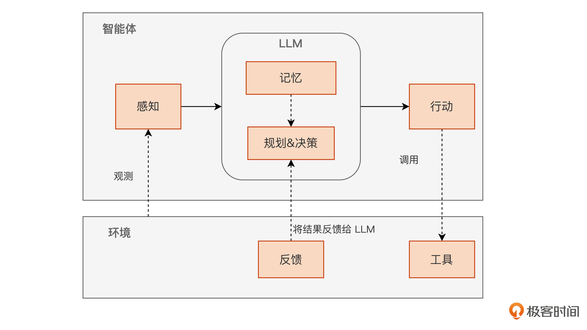
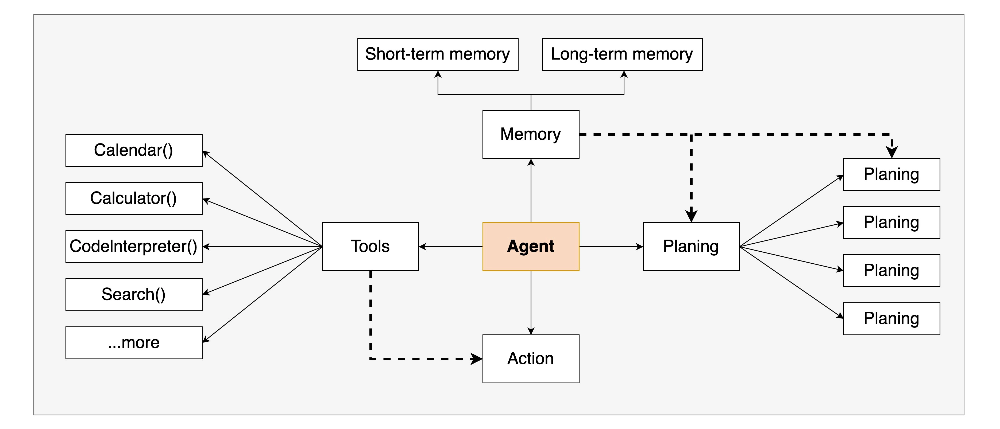
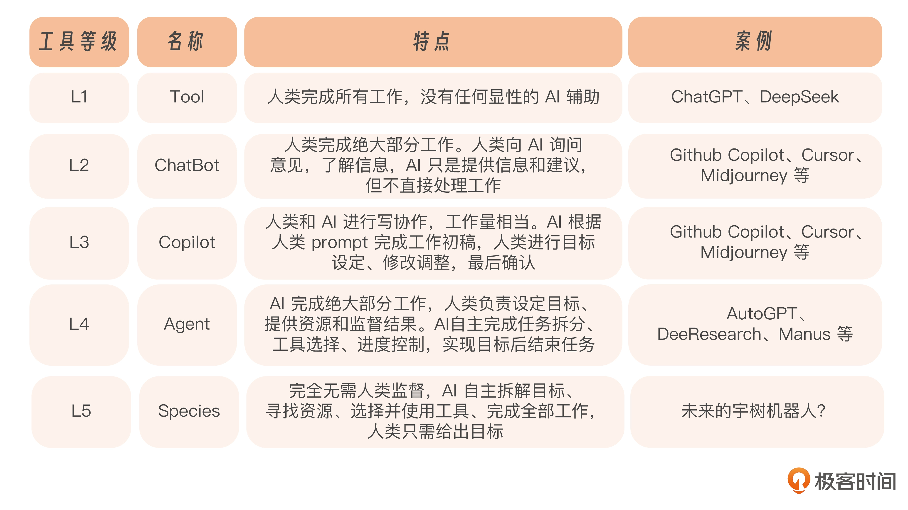
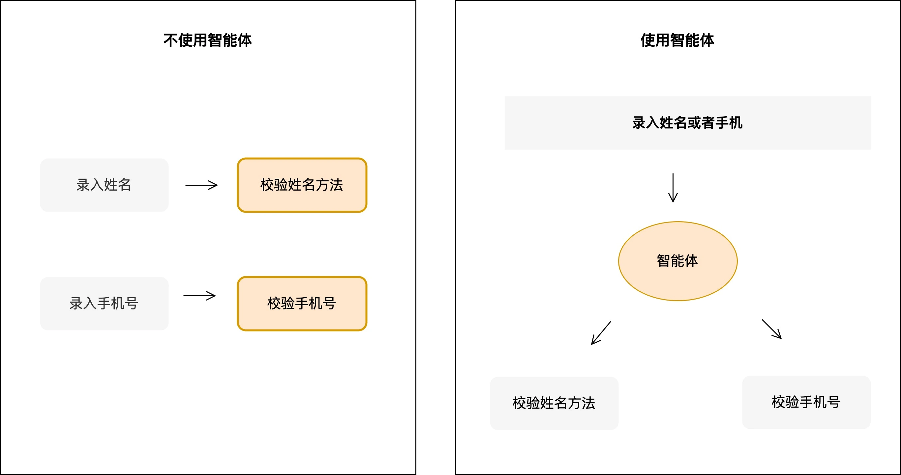
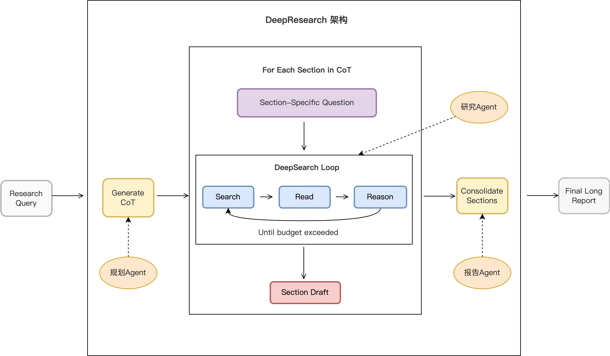
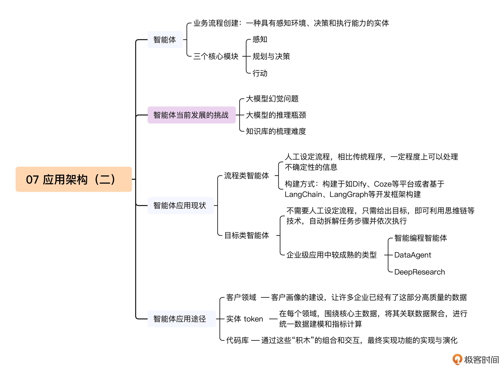

# 07 | 应用架构：如何面向智能体设计？

你好，我是灵犀。

智能体这个概念，是大模型带来的新一轮智能革命中，我认为对架构设计启发最为深远的一个。

但当前大多数关注点仍停留在技术实现层面，比如智能体平台、MCP、A2A、多智能体协作框架、上下文工程等工具链上。这其实让我们错失了一个方法论层面的“大杀器”。因为，智能体绝对不仅仅是一种技术形态，它背后更是一种深刻的系统设计思维。

所以，尽管本文的题目叫“面向智能体设计”，其实并不是想去教大家开发一个 Agent 什么的，而是要真正理解面向 Agent 的设计理念。

从这个层面上看，它有点类似于“面向对象”，对象也并不只是一个实体，更重要是对象的思维，是一种将复杂系统如何拆解和设计为对象的思维方式。

今天这节课，我先带你由浅入深认识一下智能体。后续课程也会持续深化这个主题。

## 智能体是什么？

智能体（Agent）这个概念，是上世纪 90 年代 AI 界从哲学领域引入的一个舶来品。原来在哲学领域，智能体指的是人、动物，或者是一些抽象的概念或实体。

到了 AI 领域中，智能体用于指代一个计算实体，既可以是真实世界中的机器人，也可以是虚拟世界中的游戏角色、软件程序等。

智能体的目标也简单直接，就是模仿人的行为方式。我们人类在处理问题和任务时，基本都会经历三个基本过程：信息输入（感知）、信息处理（规划和决策）和信息输出（行动）。

同样地，AI 智能体的抽象框架也主要由三个核心模块组成：感知、规划与决策以及行动。

总之，在上世纪 90 年代，大家已经对智能体的理论框架研究的基本挺清楚了。但是，当时深度学习还没出来，移动互联网带来的大数据浪潮也还没有来。智能体所涉及的几个核心能力——感知能力、推理能力以及工具集是全方位的落后。

因此，智能体这个事情火了一阵后就开始一直沉寂，直到 ChatGPT 的出现，才将它从睡梦中唤醒。

其实，OpenAI 提出的 AI 智能体模型，与上世纪 90 年代的框架基本是一模一样的。

但是，由于 AI 已经历了 30 多年的发展，Agent 的各项能力都有了很大的提升。尤其是推理能力，大模型的水平之高，相较于 90 年代的贝叶斯网络，犹如博士生与 3 岁小孩子之间的差别。

所以，尽管 Agent 的外表没变，但是内在材质却着实提升了太多，相当于由木头渣渣升级成了太空铝。

总而言之，智能体就是一种具有感知环境、决策和执行能力的实体。通俗来说，就是一个妥妥的“数字劳动力”，纯纯的天选打工人。

正因如此，自从智能体概念被 OpenAI 重新唤醒以来，便被 AI 界广泛视为通往通用人工智能（AGI）的关键路径。

我们可以通过一张等级表，更直观地了解一下智能体在 AI 工具中的地位。可以看出，像ChatGPT 这类对话机器人，基本处于 L2 级别，而真正的智能体，已经可以达到 L4 阶段，具备更强的自主性和复杂任务处理能力。

## 智能体应用现状

接下来，我们先来看看当前企业中已经落地的几类智能体应用，让大家对“智能体目前到底能做什么？”有一个直观的认识。

一、流程类智能体

这种智能体主要有两种构建方式。

一种是构建于如 Dify、Coze 等平台上，通过集成大语言模型的能力，实现流程的智能判断与动态流转。

比如，在一个审批流程中，智能体可以结合当前申请内容、用户角色、历史数据等信息，判断是否可以直接通过，还是应该跳转到哪一个审批环节，从而提升流程的灵活性与自动化水平。

另一种是基于 LangChain、LangGraph 等开发框架构建。下面给大家简单看一个“页面输入校验场景”中的智能体，尽管这是一个看似简单的任务，但其背后的设计逻辑与复杂场景基本是一致的。

传统程序的处理方式（如左图）：程序需要依赖页面元素的标签、ID 等信息来判断当前输入属于哪个字段，再进行相应校验。这种方式高度依赖结构化上下文，规则完全固定。

使用智能体的处理方式（如右图）：智能体无需事先知道输入内容的字段类型，它能够根据输入内容自动判断是姓名还是手机号，并调用相应的校验逻辑，一定程度上可以处理不确定性的信息。

二、目标类智能体

这种智能体不需要人工设定流程，只需给出目标，它就能利用“思维链”（Chain of Thought）等技术，自动拆解任务步骤并依次执行。

目前，对企业级应用来说，相对成熟的是以下三类目标类智能体。

1. 智能编程智能体：可以根据用户提交的指令，编写代码。

2. DataAgent：主要基于数据湖或数据仓库来构建的数据智能体，用户可以通过自然语言提出查数需求，让智能体分析需求、编写 SQL 语句、整合呈现给用户，目前这一类智能体产品也比较多。

3. DeepResearch： 它们可以对接企业的知识库、数据库、MCP 接口等资源，用于完成高质量的、可读性强的长篇研究报告。

上面这三类智能体，我们以 DeepResearch 为例稍微展开介绍一下，其他两类智能体的原理都是类似的。

DeepResearch 可以被视作一个具备搜索和生成报告领域的通用智能体，它的一般架构如下。

在该架构下包含三个核心 Agent。研究 Agent 负责定义课题，并通过搜索引擎等接口获取外部信息。报告 Agent 负责整合信息并生成最终报告。在这两个 Agent 之外，还有一个规划Agent，它用来生成解决这个问题的思维链，思维链的主要作用就是给出这个问题的推理步骤。

这里稍微扩展介绍一下思维链技术，它是支撑 Agent 进行逻辑推理的核心机制。我们知道，像OpenAI 的 O1 或 DeepSeek R1 这种推理大模型，它们其实是将思维链技术内化到了大模型中。然后，用户提问时，推理模型能够接受普通的提示词，并自动生成思维链。因此，对于推理模型来说，提示词可以比较简单，复杂性留给了大模型。

对于大多数没有自研大模型能力的公司或开发者来说，通常是将思维链显式地构造出来，并作为提示词输入给大模型。像我们熟悉的 Cursor 等编程工具，它的核心其实也是一个类似思维链的东西，这是厂商基于源码库自己训练得到的，也是 Cursor 的核心能力。

所以，从本质上看，思维链（CoT）相当于是一种带有逻辑推理步骤的提示词技术。

其实，思维链还有多种变体，如 ToT（思维树）、GoT（思维图谱）、PoT（程序思维）等。其中，PoT 的意思是在推理过程中自动生成代码，用代码执行去完成这个任务，这种能力目前已在 Manus 等许多智能体中支持了。

了解以上三类智能体的应用案例后，相信你对当前智能体的能力和发展阶段已经有了更清晰的认识。

这三类智能体有一些共性的地方。一是都是高频类场景，能形成稳定的数据反馈闭环，适合迭代优化；二是这些场景对输出结果的准确性要求相对较低，即使智能体在某些环节出现错误，最终仍有人工复核机制兜底，对整体业务影响可控。所以，这些场景作为智能体的切入口是非常合适的，也是当前构建智能体的首选方向。

## 智能体未来方向

但是，许多人现在都关心的一个问题是：未来智能体会朝什么方向发展呢？终极形态的通用智能体有戏吗？

首先，只会有通用大模型，不会有通用智能体。

为什么这么说呢？因为智能体所依赖的底座和大模型依赖的底座性质是完全不同的。

大模型依赖的是人类积累的文本数据。而智能体所依赖的主要是特定的业务知识库和外部工具集，模型起到的更多是“穿针引线”的作用。这就需要具备对特定业务语境、流程规则和历史数据的理解与调用能力，这些知识和工具本身具有高度的业务相关性，无法做到通用化。

目前来看，未来最有可能出现的是特定场景下的“准通用”智能体。这类智能体也是目标驱动的，但相较于像 DataAgent、DeepResearch 这类以数据分析和信息检索为主的智能体，这类智能体的能力更进一步。它们不仅仅能用于“不痛不痒”的分析类业务，也能在特定场景下完成具有操作性、闭环性的事务类任务。

当然，目前关于这类智能体的发展仍存在很多争论，主要集中在以下几个方面。

一、大模型的幻觉问题

大模型的概率性与企业业务要求的精确性之间存在根本的矛盾。

实际上，大模型的“幻觉”主要出现在生成阶段，而在理解用户意图的阶段，大模型已经表现得非常稳定和可靠。

而且，在生成阶段，我们可以通过设计“中间层机制”来控制不确定性的传播。例如，目前已经有通过接入知识库、调用外部接口和数据、引入评估机制、ReAct 等方式来增强输出的可控性，还有类似微卡片、控制类框架等技术也可以加以利用。

二、大模型的推理瓶颈

大模型的推理能力与人的推理能力仍然存在显著差距。

尽管推理能力是智能体的“大脑”。然而，在实际业务场景中，真正需要的是专业语境下的推理逻辑，这部分本身就需要结合企业自身的业务规则和流程来构建，而非依赖模型“天生就懂”。

三、知识库的梳理难度

知识库的外挂推理与知识的结构化提取之间仍存在很大的断层。

目前，有一些方案是依赖人来梳理业务规则，这种路线只能适合比较简单的场景。一方面成本太高，另一方面业务通常给人比给机器留的容错空间更低。

因此，知识的梳理未来一定是交给 AI 来主导完成的。就像我们前文中提到的“思维链”，AI 可以利用已有的数据信息，训练出适合业务场景的思维链。然后，通过用户使用中的反馈、产生的数据再来不断地完善这个思维链，像目前的 Cursor 或 DeepResearch 那样。

总之，对于“准通用”智能体，我认为技术层面的问题并不大。并且，目前许多人的理解还存在一个误区，那就是认为这类智能体只要给定一个目标，剩下的智能体就什么都给干了，其实这个过程通常是智能体与人之间通过多轮交互实现的。

## 智能体应用路径

既然特定场景下的“准通用”智能体这条路是可行的，那应该如何落地呢？

理论和工程实现之间往往确实存在着很大的鸿沟。目前来看，最关键的瓶颈还是在数据上。这个基础如果没打好，前面那些全是“花拳绣腿”。

我认为这类通用智能体最先可能出现的地方应该是客户领域，因为客户画像的建设，让许多企业已经有了这部分高质量的数据。

那除了客户领域，其它领域有没有一些好的切入点，可以慢慢展开呢？

答案是有的。在前面“实体 Token”的文章中提到过这个思路：在每个领域，围绕核心主数据，将与之产生关联的数据聚合起来，进行统一的数据建模和指标计算。

一旦这些基础工作完成，高质量的服务接口也就有了，思维链也可能通过 AI 生成出来，我们现在所谓的这些处在端侧的智能体也就可以建设出来了。

除了数据之外，企业内部还有一个蕴含巨大价值的资源库——代码库。我将在后续课程中和你探讨一些相关思路。

## 智能体到底是什么？

智能体概念越火热，企业和 IT 人员也就越焦虑。但至少目前来看，还没有很通用的智能体出现。

即便是目前看起来最可行的 DataAgent、DeepResearch 等分析类智能体，其实最关键的部分还是数据，许多这类项目绝大部分工作都是在数据治理上。

我认为现在对智能体的认识还不够深入。目前 MCP、A2A、平台协作框架这些全是工具层面的东西。如果缺乏架构规划，很可能导致更多的信息孤岛和更多的技术债务。

我们现在需要深入思考一个问题：智能体到底是什么？它只是我们目前看到的这些形式吗？

还是以“实体 Token”为例。它也能主动收集与实体相关联的数据，并通过计算得到的标签或指标来自主驱动一些流程。也就是说，“实体 Token”也具备感知、决策和执行的能力。而且，它的“推理能力”就蕴含在其中，显然还是一种更好的形式。

那么，它算是一种智能体吗？欢迎你说说你的看法。

这里我们先记住，智能体并非一种具体的技术形态，而是一种系统设计的思维方式。随着后续课程的学习，希望你能完全领悟这种模式。

## 总结

在这节课中，我们以同一个问题作为开头和结尾。在开头中，我们介绍了智能体目前普遍认可的定义；而在结尾处，我们则希望引发大家对智能体的本质有一些更深刻的思考。

在课程的中间部分，我们一起了解了智能体目前的应用现状、未来方向以及当前可实施的应用路径。

这节课的题目是“面向智能体的设计”，其实在课程里，我们只是大致回答了什么是面向智能体的设计。但是，我们还没有回答怎么去做面向智能体的设计。

你也可以在课后好好思考一下。我个人认为，面向智能体的设计带来的影响和面向对象、SOA、微服务至少是同一层级的，这也是“实现篇”中主要想解答的问题。

## 思考题

目前，你所在的企业是否有已经成功应用智能体的场景？欢迎在评论区分享经验。如果没有，你认为智能体目前面临的最大阻碍是什么？

期待你在留言区和我交流互动，如果这节课对你有启发，别忘了分享给身边更多朋友。
