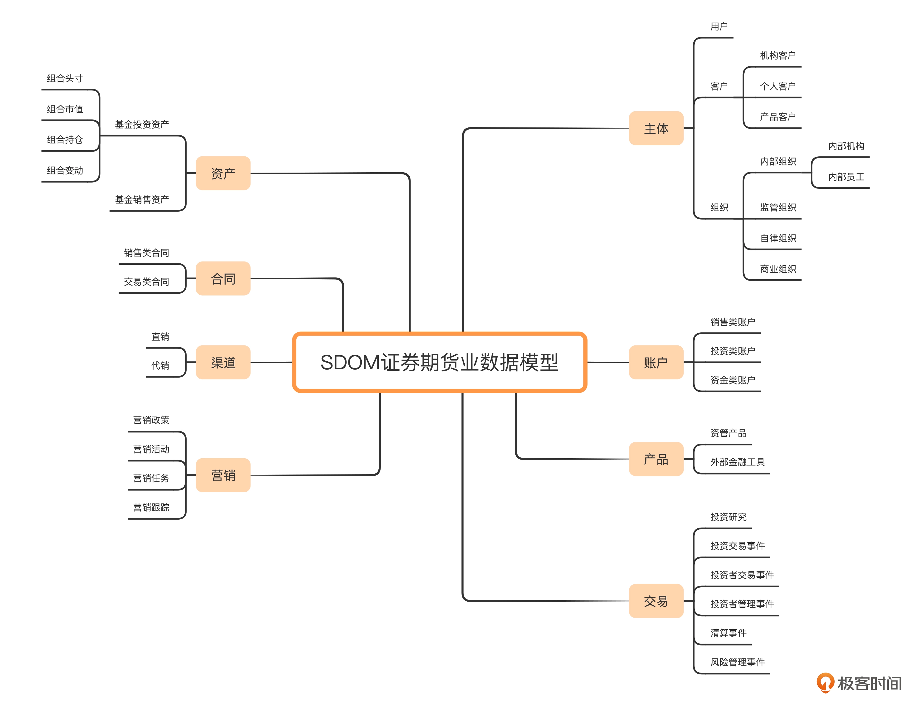
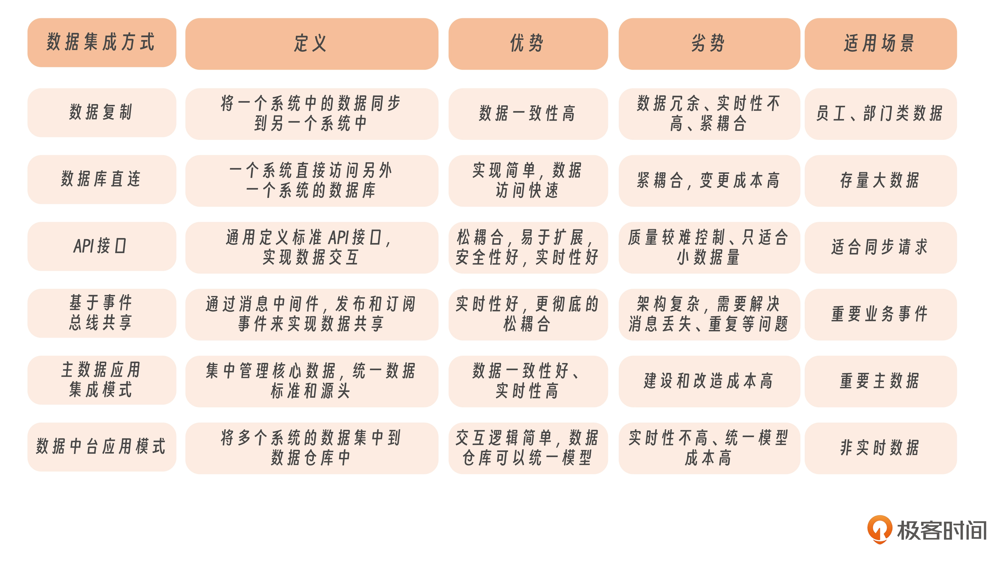
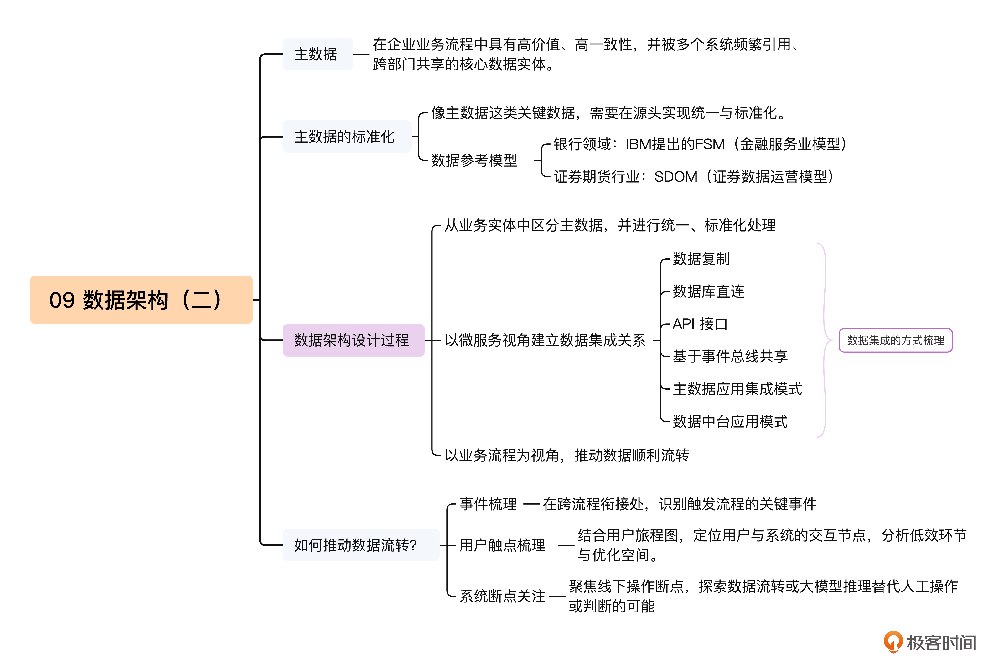

# 09 | 数据架构：如何以价值导向设计？

你好，我是灵犀。

我们每个人都听说过“盲人摸象”的故事，也自认为领悟了其中的寓意，但看看传统的“以应用为导向”的数据架构设计，其实就是一种典型的“盲人摸象”。

那如何才能在数据架构设计中，努力看到“整头大象”呢？这时候“以价值为导向”设计就能派上用场了，这也是我们今天要探讨的主题，探讨“以价值为导向设计”在数据架构里的具体设计过程。

## 从业务实体中区分主数据

在完成前期业务实体识别的基础上，下一步是对这些实体进行分类，并从中识别出主数据（Master Data）。

主数据是指在企业业务流程中具有高价值、高一致性，并被多个系统频繁引用、跨部门共享的核心数据实体。例如，资管领域常见的主数据包括：客户、产品、机构、员工、资产、指令等。

正如我们在上节课提到的，主数据的价值不仅体现在数据本身，更在于它作为企业业务运行和数据流转的基石作用。绝大多数业务流程和交易行为，都是围绕主数据展开的。

为了更好地理解主数据的重要性，我们可以从一个实际案例入手。当某外部合作机构出现信用风险时，企业需要快速、全面地评估其可能带来的影响。这就要求我们能迅速获取该机构的完整信息，包括历史沟通记录、合作项目、合同条款等。然而在现实中，特别是大型集团企业中，要实现这一点往往面临巨大困难。

造成这一问题的根本原因，在于“机构主数据”的缺失或不统一。在传统管理模式下，各部门往往各自为政，独立与外部机构开展合作，缺乏统一、规范的主数据视图。结果是，原本可能是局部的风险，由于缺乏全局视角，可能扩散至整个组织，最终演变为系统性风险。

那么我们能否通过建设数据中台来解决主数据的一致性问题呢？

其实只能解决一部分。因为现实情况是，主数据在各个业务系统中是实时流动的，且与大量其他数据存在强关联。如果主数据在源头就存在不一致，这些数据就会像涟漪一样很快扩散到整个企业数据体系，从而严重削弱数据的整体价值和可信度。

随着企业进入智能化时代，主数据一致性的问题将被进一步放大。我们知道，大语言模型本质上依赖概率逻辑进行推理和生成，它会从训练数据中提取语义特征，并编码到 token 中，最终以概率形式输出结果。

如果数据模型本身存在不一致或歧义，那么模型在学习过程中就可能捕捉到错误或模糊的语义关联，导致输出结果出现“幻觉”或不准确的结论。这不仅影响模型的可信度，也会对业务决策产生误导。

因此，我们认为像主数据这类关键数据，需要在源头实现统一与标准化。

这项工作也不需要从头开始。目前，多个行业已形成了较为成熟的主数据参考模型，可供企业直接借鉴与应用。例如：在银行领域，IBM 提出的 FSM（金融服务业模型）；在证券期货行业，也有 SDOM（证券数据运营模型），如下图所示。企业可以结合自身业务特点，参考这些行业模型，从中识别出关键的主数据实体，并逐步建立并维护一份统一的顶层主数据视图。

## 以微服务为视角，建立数据集成关系

数据分类是基础，完成之后的下一步设计就是让数据能够“流动起来”，这其实是数据架构的核心目标。在设计时通常遵循“先局部、后全局”的节奏：先将数据在微服务之间打通，也就是数据集成。

数据集成是指在多个微服务之间，共享和同步关键数据对象的过程。由于微服务强调“数据自治”，每个服务通常拥有自己的数据存储。但在实际业务中，一些核心数据（如客户、产品、资产、估值）往往需要在多个微服务之间使用，而数据集成模式就是用于解决数据交换共享和使用的问题。

在这个步骤中，需要结合每个微服务的输入 / 输出数据及其与其他微服务的交互关系，梳理出需要集成的数据内容，并根据实际业务需求和技术条件，选择合适的数据集成方式如 API 调用、事件驱动、数据复制、主数据管理等。

该步骤的目标是，在保障数据自治的前提下，实现服务间的高效的数据共享与协同，让数据能够顺利地流通。

下表是常见 6 种数据集成方式的对比和适用场景。

## 以业务流程为视角，让数据流动起来

在实现微服务层面的数据打通之后，下一步就要把视角拉到整条业务流程，推动数据在整个流程中的顺利流转。而在这一过程中，区分几类主要的业务流程是第一步，也是很关键的 一步。

业务流程可以分为职能性流程、端到端流程和领域级流程。我们依次来理解。

职能性流程是指各职能部门内部为完成特定职责而开展的工作流程；而端到端流程则是指多个职能部门之间按照业务逻辑顺序协作、接力完成一个完整业务目标的流程。在这两者之间，还可能存在一些领域级流程，其粒度介于职能性流程与端到端流程之间，覆盖范围大于单一职能部门，但小于整体业务链条。

前面讲微服务划分时，我们曾提出“拆是基础，合是关键”。微服务的价值不仅在于将系统解耦，更在于它们能够组合为一个有机整体，协同完成业务目标。

因此，这一步骤希望能从更高的业务流程视角出发，进一步审视、优化微服务之间的协作关系，我们这就来看看具体的设计实现。

一、以事件梳理为抓手，推动数据流转

在完成微服务划分与数据建模之后，每个微服务内部都会包含一组核心数据对象。这些数据对象的状态变化，往往会对其他微服务或系统产生联动影响。

因此，我们应从业务语义出发，结合关键数据对象的状态变更，识别出该微服务应主动对外发布的事件。

举个现实中的例子，资产是一个关键数据，如果股票池里的某只股票突然暴跌，这就是一个重要事件，会涉及到风控、流动性、估值、客户沟通等条业务链路，这类事件就应该识别出来并对外发布，所有相关方应该订阅并做一定的主动处理。

在此基础上，进一步结合端到端流程或领域级流程——这些流程本质上是由底层的职能性流程组装而成。在不同职能流程之间的衔接点上，识别出能够触发流程发起的关键事件。这些事件也转化为微服务需要订阅和响应的事件。

比如，以“多部门协同报告”为例。由于每个职能型流程之间是割裂的，过去经常出现同一份报告需要在不同系统之间通过线下方式流转多次的情形，这种可以将报告放在到一个公共报告平台中，各个系统直接引用，并在完成之后自动发出一个待办事件告知下游部门。

这一步的核心价值在于：通过事件驱动的方式，将局部的微服务能力与整体业务流程协同起来，打通不同职能流程之间的壁垒，实现跨服务和跨领域的数据流转和业务协同。

二、以用户触点梳理为抓手，推动数据流转

我们都希望系统能够承担更多的操作任务，提升效率，减轻业务人员负担。但很多时候，缺乏一些可落地的方法。

在数据架构设计中，一个切实可行的路径，是从用户在使用系统过程中的关键触点入手，借助用户旅程图等工具，识别用户与系统之间的交互节点，深入分析其中的低效环节与优化潜力。

举个简单的例子：在证券研究工作中，研究员常常需要查看来自不同券商的研究报告。有些报告以邮件形式发送，研究员就需要手动下载邮件附件，再登录研报系统上传文件。

这个“上传研报”的动作，就是一个典型的用户触点。如果我们能够识别这一触点，就可以思考如何通过数据流转的方式解决，比如系统自动监听邮件附件、提取内容、解析结构、完成上传，整个过程无需人工干预。

三、以系统断点梳理为抓手，推动数据流转

除了用户触点，另一个非常重要的切入点是识别和分析系统间的“断点”。我们在日常工作中绘制的业务流程图，往往只是理想状态下的流程描述，现实中并非所有环节都能通过信息系统实现，很多仍依赖线下操作，这些缺失的连接点，就是我们需要重点关注的“系统断点”。

仍然举个简单的例子。投资经理在投资系统中完成了投资组合的配置，想要下达交易指令时，需要调用交易系统的接口。但现实中，两个系统之间并未打通，投资经理只能将指令导出、线下通知交易员，再由交易员手动登录交易系统重新录入。这就是一个典型的跨系统断点。

针对这些断点，我们可以思考：是否可以通过数据流转的方式，或是借助大模型的推理能力，来部分或完全替代人工操作和判断？比如系统间自动触发指令、智能校验逻辑、甚至辅助决策，逐步实现从“人驱动流程”向“数据驱动流程”的转变。

## 总结

今天我们学习了“以价值为导向”的数据架构设计过程，主要探讨了主数据的价值，以及如何通过事件梳理、用户触点分析和系统断点识别为抓手，推动数据在流程之中的高效流转。

如果我们从更深层次的底层逻辑来看，这种数据架构的设计本质上是在推动我们以“数据叙事”的思维方式，来补充甚至替代传统的“流程叙事”模式。

那么，这两种叙事模式之间有什么不同？

在传统的“流程叙事”模式中，人是主角，流程是围绕人设计并运行的。人在流程的各个环节中起着“连接点”和“决策点”的作用，是流程运转的关键驱动者。也因为如此，没有人的参与，流程就无法自动完成。

而“数据叙事”是另一种模式。它将数据作为主角，数据不再是流程运行的被动产物，而是成为流程中各个环节之间的主动连接者和决策者。而在这种模式下，人更多变成信息的接收者和响应者，而非流程的“主导者”。由于人不需要从中决策，这样整个流程运转自然就快了。

我们也可以观察当前一些数字原生型的应用，比如今日头条、美团、抖音等，在这些应用中，用户往往更多扮演着“内容接收者”的角色，行为被数据所引导，流程的推进也由数据自动完成。这种以数据为核心来构建和推动应用运行的方式，正是“数据叙事”的体现。

最后，我梳理了这节课的知识导图，供你参考。

## 思考题

数据架构的重要性不言而喻。在 AI 时代，它将变得更加重要。希望这两节关于数据架构的内容，能够为你带来一些启发和思考。如果你在实践中还遇到过其他有效的数据架构方法，欢迎在评论区分享交流。
