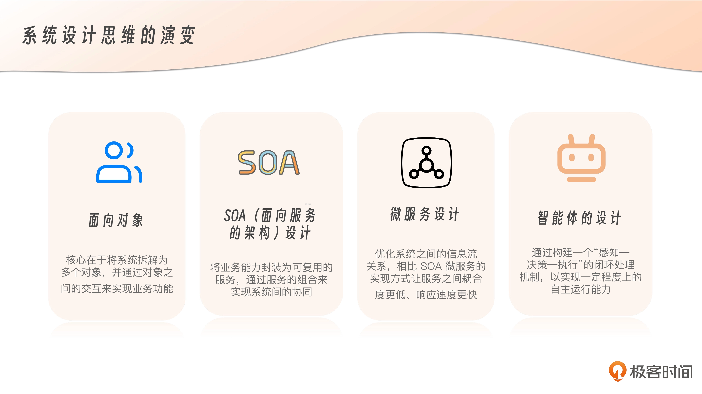
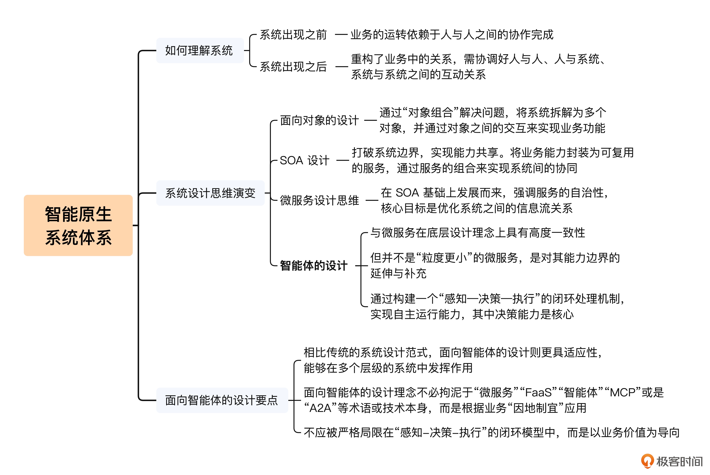

# 11 | 智能原生系统体系底层运行逻辑

你好，我是灵犀。

在之前的“方法篇”中，我们介绍了智能原生架构的设计方法。而这些设计方法在实际落地后，就构成了一个完整的“智能原生”系统体系。

作为“实现篇”的第一课。今天我们将先从整体视角出发，帮助你直观地了解这个系统体系的全貌。接下来的“实现篇”中，我们会讲解这个体系是如何构建出来的。

## 关于“智能体”概念的疑问

在前面第 7 节课《如何面向智能体设计》中，我们在最后部分提到：智能体并非一种具体的技术形态，而是一种系统设计的思维方式。

今天，我们将继续深入探讨“智能体”这一话题。目前，智能体已成为大模型领域的热点，各种新概念层出不穷，比如 MCP、A2A、智能体平台、多智能体协作框架、上下文工程等。

但你是否曾思考过这些问题：

- 只有通过 Coze、Dify 这类平台或 LangGraph 这类框架开发出来的系统，才算是智能体吗？

- 只有在决策部分应用了大模型的推理能力或思维链（Chain of Thought）技术，才算是智能体吗？

- 只有在行动部分使用了 MCP 或 FunctionCall 等通信协议，才算是智能体吗？

- 只有在感知部分采用了自然语言或多模态交互方式，才算是智能体吗？

- 只有使用了 A2A 协作协议，或是采用了顺序、主从和混合等协作模式，才算是智能体吗？

智能体的本质究竟是什么呢？其实，这些问题本质上与我们之前常见的一些困惑是相通的。我们可以对比一下。

- 只有使用 SpringCloud、Dubbo 这样的微服务框架开发出来的应用，才算是微服务吗？

- 只有使用 Java 这种面向对象的语言，才能写出面向对象的代码吗？

- 只有应用了限界上下文、聚合、仓储、值对象等概念，才算是使用了 DDD（领域驱动设计）吗？

- 只有使用了数据中台，才能说我们“用好”了数据吗？

接下来，带着这些疑问，让我们继续往下看。

## 系统是什么？

在探讨“智能体”之前，我们不妨先回到一个更基础的问题：系统是什么？

可以肯定的是，智能体只是系统的一种形态。

在计算机出现之前，企业中业务的核心元素非常简单：人和流程。每个业务背后都有一个相对固定的流程，在流程的各个节点上安排着不同角色的人。业务的运转依赖于人与人之间的协作来完成。

从本质上看，每个业务流程其实是一条信息流。信息在人与人之间流转、处理和转化，最终形成有价值的结果。

随着计算机的出现，系统开始出现。那么，系统设计的目的是什么呢？

系统的本质是尽可能将这条信息流以代码的形式表达出来，在计算机世界里去执行，从而实现标准化和自动化处理。这样一来，人的主观干扰被尽可能地削弱，业务流程的运转变得高度可控和可预测。

为什么？ 因为代码是确定性的。只要程序没有 Bug，它就能以一致的方式，不知疲倦地运行无数次，永远不会“疲劳”或“犯错”。

尽管系统的引入重构了业务中的关系：由原来单纯的人与人之间的协作，转变为人与人、人与系统、系统与系统之间的互动关系。

然而，从信息流的角度来看，业务的本质其实并没有改变。系统所做的，只是在解决这样一个问题：信息在业务流程的脉络上流动时，如何在系统内部、系统之间、以及人与系统之间，在现实世界与计算机虚拟世界的切换之间，能够更有效地传递、处理和呈现。

## 系统设计思维的演进

那么，系统是如何一步步演进到“智能体”这种形态的呢？接下来，我们沿着系统的发展脉络，探讨在这一历程上对系统设计影响较大的几种思维方式。

### 一、面向对象的设计

面向对象是面向过程设计的一种演进形式，其核心在于将系统拆解为多个对象，并通过对象之间的交互来实现业务功能。

这种方式通过“对象组合”来解决问题，有效提升了系统的复用性与可扩展性，解决了面向过程中常见的“耦合度高、难以维护”等问题。从系统内部的组织来看，这是一次结构上的演化。

此外，面向对象还实现了主客体关系的转换：在面向过程中，计算机是“中心”，系统设计与代码实现适配机器的特点；而在面向对象中，人成为价值的核心，系统的设计围绕人的思维方式展开，从而也激发了软件需求的爆发式增长，推动了整个软件行业的繁荣。

因此，面向对象不仅改变了系统的内部结构，也改变了人与系统之间的关系。

### 二、SOA 的设计

系统最初出现时，主要服务于企业内部各部门的信息化建设，如 ERP、CRM、SRM 等系统。

然而，随着业务复杂度的提升，企业内部逐渐涌现出越来越多跨部门、跨业务线的协作需求。传统的“信息孤岛”模式已无法满足系统间高效协同的需求，信息共享与流程整合成为亟待解决的问题。

在这样的背景下，SOA（面向服务的架构） 应运而生。SOA 的核心思想是将业务能力封装为可复用的服务，通过服务的组合来实现系统间的协同。

它本质上是一种去中心化的架构思路，旨在打破系统边界，实现能力共享。不过，SOA 的去中心化并未完全实现，它仍然依赖企业服务总线（ESB）和统一的通信协议等技术，未能真正实现服务的自治。

尽管如此，SOA 在当时为系统间的信息流动与共享提供了一种有效的解决思路。

### 三、微服务设计思想

微服务是在 SOA 基础上发展而来的、更为彻底的去中心化架构实现。它强调服务的自治性，每个服务都可以独立开发、独立部署、独立运行，从而大大提升了系统的灵活性和可扩展性。

与 SOA 一样，微服务的核心目标同样是优化系统之间的信息流关系。但与 SOA 相比，微服务的实现方式让服务之间的耦合度更低、响应速度更快。

同时，与传统单体应用相比，微服务重构了企业系统体系中的组织结构。单体应用通常按部门或角色维度构建，形成一个个相互隔离的“竖井”，容易导致信息孤岛。而微服务以业务能力出发，基于领域模型进行拆分，构建出高内聚、低耦合的服务单元，从而实现更灵活、可组合的系统体系。

### 四、智能体的设计

在之前的课程中，我们曾指出：智能体与微服务在底层设计理念上具有高度一致性。它们都采用了分布式、自下而上的系统架构思想，通过赋予个体单元更高的独立性和灵活性，来提升整个系统的适应力与创新能力，从而更好地应对复杂、动态的业务场景。

然而，智能体并不是“粒度更小”的微服务，而是在其基础上进行的理念升级和能力拓展。其中最具代表性的突破，便是自主性的引入。

与传统微服务更多地扮演“被动响应和执行”角色不同，智能体具备感知环境、自主决策和执行任务的能力。因此，它能够更加智能和灵活地应对不确定性和动态变化的业务需求。

从这个角度看，智能体可以被看作是微服务的一种“演进形态”。它并不是对微服务的替代，而是对其能力边界的延伸与补充。

简单来说，智能体的核心设计理念是通过构建一个“感知—决策—执行”的闭环处理机制，以实现一定程度上的自主运行能力。

而在这一闭环中，决策能力是其核心。当前，这一能力的实现，主要依赖于大模型的支持。

我们可以结合目前的 MCP 技术，进一步探讨一下这种决策能力带来的优势。

在现有智能体框架下，相当于将“思考”与“干活”做了解耦。并且，通过 MCP 协议，“干活”的工具可以实现可插拔、替换和升级，形成一个高度可扩展的生态。

但是，大家想想，这是智能体的核心能力吗？

这种可插拔机制，其实与微服务中的服务注册与发现机制，甚至与 Spring 框架中的依赖注入，在设计思路上是相通的。

真正促使智能体发生质变的，还是大模型为其赋予了“理解环境、分析上下文、进行推理判断”的能力。这使得智能体能够在复杂且动态的场景中，做出更加合理、灵活的决策。

在这种背景下，系统中的“感知”部分不再依赖于高度结构化、严谨准确的输入，而是可以通过自然语言或多模态等更“模糊”的方式交互。大模型能够准确识别用户的意图，从而实现更自然、更有“温度”的理解与响应。

同样地，系统中的“执行”部分也不再局限于固定的流程或预设的路径，而是能够根据当前环境和上下文动态调整执行策略，实现更灵活、自适应的操作。

这与微服务有着显著区别。微服务通常仅作为执行工具，嵌入在预设的流程中，扮演着被动执行的角色，缺乏对环境的感知能力与自主决策的机制。

## 智能体是什么？

总而言之，智能体最基本的特征，是能够将“感知”“决策”和“执行”三个阶段有机地串联起来，实现信息的获取、处理与响应之间的无缝衔接，中间不再存在断点。而在这三个环节中，决策是核心所在。

那么，我们不妨进一步思考：只有大模型做出的决策，才算是决策吗？

显然，这并不是我们的初衷。我们的目标，是让机器具备决策能力，而不是局限于是否使用大模型这一种形式。

我们先来看看决策的类型，大致可以分为以下三种。

1. 人的决策：决策的主体始终是人，系统只是执行由人触发的指令，缺乏自主性。

2. 人机协同决策：在决策过程中，将部分任务或判断交给机器完成，人仍然在其中发挥主导作用。

3. 机器决策：决策的主体由机器承担。机器能够根据环境、数据和模型完成判断与响应。实际上，机器决策也并不意味着完全无人参与。例如，在大模型的决策过程中，系统通常需要与人进行多轮交互，不断澄清需求与上下文。但整体来看，决策过程中的方案是机器输出的，人只是负责选择、审核等。因此，机器是决策过程中的主导者。

结合上述内容，我们可以看到，大模型更多是一种机器决策。那么，反过来讲，机器决策只能由大模型来实现吗？

显然不是。在很多场景下，数据本身或者小模型，同样可以完成类似的判断和处理任务。

我曾在之前的课程中举过“实体 Token”的例子，它就是依赖小模型和数据驱动完成了“感知 - 决策 - 执行”的闭环，显然它也具备智能体的基本特征，可以被视为一种智能体。

再来看现在许多移动端 APP 的运作方式：用户一登录，后台系统便会立即获取其客户标签，并根据其特征进行个性化推荐。整个过程无人参与，实现了“感知 - 决策 - 执行”的完整闭环，同样可以被归类为一个智能体。

综上所述，结合我们上面的阐述，再回看开头提出的问题，答案已经变得比较明朗。

不论是决策中的大模型、感知中的自然语言和多模态交互、行动里的 MCP 和 FunctionCall，还是 Coze、Dify、AgentStudio 这种平台，或是 LangGraph 开发框架等，这些都属于技术层面的具体实现手段，它们本身不代表智能体，它们的目标只是帮助我们更好地构建智能体。

## 面向智能体的设计是什么？

接下来，我们结合今天的主题“智能原生系统体系底层运行逻辑”，进一步来探讨“面向智能体的设计”这一理念。

关于智能原生系统体系的底层运行逻辑，我们仍然从信息流的角度来理解一下。正如前面说的那样，系统的核心目标是重构人机之间的关系，让数据尽可能实现自动流转，在合适的时间传递给合适的人或机器。

无论是数字原生还是智能原生系统，这一本质并未发生变化。区别在于，它们进一步降低人在信息流转过程中的决策比例，增加机器决策的占比，让信息自动流转的效率更高。

智能体，由于其具备自主性的特点，成为实现这一目标的更有效的手段。而面向智能体的设计理念，则是帮助我们在系统体系中，能够更加合理地设计出形态各异、功能多样的“智能体”出来。

了解了这一基本目标之后，再来看一下“面向智能体设计”的一些具体观点。

首先，我认为面向智能体的设计理念相较于传统的面向对象和微服务等设计范式，在范围上要更为深远。本质上，这些设计方法都在尝试将复杂系统进行拆解和结构化，以提升系统中信息流的效率。

然而，它们作用的层级不同：对象主要在应用层进行设计，微服务则更多聚焦于领域层。而面向智能体的设计则更具适应性，能够在多个层级的系统中发挥作用。这意味着，在未来的企业IT 系统生态中，不论是整体架构、中台、平台、微服务，还是像 FaaS 这样的函数级组件，都可以借助智能体的设计理念实现优化与提升。

其次，面向智能体的设计理念，还在于不必过分拘泥于“微服务”“FaaS”“智能体”“MCP”或是“A2A”等术语或技术本身，更重要的是理解其背后的设计思想，并在不同的业务场景中灵活组合与应用。没有任何一种技术可以适用于所有场景，正如面向对象很好，但在某些情况下，面向过程可能更为合适。未来的企业系统体系也必然是多种设计模式共存、协同工作的混合体系，而非由某一种模式“一统天下”。

最后，面向智能体的设计理念也不应被严格局限在“感知 - 决策 - 执行”的闭环模型中。比如，在某些场景下，如果实现“主动感知”能够提升系统效能，也可以视为该理念的一种体现。架构设计的最终目标，不是追求某种技术形式，而是为业务带来实际的价值。

## 总结

今天我们从对“系统是什么”出发，逐步梳理了系统发展历程中的关键设计思维，并最终引出了“智能体”的概念。

在此基础上，我们进一步探讨了“面向智能体的设计”这一理念。它是一种适用范围广泛的系统设计思维，能够灵活应用于从整体架构到中台、平台、微服务乃至函数等不同层次与粒度的设计中。

在接下来的课程里，我们就将结合“分析篇”中提出的核心挑战，深入探讨如何运用“面向智能体的设计”理念，解决各个层面系统建设过程中的实际问题。

## 思考题

按照今天探讨的面向智能体设计的理念，未来智能体一定会在企业内遍地开花，但它们的呈现形态一定会多种多样。当然，每个人的理解肯定会有所不同，也请你谈谈你心目中的面向智能体的设计是什么样子？

期待你在留言区和我交流探讨，如果这节课对你有启发，别忘了分享给身边更多朋友。
