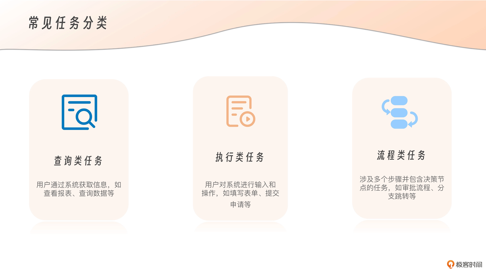
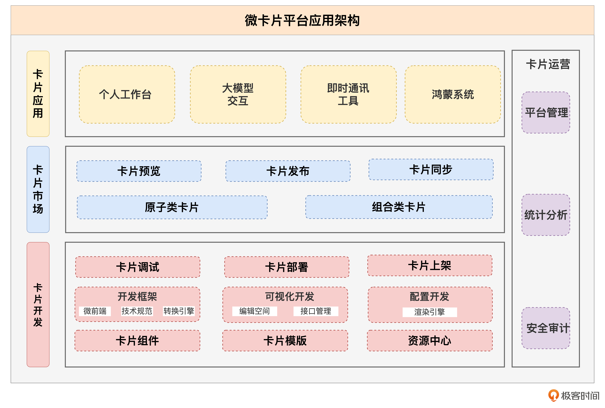
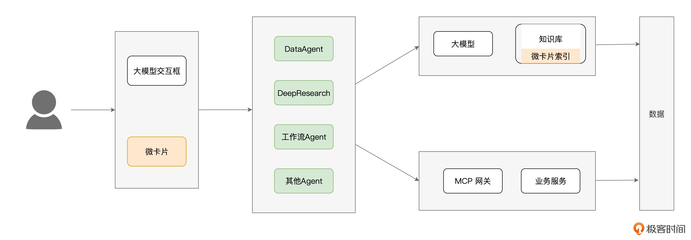
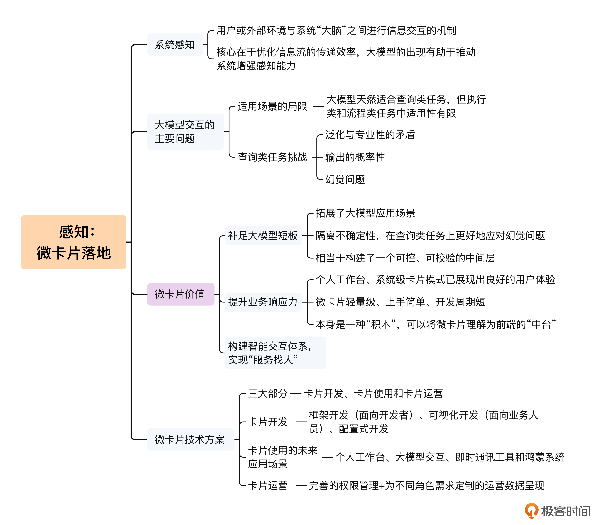

# 12 | 感知：如何实现系统的立体感知？

你好，我是灵犀。

在电影《哪吒 2》临近结尾时，有一个桥段笑翻全场：无量仙翁本想通过人脸识别进入密室炼丹，但由于脸上的伤早已痊愈，系统无法识别他的身份，将他“无情”地拦在门外。

无奈之下，无量仙翁只好请求鹤童和鹿童出手“相助”，打回原来的伤痕状态。最终，他在两位徒弟的“帮助”下再次变得鼻青脸肿。

从技术视角看，这种“严丝合缝”的人脸识别缺乏一定的“温度”。实际上，这种交互方式，和当下前端页面要求的、高度结构化的交互方式一样：只要输入稍有差池，系统就可能拒绝响应。

而大模型的兴起，正在改变这种冷冰冰的交互逻辑。凭借对用户意图的理解能力，大模型让系统从“只认格式”走向“理解意图”，从而实现更具人性化、适应性的交互体验，推动人机交互迈入新阶段。

今天我们就来学习一下大模型的“感知”部分，看看大模型时代的感知应该如何落地实现。

## 感知是什么？

“感知”是一个源自生命体的概念。对于生命体而言，如果将大脑视作信息处理的“中心”的话，那么感知就是让信息流触达“中心”的路径。

这一概念同样可以延伸至系统中。在系统视角下，数据与服务构成了其运作的“大脑”，而“感知”则可理解为用户或外部环境与系统“大脑”之间进行信息交互的机制。

在前面“分析篇”中提到，未来在构建“轻交互”用户体验的过程中要围绕两个核心理念：“用户所得即所想”和“想用户之所想”。

然而，当前企业内部系统中，主流的前端交互方式仍以“重交互”为主。系统界面通常通过聚合方式一次性展示大量信息，这种交互模式类似于“大卖场”，信息冗余度高，用户需要承担大量认知负荷，效率较低。除此之外，“信息主动找人”的模式也较为少见。

大模型的出现，为构建“轻交互”体验提供了全新的技术引擎。其问答式交互具备“所问即所得”的特点——用户只需用自然语言表达需求，系统即可理解其意图并给出精准响应。这种方式极大提升了交互效率。

与此同时，多模态交互技术也在打破传统图形用户界面（GUI）的限制。语音、图像、视频等多种交互方式的融合，使用户能够通过更自然、更智能的路径与系统进行交流。这种多通道融合的交互方式，不仅降低了使用门槛，也显著提升了整体的用户体验。

总而言之，感知的核心在于优化信息流的传递效率——尽可能减少冗余，降低用户的认知负担。它追求的是一种“无感而高效”的交互体验，仿佛系统就像一个真正的“大脑”一样。

## 大模型交互的主要问题

尽管大模型的交互方式已展现出巨大潜力，但目前仍集中在特定场景使用，全面推广还面临一些关键挑战。接下来，我们主要以主流的“问答式交互”为例，结合日常业务中常见的三类任务类型进行分析。

- 查询类任务：用户通过系统获取信息，如查看报表、查询数据等。

- 执行类任务：用户对系统进行输入和操作，如填写表单、提交申请等。

- 流程类任务：涉及多个步骤并包含决策节点的任务，如审批流程、分支跳转等。

### 一、适用场景的局限性

大模型本质上是一个生成式模型，这让它天然适合查询类任务，能够实现“所问即所得”的理想效果。然而，在执行类和流程类任务中，其适用性有限。

简而言之，大模型本身只有“理解”能力，但缺乏“执行”能力。而智能体打通了“理解”和“执行”之间的鸿沟，因此能够应对这两类任务。但是，智能体真正发挥价值的地方，还是那些目标驱动下的具有不确定性的复杂任务。对于完全确定性的任务来说，使用智能体显得“过重”。

### 二、查询类任务的挑战 **

即便在查询类任务中，大模型仍存在以下问题。

1. 泛化与专业性的矛盾大模型具备强大的泛化能力，但在面对企业特定业务领域时，往往难以准确理解并生成符合业务规范和术语体系的内容。尽管这可以通过企业自有数据训练或微调提升其专业性，但这个过程的技术门槛仍然较高。

2. 输出的概率性

大模型基于概率生成内容，这意味着对同一问题的输出总是不同的。例如，在使用 DataAgent时，用户可能期望获取一致的数据结果，但系统可能每次返回格式或内容不一，影响用户体验与信任度。

3. 幻觉问题

大模型在生成内容时可能产生与事实不符的信息，即“幻觉”。尽管可以通过结合知识库等方式缓解这一问题，但在对准确性和一致性要求高的场景下，这一问题仍然很大。

面对模型所带来的上述挑战，我们当前的解决方案是引入一个“中间层”来应对。那么，具体应选择什么样的中间层呢？

## 微卡片是什么？

“微卡片”就是一个理想的选择，它本身也代表了当前一种优秀的“轻交互”方式。

“微卡片”是华为鸿蒙系统中提出的一个概念，通常与另一个概念“元服务”配合使用。其中，微卡片作为元服务的前端入口，承担核心信息展示和快捷交互的功能。

而元服务作为一种面向未来的服务形态，具备独立入口、免安装、即用即走等特点。它本身带有完整的页面和功能，形态轻便，使用灵活，类似于微信小程序。

鸿蒙系统将微卡片与元服务相结合，体现出一种“轻交互、服务直达”的设计理念，以提升用户交互效率与体验。

在实践中，我们对“微卡片”的概念进行了适度扩展。它不仅仅是鸿蒙系统中那种仅作为服务入口的轻量组件，而是可以承载具体业务功能的前端单元。

可以说，微卡片相当于前端中的“最小业务单元”：既可以独立使用，满足单一功能需求；也可以灵活组合，适配更复杂、多样化的业务场景。

## “微卡片”具体价值

那么，微卡片究竟能带来哪些具体价值？又能解决哪些实际问题？我们可以从后面这些方面来理解。

### 一、与大模型强强联合，补足大模型短板 **

尽管大模型在交互中展现出了强大的意图理解和生成能力，但其输出的“答案”多以纯文本为主，缺乏结构化和操作引导性。而微卡片作为一种理想的“答案”呈现载体，能够将大模型的输出以视觉友好、结构清晰的方式进行展示，帮助用户更快速地理解内容并完成相应操作。

可以看到，有了微卡片之后，大模型也能支持执行类和流程类任务，拓展了大模型的应用场景。

此外，对于查询类任务，微卡片的引入也基本解决了大模型的“幻觉”和结果不确定性等问题。

因为，通过将后台接口或数据逻辑固化在卡片层，微卡片相当于构建了一个可控、可校验的中间层。即便大模型的输出存在偏差，也将不确定性“隔离”在卡片层，而这一层是用户很容易识别和判断的。

### 二、前端开发模式变革，提升业务响应力

尽管大模型在交互体验上展现了“温度”与智能化优势，但它不会是未来唯一的交互形态。将前端完全压缩在一个对话框式的“黑盒子”里，并非所有用户都能接受，也并不适用于所有业务场景。

因此，未来的前端交互将朝着多种方式共存、优势互补的生态系统演进，以满足多样化场景下的用户需求。

以“个人工作台”和“系统级卡片”为例，这两种模式在实际应用中已展现出良好的用户体验，未来也将长期存在。

其中，在个人工作台的场景中，业务人员可根据自身权限自由选择、灵活组合各类微卡片，构建个性化的操作界面。用户在使用过程中，只需点击对应卡片即可完成业务操作，实现“零跳转”的直觉式交互体验。

此外，华为鸿蒙操作系统已从底层支持卡片的展示、搜索与交互，进一步拓展微卡片的应用场景，这也是传统前端页面无法实现的。

如果说以上两个场景还只是体验性质的。那么，从前端开发自身来看，前端更是一个个“小竖井”，重复建设多、开发周期长。

在大模型时代，业务要求的快速试错与高频迭代的创新需求只会更多，传统前端开发在响应速度和成本控制方面很难满足。而微卡片的出现，为这些问题提供了一种新的解法。

一是微卡片非常轻量级、上手简单、开发周期短。并且，大模型让研发门槛降低之后，未来业务也会参与到 IT 的共建当中，这种低门槛的模式也非常适合业务来参与。

二是微卡片本身也是一种非常好的“积木”。你可以将微卡片理解为前端的“中台”，其是具备业务含义的前端单元，复用粒度比传统前端组件颗粒度更大。因此，微卡片的组装方式，比原来前端组件级别的组装方式，效率要高很多。

三、构建智能交互体系，实现“服务找人”

微卡片的这种形态，也非常适合“服务找人”的交互模式。用户的微卡片使用行为会被记录并形成数据，通过分析这些数据，可以清晰地了解用户在一天中的卡片使用习惯。基于这些信息，系统可对卡片进行聚类，并在合适的时机主动推送给用户，提升使用效率和体验。

## 微卡片技术方案

下面，我们具体学习一下微卡片的实现思路。围绕卡片市场，整个实现可以划分为三个部分：卡片开发、卡片使用和卡片运营。

一、卡片开发

微卡片的开发方式主要包括三类：框架开发、可视化开发和配置式开发。

1. 框架开发

主要是面向开发人员用于复杂卡片的开发。微卡片开发平台提供统一的开发框架，确保所有卡片在技术规范、交互标准和视觉风格上保持一致性。

同时，框架支持“一次开发、多端运行”，包括鸿蒙系统在内。平台通过内置的转换引擎实现不同终端的兼容适配，提升开发效率。

2. 可视化开发

主要给业务人员使用。平台提供可视化编辑能力，通过拖拽组件、调整样式等操作，即可快速构建所需卡片，显著降低开发门槛。

3. 配置式开发

为增强卡片的灵活性和可扩展性，微卡片平台支持配置式开发，避免硬编码带来的维护难题。用户可根据实际需求，在配置中心动态新增字段、修改属性或调整显示风格。系统通过平台提供的渲染引擎解析配置并动态生成页面。

该方式适用于业务逻辑较为简单的卡片。对于复杂业务场景，仍需采用编码方式实现。

开发完成后，微卡片的发布流程主要包括以下两个步骤。

1. 卡片部署

卡片代码经过打包构建后，部署至指定运行环境。系统将为每张卡片生成唯一的访问 URL，便于后续调用与管理。该过程由研发流水线统一控制，实现版本管理与自动化部署。

2. 卡片上架

开发完成并通过测试的卡片需上架至“卡片市场”，供业务人员搜索、预览和使用。卡片市场作为统一的资源目录，有助于提升卡片的可见性与复用率。

二、卡片使用

为实现卡片资产的统一管理与高效复用，建设统一的卡片市场，支持卡片的结构化管理与全生命周期维护。

卡片市场分为测试环境和生产环境。卡片开发完成后，可在测试环境中先行发布和测试。确认无误后，通过“同步”操作将卡片发布至生产环境。

卡片发布后，将以多种形式呈现，便于不同场景下的调用与集成，主要包括：

- 卡片的访问 URL、缩略图 URL 和完整页面 URL；

- 卡片的缩略图及基本信息展示；

- 卡片完整页面及其元数据信息。

卡片未来规划主要有四个应用场景：个人工作台、大模型交互、即时通讯工具和鸿蒙系统。

以大模型和微卡片的结合使用为例。微卡片的元数据信息被统一接入知识库。用户与大模型交互提问时，模型可基于知识库识别是否存在对应的卡片。如果识别到相关卡片，大模型将在交互框中展示该卡片的缩略图。然后，用户可直接点击卡片进行查看或操作，实现从“问答”到“执行”的无缝衔接。

三、卡片运营

在卡片的上线和使用过程中，运营能力是保障其持续发挥作用的关键，主要包括权限管理和数据运营管理两方面。

1、权限管理

卡片平台需具备完善的权限管理机制，并与企业统一权限中心打通，实现卡片权限的集中配置与统一管理。

在具体实施中，卡片的访问权限由平台统一控制，而其功能权限与数据权限则由关联的业务应用根据实际场景进行细化配置，确保权限分配的安全性与灵活性。

2、运营管理

平台将对卡片从创建、上线、使用到下架的全生命周期内的使用数据进行采集与分析，包括访问频率、用户行为、性能表现等关键指标。

这些运营数据将根据不同角色（如管理员、开发者、业务人员等）的需求进行分类展示，为运营决策、性能优化、资源调度等提供数据支撑，助力卡片持续迭代与价值提升。

## 总结

这节课中，我们主要介绍了以微卡片为核心，构建基于大模型、个人工作台和鸿蒙操作系统的“立体化”的感知体系，并探讨了微卡片的具体落地方案。

微卡片虽然在技术实现上主要涉及前端开发，但其实它是一个涵盖需求分析、前端开发与后端支撑的系统工程。产品经理需要从场景化视角出发，从中提炼出粒度适中、可高度复用的“原子卡片”单元，从而实现卡片的灵活拼装与高效应用。同时，微卡片的落地也为后端系统提供了重构和优化的契机，推动其提供高质量的数据与服务支撑。

实际上，这种场景化、高质量的数据和接口能力，也正是未来智能体所依赖的基础。因此，微卡片不仅是提升用户体验的有效手段，更是推动智能体落地的重要切入点。

今天的内容我同样梳理了知识导图，你可以对照文稿复习回顾。

## 思考题

在大模型与微卡片的结合中，微卡片作为“中间层”，在一定程度上解决大模型在生成过程中的幻觉和不确定性问题。未来，类似的中间层设计在很多场景下都有其价值。你认为还有哪些场景适合引入这类中间层机制？

期待你在留言区和我交流探讨，如果这节课对你有启发，别忘了分享给身边更多朋友。
