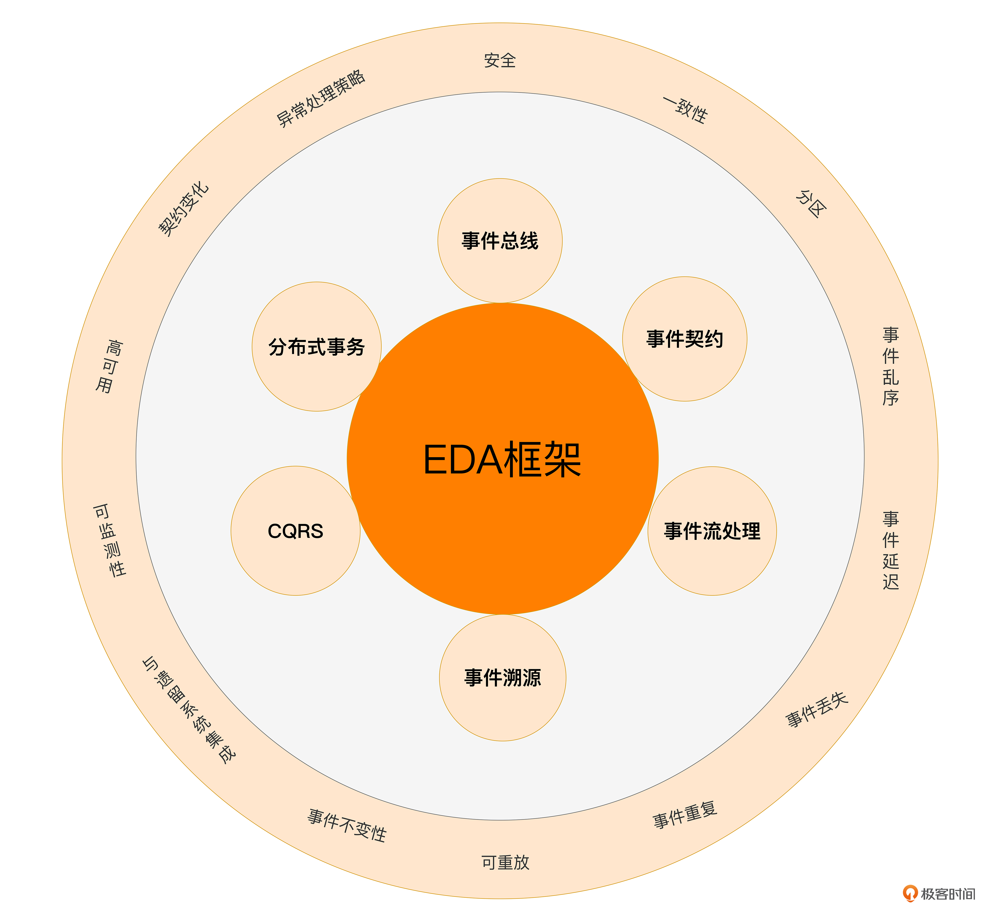
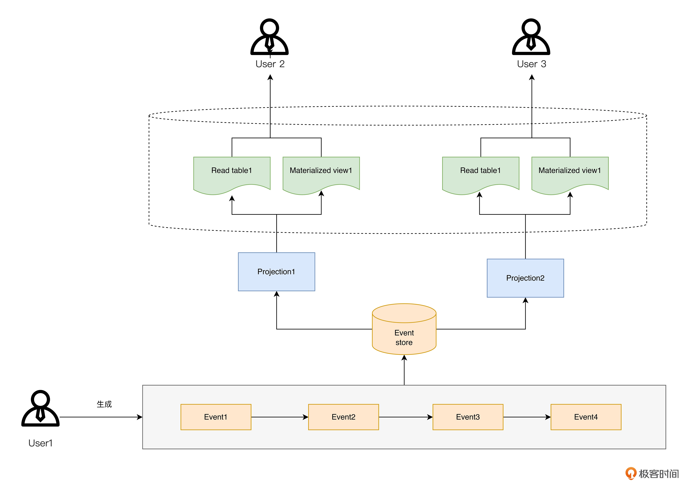
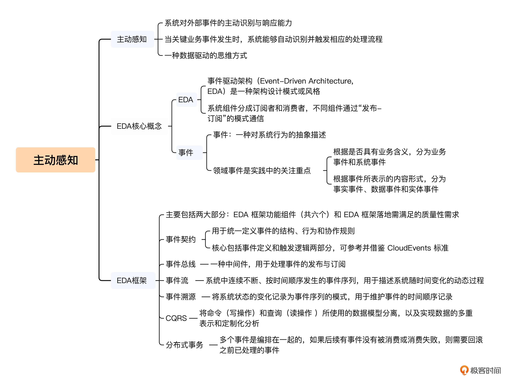

# 13 | 感知：如何实现系统的主动感知？

你好，我是灵犀。

大家对“雷达”应该并不陌生，它早已被广泛应用于汽车领域，用于实时感知周围环境。

但雷达的真正价值和广泛应用，最早源于空战需求。随着雷达技术的发展，空战的战术也发生了根本性的变化。传统空战中，战斗机必须近距离格斗才能发现并攻击敌机。而如今，借助雷达技术，空战已进入“超视距作战”时代。

换句话说，现代空战的关键在于“谁先发现谁”。再配合先进的导弹技术，在飞机还未看到对方时，就已经被击落。

实际上，雷达技术本身也受到自然界生命体的启发。可以说，主动感知是生命体普遍具备的一种生存技能。因为，在充满不确定性的环境中，谁具备更强的主动感知能力，谁就能在竞争中占据优势。

简而言之，雷达技术的核心价值就在于“主动感知”。那么，“雷达”的这种能力，是否也适用于企业系统呢？答案是肯定的。接下来，我们就进入今天学习的主题——主动感知。

## 主动感知是什么？

一看到系统的“主动感知”，很多人首先联想到的是 App 对用户行为的捕捉。在网购、浏览新闻、刷短视频等场景中，用户持续产生大量行为数据。平台通过行为分析算法，构建出一个个“数字化的人”，并据此实现千人千面的展示或个性化推荐。

这确实是“主动感知”的一种体现，但更多聚焦于用户行为特征的识别。随着移动互联网的发展，这类用户画像与行为感知技术已相对成熟。

但今天我所讲的“主动感知”，是从一个更广义的视角出发，强调的是系统对外部事件的主动识别与响应能力。用前面的例子来说，我们希望系统也拥有自己的“雷达”，能够感知并及时响应外部发生的重要事件。

我们通过一个具体案例来说明。在很多企业中，时常会发生对业务至关重要的突发事件。例如，在资管行业中，当市场剧烈波动、持仓资产出现负面舆情等“黑天鹅事件”发生时，需要基金经理、风控人员、合规专员等多个角色迅速介入处理。

然而现实中，许多企业仍主要依赖人工来进行处理。再看看目前系统的常见激活方式，大多也属于“被动触发”，主要包括后面这两种方式。

1. 用户在前端界面操作，触发后台接口调用。

2. 其他系统通过 API 主动发起调用。

这些方式本质上还都是“被动响应”，缺乏对业务事件的主动感知和及时处理能力。

那么，更理想的系统设计应该是怎样的？是让系统具备“主动感知”能力。也就是说，当关键业务事件发生时，系统能够自动识别并触发相应的处理流程。对于需要人工判断的任务，系统可以自动提醒相关人员；对于可自动处理的任务，则实现全流程闭环操作。

这种“系统驱动工作”的模式，正是数字化转型中需要重点突破的方向。

## 主动感知的本质

有人可能会问：这种“主动感知”，不就是我们常说的“事件发布与订阅机制”吗？

从技术实现的角度看，这种说法没问题。然而，在推动数字化乃至智能化转型的过程中，真正重要的是我们对于业务思维模式的转变，而不只是关注技术手段。

从业务角度来看，系统的主动感知能力，以及它所依赖的事件驱动思想，本质上是一种“数据驱动”的模式。

为什么这样说？因为事件本身也是一种数据。它代表了系统中某一时刻状态的变化，是对现实世界变化的捕捉和响应。这种对变化的捕捉，正是“感知”的核心。其实就像我们人类一样，人类的感知也着重于对运动的捕捉。

更进一步来看，这种思维方式的转变，正是之前课程里提到的：从“流程叙事”到“数据叙事”的转变。

“流程叙事”的核心仍然是“人”。在信息化时代，尽管我们将大量业务流程搬到了线上，但系统仍然需要人来推动，系统本身只是被动执行的工具。

而“数据叙事”的核心变成了“数据”。它强调尽可能减少人在流程中的主导作用。在这一模式下，事件作为一种数据，就像系统的“雷达”，代替了以往由人来感知、录入的过程。通过数字化手段，将“感知”也实现自动化，从而降低了对人的依赖，提升了数据流转的效率。

简而言之，主动感知的本质，是一种数据驱动的思维方式。它要求我们跳出传统的“流程叙事”思维，转而从“数据叙事”的角度出发，重新审视并串联系统中的角色与流程。

而且，大家要记住一点，在整个从信息化到数字化，再到智能化的演进过程中，思维方式的转变远比技术实现更为关键。在接下来关于“决策”的课程里，我们还将深入探讨这一演进过程。

## 主动感知的落地

接下来，我们来介绍支撑系统主动感知能力的落地方案——一个以 EDA（Event-DrivenArchitecture，事件驱动架构）理念为核心的框架。

正如前面讲的那样，EDA 框架背后体现的是“数据驱动”的理念。在智能原生时代，它是企业构建核心系统能力的重要基础设施，是实现主动感知、重塑记忆结构乃至智能化决策的关键支撑。

### 一、EDA 框架相关概念

首先，我们先来澄清 EDA 框架的两个最基本的概念。

1. EDA 是什么？

事件驱动架构（Event-Driven Architecture, EDA）是一种架构设计模式或风格。在 EDA 中，系统中的各个组件分为事件的生产者（发布者）和消费者（订阅者）。

与此同时，EDA 中的流程由事件来推动运转。事件生产者负责生成并发布事件，而事件消费者则订阅感兴趣的事件，并在接收到事件后执行相应的处理逻辑。通过这种方式，不同组件之间通过“发布 - 订阅”的模式进行松耦合通信，从而实现了系统的灵活性、可扩展性和解耦。

2. 事件是什么？

事件是系统中发生的有意义的事情，它可以是状态的变化、操作的触发或通知的发出等。作为一种对系统行为的抽象描述，事件通常具有不可变性、无时间概念、无预期性和解耦性这四个主要特征。

在实践中，我们关注的重点是领域事件，它是领域驱动设计（DDD）中的一个重要概念。领域事件指在领域模型中发生、具有业务意义的事件，能够准确反映业务逻辑的变化过程，是构建事件驱动架构的重要基础。

为了更好地理解和利用事件，我们可以通过对事件进行分类，进一步明确其应用场景和处理方式。通常可以从两个维度对事件进行划分。

一方面，根据是否具有业务含义，可以将领域事件分为业务事件和系统事件两类。

- 业务事件：直接反映业务逻辑中关键操作或状态变化的事件，如“指令创建”、“指令变更”等；

- 系统事件：与业务逻辑无直接关系的技术性事件，如“文件上传完成”、“文件传输出现异常”等。

另一方面，根据事件所表示的内容形式来区分，领域事件可以划分为事实事件、数据事件和实体事件三类。

- 事实事件：用于描述系统中发生的一个客观事实，如“用户点击按钮”。

- 数据事件：关注的是数据本身发生的变化，强调数据在状态或属性上的转变。例如订单状态从“已下单”变为“已支付”，在这种事件中，事件内容可能只包含订单 ID 和状态的变化部分。

- 实体事件：用于描述系统中特定实体（对象）的状态变化。这类事件通常与领域模型中的实体相关，强调的是实体的生命周期和状态演变。例如，当订单状态发生改变时，实体事件可能不仅包含状态的变更，还包含整个订单对象在该状态下的完整属性信息。

### 二、EDA 框架

下面我就带你系统了解一下 EDA 框架，如下图所示。

EDA 框架主要包括两大部分：EDA 框架功能组件和 EDA 框架落地需满足的质量性需求。

EDA 框架功能组件共有 6 个，包括事件契约、事件代理、事件流处理、事件溯源、CQRS、和分布式事务。

另外，在 EDA 框架落地时需考虑实现相关的质量性需求，主要包括安全性、一致性、分区、事件乱序、事件延迟、事件丢失、事件重复、可重放性、事件不变性、与遗留系统集成、可监测性、高可用、契约变化、异常处理策略等。

我们这就来看看 EDA 框架中的 6 个功能组件以及具体技术方案。

1. 事件契约

事件契约是 EDA 架构的核心规范之一，用于统一定义事件的结构、行为和协作规则，从而确保跨服务之间事件交互的标准化与一致性。

事件契约主要包括以下两个核心组成部分：

- 事件定义：包括事件类型、格式规范、数据结构、版本控制以及演化规则等，确保不同服务间对事件语义的理解一致，支持向前兼容与演化；

- 触发逻辑：定义事件的生成条件、来源以及传播范围，确保事件的产生具备准确性与可控性，避免事件泛滥或遗漏。

在落地中，可参考并借鉴 CloudEvents 标准，该标准为事件的结构和元数据提供了统一的语义模型。

2. 事件总线

事件总线提供了用于事件传递的基础设施。事件总线与常用的术语如事件代理、消息队列、消息引擎、消息中间件等基本同义，在本课程中，我们将统一采用“事件总线”这一称呼。

简而言之，事件总线是一种中间件，用于处理事件的发布与订阅。它作为系统中组件之间通信的中心化媒介，通过标准化的事件协议实现事件的路由、分发和传递，将事件从生产者高效地传递给订阅者。

在技术实现上，事件总线可以基于开源产品（如 RabbitMQ、RockeMQ、Kafka、Pulsar）或商业产品进行搭建。

3. 事件流

在前面的案例中，系统“主动感知”的对象是多是单个事件，而在企业实际业务中，还存在一类感知需求，其对象是事件流。

那么，什么是事件流？事件流是指系统中连续不断、按时间顺序发生的事件序列，通常可以被建模为一个“无限数据集”，用以描述系统行为随时间变化的动态过程。

打个比方，事件流就像打开开关的“水龙头”，源源不断地产生“流水”（即事件）。为处理这类事件流，我们通常依赖于流处理平台，它是一种专门用于处理无限数据集的技术方案，常见的开源流处理引擎包括 Spark、Flink 和 Storm 等。

4. 事件溯源（Event Sourcing）

事件溯源是一种将系统状态的变化记录为事件序列的模式。系统状态不是直接存储的，而是通过重放这些事件来构建当前状态。

与传统数据库方式相比，数据库通常只记录当前最新状态，而事件溯源能够完整描述对象在整个生命周期过程中所经历的所有事件。

在 EDA 框架中，事件溯源（ES）被用于维护事件的时间顺序记录，特别适合用于需要确保连续性和可靠性、审计能力和历史数据追溯的场景。

关于事件溯源机制的实现。如果事件总线用的是 Kafka，则可以选用 kafka-Journal 开源产品。如果想在数据湖上实现，目前像 Hudi/Iceberg 尽管不是传统意义上的事件存储（如Kafka），但它也可以通过“快照 + 增量读取 + 时间旅行”的组合，来实现事件溯源的功能。

5. CQRS

CQRS（命令查询责任分离）也是一种架构模式，其核心思想是将命令（写操作）和查询（读操作）所使用的数据模型分离，从而具备更好的灵活性。

在 EDA 框架中，CQRS 通常与 ES（事件溯源）配合使用。在两者结合时，涉及两个重要概念。

- 映射：根据事件存储中存储的事件转换和更新读模型的过程。

- 读模型：专门用于查询的呈现数据的模型。它对读取操作进行了优化，并根据写模型生成的事件构建。在实践中。从相同的事件源，可以构建不同视图的读模型，为业务领域提供不同的视角。

在实践中，CQRS 一般自主实现即可。而且，这相当于提供了一个扩展点，各个视图的不同需求方可以自己定制这部分转换逻辑。

6. 分布式事务

分布式事务原来指的是在分布式系统中，跨越多个独立资源（如数据库、服务或节点）的操作被视作一个整体，保证其原子性和一致性。在 EDA 中，分布式事务指的是多个事件是编排在一起的，如果后续有事件没有被消费或消费失败，则需要回滚到之前已处理的事件。

在实践中，分布式事务一般采用 Saga 与 TCC 等模式实现，目前我们通常不允许有分布式事务的存在。

## 总结

在这节课中，我们首先深入探讨了“主动感知”的定义及其核心本质，随后学习了其在实际落地中围绕 EDA 为中心的实现方案。

至此，关于“感知”主题的两节课程已全部完成。作为智能体的重要特征之一，感知机制在系统设计中是不可或缺的考量要素。

从本质上看，感知体现为交互双方之间的一种信息流动机制。无论是“立体感知”还是“主动感知”，其共同目标都是提升这一信息交互过程的效率。

具体而言，立体感知主要从空间维度入手，通过信息流的结构优化，使其更加精炼、直观，从而降低人类在认知过程中的负担。

而主动感知则侧重于时间维度，在信息流转过程中通过将状态的变化进行数字化表达，将其转化为可识别、可传递的“事件”，从而实现上下游的有机联动，减少人为干预，使信息流在时间轴上更加高效地传递。

因此，未来无论系统形态如何演变，是传统的微服务、FAAS 还是当前快速发展的智能体，主动感知能力都将是一个关键使能因素。

## 思考题

EDA（事件驱动架构）是一种应用非常广泛的架构模式，除了这节课里提到的主动感知场景之外，你在实践中还用它解决了哪些业务问题？

期待你在留言区和我交流探讨，如果这节课对你有启发，别忘了分享给身边更多朋友。
