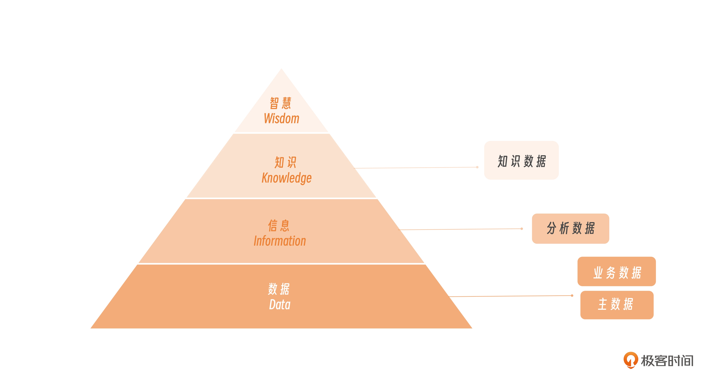
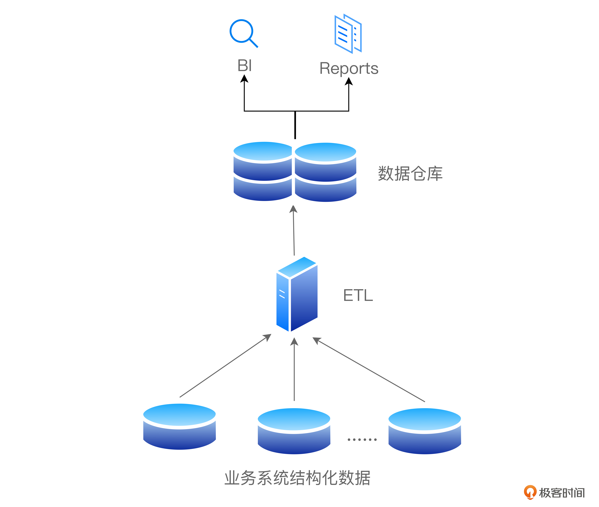
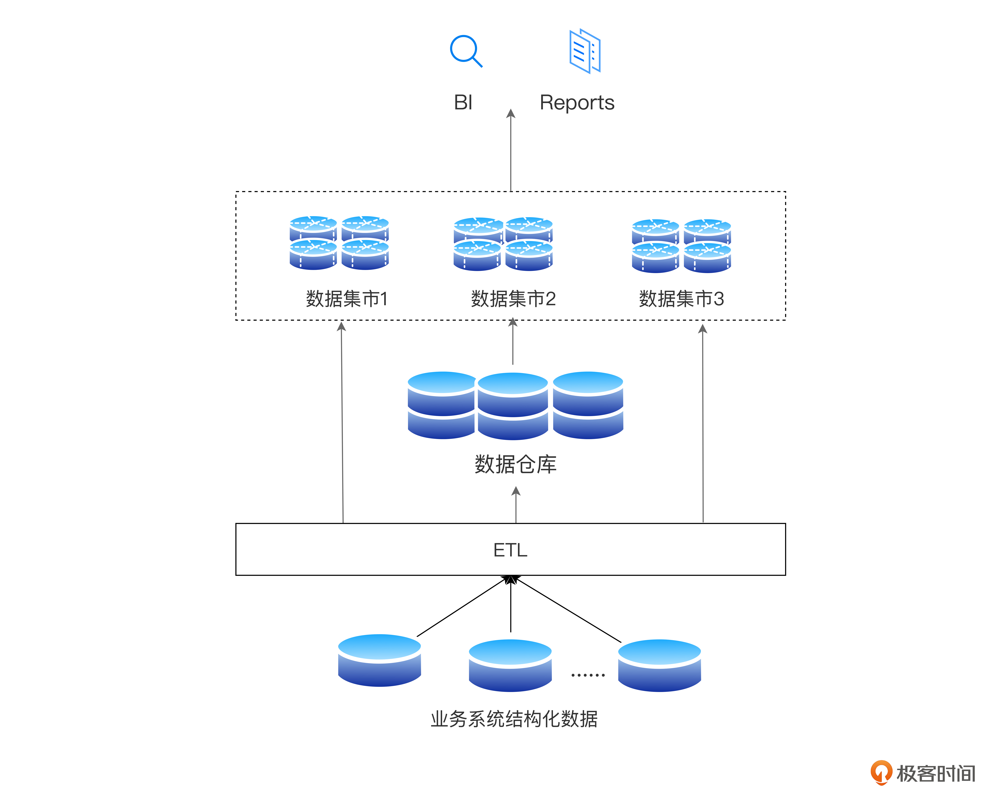
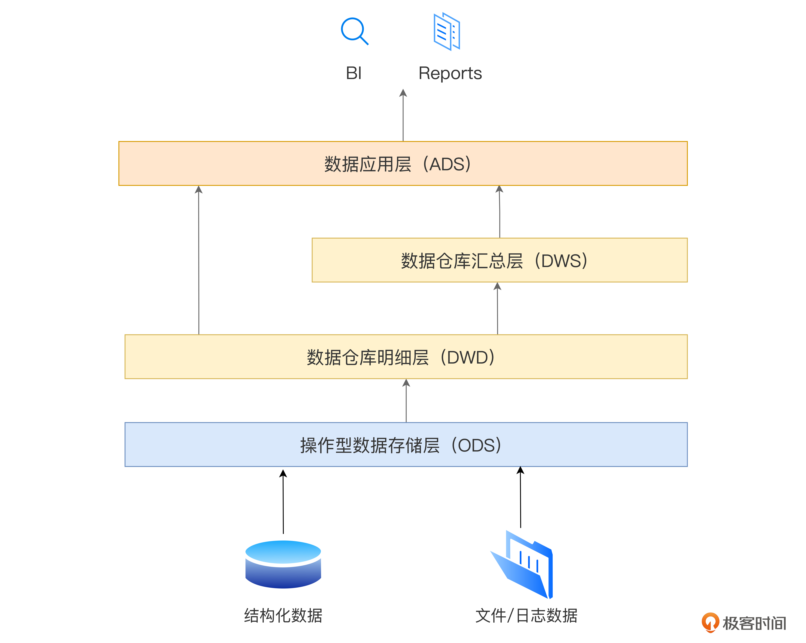
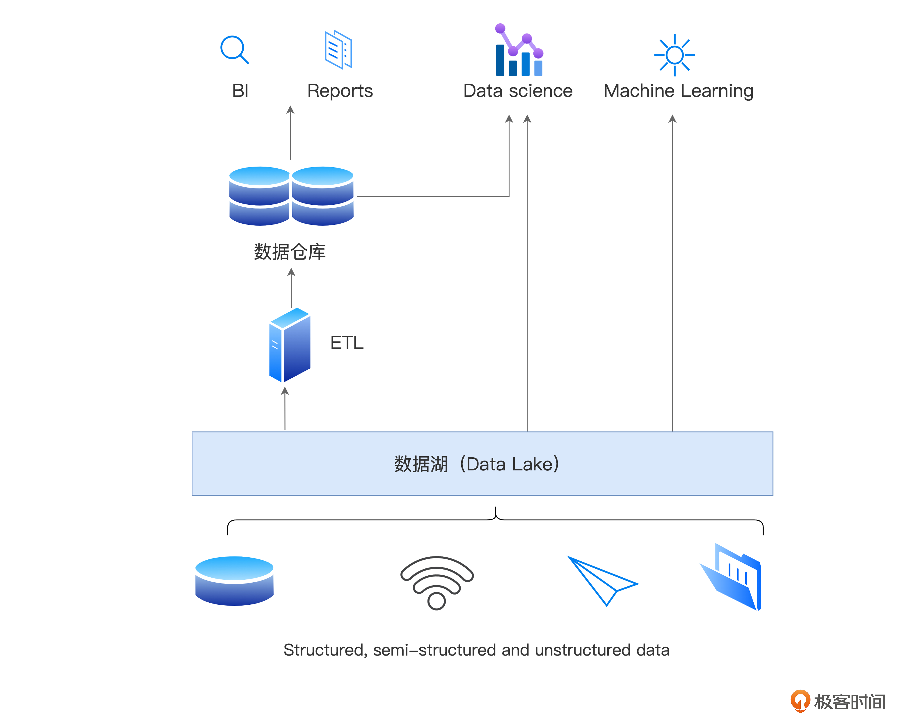
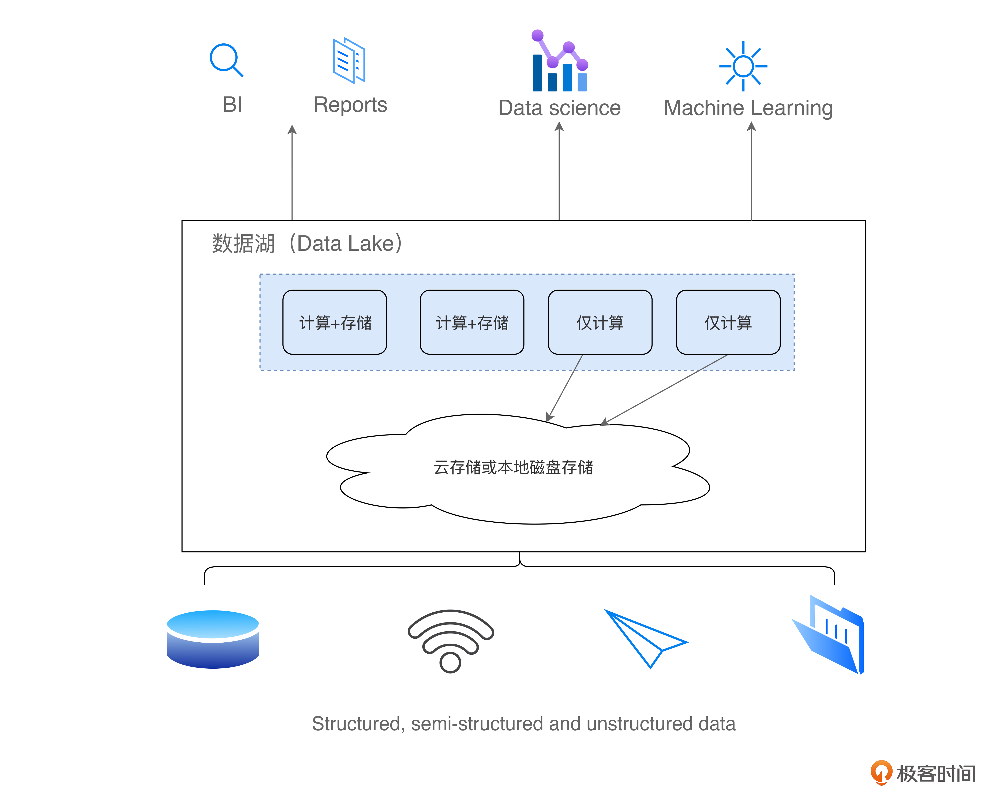
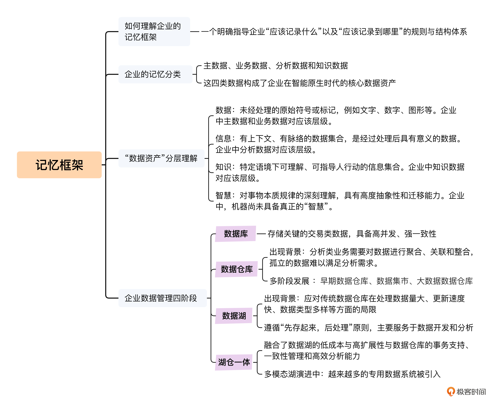

# 14 | 记忆：如何重构企业的记忆框架？

你好，我是灵犀。

大家可能有所不知，AI 中最重要的神经网络算法，其灵感最初源自对一种名为“海兔”生物的“记忆机制”的研究。

海兔是一种结构简单的软体生物，其鳃的呼吸反应由一个简单的神经网络所控制。当你用手触摸它的鳃时，鳃会迅速缩回。如果你重复这个动作，鳃会再次缩回。然而，如果你持续多次触碰，它最终会“适应”这种刺激，鳃的缩回反应也会逐渐减弱甚至消失。

这个实验揭示了一个深刻的机制：通过调整神经元之间的连接强度，也就是我们所说的“权重”，系统可以形成一定程度的“记忆”，并基于这种“记忆”产生出更复杂的智能行为。

而神经网络算法正是受到这一生物机制的启发，试图在计算机中模拟和复现这种“记忆”机制，从而在机器中涌现出“智能”。今天我们就来聊聊智能原生时代的企业记忆框架。

## 大模型“记忆能力”的成长

随着 AI 的发展，如今的大模型已经将这种“记忆机制”发展到一个前所未有的高度。

你还记得第一次使用像 ChatGPT 这样的大模型时的感受吗？除了对其流畅自然的文本生成能力感到惊叹之外，你是否也对它“记住上下文”的能力印象深刻？

其实，这种“记住上下文”的能力并不是模型本身“记得”了什么，而是前端将历史对话内容打包并重新输入模型，使其能够“看到”之前的对话内容。这种机制也被称为大模型的“感觉记忆”。

此外，像 RAG（检索增强生成）这类外挂知识库系统，也被视为大模型的“短期记忆”。它可以在任务执行时，动态检索并注入相关知识，帮助模型降低“幻觉”。

而最令人惊叹的，还是大模型在训练过程中内化到自身参数中的“长期记忆”。通过学习海量人类文本，大模型将庞杂的知识压缩到成千上万亿个神经网络连接之中，构成了其“记忆”基础，从而展现出类人的理解力与智能行为。

然而，如果我们要将大模型或智能体真正落地到企业中，仅依赖其“长期记忆”是远远不够的。企业需要的是一个与其业务相适配的智能系统，这就要求我们把企业的“记忆”，包括业务规则、行业知识、运行数据等，系统性地融合进模型的认知体系中，使其具备理解企业语言、处理业务逻辑的能力。

那么问题来，我们该如何规划企业的“记忆”？

在接下来的两篇文章中，我们将结合大模型“记忆机制”带来的启发，深入探讨企业中“记忆机制”的构建逻辑与实现路径。

## 记忆框架是什么？

从最初的神经网络，到后来的深度学习网络，再到如今的大模型，其“记忆机制”呈现出一个很明显的趋势：记住的信息越来越多。这一变化可以从神经网络参数数量不断上升这一点看出来。

这也说明了一个基本规律：模型的“记忆力”越强，它的能力往往就越强，两者之间是明显的正相关关系。

同样的逻辑也适用于企业。企业所拥有的数据量越大、数据质量越高，在与大模型融合之后，模型所能达到的效果和应用深度也将越强。

因此，关键的问题在于我们如何在企业的日常业务运转中，系统性地记录下那些有价值的数据？

这就引出了我们今天要讨论的核心概念——企业的“记忆框架”。

从系统设计的角度来看，企业的“记忆框架”，指的是一个明确指导企业“应该记录什么”以及“应该记录到哪里”的规则与结构体系。

接下来，我们先来看第一个问题：企业应该“记什么”？这是构建企业“记忆框架”的第一步。因为并不是所有数据都值得记录，我们需要在海量信息中，识别出真正对企业有价值、对未来模型有意义的数据。

根据这个“记忆框架”，企业的“记忆”可以分为四类：主数据、业务数据、分析数据和知识数据。这四类数据构成了企业在智能原生时代的核心数据资产。

这一“记忆框架”与知识管理领域著名的 DIKW 模型（Data - Information - Knowledge -Wisdom）基本相对应，只是略去了“智慧”这一层。接下来，我们逐一进行说明。

一、数据（Data）

在 DIKW 模型中，数据指的是未经处理的原始符号或标记，例如文字、数字、图形等。在企业的“记忆框架”中，主数据和业务数据对应这一层级。

其中，主数据是企业中最核心、最基础的业务实体。它们是业务流程运行的基石，通常被多个系统共享使用，例如，客户、产品、账户、资产等。而业务数据是指企业在日常业务运转过程中产生的具体操作记录，例如交易流水、支付记录、行为轨迹等。

我们可以用一个简单的类比来理解。在自然界中，人类很早就开始记录日月星辰的运行轨迹，这便是“数据”的最初形式。在企业中，我们也有类似的众多实体，如员工、IT 系统、实物等，它们在业务运行中也会交互产生大量数据。

二、信息在 DIKW 模型中，信息是有上下文、有脉络的数据集合，是经过处理后具有意义的数据。在企业的“记忆框架”中，信息对应的是分析数据。

这类数据通常由主数据和业务数据经过清洗、聚合、计算后生成，用于支持企业的分析决策、业务洞察和智能化运营。例如，用户活跃度、交易转化率、基金收益率等指标，都是典型的分析数据。

继续用前面的类比，就像人类将日月星辰的运行数据与四季变化、潮汐规律等联系起来，从而形成“信息”一样，企业的分析数据也是对原始业务数据关联之后的提炼。

三、知识

在 DIKW 模型中，知识是特定语境下可理解、可指导人行动的信息集合。在企业的“记忆框架”中，知识数据正是这一层级的体现。

知识数据通常是结构化的规则、逻辑或经验，可以直接用于指导业务行为。与分析数据不同，知识数据往往可以替代人做出决策。例如，在资管公司，有不少基于风控指标形成的规则，比如“某股票在一周内下跌超过 30%，则自动清仓”，这样的一条规则就属于知识。

还是上面的例子，牛顿根据观察数据总结出三大运动定律，这就是信息到知识的升华。在企业中，知识数据也正是我们从下层数据中提炼出的“可执行的智慧”。

四、智慧

在 DIKW 模型中，智慧是对事物本质规律的深刻理解，具有高度抽象性和迁移能力。目前在企业系统中，智慧还主要存在于人的大脑中，机器尚未具备真正意义上的“智慧”。

下面，我们进一步细化企业的“记忆框架”所包含的具体数据类型。

以下表格对各类数据类型进行了简要说明，可以参考。

在明确“记什么”之后，接下来需要回答的是：“这些数据应该记在哪里？”

这一问题并没有统一的答案，其与企业的数字化成熟度、技术架构以及业务场景等密切相关。

因此，在接下来的内容中，我将从“数据存储”演进的视角出发，结合我们实践中的一些经验，介绍企业在不同阶段可能采用的数据存储方案，以及背后的技术实现方式，帮助大家从全局视角理解“企业记忆框架”如何落地与演进。

## 记忆框架的落地与演进

从数据存储的维度来看，企业数据管理的发展大致经历了数据库、数据仓库、数据湖和湖仓一体这四个主要阶段。

一、数据库

上世纪六七十年代，数据库的出现开启了企业数据集中存储管理的序幕。当时系统中尚未区分主数据与业务数据，也未产生分析数据的需求。

数据库主要用于存储关键的交易类数据，具备高并发、强一致性等特性，强调事务处理的高效与可靠。

至今，数据库仍主要用于支持面向事务处理（OLTP），保障业务的实时操作与数据一致性。

二、数据仓库

随着业务的不断发展，企业逐渐意识到数据中蕴含着可用于分析和决策的价值。然而，传统数据库的设计初衷主要是支持高频的随机读写操作。

如果在 OLTP 系统中执行 OLAP 类分析操作，会直接影响业务系统的性能和稳定性。因此，事务处理与分析处理需要进行分离。

此外，早期企业系统大多是独立建设，数据分散在各个系统中，缺乏统一标准。而分析类业务需要对数据进行聚合、关联和整合，孤立的数据难以满足分析需求。

基于这些挑战，数据仓库的建设成为企业数据架构演进的必然方向。在实践中，数据仓库的发展也经历了多个阶段。

1、早期数据仓库早期的数据仓库通常还是基于关系型数据库构建，它的核心目标是将来自多个异构系统的数据，按照业务主题域进行集成和重组，从而为业务提供数据洞察能力。

2、数据集市

数据集市的出现，主要是为了应对企业级数据仓库建设中常见的问题，最主要的就是统一建模复杂，导致开发周期长、协调成本高，难以快速响应业务变化。

相比之下，数据集市通常聚焦于特定的业务部门或业务线，数据量相对较小，建设周期短、响应快，能够快速支持部门的分析和决策需求。

在这一阶段，企业的数据架构通常分为两层。底层是数据仓库，面向多个业务条线，提供统一的数据模型和历史数据存储。上层是数据集市，按业务主题定制，为各部门提供更贴近业务需求的数据分析支持。

此时，除了关系型数据库之外，有些企业还采用了 MPP 架构的数据仓库产品，比如Teradata、Greenplum 等。

3、大数据数据仓库

在“数据仓库 + 数据集市”的双层架构中，业务部门通常需要将数据从数据仓库复制到各自的数据集市中，才能进行分析。此外，随着数据规模不断增长，如果还是采用关系型数据库或MPP 分布式数据库，数据存储和管理的成本很高。

进入 21 世纪初，随着大数据存储技术的发展，特别是 HDFS 分布式文件存储的成熟，存储成本大幅降低，企业开始有了更具成本效益的数据存储方案。

这一阶段，大数据数据仓库逐渐成为主流。它以分布式存储为基础，具备更强的扩展性，能够支持海量数据的存储与管理。

同时，从 MPP 分布式数据库开始到大数据平台，平台也开始具备计算能力，许多分析任务可以在平台内部直接完成，而不再依赖程序或 ETL。因此，数据仓库的架构通常被设计为分层结构，以执行一些分析任务。

1.ODS 层

存原始数据的地方，直接加载原始日志、数据，不做任何处理，通常使用 HDFS 存储。

2.DWD 层

结构和数据颗粒度跟原始表保持一致，主要是对 ODS 层的数据做清洗，比如去掉重复的、纠正错误。通常使用 HIVE，可以方便地将 SQL 语言转换成 MapReduce 或 Spark 任务。

3.DWS 层

以 DWD 层为基础，做轻度汇总。比如把每天的数据按周进行汇总，通常使用 HIVE。

4.ADS 层

专门给各种统计报表提供数据，这一层通常使用传统关系型数据库。

三、数据湖

数据湖（Data Lake）是一种随着大数据和人工智能需求快速增长而兴起的新型数据存储架构。该概念最早于 2010 年提出，旨在应对传统数据仓库在处理数据量大、更新速度快、数据类型多样等方面所面临的局限。

数据湖通常基于 S3 等对象存储系统，具备低成本、高扩展性的特性，支持结构化、半结构化和非结构化数据的混合存储。与传统数据仓库不同，数据湖入湖门槛低，无需复杂的数据建模，仅需进行基础的数据一致性检查和质量管理即可。

总体而言，数据湖奉行“先存起来，后处理”的原则，区别于数据仓库“先建模、再使用”的理念。

此外，数据湖与主流 AI 框架（如 Spark MLlib、PyTorch 等）高度兼容，使数据科学家和 AI工程师可以直接在数据湖平台上部署机器学习任务，由数据湖的计算引擎完成计算，从而实现快速算法验证与模型迭代。

尽管如此，由于数据湖主要服务于数据开发和分析，而业务部门和管理层对报表和统计分析的需求仍较高。因此，通常会在数据湖之上叠加构建数据仓库层，以满足结构化分析和决策支持的需求。

四、湖仓一体

在传统数据湖与数据仓库共存的架构中，企业常常需要在两者之间频繁地进行数据迁移或复制，这不仅增加了系统复杂性，也带来了更高的运维成本。为了解决这一矛盾，湖仓一体（Data Lakehouse） 技术应运而生。

湖仓一体融合了数据湖的低成本与高扩展性与数据仓库的事务支持、一致性管理和高效分析能力，构建了一个统一、弹性、灵活的数据平台，兼顾了存储与计算的需求。

在存储层面，湖仓一体架构通常采用 Delta Lake、Iceberg、Hudi 等开源格式，从而可以支持结构化元数据管理和 ACID 事务特性。同时，也支持分层存储，实现冷热数据分离，进一步提升存储效率和成本控制能力。

此外，随着大模型的持续发展与广泛应用，数据湖仓也正逐步演进为多模态湖仓。在这一演进过程中，越来越多的专用数据系统（如向量数据库、图数据库等）被引入，用于支持不同类型知识的存储与高效处理。

## 总结

在这节课中，我们围绕智能原生时代企业所必需的“记忆框架”，重点探讨了其两个核心问题：“记什么”与“记到哪里”，并进行了深入阐述。

那么，仅仅构建这样一个“记忆框架”就够了吗？显然是远远不够的。这里我列出几个后续章节要继续探讨的问题，你可以先思考一下。

例如，如果企业在“记忆框架”中，业务数据层仍然是一些孤立的“数据空间”，那么在实际业务运行中，就很容易出现数据卡顿、断点和摩擦等问题，影响数据流转效率。

再比如，企业的“记忆框架”中，业务数据会转化为分析数据，再进一步提炼为知识数据。而这些分析结果与知识成果，又会作用到业务流程中，形成一个完整的数据闭环。显然，如何提升这一闭环的效率，是数字化和智能化的关键。

此外，在课程中我们提到的数据仓库、数据湖与湖仓一体，主要聚焦于数据存储这一维度。实际上，大数据架构的核心包含三个关键层面：数据存储、数据计算与数据应用。尤其是计算这块，在信息化到数字化、智能化的过程中，它又是如何演进的？

在接下来的章节中，我们将围绕这些问题进行深入探讨。

## 思考题

今天我们课程里提到了数据仓库、数据湖和湖仓一体等概念。在你看来，它们我们常说的数据中台又是什么关系？

期待你在留言区和我交流互动，如果这节课对你有启发，别忘了分享给身边更多朋友。
