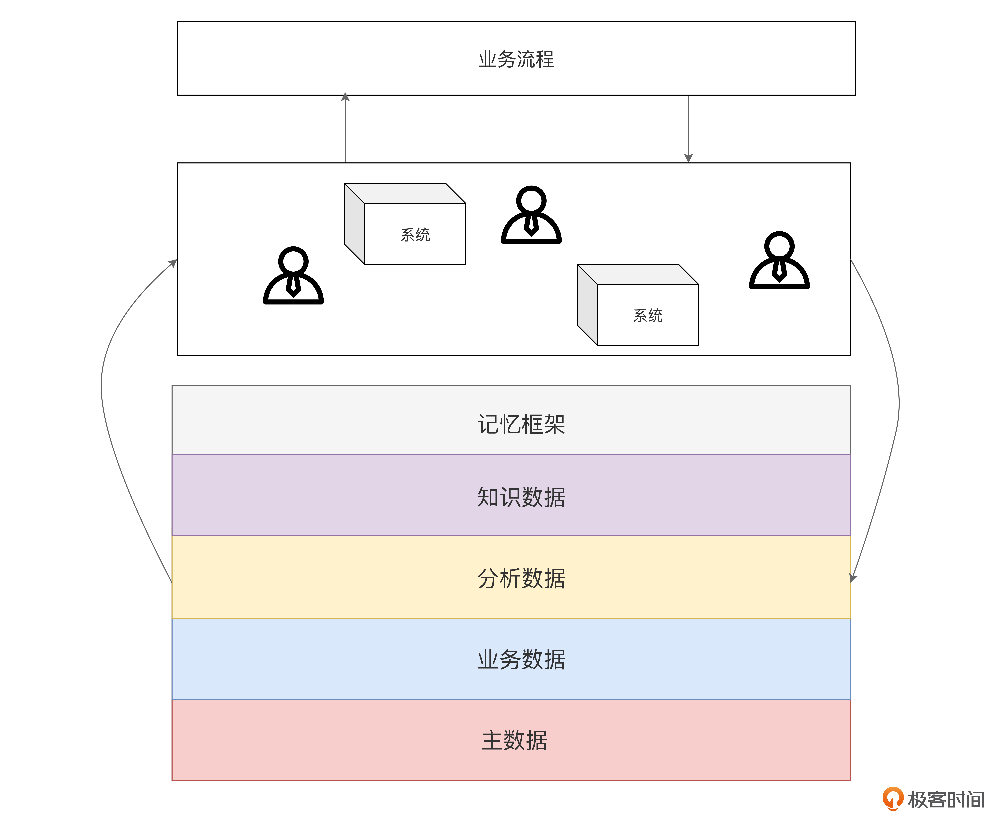
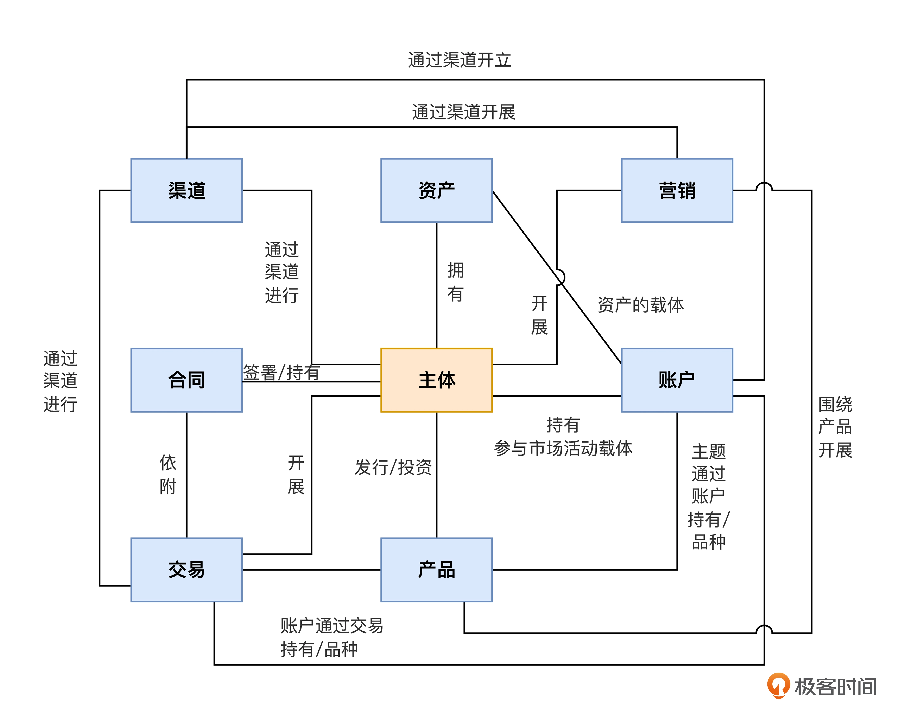
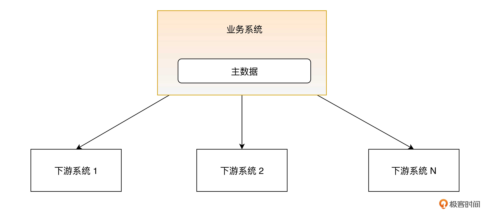
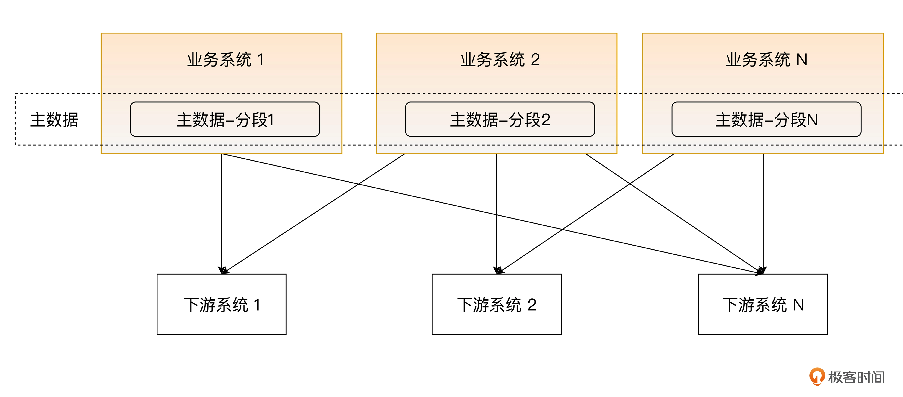
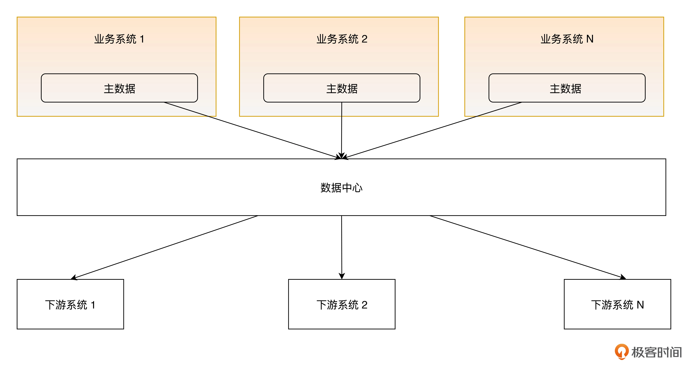
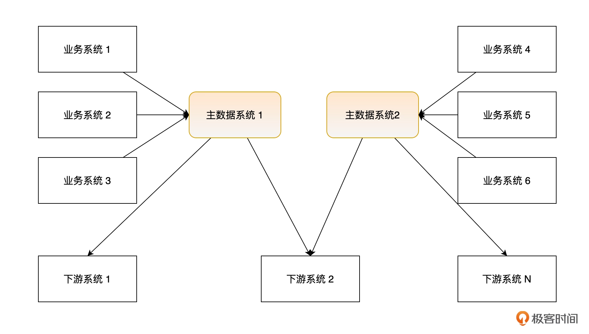
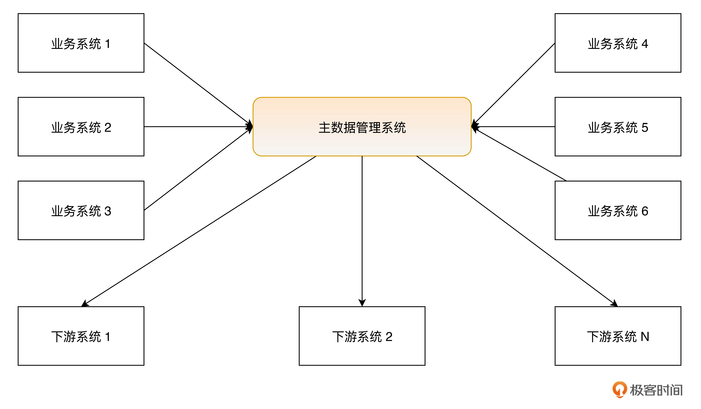
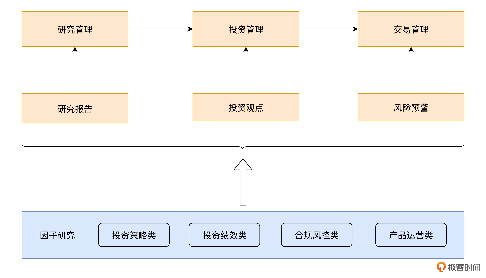
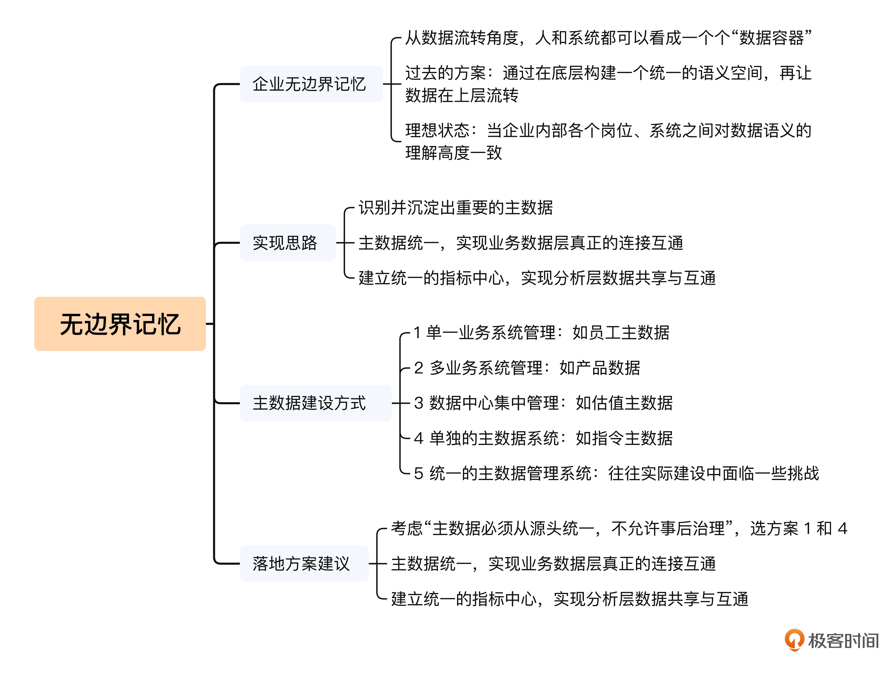

# 15 | 记忆：如何打造企业无边界记忆？

你好，我是灵犀。

在上一节课中，我们提到了大模型“记忆机制”带来的第一个重要启发：模型的记忆量与能力之间基本呈正相关关系。

实际上，大模型所带来的还有一个更具革命性的启发：大模型在空间维度实现了信息的无边界互通。这能为企业架构设计带来什么样的灵感呢，这就是我们今天这节课要探讨的话题。

## 如何理解大模型的无边界信息互通？

我们先来理解一下什么是大模型的无边界信息互动。

我们知道，信息要实现高效、顺畅地流转，最大的障碍在于语义空间的割裂。因为不同的语义空间往往遵循不同的规则，彼此之间难以直接沟通。

在大模型出现之前，小模型就是这样运行的。为了不同的应用场景分别训练，彼此之间缺乏联系。这就导致了同一个语义信息（例如“苹果”这个词），在不同的模型中会有不同的向量表示。

而大模型的解决方法非常直接：它将所有的文本信息压缩到到一个统一的向量空间中。

这个统一的向量空间，是通过训练海量的语言数据（包括书籍、网页、文本文档等）构建出来的。在训练完成后，每一个 “Token” 都会被映射为该空间中的一个高维向量。正是这种统一的表示方式，使得信息可以在模型内部自由流动、无缝连接。

例如，大模型的上下文记忆、RAG 的短期记忆、以及模型本身的长期记忆之间之所以可以互通，正是因为它们共享同一个语义空间。此外，我们让大模型生成文本的过程，本质上也是信息在这个统一空间中不断传递与演化的过程。

更进一步地，多模态大模型也是在这一基础上的扩展：它将文本、图像、视频等也统一表示为同一空间中的向量。

这地方可能有人会有疑问——在大模型出现之前，其实这种设计思路也实践过，为什么当时没有成功呢？其实答案还是与大模型在空间处理机制上的创新有关。

在自然语言处理中，无论是大模型还是小模型，其核心目标都是一致的：尽可能多地捕捉和表达语义信息。

我们知道，人类语言文本天然是一种时间序列。因此，传统模型如 RNN（循环神经网络）通常也是按顺序逐词处理，这种处理方式使得每个词只能与上下文中较近的词建立联系，记忆窗口有限。

而大模型通过引入“注意力机制”，彻底打破了这种基于时序的局部处理方式。它可以从整个上下文中自由捕捉任意两个 Token 之间的语义关联。

举个简单的例子，我们来看后面这句话：“邻居家有只小花猫，小时候我经常和它一起玩。”

如果用传统 RNN 处理这句话，当记忆窗口较短时，“它”与“小花猫”之间的语义联系可能会被忽略。而大模型的注意力机制，可以轻松识别并建立这种远距离的语义关系。

那么，对于企业来说，大模型这种在空间维度上实现信息无边界互通的能力，又能带来哪些启发呢？

## 企业无边界记忆是什么？

我们先来探讨一下，企业的无边界记忆是什么？

我们可以将企业的“记忆框架”，放在企业的整个运行环境中来理解这个问题。

企业中有许多业务，每个业务背后都对应一个业务流程。每个业务流程都可能涉及许多岗位和系统来协同完成。

无论人还是系统，在完成任务的过程中，通常需要从企业的“记忆框架”获取数据。同时，在业务运行过程也会不断产生新的数据，并把这些数据再次回流到“记忆框架”中。

其实，如果从数据流转的角度来看，人和系统都可以被看作是一个个“数据容器”。在这个容器空间里，装着一套关于数据处理的规则体系。只不过，系统是一个规则固化的“容器”，它的行为由代码所定义。而人则是一个相对灵活的“容器”，行为受经验、灵感，甚至是情绪的影响。

我们不妨设想一下最坏的情况，每个“数据容器”都定义了一套自己的语义规则。那一个业务流程想要运转，就不得不在这些空间之间进行大量的语义转换。这就像一个只会一门语言的人要去全世界旅游，那么每到一个语言不通的国家，就只能靠翻译。

过去的解决办法是，是通过在底层构建一个统一的语义空间，再让数据在上层流转。这种方式有点像“建立一门世界语”，大家在交流时都用这门“语言”来交流，各自内部还是用自己的“方言”。

但这个方案的效果往往并不理想。为什么呢？

因为语义的统一不仅仅是语言层面的，它还涉及认知、文化、思维方式等更深层次的差异。同样地，当业务流转涉及众多岗位和系统时，要让所有人都“说同一种语言”，难度也很大。

那什么才是理想的状态？

当企业内部各个岗位、系统之间对数据语义的理解高度一致时，数据在不同“容器”之间流动时，就能实现无缝连接、快速响应，就像在一个统一的系统中运行一样。

我们可以拿足球队为例再说明一下。有时候一个足球队里大牌球员多，不一定是好事，因为大家对足球的理念、每个人的定位可能会不一致，这样反而在踢的过程中会出现很多停顿。而好的足球队，大家对战术的理解、对各自的定位都非常一致，那么球在他们之间流转时就能非常顺畅。

简而言之，企业的“无边界记忆”，指的是在企业内部天然存在多个岗位、系统这种“空间割裂”的情形之下，如何规划企业的“记忆框架”，以便让数据能够在这些看似割裂的空间中自由穿梭，实现真正意义上的“无边界”协作。

## 企业无边界记忆的解决思路

那么，应该如何实现这种无边界记忆呢？

我们首先分析当前企业无法实现无边界记忆的根本原因。其实，问题的根源在于当前企业普遍采用的“烟囱式”建设模式，这种模式的弊端主要体现在两个方面。

一方面，各个系统是独立建设的，形成了一个个“数据孤岛”。这种模式导致在业务数据层面，形成了多个独立的数据空间，不同空间之间的数据难以有效连接与流通。

第二，各业务领域对指标的计算也是各自为政，造成了一个个“指标孤岛”。过去，各条线或部门往往会从原始数据中抽取自己所需的内容，用于开发各自定义的指标。由于缺乏统一的语义标准，这些指标之间难以共享和对齐。

之前，我们通常通过两种方式来解决这种语义不一致的问题。一种是在系统层面对数据进行大量中间处理，进行数据转换与整合。另一种则是构建一个统一的数据池，在底层完成标准化，再基于这个池子进行指标计算和数据流转。

然而，在大模型时代，这些传统方式都将面临根本性的挑战。大模型本质上是基于概率的学习模型，它在学习企业数据的过程中，如果数据存在大量的不一致，就可能加剧模型的“幻觉”。

那么，有没有更好的解决思路呢？

事实上，每个企业的业务体系，主要由一组核心实体构成，而业务运行的过程也正是一系列实体之间的交互结果。这些核心实体本质上就是主数据。以证券期货行业为例，其核心实体关系如下图所示。当然，实际情况中，主数据的范围会更广一些，但主数据始终是构建业务体系的基础。

因此，实现企业无边界记忆的关键在于：识别并沉淀出这些重要的主数据。一旦主数据实现统一，业务数据层就可以实现真正的连接与互通。

进一步地，分析层的数据大多是从业务数据层中提炼而来的。要想实现这一层级的数据共享与互通，还需要建立统一的指标中心，以确保指标定义的一致性和可复用性。

接下来，我们将具体探讨企业在实践中如何落地无边界记忆的建设方案。

## 主数据的落地实现

下面，我们来看看主数据常见的几种管理方式。

一、单一业务系统管理

将主数据归属于一个业务系统进行集中管理，该系统作为主数据的唯一可信来源。其他系统仅消费和使用数据，不进行任何修改或维护操作。

在这种管理模式下，数据来源单一，能够有效避免重复录入和数据冲突，数据一致性高。但缺点是不支持跨系统共享主数据的情形。

典型的例子是员工主数据，通常可统一由人力资源系统进行管理。

二、多业务系统管理

主数据由多个业务系统分别管理，各系统负责维护其相关的部分字段或内容。该模式相对灵活，各系统能快速响应业务变化，维护成本较低。但其缺点是下游往往需要聚合后的数据，数据治理和整合成本较高。

典型的案例是产品数据。在资产管理领域，产品通常贯穿“研—募—投—管—退”等多个业务阶段，各个阶段涉及不同的系统和数据类型。例如，研究阶段涉及产品的基本信息，投资阶段涉及收益结构、风险指标等。

三、数据中心集中管理

各业务系统自建数据，通过在数据仓库或数据湖中进行统一清洗、建模、整合后，作为企业级主数据提供给各系统使用。

这种方式下，也可以确保数据标准统一。但对于实时性要求高的场景，架构复杂度会比较复杂。此外，上游系统仍具有数据的修改权限，频繁变更容易导致数据中台和下游系统出错，这种情况在实践中经常出现。

典型的案例如估值主数据。在资管的业务条线中，像运作、投资、风险等领域许多地方都会用到估值数据，过去外购系统都自带了一套估值方法，标准不统一，导致下游系统难以选择。因此，许多企业选择在数据仓库中统一维护一套估值数据。

四、单独的主数据系统

对关键主数据建立独立的系统，统一管理其生命周期。其他业务系统必须通过该系统获取或更新主数据，禁止自行建模。

这种方式下，主数据统一管理、质量高、一致性好，同时支持多系统协同、实时性好。但系统建设和维护成本相对较高。

典型的案例是指令主数据。在资管业务中，各种交易类型都有自己的指令类型，过去分散在交易系统中。为统一管理，建立独立的指令管理系统。

五、统一的主数据管理系统

建设一个统一的主数据管理系统，可以实现对公司内部主数据的集中管理，涵盖主数据的新增、变更、分发、工作流审批等关键操作。

然而，这类系统在实际建设中面临一些挑战，如果将其作为业务系统来构建，往往难以明确其业务归属部门。而如果将其作为后台类系统放在数据中台中，又成为“事后治理”的工具，实际价值大打折扣。

在以上 5 种主数据建设方式中，我们选择的是方案 1 和方案 4。我们的核心原则是主数据必须从源头统一，不允许事后治理。之所以这样设计，主要是考虑了后面这两个因素。

一是主数据的价值远不只是它本身自有属性的价值，而是连接带来的价值。若源头不统一，连接的数据也会混乱，严重影响数据价值，尤其在大模型时代，数据不统一将大大削弱其价值。

二是事后治理许多场景落地困难，且成本太高。因为如果大家在初始阶段对数据的理解就不一致，后续治理很难推动。

因此，目前我们对产品主数据、估值、指令等主数据等均采用独立主数据系统管理，其他系统不准自行建模。

此外，主数据的状态变化往往具有重要意义。因此，主数据除了要求持久化存储之外，每一次状态的变更，都会发布一个领域事件。其他系统如需主动感知主数据变化，可通过订阅机制实时获取事件内容，提升系统间的协同能力。

## 统一指标的落地实现

统一指标中心的建设与业务密切相关。比如在资产管理业务中，尽管研究管理、投资管理和交易管理看起来属于不同的领域，但它们底层所依赖的因子（指标）大多是共享的。

过去，由于缺乏统一的数据规划，研究、投资、交易以及风险等各业务条线往往各自建立了独立的数据子中心，每个子中心分别进行数据采集、建模和指标计算。

这种“各自为政”的模式带来了两个主要问题：一是资源浪费严重，同一指标在多个系统中被重复计算。其次，口径也存在不一致，不同条线对同一指标的定义、计算逻辑不同，导致结果不一致，需要大量人工审核、对账。

基于上面的问题，正是我们当时推动数据中台建设的主要动因。通过数据中台，各业务系统不再独立采集和建模，而是基于统一的开发平台进行协作。所有的指标统一通过数据中台的指标服务对外提供。

上节课，我们已经提到了多个数据相关的概念，如数据仓库、数据湖、湖仓一体和数据中台等。关于它们之间的共性与差异，这里做一下简单的探讨。

首先，无论数据湖、数据仓库、湖仓一体，还是数据中台，它们都不仅仅是一个技术概念，而都是一种体系。因此，不仅仅数据中台的目标是“让数据用起来”，其实其他概念的核心目的也是如此，绝不是为了单纯实现某种技术目标。

从这个角度来看，这些概念本身都是技术中立的。它们都可以根据企业的实际业务目标，灵活选择适合的数据存储技术、计算引擎、数据分析工具或 BI 系统等，关键在于如何结合业务需求进行有效落地。

其次，在共性的基础上，不同概念强调的核心目标确实存在差异。

其中，数据仓库的核心在于统一建模。它通过将散落在各个系统中的数据，按照主题进行整合，构建出结构清晰、规范统一的数据模型，为业务分析和报表提供数据支撑。

数据湖的核心在于数据的汇聚与原始存储。它像一个“大池子”，将企业业务中产生的各种结构化、半结构化和非结构化数据统一汇聚起来，满足 AI 和大数据分析对数据量和多样性的需求。

然而，数据汇聚起来其实只是很基础的一步。在实践中，会发现数据湖对源数据的质量有着很高的要求，一个最基本的要求就是数据之间要能连接起来，否则很难真正用起来。

湖仓一体的核心是通过技术手段，实现数据仓库与数据湖的融合，在同一个数据底座上兼顾数据的统一管理与灵活分析。虽然湖仓一体的技术本身非常先进，但其最终效果仍然取决于数据湖中原始数据的质量。如果数据本身不规范、不完整，依然需要通过大量的中间处理才能用起来。

数据中台，我认为其首要任务还是要体现“中台”的价值。中台的核心在于解决烟囱式系统建设的问题，通过统一的数据平台，提供高频复用的核心数据能力，从而支持各个业务场景的快速响应与业务创新。

## 总结

如果说上一节课重点解决的是企业“记忆框架”中“记什么”和“记在哪里”的问题，那么本节课则是围绕“如何记得更好”展开探讨。

所谓“记得更好”，主要体现在空间维度上，即业务数据层、指标层之中，不再是一些孤立的“数据空间”，而是在语义上打通，实现数据的高效连接与流通。这种打通最终会体现在企业的业务流程中，表现为数据能够顺畅流转，从而支撑更高效的业务运行。

解决了“空间维度”的问题之后，“时间维度”也同样至关重要。具体来说，就是从业务数据出发，经过处理转化为分析数据，进一步提炼为知识数据，然后这些分析结果与知识成果，再反向回流并应用于业务流程中，形成一个持续运转的数据闭环。这一闭环上各类数据转化的效率，正是推动企业实现数字化和智能化的关键所在。

接下来的关于“决策”的几节课中，我们将来深入探讨这一话题。

最后，我想先提出一个问题也提供大家思考一下。在讨论空间维度时，没有提到代码空间与数据空间之间的打通，我认为这也是进入大模型时代后需要重点关注的一个课题。

## 思考题

在企业架构框架 TOGAF 中，提出了“无边界信息流”这一重要理念。请你结合今天我们探讨的“无边界记忆”概念，谈一下对“无边界信息流”的理解。

欢迎你在留言区参与交流讨论，如果这节课对你有启发，别忘了分享给身边更多朋友。
