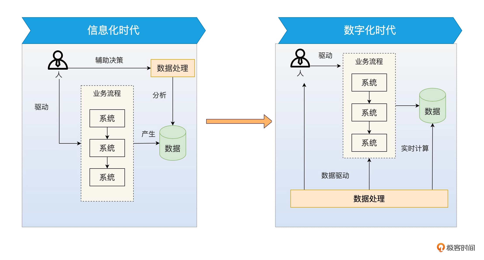
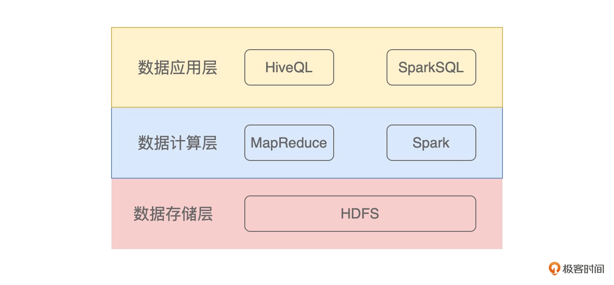
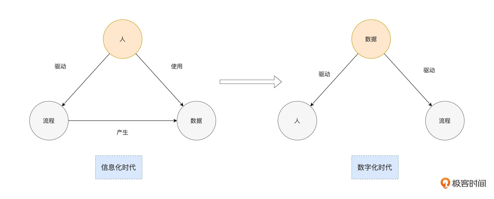
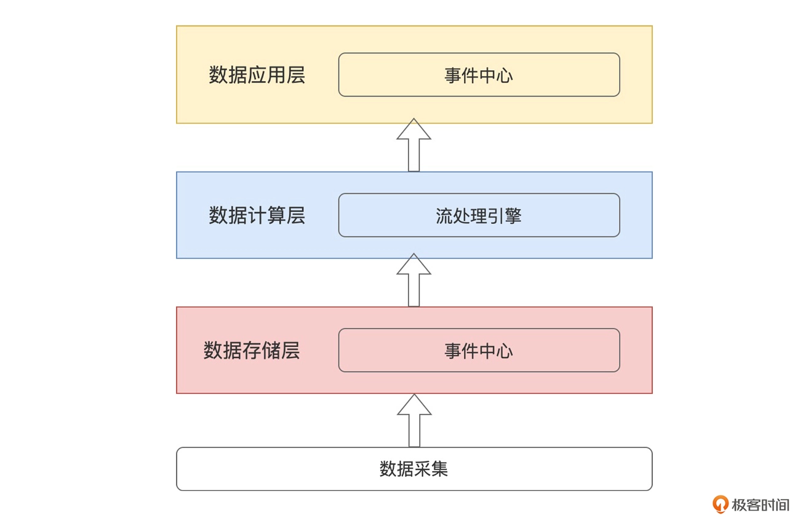
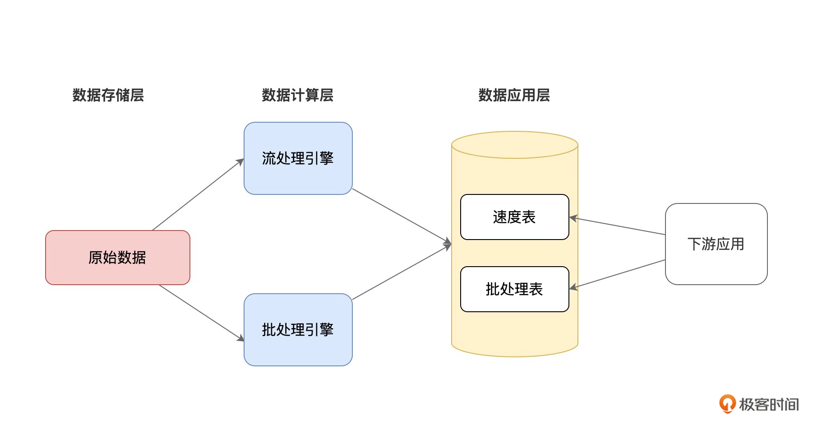
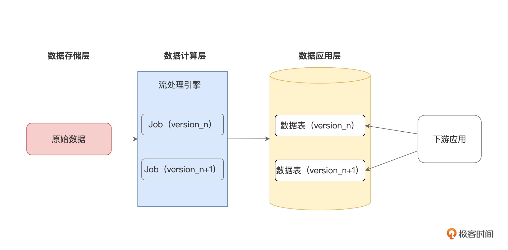
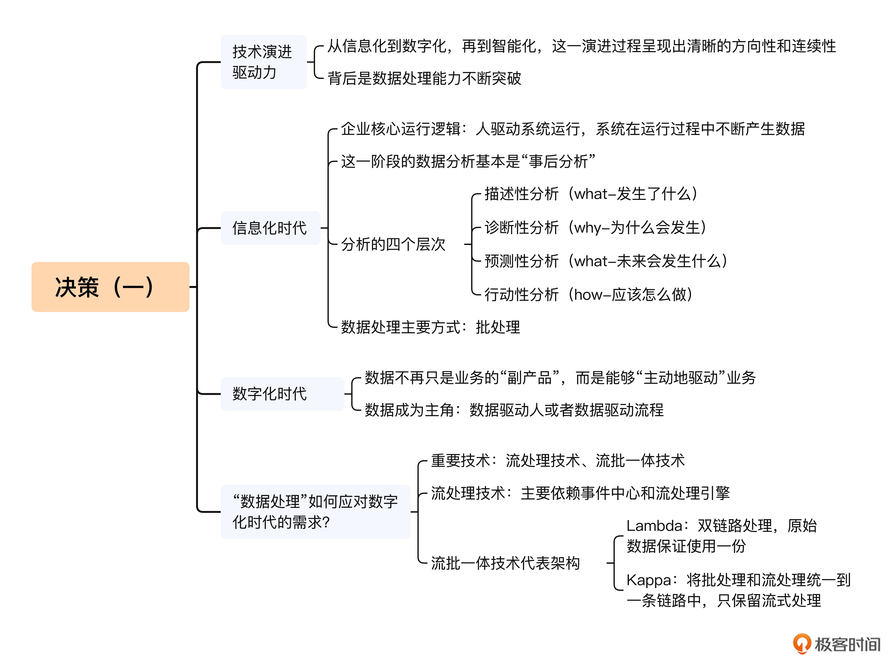

# 16 | 决策：如何落地企业的数字中枢

你好，我是灵犀。

我们在读历史书籍时，常常会被一些英雄人物的事迹所震撼，也不时会心生感慨：历史到底是被少数英雄人物所推动的，即“英雄造时势”，还是历史本身具有其内在的演进逻辑，英雄只是恰逢其时地站在了风口，即“时势造英雄”呢？

同样的逻辑其实也适用于技术领域。你是否曾思考过，是数据中台的出现催生了数字化时代的到来吗？大模型的诞生是偶然的，还是历史趋势下的必然产物呢？

## 技术演进的驱动力是什么？

我们可以用一个类比简单解答一下。技术发展的整体趋势，就像一条奔涌向前的大江大河，而那些不断涌现的新技术，则像是江河中跃动的浪花。它们绚丽多彩、夺人眼目。但是，真正决定江河走向的，还是地势、河床等深层力量，而非某一朵“浪花”。

在由计算机引发的信息化浪潮中，我们也能够清晰地看到一个发展趋势：从信息化到数字化，再到智能化，这一演进过程呈现出清晰的方向性和连续性。

而推动这一趋势的，也并非某一项技术的单独突破，而是源自一种更根本的驱动力——数据、算力与算法三者相融合，共同催生出日益增强的机器智能。

简而言之，这是一场数据处理能力不断突破的演进过程。因为，从数据的角度看，无论是关系型数据库中的表、列式数据库中的列、MapReduce 中的 Map 和 Reduce、Spark 中的RDD、流式处理中的流，还是 AI 中的各种算法模型，本质上都是对数据的不同“组织和计算方式”，其核心目标都是提升特定场景下的数据处理能力。

在这个过程中，各种技术的出现，都是这一趋势发展的自然结果。无论是数据中台、大模型，还是云计算、智能体……它们更像是这条奔涌长河中的朵朵浪花，只是加快了河流的流动，但并非“河流”本身。

在接下来的两节课中，我们就来深入探讨信息化到数字化、再到智能化背后的演进逻辑。

## 总体阐述脉络

在进入对信息化、数字化和智能化的具体探讨之前，我先对后面的阐述思路做一个整体说明，帮助大家建立起一个清晰的框架。

因为，信息化、数字化与智能化这三个概念，不但内涵丰富，外延也非常广泛，它们并不仅仅是一些技术术语，更是企业在运营模式、管理理念等多个维度的呈现。就像透过一块多棱镜观察世界，从不同的角度可以看到截然不同的风景一样，当我们以不同的视角切入这三个概念时，也会发现它们呈现出多样化的面貌。

所以为了让你更容易理解，我选择从两个核心维度切入，尝试探讨其发展脉络与内在逻辑。

一是业务运行逻辑的演进路径。从信息化到数字化，再到智能化，这三个阶段实际上代表了企业在业务运行逻辑上的三次跃迁，这种跃迁的关键点在于，逐步降低人在信息流转过程中的决策比例，增加机器决策的占比，让信息自动流转的效率更高。

我们将分别探讨这三个阶段的核心业务运行逻辑，并通过介绍每种逻辑所代表的典型案例，帮助大家理解这种演变的内涵。

二是数据处理能力的变革驱动。推动信息化、数字化与智能化不断向前发展的核心驱动力，是数据处理能力的不断提升。这种能力主要体现在数据的组织方式、计算引擎、算法创新等层面上。

我们将沿着这一技术演进的主线，探讨数据处理能力如何为业务模式的升级提供支撑，并最终推动企业向更高层次的智能化迈进。

我们先来探讨一下信息化到数字化的演进历程。

## 信息化时代

在信息化时代，企业的核心运行逻辑是：人驱动系统运行，系统在运行过程中不断产生数据。

这些数据经过整理和分析后，能够辅助管理层进行管理决策和业务优化。但需要注意的是，这一阶段的数据分析基本是“事后分析”，即基于已经发生的业务行为进行回溯性分析，无法实时应用于日常业务流程中。

这一阶段的数据分析，可以根据其对业务的影响程度，分为四个层次。

### 一、描述性分析（what- 发生了什么）

这是数据分析的初级阶段，核心目标是通过对历史数据的汇总、分类与可视化，帮助业务来了解当前业务的状态和趋势。

例如，在资管公司中，常见的描述性分析包括客户开户数量与分布、投资组合的收益波动情况和渠道销售的占比与排名等。

这些分析内容通常以报表、图表、仪表盘等形式呈现，帮助业务快速掌握关键业务指标，回答“我们做了什么、发生了什么”。

### 二、诊断性分析（why- 为什么会发生）

在这一阶段，数据分析从“现象描述”进一步深入到“原因挖掘”，通过构建统计模型，进行相关性分析、因果推断或归因分析，揭示数据背后的变化逻辑和关键影响因素。

例如，某只基金的净值在某季度大幅下跌，是由于市场整体下跌，还是基金经理的调仓失误？某渠道的销售转化率下降，是由于营销内容吸引力不足，还是客户体验流程存在瓶颈？

通过诊断性分析，可以还原业务变化过程，识别关键驱动因素，从而为后续的业务调整提供更具依据的判断。

### 三、预测性分析（what- 未来会发生什么）

在这一阶段，数据分析的目标转向对未来趋势的预测，通过对历史数据的建模，企业可以提前预判关键业务指标的变化趋势，以防患于未然。

例如，在资管行业中，这类预测性指标具有非常广泛的应用。事实上，投资经理工作的核心之一，就是预测资产未来在市场中的表现。常见的指标包括预测下季度某类基金的申购量、预测客户流失率、预测某只基金在特定市场环境下的净值表现等。

通过预测性分析，是业务从“回顾过去”向“谋划未来”迈进的重要一步。

### 四、行动性分析（how- 应该怎么做）

如果说前三类分析都是过程，那么行动性分析的目标是基于分析结果提出具体、可执行的业务建议，实现从“知道什么会发生”到“知道该如何应对”的跨越。

还是以资管公司为例，这类分析包括基于预测结果，制定营销策略调整方案、根据客户行为预测，优化投顾服务流程、根据市场趋势，调整基金持仓结构等。

通过行动性分析，企业开始可以将数据逐步转化为决策。

在探讨完信息化时代所支撑的四类数据分析之后，我们接下来简单看一下，为了实现这些分析，“数据处理”应该如何支撑？

由于这些分析主要基于历史数据，属于“事后分析”，因此其数据处理模式以“批处理”为主。

在具体实现中，批处理的计算引擎通常采用 MapReduce 或 Spark，它们可以与底层的 HDFS存储层无缝对接，构成一个灵活可扩展的数据处理平台。

同时，为了便于业务人员进行数据分析，通常会在这一平台上通过 HiveQL 或 Spark SQL 进行查询与建模。

## 数字化时代

随着信息化的不断发展，企业积累了海量的历史数据。在这个过程中，一个根本性的认知也在发生改变——数据不再只是业务的“副产品”，而逐渐演变为一种具有“主动驱动”能力的核心资源。

换句话说，数据不再只是“被动地反映”业务，而是能够“主动地驱动”业务。这一转变，代表着企业从“信息化”迈向“数字化”的关键突破。

通过下图可以清晰看到，从信息化到数字化时代，最大的变化在于数据与人、流程之间的角色发生了根本性反转。

在信息化时代，不管是对人、还是流程，数据都处于被动的角色，人是主角。而到了数据化时代，数据成了主角，人和流程则围绕数据进行协同与响应。

“数据驱动”开始成为企业业务运行的一种核心逻辑，我们可以将“数据驱动”归纳为以下两种主要形式。

一种是数据驱动人。在这种模式中，人仍然是流程的一部分，但不再是决策主体。数据在流程中扮演“指挥官”的角色，通过预警、推荐、提示等方式，引导人做出更高效、精准的决策。

我们在前面课程中提到的“事件驱动”机制，就是这种模式的典型体现。例如，在资管公司中，产品波动、市场变化等都可以通过事件实时监测，并在关键节点驱动投资经理或运营人员做出反应。

另一种则是数据驱动流程。在这种模式中，人完全退出决策环节，整个流程由数据串联并自动执行。

这类案例在资管领域应用也非常广泛。例如，风控系统中的异常交易拦截，在交易过程中，系统根据实时数据判断是否为异常行为，实现毫秒级拦截；推荐系统中的即时个性化展示，根据客户历史行为、市场行情等实时信息，动态调整推荐内容。

总体而言，无论是数据驱动人还是数据驱动流程，数据都已经深度嵌入到业务流程中，成为不可或缺的组成部分。通过数据的流动，可以显著降低人参与决策的比例，大幅提升信息流转的效率。

接下来，我们再来探讨一下“数据处理”如何应对数字化时代的需求。显然，传统信息化时代所依赖的“批处理”方式，已难以满足当前对实时性的要求。因此，随着业务场景的演变，“流处理”技术应运而生。它围绕“事件”进行处理，逐渐成为数据驱动业务的核心引擎。

如果将“批处理”理解为在固定数据集上执行流动的计算任务，任务执行完成就退出。那么“流处理”则是针对持续流动的数据，应用固定的计算逻辑进行处理，由于这种计算任务需要持续运行，因此通常在后台以常驻服务的方式运行。

流处理技术主要依赖两个核心组件，事件中心和流处理引擎。事件中心负责数据的收集与分发，通常使用 Kafka、RabbitMQ 或 Pulsar 等工具实现；而流处理引擎则负责数据的实时计算，常用的有 Storm、Flink 等。

可以看到，支撑信息化和数字化时代的数据处理技术分别是批处理和流处理技术。起初，两者是两条不同的技术路线。

因为，各自具有不同的优势和适用场景。流处理以低延迟、实时性强为特点，可以对每一条到来的数据立即进行处理。但由于其处理的是无界数据流，很难判断结果的最终状态。而批处理则在准确性方面表现优异，适合处理有界数据集，但处理延迟较高，难以满足实时业务需求。

但是，所谓“有分就有合”，流批一体技术逐步成熟之后成为主流趋势。在这一过程中，出现了两种代表性的架构模式。

1. Lambda 架构

Lambda 架构采用双链路处理的思路。一条链路中，利用流处理快速生成近似结果，满足实时性需求。另一条链路中，则通过批处理最终实现数据的准确性和一致性。

Lambda 的核心思想是原始数据保证使用一份，无论流处理还是批处理，都是对同一份原始数据的分析。

然而，该架构也存在一个显著的缺点，由于需要同时维护两套处理链路，意味着程序需要编写两份、计算资源消耗也翻倍。

基于这些挑战，Kappa 架构应运而生，提出了“流批一体”的新思路。

2. Kappa 架构

Kappa 架构对 Lambda 架构进行了简化，将批处理和流处理统一到一条链路中，只保留流式处理，不再单独设立批处理层。

那么，如何满足原来批处理的准确性需求呢？Kappa 架构通过多版本视图的方式实现。如果需要对数据逻辑进行修改，或者对历史数据重新处理，可以从上游日志进行重放。

重放完成后，会生成一份新的视图结果。在此期间，用户仍可访问旧版本的结果，一旦新版本完成追赶，就能切换查询源，旧版本处理流程即可停止。

## 总结

这节课中，我们先是探讨了从信息化到数字化时代业务运行逻辑的演进路径。简单来说，就是从“人当主角”逐渐转变为“数据成为主角”。道理也很简单，数据驱动可以实现更高程度的自动化，从而降本增效。

随后，我们探讨了这种运行逻辑背后的驱动力量：本质是“批处理”到“流处理”数据处理能力的转变。

其实，每一种被广泛采用的技术背后，都蕴含着更深层次的思维方式。为了帮助大家更好地理解“批处理”与“流处理”，我们可以拿一个类比来进行说明，它们与人类历史上微积分诞生时带来的转变非常相似。

在微积分出现之前，数学只能用来描述和计算静态世界。而微积分的出现，让人类第一次系统地掌握了变化的规律，从而打开了动态世界的理解之门。

在牛顿的微积分中，他提出了“流数”与“流量”这两个核心概念。其中，“流数”代表的是“变化的过程”，就像流处理中对实时数据的处理。而“流量”则代表的是“变化的积累”，类似于批处理中对数据总量的处理。

可以看到，流处理关注的是“动”，而批处理关注的是“静”。但实际上，两者很难真正分离。

例如，MapReduce 是一个典型的批处理引擎，但它在执行过程中，仍然是逐条数据处理的；而 Spark Streaming 虽然是流处理引擎，却也使用了“微批”的技术来提升效率。

这就像微积分中的“微分”与“积分”，看似是两个方向，实则是一个动态过程的两个方面。同样地，流处理与批处理，同样可以看作是数据处理的“一体两面”，它们本身不是目的，而都是试图从数据中发现更大的价值的工具。

因此，在面对各种令人眼花缭乱的批处理、流处理等平台时，有时候我们需要跳出技术框架给我们设定的约束，始终从业务的本质出发，从“数据叙事”的更高视角去看待数据，这是数字化时代架构师更需具备的能力。

最后，智能化时代下，业务运行逻辑和数据处理方式又将如何进一步演进呢？我们将在下一节课中继续探讨这个话题。

## 思考题

在这节课探讨数字化的业务运行逻辑时，提到了两种典型的“数据驱动”模式：数据驱动人和数据驱动流程。结合你的经验，你认为还存在哪些好的数据驱动模式？

期待你在留言区和我交流探讨，如果这节课对你有启发，别忘了分享给身边更多朋友。
