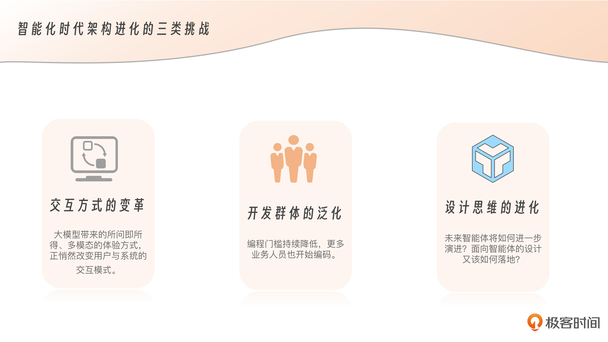
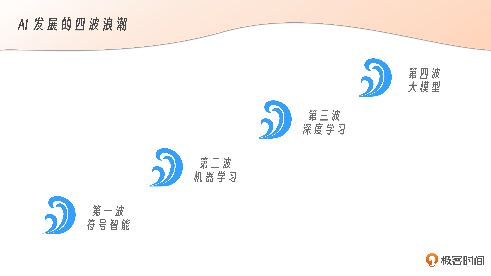
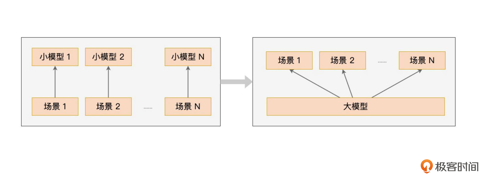
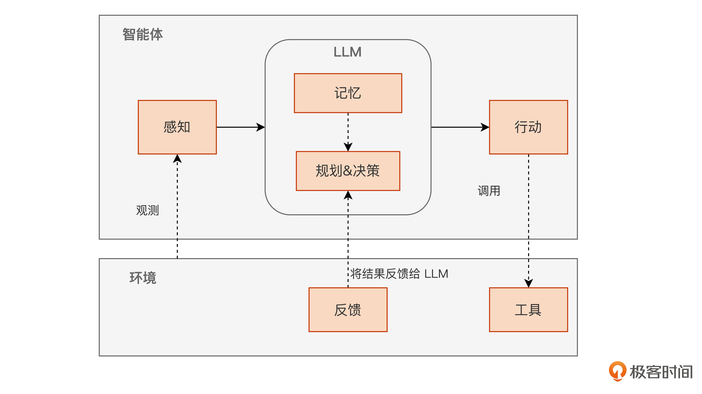
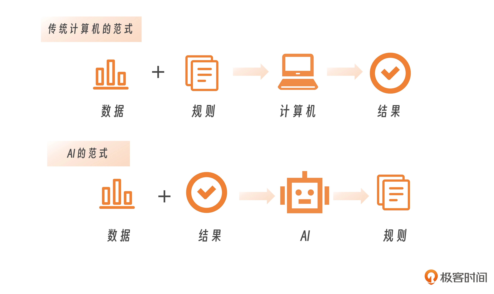
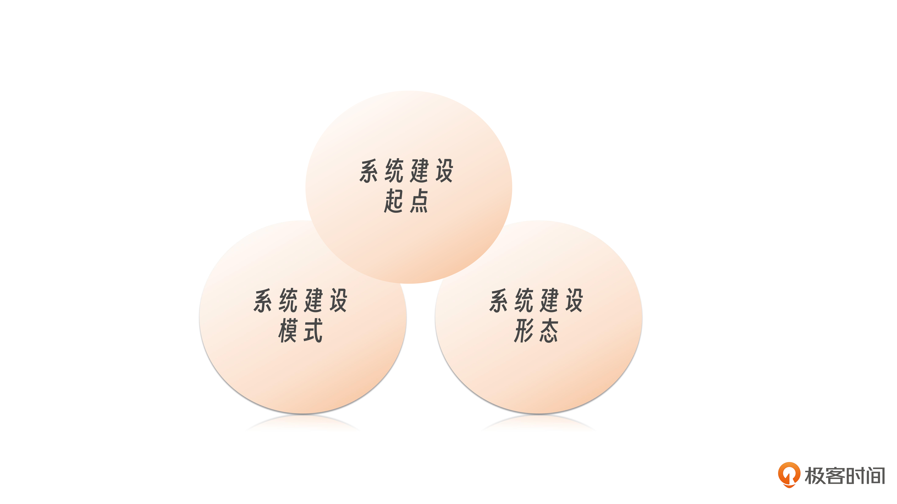
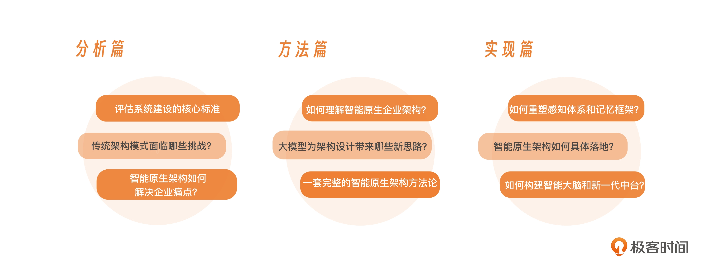
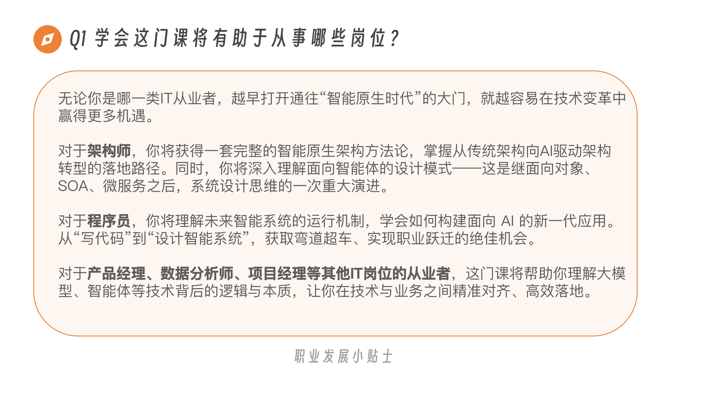
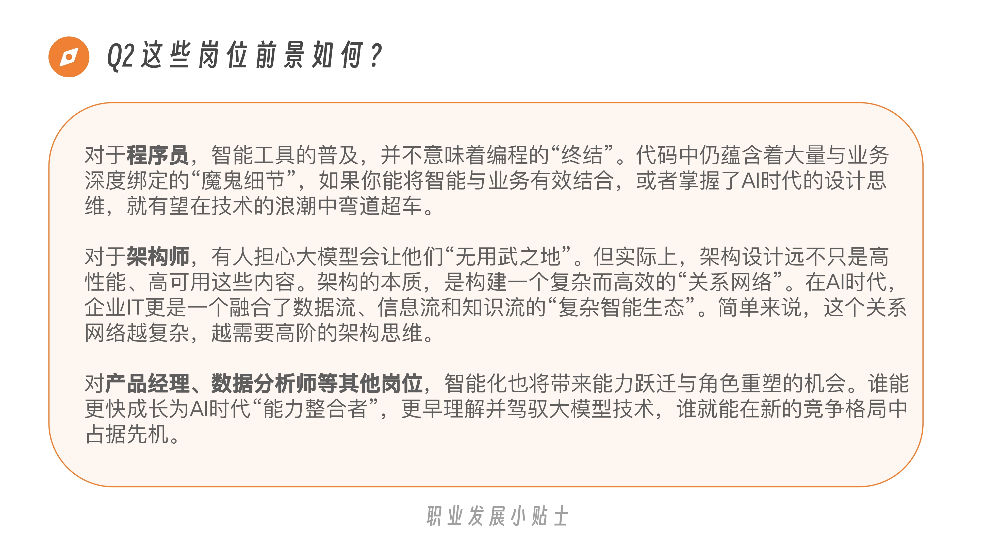

# 开篇词 | 智能化时代，你需要什么样的架构？

你好，我是灵犀。

先简单介绍一下我自己。我 2011 年毕业开始工作，2015 年左右开始担任架构师，负责过支付、政务、资管领域等多个大型项目的架构设计。在我看来，架构师就像是数字世界的“建筑师”，这份工作也让我逐渐领悟到一个底层逻辑，搭建系统和构建任何一个知识体系其实是相通的。同时也是源于对技术的热爱，我在 AI、大数据、云原生等许多领域都积累了扎实的专业能力。

2022 年，ChatGPT 横空出世，由它引发的这一轮智能技术革命，影响力远超预期。一个最直观的变化是，企业里的每个人都明显忙碌了很多，大家都在积极探索自身工作与大模型的结合点，生怕在这场变革中落后。

目前，我在公司里负责的是企业顶层规划工作，当前工作的重点就是研究大模型带来的业务模式变革，进而规划企业架构未来的方向。说实话，我在 AI 上的积累为这项工作带来了不少帮助。在这门课程里，我会将大模型给我带来的一些启发、它对业务运行模式和架构的重塑，以及很多实战中的干货经验和你分享。

可能不少人会有疑问，大模型也好，智能体也罢，不就是一项新技术吗？其实并非这么简单。这场变革不仅体现在技术层面，更在组织形态、架构理念和研发模式上带来了前所未有的挑战。

## 智能化时代架构进化的三类挑战

在这场变革中，架构师也要面对一系列前所未有的新课题，最主要的是下面这三类挑战。

第一，交互方式的变革。大模型所带来的所问即所得、多模态的体验方式，正在悄然改变用户与系统的交互模式。这种新型交互是否只是前端界面的一次局部优化？还是将引发从界面设计到后端服务、数据乃至整体架构范式的深层次重构？

第二，开发群体的泛化。编程门槛持续降低，越来越多的业务人员也开始编码。那这些“新开发者”与原开发者的边界在哪里？又需要构建什么样的新研发模式？此外，研发内容会有哪些大的改变，程序员还会“岁月静好”，呆在 MVC 框定的“舒适圈”里吗？

第三，设计思维的进化。智能体作为一种新兴的应用形态，正推动一系列相关技术的发展，如MCP、A2A 以及 DataAgent、DeepResearch 等应用模式。然而，其更大的价值在于对系统设计思维带来的变革，这一变革是继面向对象和微服务之后的又一次重大突破。那么，未来智能体将如何进一步演进？面向智能体的设计又该如何落地？

这些问题背后，其实都在指向一个更深层次的趋势：企业的叙事逻辑正在从“数字原生”向“智能原生”演进。

## 大模型的“核心三问”

如何理解 “智能原生” 呢？这里我先用一个比喻简单说明一下：假如把企业比作一条高速公路，那么各类系统就像是行驶在这条路上的车辆。

“数字原生” 类似于“导航驾驶模式”。导航体系能够实时收集路况、车况等信息，并通过数据驱动的方式指引车辆如何更快到达目的地，但车辆的决策权仍然由人来掌控。

而 “智能原生” 则更进一步，它就像车辆升级成了“智能驾驶模式”，从而车辆能自主观察路况、判断环境、做出决策，整个公路的运转大大减轻人的依赖，实现了更自主、高效的协同。

那么，为什么大模型出现之后才让“智能原生”变得真正可行呢？

要知道，AI 并非新事物，许多企业早已在不少业务场景中引入 AI 技术。那相比前几波 AI 热潮，为何这次的影响更为深远？

想要解决这个疑问，我们需要先想清楚下面这几件事儿。

- 大模型的本质是什么？

- 大模型能够改变什么？

- AI 的思维范式是什么？

### 大模型的本质

自 AI 诞生以来，其发展历程大致可分为四波浪潮。通过对比每一波浪潮中智能涌现的底层逻辑，能帮助我们更好理解大模型的本质。

第一波浪潮：符号智能

这一阶段的底层逻辑是逻辑推理，第一代 AI 学者试图将大脑的认知提炼成算法，“自上而下”一劳永逸地实现通用智能，这条路还未行通。

第二波浪潮：机器学习

这一阶段的底层逻辑是“自下而上”的学习，从数据中挖掘规律。相比符号智能，这种方法更像人类自身的成长方式，但其智能受限于特定场景。

第三波浪潮：深度学习

这一阶段的底层逻辑是在高维空间中进行数据拟合。深度学习在图像识别、自然语言处理等领域取得了突破性进展。然而，其依然缺乏泛化能力。

第四波浪潮：大模型

这一阶段的底层逻辑是“原子化”。当前的大模型又尝试重新探索“通用智能”的可能性。它的核心思路是通过数据构建更基础的语义单元——“Token”。

这些 Token，可以看作是大模型世界中的“原子”，正如现实世界中万物皆由原子构成。通过这些基础单元之间的组合与交互，智能得以“涌现”。

这种本质上的差异也带来模型构建上的不同。在大模型之前，我们通常针对每个业务场景中的数据去训练专用小模型。这些小模型虽在特定场景表现不错，但缺乏泛化和迁移能力，呈现出“烟囱式”、“碎片化”特征。

而大模型则依托于海量的跨领域数据进行预训练，先形成一个具备广泛认知能力的通用模型。随后，再通过微调或提示灵活适配多业务场景，展现出强大的适应性。

这种“先通用、后专用”的构建思路，对架构设计也带来了深刻启发。当前，我们许多系统是基于一个个业务流程来建设的，很像是一个个“小模型”，也呈现出“烟囱式”等特征。

那么，能否借鉴大模型“Token 原子化”的思想，为系统设计提供一些新思路？答案是肯定的。在后续课程中，我将提出“实体 Token”这个概念，为中台建设提供新模式。

### 大模型能够改变什么？

关于第二个问题，就不得不提到大模型给“智能体”这一概念带来的深刻变革。

大模型的强大之处在于，它让一个非生命体竟然具备了某种程度的“自主性”与“智能性”，这也启发我们重新审视企业中各类系统的本质与潜力。

因为，如果从智能体的维度来看，架构规划下的各个系统，其实也都可视为具备一定功能的“非生命智能体”。那么，在大模型的加持之下，这些系统是否也能够呈现出新的潜能呢？

答案是肯定的！接下来，我将从智能体的四个关键维度——感知、记忆、决策、行动，聊一聊它们对系统架构设计的潜在影响。

### 1. 感知方面

从系统视角看，“感知”是指系统核心服务与数据与外界交互的过程，可以从感知通路和感知方向两个维度来理解。

- 如果说传统的系统感知方式是一种“平面化”的输入响应机制，如前端

首先，感知通路方面。界面、API 接口等。那么，在当前智能技术驱动下，系统正逐步具备一种“立体化”的多维感知能力，如问答式、多模态等。

其次，感知方向方面。系统的感知也将由“被动感知”向“主动感知”转变。当前系统多是只有在用户点击、接口调用等外部触发时才会做出响应。而现在的智能体都已经能够根据自身需求，主动获取信息、识别变化、发起交互。

这也启发我们，应当为系统赋予主动感知机制，推动其从“被动响应”向“主动服务”演进，更智能高效地完成任务。

### 2. 记忆方面

“记忆”可以理解为企业中的数据。目前企业中存在的一个突出问题是：这些 “记忆” 被按照应用维度分割成了一个个独立的数据空间。这种“数据孤岛”现象，使得数据难以通过关联进行“升维”，只能陷在“低维”的局部视图里，制约了数据协同的价值。

这一困境或许能从大模型中获得启发。大模型凭借“注意力机制”突破了传统算法的 “记忆” 局限性。传统算法通常只能记住短距离中词与词之间的关联，而大模型则能在更广空间进行连接，构建连贯的上下文记忆，从而实现更高质量的文本输出。

这为企业系统的“记忆”机制重构提供了重要启示：我们需要重新思考和设计系统的记忆能力，不只是让系统“记住更多”，更要能“连接更多”，从而获得更深入的业务洞察。

### 3. 决策方面

决策本质上是基于感知与数据形成认知之后的判断能力。在信息化时代，企业开始借助 BI 分析历史数据来辅助决策，但人始终还是主角。

到了数字化时代，伴随大数据技术的逐步成熟，数据开始成为驱动业务运转的主角，由此实现了从 “事后分析” 向 “实时决策” 的关键跃迁。

那么，进入智能化时代，主角又将发生怎样的转变？核心业务模式又将演进成什么形态？

### 4. 行动方面

“行动”是系统中承载实际业务功能的核心逻辑。无论决策是由人、数据还是模型完成，最终还需要通过“行动”来落地执行。在大模型的浪潮下，这部分也正在发生深刻变革。

一方面传统系统建设将从“封闭式”开发模式，转向“业务 + 科技”协同共建的新模式；另一方面随着业务创新节奏的进一步加快，传统大而全的“重应用”，也将向结构灵活、响应迅速的“轻应用”转型。

面对这些变化，传统的多层架构显然已无法满足需求。那么，新的架构模式该如何设计，才能适配新的协作方式与转型趋势？

### AI 思维范式如何影响未来的架构

第三个要讨论的是 AI 思维范式对未来架构的影响。我们首先需要关注大模型对传统计算机思维范式的突破与重构。

1. 传统计算机的范式：规则驱动的确定性

在传统计算机系统中，我们遵循的是一个“规则驱动”的范式：

- 数据 + 规则 → 计算机 → 结果

这里的“规则”，是由程序员基于业务逻辑编写的一组确定性指令。这种方式适用于那些边界清晰、流程可预设的场景。

2.AI 的范式：结果驱动的不确定性

而 AI，特别是大模型所带来的思维方式完全不同，它是一种“结果驱动”的范式：

- 数据 + 结果 → AI → 规则

AI 并不依赖程序员显式编写规则，而是通过大量历史数据，让模型自行学习出潜在的规则。这些规则往往是复杂、隐式、甚至人类难以理解的，但在预测、推理等任务中却表现出惊人的效果。

这种范式打破了传统程序的确定性边界，引入了不确定性，也让系统有了动态的适应能力，适合处理那些“流程无法预设”的任务。

这种思维范式也为我们提供了新思路：系统设计可以从“结果”出发，而不是局限于预设的流程。系统可以通过试错与学习，动态规划路径、调整策略，最终达成目标。

这一转变正在为企业系统建设打开一片新的空间。而在这个方向上，智能体技术将展现出巨大的潜力。

## 架构应如何向智能方向演进？

总结一下前面的“核心三问”，我们第一个问题关注的是系统建设模式上的转变；第二个问题则揭示了系统应该向“智能体”演进，这本质上是对系统建设形态的重新定义；而第三个问题强调的则是系统建设起点发生的变化。

为了顺应这样的变化，智能原生架构在系统建设起点、建设模式与建设形态三个方面，都将面对深刻的变革与升级。

## 课程安排

既然架构向着“智能原生”演化是必然趋势，那么具体应该从哪些方面入手？有哪些架构方法、设计原则等需要相应调整？落地过程中又有哪些最佳实践呢？

说实话，关于上面这些话题，很容易陷入“讲得大、说得虚”的困境，看起来高大上，但离真正落地还有很大距离。

但是这门课程，我希望给你分享的绝不是空架子，而是自己在实践“智能原生架构”过程中，真实遇到的问题、总结出来的思路和做法，目的只有一个：让大家看完以后觉得这事儿不是纸上谈兵，而是可以干，也能干成。

接下来我们就来看看课程是如何安排的。

第一部分：分析篇

无论是数字原生还是智能原生架构，其核心都是提供系统建设的方向与方法。尽管架构不断演进，评估系统建设的核心标准其实始终聚焦于两个维度——业务响应力与业务体验性。

这一章将围绕这两个核心维度，系统分析传统架构模式下企业面临的主要挑战，并探讨智能原生架构的相应解决思路。

第二部分：方法篇

基于问题分析，我们将从方法论层面提出一套面向智能原生架构的框架。因为，如果以智能原生为标准，TOGAF、DDD 等传统架构方法论都需要扩展与重构。

因此，在这部分内容中，你将收获一套基于实战经验的新架构框架重构思路，不仅能给你带来多维度启发，也能解决传统架构的普遍痛点问题。

- 业务架构：借鉴大模型 “Token” 衍生的 “实体 Token” 概念，为业务中台建设提供全新模式。

- 应用架构：面向智能体设计的探索，或许能启发你跳出当前技术框架的约束，从方法层面真正掌握这一新设计思维。

- 数据架构：“以价值为导向” 的设计方法，将破解过去 “以应用为导向” 导致的数据孤岛等难题，让数据成为核心驱动力。

第三部分：实现篇

在方法篇之后，实现篇深入到具体实践层面，探讨在智能原生时代如何应对系统建设中的现实难题，答案就在于——所有系统都应该像智能体一样。

没错！不论是传统架构下的微服务还是中台，或是整个企业 IT 体系，各个层级的“系统”都应由“工具”属性向“拟人化智能体”演进，这也是大模型带来的最深刻的系统思维变革。

因此，这一章也将从智能体的感知、记忆、决策和行动四个维度出发，结合分析篇中提出的核心挑战，探讨如何用面向智能体的设计解决这些问题。

最后，这门课的撰写也是一次深入学习与开放交流的过程。极客时间的读者中，有很多来自一线的资深架构师和技术专家。我也非常期待通过这次分享，激发更多思想碰撞，共同探索一条面向智能原生架构设计的可行之路！

