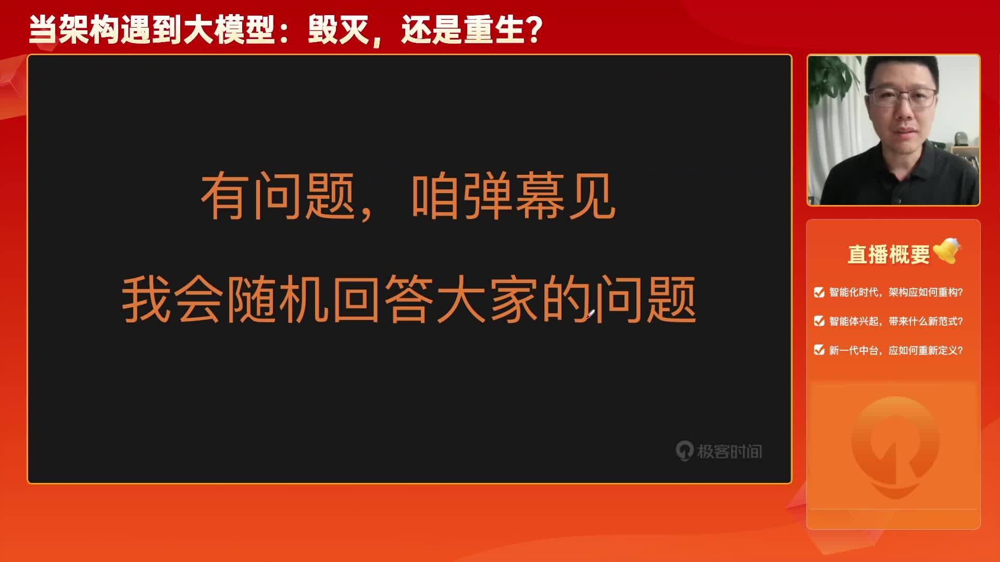

# 直播回放 | 当架构遇到大模型：毁灭，还是重生

本次直播，你将获得：

- 智能化时代，架构应如何重构？

- 智能体兴起，带来什么新范式？

- 新一代中台，应如何重新定义？

### 技术演进的本质

人类技术发展经历了六个时代，核心驱动力是技术本身，而非业务。

技术演进的两个关键维度是工具与链接。

- 工具趋势：算力需求越来越高、智能程度不断提升（从简单机械到可感知、学习、决策的智能体）。

- 链接趋势：信息流转速度加快、主动性增强（从人驱动到数据 / 智能自主驱动）。

技术的本质是重塑人与工具、工具与工具之间的信息流关系。

### 架构与智能化的融合

智能化的本质是“工具自主驱动”，取代人类执行任务。企业架构的本质同样是构建人与虚拟工具（微服务、数据、系统等）之间的关系网络。二者本质一致，均为信息流交互，因此可以融合形成智能原生架构。

智能原生架构的目标是将高阶知识型信息流（由大模型携带）融入传统低阶数据 / 指令流中，统一规划信息的产生、转化与处理。

### 大模型对架构的影响：重生而非毁灭

- 面对“大模型是否毁灭架构”的争议，观点为：架构迎来重生。

- 理由：智能化使系统关系网络更复杂（如现代化城市 vs 贫民窟），架构设计难度提升，架构师价值反而增大。

### 传统架构的痛点分析

- 业务响应力问题：研发门槛高、能力复用弱、变更影响大 → 根源在于软件形态、封闭开发、模块化不足。

- 业务体验性问题：交互体验落后、数字化深度不足、智能化不足 → 归结为信息流中的冗余、断点与摩擦。

### 智能原生架构方法论（四维框架重构）

尽管仍采用业务、应用、数据、技术四层架构，但各层均进行重构：

- 业务架构：融合通用思想，提出新型业务中台建设思路。

- 应用架构：引入智能体为核心单元，反思微服务本质，提出面向智能体的设计理念。

- 数据架构：提出双层价值模型，转向以价值为导向的设计，打破数据孤岛。

- 技术架构：强调思想误区剖析，如数字化落地效果差的原因。

### 智能体的本质与设计范式

智能体定义：将感知、决策、执行三阶段无缝串联，核心是决策（不限于大模型）。

智能体是概念，非技术绑定。即使未使用大模型（如推荐广告系统），只要具备感知 - 决策 -执行闭环，即为智能体。

面向智能体设计是一种设计范式演进：

- 从面向过程、面向对象、SOA/ 微服务到智能体，本质是“分而治之”（拆解 + 组合）。

- 智能体设计的作用层级更广，可应用于函数、应用、领域乃至整个生态。

- 这是一种深远的设计变革，将会影响所有层级。

### 新一代中台建设

### 业务中台

- 传统模式：从具体业务流程中抽象共性能力 → 导致烟囱式系统与信息孤岛。

- 新模式（受大模型启发）：先构建通用原子能力层，再支撑各专用场景。

- 核心转变：从“能力复用”到“能力生长性与滋养性”。

### 数据中台

- 传统问题：数据沦为应用架构的附庸。

- 大模型启发：打破“空间边界”概念（如 token 无边界）。

- 新思路：强调数据底层一致性，从源头保障主数据一致，避免后期转换摩擦。

- 设计原则：无边界思维应贯穿数据架构设计。

### 关键趋势与思想

- 叙事逻辑：从流程叙事转向数据叙事。

- 驱动逻辑：从人驱动 → 数据驱动 → 知识驱动（含模型驱动、目标驱动）。

- 处理模式：从批处理到流处理。

- 信息演进：从数据 → 信息 → 知识的转化是智能化关键。

### 架构演进策略

- 不应全盘推翻旧架构，而应逐步演进。

- 可选取主数据、跨系统共享数据等作为试点，验证新模式后再推广。

### 架构师的未来

- 新技能重点：理解智能体等新技术，但更应掌握其背后的设计思想。

- 核心能力：思想驱动设计，而非工具堆砌；深入理解业务逻辑与企业诉求。

- 职业前景：初级架构师不应恐慌，大模型无法替代对业务深度理解与架构思想融合的能力，架构师将更加稀缺。
