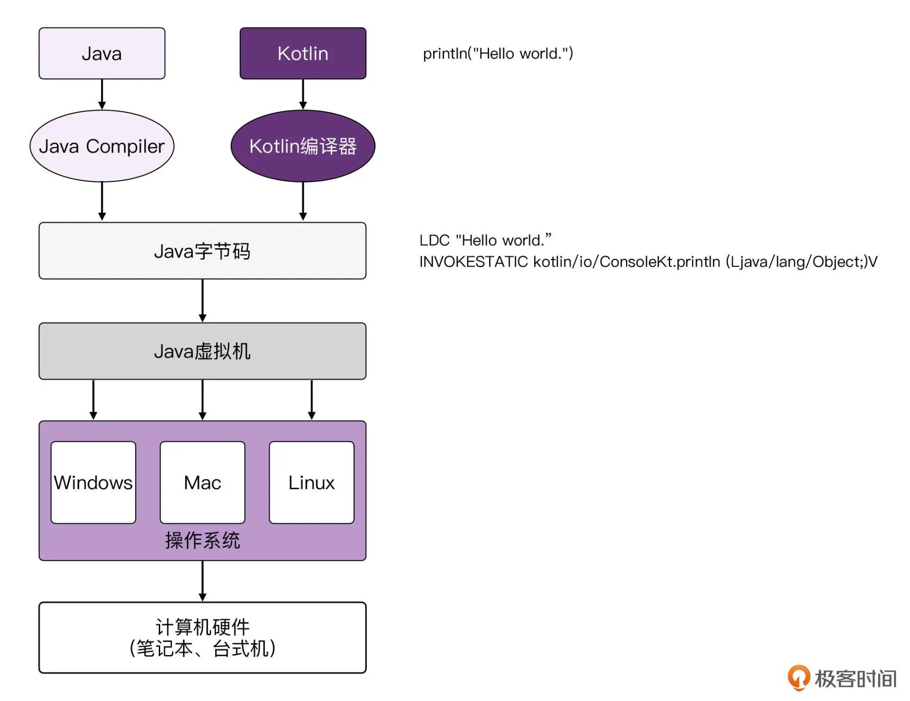
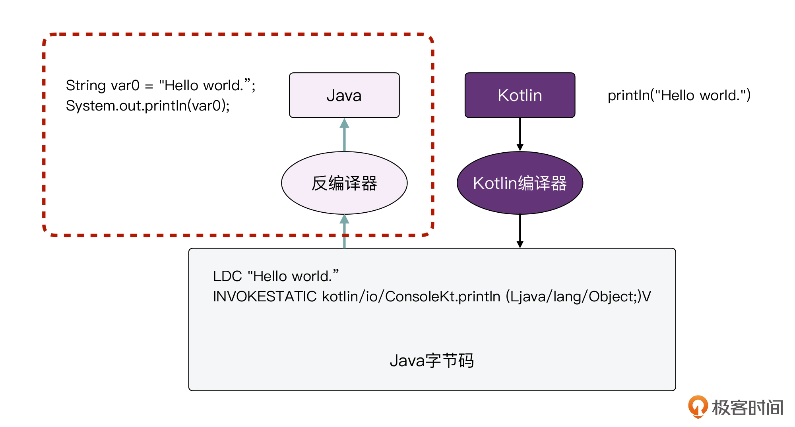
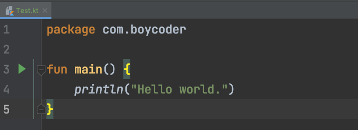
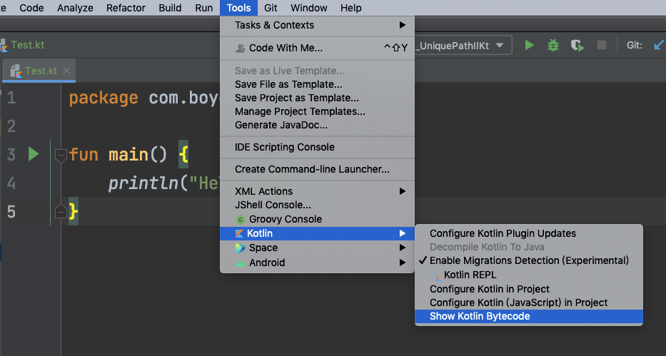
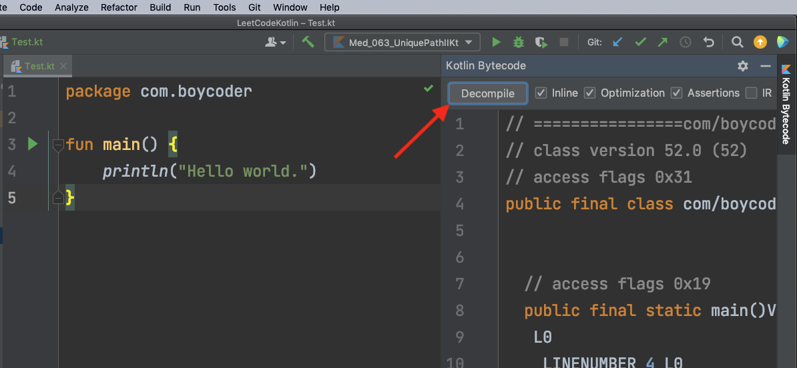
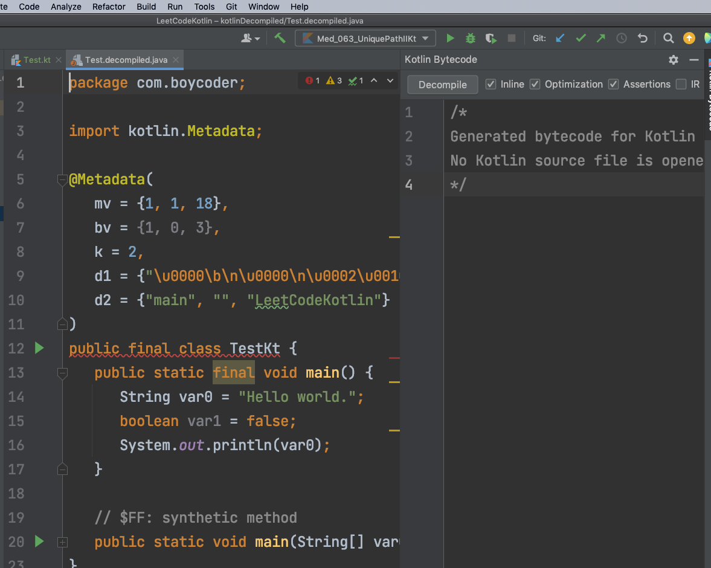
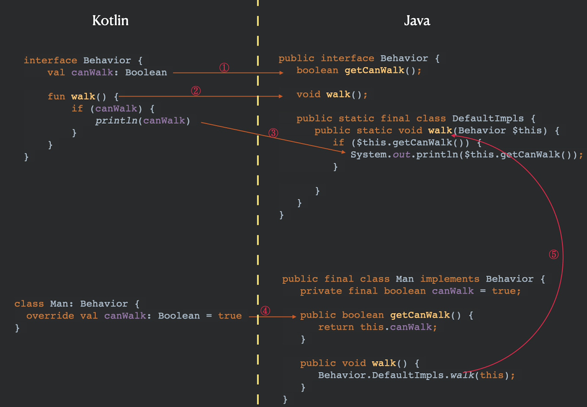
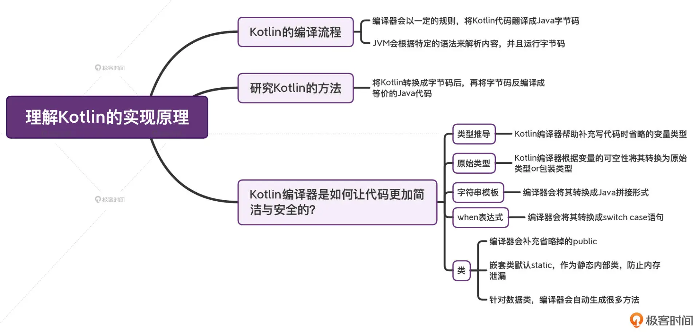

# 03-Kotlin原理：编译器在幕后干了哪些“好事”？

你好，我是朱涛。

在前面两节课里，我们学了不少 Kotlin 的语法，其中有些语法是和 Java 类似的，比如数字类型、字符串；也有些语法是 Kotlin 所独有的，比如数据类、密封类。另外，我们还知道 Kotlin和 Java 完全兼容，它们可以同时出现在一个代码工程当中，并且可以互相调用。

但是，这样就会引出一个问题：Java 是如何识别 Kotlin 的独有语法的呢？比如，Java 如何能够认识 Kotlin 里的“数据类”？

这就要从整个 Kotlin 的实现机制说起了。

所以，今天这节课，我会从 Kotlin 的编译流程出发，来带你探索这门语言的底层原理。在这个过程中，你会真正地理解，Kotlin 是如何在实现灵活、简洁的语法的同时，还做到了兼容 Java语言的。并且你在日后的学习和工作中，也可以根据今天所学的内容，来快速理解 Kotlin 的其他新特性。

## Kotlin 的编译流程

在介绍 Kotlin 的原理细节之前，我们先从宏观上看看它是如何运行在电脑上的，这其实就涉及到它的编译流程。

那么首先，你需要知道一件事情：你写出的 Kotlin 代码，电脑是无法直接理解的。即使是最简

```
单的println("Hello world.")，你将这行代码告诉电脑，它也是无法直接运行的。这是
```

因为，Kotlin 的语法是基于人类语言设计的，电脑没有人的思维，它只能理解二进制的 0 和1，不能理解 println 到底是什么东西。

因此，Kotlin 的代码在运行之前，要先经过编译（Compile）。举个例子，假如我们现在有一个简单的 Hello World 程序：

```
println("Hello world.")
```

经过编译以后，它会变成类似这样的东西：

```
LDC "Hello world."
INVOKESTATIC kotlin/io/ConsoleKt.println (Ljava/lang/Object;)V
```

上面两行代码，其实是 Java 的字节码。对，你没看错，Kotlin 代码经过编译后，最终会变成Java 字节码。这给人的感觉就像是：我说了一句中文，编译器将其翻译成了英文。而 Kotlin和 Java 能够兼容的原因也在于此，Java 和 Kotlin 本质上是在用同一种语言进行沟通。

英语被看作人类世界的通用语言，那么 Kotlin 和 Java 用的是什么语言呢？没错，它们用的就是 Java 字节码。Java 字节码并不是为人类设计的语言，它是专门给 JVM 执行的。

JVM，也被称作 Java 虚拟机，它拿到字节码后就可以解析出字节码的含义，并且在电脑里输

```
出打印“Hello World.”。所以，你可以先把 Java 虚拟机理解为一种执行环境。回想我们在
```

第一节课开头所安装的 JDK，就是为了安装 Java 的编译器和 Java 的运行环境。

不过现在，你可能会有点晕头转向，还是没有搞清楚 Kotlin 的这个编译流程具体是怎么回事儿，也不清楚 Kotlin 和 Java 之间到底是什么关系。别着急，我们一起来看看下面这张图：



这张图的内容其实非常直观，让我们从上到下，将整个过程再梳理一遍。

首先，我们写的 Kotlin 代码，编译器会以一定的规则将其翻译成 Java 字节码。这种字节码是专门为 JVM 而设计的，它的语法思想和汇编代码有点接近。

接着，JVM 拿到字节码以后，会根据特定的语法来解析其中的内容，理解其中的含义，并且让字节码运行起来。

那么，JVM 到底是如何让字节码运行起来的呢？其实，JVM 是建立在操作系统之上的一层抽象运行环境。举个简单的例子，Windows 系统当中的程序是无法直接在 Mac 上面运行的。但是，我们写的 Java 程序却能同时在 Windows、Mac、Linux 系统上运行，这就是因为 JVM 在其中起了作用。

JVM 定义了一套字节码规范，只要是符合这种规范的，都可以在 JVM 当中运行。至于 JVM是如何跟不同的操作系统打交道的，我们不管。

还有一个更形象的例子，JVM 就像是一个精通多国语言的翻译，我们只需要让 JVM 理解要做的事情，不管去哪个国家都不用关心，翻译会帮我们搞定剩下的事情。

最后，是计算机硬件。常见的计算机硬件包括台式机和笔记本电脑，这就是我们所熟知的东西了。

## 如何研究 Kotlin？

在了解了 Kotlin 的编译流程之后，其实我们很容易就能想到办法了。

第一种思路，直接研究 Kotlin 编译后的字节码。如果我们能学会 Java 字节码的语法规则，那么就可以从字节码的层面去分析 Kotlin 的实现细节了。不过，这种方法明显吃力不讨好，即使我们学会了 Java 字节码的语法规则，对于一些稍微复杂一点的代码，我们分析起来也会十分吃力。

因此，我们可以尝试另一种思路：将 Kotlin 转换成字节码后，再将字节码反编译成等价的Java 代码。最终，我们去分析等价的 Java 代码，通过这样的方式来理解 Kotlin 的实现细节。虽然这种方式不及字节码那样深入底层，但它的好处是足够直观，也方便我们去分析更复杂的代码逻辑。

这个过程看起来会有点绕，让我们用一个流程图来表示：



我们将其分为两个部分来看。先看红色虚线框外面的图，这是一个典型的 Kotlin 编译流程，Kotlin 代码变成了字节码。另一个部分，是红色虚线框内部的图，我们用反编译器将 Java 字节码翻译成 Java 代码。经过这样一个流程后，我们就能得到和 Kotlin 等价的 Java 代码。

```java
而这样，我们也可以得出这样一个结论，Kotlin 的“println”和 Java
的“System.out.println”是等价的。
println("Hello world.") /*
         编译
          ↓            */
LDC "Hello world."
INVOKESTATIC kotlin/io/ConsoleKt.println (Ljava/lang/Object;)V  /*
        反编译
          ↓            */
String var0 = "Hello world.";
System.out.println(var0);
```

好了，思想和流程我们都清楚了，具体我们应该要怎么做呢？有以下几个步骤。

第一步，打开我们要研究的 Kotlin 代码。



第二步，依次点击菜单栏：Tools -> Kotlin -> Show Kotlin Bytecode。



这时候，我们在右边的窗口中就可以看见 Kotlin 对应的字节码了。但这并不是我们想要的，所以要继续操作，将字节码转换成 Java 代码。

第三步，点击画面右边的“Decompile”按钮。



最后，我们就能看见反编译出来的 Java 文件“Test_decompiled.java”。显而易见，main 函数中的代码和我们前面所展示的是一致的：



OK，在知道如何研究 Kotlin 原理后，让我们来看一些实际的例子吧！

## Kotlin 里到底有没有“原始类型”？

不知道你还记不记得，之前我在第 1 讲中给你留过一个思考题：

- 虽然 Kotlin 在语法层面摒弃了“原始类型”，但有的时候为了性能考虑，我们确实需要用“原始类型”。这时候我们应该怎么办？

那么现在，我们已经知道了 Kotlin 与 Java 直接存在某种对应关系，所以要弄清楚这个问题，我们只需要知道“Kotlin 的 Long”与“Java long/Long”是否存在某种联系就可以了。

- 注意：Java 当中的 long 是原始类型，而 Long 是对象类型（包装类型）。

说做就做，我们以 Kotlin 的 Long 类型为例。

```javascript
// kotlin 代码
// 用 val 定义可为空、不可为空的Long，并且赋值
val a: Long = 1L
val b: Long? = 2L
// 用 var 定义可为空、不可为空的Long，并且赋值
var c: Long = 3L
var d: Long? = 4L
// 用 var 定义可为空的Long，先赋值，然后改为null
var e: Long? = 5L
e = null
// 用 val 定义可为空的Long，直接赋值null
val f: Long? = null
// 用 var 定义可为空的Long，先赋值null，然后赋值数字
var g: Long? = null
g = 6L
```

这段代码的思路，其实就是将 Kotlin 的 Long 类型可能的使用情况都列举出来，然后去研究代码对应的 Java 反编译代码，如下所示：

```
// 反编译后的 Java 代码
long a = 1L;
long b = 2L;
long c = 3L;
long d = 4L;
Long e = 5L;
e = (Long)null;
Long f = (Long)null;
Long g = (Long)null;
g = 6L;
```

可以看到，最终 a、b、c、d 被 Kotlin 转换成了 Java 的原始类型 long；而 e、f、g 被转换成了 Java 里的包装类型 Long。这里我们就来逐步分析一下：

- 对于变量 a、c 来说，它们两个的类型是不可为空的，所以无论如何都不能为 null，对于这种情况，Kotlin 编译器会直接将它们优化成原始类型。

- 对于变量 b、d 来说，它们两个的类型虽然是可能为空的，但是它的值不为 null，并且，编译器对上下文分析后发现，这两个变量也没有在别的地方被修改。这种情况，Kotlin 编译器也会将它们优化成原始类型。

- 对于变量 e、f、g 来说，不论它们是 val 还是 var，只要它们被赋值过 null，那么，Kotlin就无法对它们进行优化了。这背后的原因也很简单，Java 的原始类型不是对象，只有对象才能被赋值为 null。

我们可以用以下两个规律，来总结下 Kotlin 对基础类型的转换规则：

- 只要基础类型的变量可能为空，那么这个变量就会被转换成 Java 的包装类型。

- 反之，只要基础类型的变量不可能为空，那么这个变量就会被转换成 Java 的原始类型。

好，接着我们再来看看另外一个例子。

## 接口语法的局限性

我在上节课，带你了解了 Kotlin 面向对象编程中的“接口”这个概念，其中我给你留了一个问题，就是：

- 接口的“成员属性”，是 Kotlin 独有的。请问它的局限性在哪？

那么在这里，我们就通过这个问题，来分析下 Kotlin 接口语法的实现原理，从而找出它的局限性。下面给出的，是一段接口代码示例：

```
// Kotlin 代码
interface Behavior {
   // 接口内可以有成员属性
   val canWalk: Boolean
   // 接口方法的默认实现
   fun walk() {
       if (canWalk) {
           println(canWalk)
       }
   }
}
private fun testInterface() {
   val man = Man()
   man.walk()
}
```

那么，要解答这个问题，我们也要弄清楚 Kotlin 的这两个特性，转换成对应的 Java 代码是什么样的。

```java
// 等价的 Java 代码
public interface Behavior {
  // 接口属性变成了方法
  boolean getCanWalk();
  // 方法默认实现消失了
  void walk();
  // 多了一个静态内部类
  public static final class DefaultImpls {
     public static void walk(Behavior $this) {
        if ($this.getCanWalk()) {
           boolean var1 = $this.getCanWalk();
           System.out.println(var1);
        }
     }
  }
}
```

从上面的 Java 代码中我们能看出来，Kotlin 接口的“默认属性”canWalk，本质上并不是一个真正的属性，当它转换成 Java 以后，就变成了一个普通的接口方法 getCanWalk()。

另外，Kotlin 接口的“方法默认实现”，它本质上也没有直接提供实现的代码。对应的，它只是在接口当中定义了一个静态内部类“DefaultImpls”，然后将默认实现的代码放到了静态内部类当中去了。

我们能看到，Kotlin 的新特性，最终被转换成了一种 Java 能认识的语法。

我们再具体来看看接口使用的细节：

```python
// Kotlin 代码
class Man: Behavior {
   override val canWalk: Boolean = true
}
```

以上代码中，我们定义了一个 Man 类，它实现了 Behavior 接口，与此同时它也重写了canWalk 属性。另外，由于 Behavior 接口的 walk() 方法已经有了默认实现，所以 Man 可以不必实现 walk() 方法。

那么，Man 类反编译成 Java 后，会变成什么样子呢？

```java
// 等价的 Java 代码
public final class Man implements Behavior {
  private final boolean canWalk = true;
  public boolean getCanWalk() {
     // 关键点 ①
     return this.canWalk;
  }
  public void walk() {
     // 关键点 ②
     Behavior.DefaultImpls.walk(this);
  }
}
```

可以看到，Man 类里的 getCanWalk() 实现了接口当中的方法，从注释①那里我们注意到，getCanWalk() 返回的还是它内部私有的 canWalk 属性，这就跟 Kotlin 当中的逻辑“overrideval canWalk: Boolean = true”对应上了。

另外，对于 Man 类当中的 walk() 方法，它将执行流程交给了“Behavior.DefaultImpls.walk()”，并将 this 作为参数传了进去。这里的逻辑，就可以跟 Kotlin 接口当中的默认方法逻辑对应上来了。

看完这一堆的代码之后，你的脑子可能会有点乱，我们用一张图来总结一下前面的内容吧：



以上图中一共有 5 个箭头，它们揭示了 Kotlin 接口新特性的实现原理，让我们一个个来分析：

- 箭头①，代表 Kotlin 接口属性，实际上会被当中接口方法来看待。

- 箭头②，代表 Kotlin 接口默认实现，实际上还是一个普通的方法。

- 箭头③，代表 Kotlin 接口默认实现的逻辑是被放在 DefaultImpls 当中的，它成了静态内部类当中的一个静态方法 DefaultImpls.walk()。

- 箭头④，代表 Kotlin 接口的实现类必须要重写接口当中的属性，同时，它仍然还是一个方法。

- 箭头⑤，即使 Kotlin 里的 Man 类没有实现 walk() 方法，但是从 Java 的角度看，它仍然存在 walk() 方法，并且，walk() 方法将它的执行流程转交给了 DefaultImpls.walk()，并将 this传入了进去。这样，接口默认方法的逻辑就可以成功执行了。

到这里，我们的答案就呼之欲出了。Kotlin 接口当中的属性，在它被真正实现之前，本质上并不是一个真正的属性。因此，Kotlin 接口当中的属性，它既不能真正存储任何状态，也不能被赋予初始值，因为它本质上还是一个接口方法。

## 小结

到这里，你应该就明白了：你写的 Kotlin 代码，最终都会被 Kotlin 编译器进行一次统一的翻译，把它们变成 Java 能理解的格式。Kotlin 的编译器，在这个过程当中就像是一个藏在幕后的翻译官。

可以说，Kotlin 的每一个语法，最终都会被翻译成对应的 Java 字节码。但如果你不去反编译，你甚至感觉不到它在幕后做的那些事情。而正是因为 Kotlin 编译器在背后做的这些翻译工作，才可以让我们写出的 Kotlin 代码更加简洁、更加安全。

我们举一些更具体的例子：

- 类型推导，我们写 Kotlin 代码的时候省略的变量类型，最终被编译器补充回来了。

- 原始类型，虽然 Kotlin 没有原始类型，但编译器会根据每一个变量的可空性将它们转换成“原始类型”或者“包装类型”。

- 字符串模板，编译器最终会将它们转换成 Java 拼接的形式。

- when 表达式，编译器最终会将它们转换成类似 switch case 的语句。

- 类默认 public，Kotlin 当中被我们省略掉 public，最终会被编译器补充。

- 嵌套类默认 static，我们在 Kotlin 当中的嵌套类，默认会被添加 static 关键字，将其变成静态内部类，防止不必要的内存泄漏。

- 数据类，Kotlin 当中简单的一行代码“data class Person(val name: String, val age: Int)”，编译器帮我们自动生成很多方法：getter()、setter()、equals()、hashCode()、toString()、componentN()、copy()。



最后，我们还需要思考一个问题：Kotlin 编译器一直在幕后帮忙做着翻译的好事，那它有没有可能“好心办坏事”？这个悬念留着，我们在第 8 讲再探讨。

## 思考题

在上节课当中，我们曾提到过，为 Person 类增加 isAdult 属性，我们要通过自定义 getter 来实现，比如说：

```python
class Person(val name: String, var age: Int) {
   val isAdult
       get() = age >= 18
}
```

而下面这种写法则是错误的：

```python
class Person(val name: String, var age: Int) {
   val isAdult = age >= 18
}
```

请运用今天学到的知识来分析这个问题背后的原因。欢迎你在留言区分享你的答案和思路，我们下节课再见。
