# 04-实战：构建一个Kotlin版本的四则运算计算器

你好，我是朱涛。

前面几节课，我们学了不少 Kotlin 的语法，也算是对 Kotlin 有了一个基本认识。不过，单纯只认识 Kotlin 是远远不够的，我们还要会用 Kotlin。当遇到一个具体问题的时候，我们得能用Kotlin 来解决这个问题。换句话说，就是要实战。在实战的过程中，我们对 Kotlin 的理解也会进一步加深。

那么这节课，我们就把前面的知识点串联起来，一起做一个 Kotlin 版本的计算器。为了便于理解，我会以循序渐进的方式来编写这个计算器程序，由简单到复杂。你在这个由易到难的实操过程中，可以实际体会到 Kotlin 的代码实现思路以及编码方式的变化，进而也就能更好地掌握和运用前面所学的基础语法，以及与面向对象相关的知识点。

这个计算器程序大致会分为三个版本：

- 计算器 1.0，实现两个整数的“加减乘除”，对输入数据有严格要求。

- 计算器 2.0，对输入数据无严格要求，融入面向对象的编程思想。

- 计算器 3.0，支持“大数的加法”，增加单元测试。

现在，我们就开始实战吧。

## 创建 Kotlin 工程

如果你之前没有使用过 IntelliJ 或 Android Studio，你可能还不知道怎么创建一个工程。别担心，这个过程其实很简单，它分为以下几个步骤。

- 第一步：选择菜单“File -> New -> Project”。

- 第二步：选中菜单左边的“Gradle”，然后在右边勾选“Java 和 Kotlin/JVM”，最后点击右下角的“Next”。

- 第三步：给工程取一个你喜欢的名字，我们这里就用 Calculator。GroupId 这个地方一般使用倒过来的域名，这里根据你的实际情况填写即可。默认情况下，IDE 会自动帮你设置成“org.example”，所以你不去改动它也没问题。最后，我们点击 Finish，工程就创建成功了！

- 第四步：等待工程配置完成。如果你是第一次创建 Kotlin 工程，点击 Finish 以后，你可能需要等待一段时间，IDE 需要下载 Gradle，然后用 Gradle 下载工程所需的依赖。当你在IDE 当中能看到这样的工程结构时，这个工程就算配置完成了。

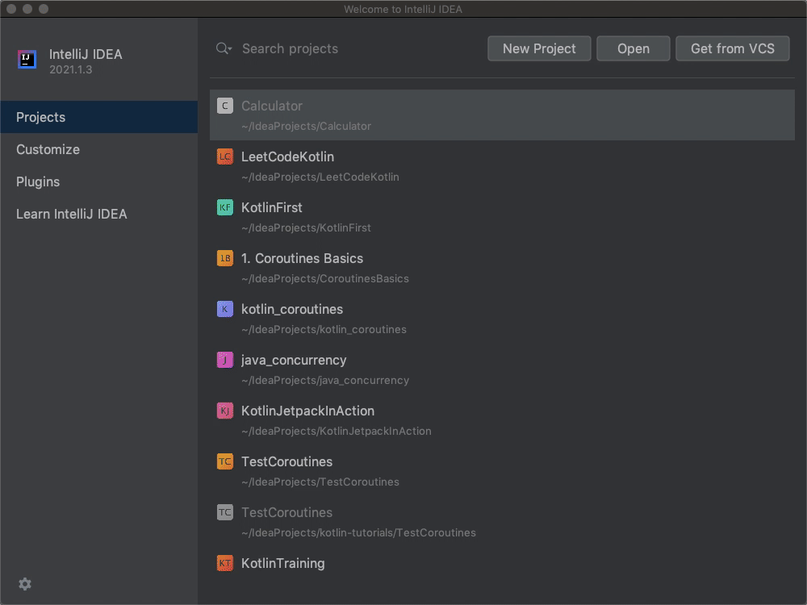

## 导入初始化工程

其实，你只需要知道如何创建一个 Kotlin 工程就行了，也没必要真的跟着我一步步操作。课程配套的源代码已经在GitHub开源，你可以将其下载下来并切换到 start 分支，这样就可以跟着课程一步步实现计算器的三个版本了。

具体做法是这样的：打开 IntelliJ，点击“Get from VCS”按钮，接着在弹出的窗口中，填入我们的 GitHub URL“https://github.com/chaxiu/Calculator.git”，然后点击右下角的 Clone 按钮即可。

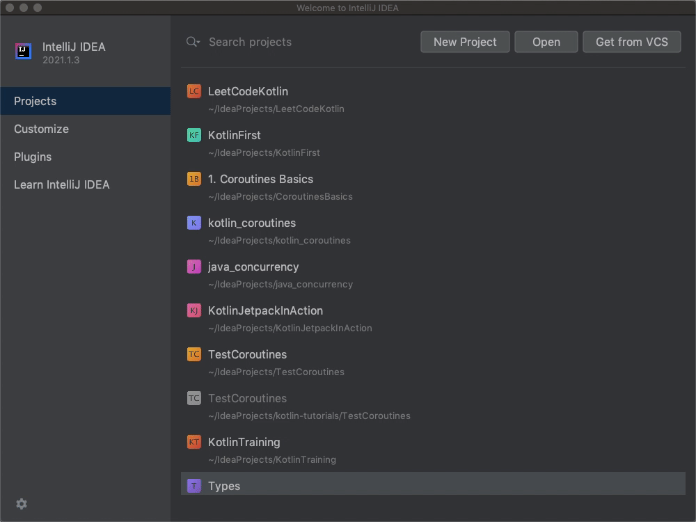

等代码下载完成以后，IDE 会问你是否要打开此工程，我们选择打开。这样，我们的计算器工程就算导入进来了。

最后，我们还需要将工程改为初始化状态，借助 Git 我们可以非常方便地实现：

- 在 IntelliJ 的右下角，找到 main 按钮并且点击；

- 在弹出的菜单中，点击 start 分支；

- 最后，点击 Checkout，代表将当前代码切换到初始状态。

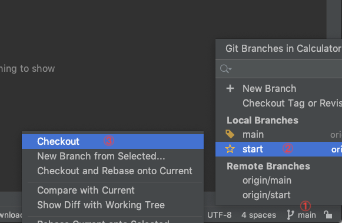

这样，我们就完成了整个工程的初始化配置了。为了测试我们的开发环境是否已经配置好，我们可以打开工程里的 HelloWorld 文件，运行一下，看看程序是否正常执行。

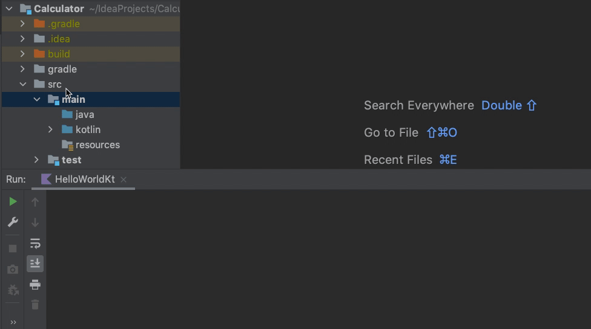

如果你也能在工程当中看见控制台输出“Hello world.”，说明你的开发环境已经完全没问题了。接下来，就让我们一起用 Kotlin 完成计算器的 1.0 版本吧！

## 计算器 1.0

第一个版本的计算器，它的功能非常简单，你可以看看下面的动图演示。

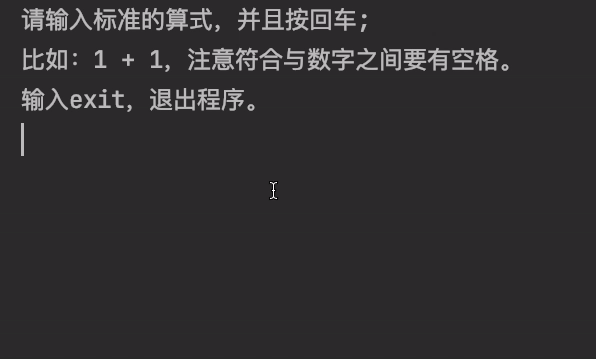

我们大致列举一下这个计算器的功能需求：

- 交互式界面，输入算式，按下回车，程序就会帮我们计算出结果；

- 数字与字符之间要求有空格，“1 + 1”是可以的，“1+1”则不行；

- 输入 exit，按下回车，程序就会退出；

- 支持“加减乘除”，四种运算，仅支持两个数的运算。

搞清楚功能需求以后，我们就可以开始写代码了。

首先，我们要创建一个 Kotlin 源代码文件：在 Kotlin 文件夹下，点击右键，选择“New ->Kotlin Class/File”，然后填写文件名字即可，这里我们创建一个名为 Calculator 的 Kotlin 文件。

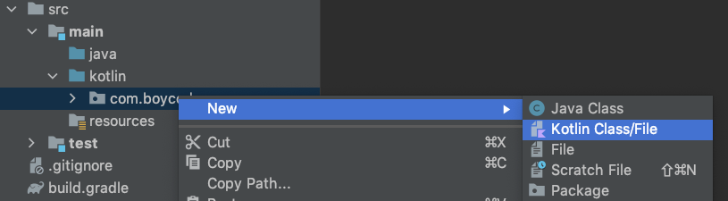

由于我们的程序要和命令进行交互，根据不同的命令来做出不同的行为，因此，我们的程序需要有一个 while 循环的逻辑，在循环当中，还要读取命令行的输入，然后根据输入的结果来判断执行逻辑。我们可以将整个程序分为以下几个步骤：

- 初始化，打印提示信息；

- 第一步，读取输入命令；

- 第二步，判断命令是不是 exit，如果用户输入的是“exit”则直接退出程序；

- 第三步，解析算式，分解出“数字”与“操作符”：“1”“+”“2”；

- 第四步，根据操作符类型，算出结果：3；

- 第五步，输出结果：1 + 2 = 3；

- 第六步，进入下一个 while 循环。

```javascript
fun main() {
   while(true) {
       // 初始化，打印提示信息
       println("请输入标准的算式，并且按回车; \n" +
               "比如：1 + 1，注意符合与数字之间要有空格。\n" +
               "输入exit，退出程序。")
       // 第一步，读取输入命令；
       var input = readLine()
       if (input == null) continue
       // 第二步，判断命令是不是exit，如果是则直接退出程序；
       if (input == "exit") exitProcess(0)
       // 第三步，解析算式，分解出“数字”与“操作符”：“1”“+”“2”；
       var inputList = input.split(" ")
       // 第四步，根据操作符类型，算出结果：3；
       var result = calculate(inputList)
       // 第五步，输出结果：1 + 2 = 3；
       if (result == null) {
           println("输入格式不对")
           continue
       } else {
           println("$input = $result")
       }
       // 第六步，进入下一个while循环。
   }
}
// 具体计算逻辑
private fun calculate(inputList: List<String>): Int? {
   if (inputList.size != 3) return null
   // 第七步，取出数字和操作符
   var left = inputList.get(0).toInt()
   var operation = inputList.get(1)
   var right = inputList.get(2).toInt()
   // 第八步，根据操作符的类型，执行计算
   when(operation) {
       "+" -> return left + right
       "-" -> return left - right
       "*" -> return left * right
       "/" -> return left / right
       else -> return null
   }
}
```

上面的代码非常简单直白，即使你没有任何编程经验，应该也能够理解。它也非常符合人的编程直觉。

不过，站在 Kotlin 的角度上看，以上的代码其实是有不少问题的，让我们通过一个图来对比着看：

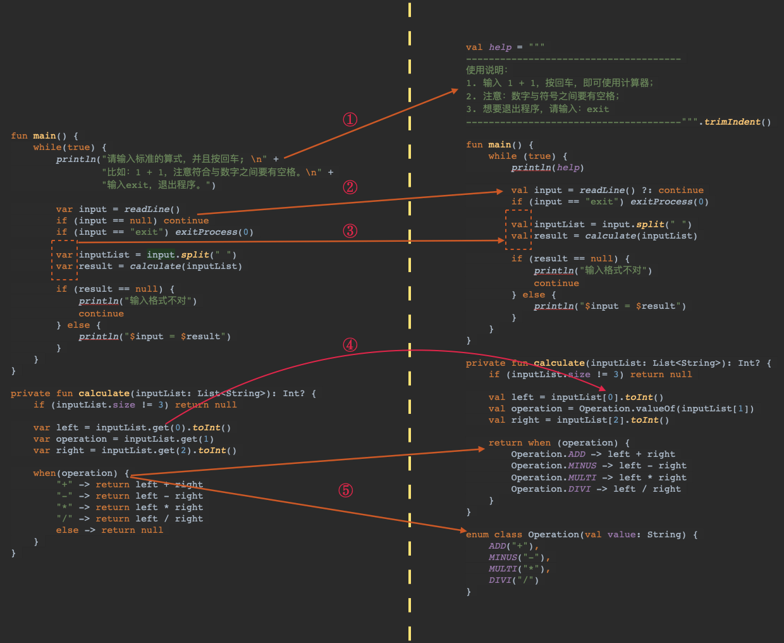

- 箭头①，表示程序中的“提示信息”应该使用 Kotlin 的“三引号”的原始字符串，这样的话，我们可以省去繁琐的“\n 和 +”，并且所见即所得；

- 箭头②，表示读取输入命令后，我们可以直接使用 Elvis 表达式，两行代码就会变成一行；

- 箭头③，表示程序中所有的 var 都应该改为 val，我在第 1 讲中说过，在 Kotlin 当中，我们应该优先使用 val，尽量避免使用可变的变量。

- 箭头④，表示 inputList.get(i) 可以改为 inputList[i]，这是因为 Kotlin 统一了数组和集合的元素访问操作，我们再也不用担心弄混了。

- 箭头⑤，表示了两点。首先，我们可以将 return 放到 when 表达式的前面，这样就省得我们每个分支都写一遍 return。另外，当我们使用 when 表达式的时候，应该尽量结合“枚举”或者“密封类”来使用。为此，我们可以为“加减乘除”四个操作符创建一个枚举类。这样，when 表达式的分支会自动判定完备，而不需要 else 分支了。

那么经过调整，最终的源代码应该是这样的：

```
val help = """
--------------------------------------
```

- 使用说明：

```
1. 输入 1 + 1，按回车，即可使用计算器；
2. 注意：数字与符号之间要有空格；
3. 想要退出程序，请输入：exit
--------------------------------------""".trimIndent()
fun main() {
   while (true) {
       println(help)
       val input = readLine() ?: continue
       if (input == "exit") exitProcess(0)
       val inputList = input.split(" ")
       val result = calculate(inputList)
       if (result == null) {
           println("输入格式不对")
           continue
       } else {
           println("$input = $result")
       }
   }
}
private fun calculate(inputList: List<String>): Int? {
   if (inputList.size != 3) return null
   val left = inputList[0].toInt()
   //                           ①
   //                           ↓
   val operation = Operation.valueOf(inputList[1])
   val right = inputList[2].toInt()
   return when (operation) {
       Operation.ADD -> left + right
       Operation.MINUS -> left - right
       Operation.MULTI -> left * right
       Operation.DIVI -> left / right
   }
}
enum class Operation(val value: String) {
   ADD("+"),
   MINUS("-"),
   MULTI("*"),
   DIVI("/")
}
```

好，我们的计算器 1.0 版本，到这里就算是完成了。

如果你跟随着我，一起来实现了这个简单的计算器，那么你在这个实操过程中就可以体会到，Kotlin 编程与传统的 Java/C 之间确实是存在着一定的差别的。

想要学会 Kotlin 语法其实不难，但要写出优雅的 Kotlin 代码，却不是一件容易的事情。我们唯一能做的，就是多写 Kotlin 代码，同时多看优秀的 Kotlin 代码，以及多思考改进自己已有的代码。

不过，代码中注释①处其实还有一些问题，接着让我们进入第二个版本的开发吧！

## 计算器 2.0

在 2.0 版本中，我们会分成两个阶段：

- 第一个阶段，融入面向对象的思想。1.0 版本中，我们只写了两个函数，一个是 main() 函数，另一个是 calculate() 函数。虽然这样的设计非常直观且便于理解，但却不太符合我们工程界的思维习惯。我们应该将程序封装到一个类当中，并且尽量让每个函数的功能划分清楚，保持每个函数尽量简单。

- 第二个阶段，兼容输入格式。1.0 版本中，我们对输入有严格的要求，数字和符号之间必须有空格，否则我们的算式解析会出错。在 2.0 版本中，我们尝试兼容不同的输入格式，不管数字和符号之间有没有空格，我们都要能成功执行。

让我们一步步来，首先是融入面向对象的思想。

### 第一阶段：融入面向对象思想

具体做法其实也很简单，我们可以将前面定义的两个函数收拢到一个类当中去，比如“CalculatorV2”：

```python
class CalculatorV2 {
   fun start() {}
   fun calculate(input: String): Int? {}
}
```

可以看到，在这个 CalculatorV2 类当中有两个方法，start() 用于启动我们的计算器程序，监听控制台的文本输入；calculate(input) 用于接收输入文本，计算出算式的结果，然后返回一个可为空的整型，当输入不合法的时候会返回 null。

这样，我们的计算器作为一个整体已经是一个对象了，我们可以很方便地在 main() 函数当中，创建一个实例，并且调用它的 start() 函数。这样一来，我们的计算器也就可以充分发挥出面向对象的优势。

```
fun main() {
   val calculator = CalculatorV2()
   calculator.start()
}
```

除了计算器本身需要面向对象，我们的输入表达式也可以抽象出一个具体模型出来。

我们知道，一个算式分为左边的数字、操作符和右边的数字。因此我们还可以定义一个类，来代表算式表达式。

```
data class Expression(
   val left: String,
   val operator: Operation,
   val right: String
)
```

比如，我们想要表达“1 + 2”这个式子的话，我们就可以用这样一个结构来表示：

```
Expression("1", Operation.ADD, "2")
```

那么，在完成了面向对象的模型化以后，我们还需要进一步拆分函数的职责与颗粒度。其中，start() 方法，主要用于控制程序的流程、输入与输出：

```
fun start() {
   while (true) {
       println(HELP)
       val input = readLine() ?: continue
       val result = calculate(input)
       if (result == null) {
           println("输入格式不对")
           continue
       } else {
           println("$input = $result")
       }
   }
}
```

而 calculate() 方法，则需要进一步地拆分：

```
fun calculate(input: String): String? {
   if (shouldExit(input)) exitProcess(0)
   val exp = parseExpression(input) ?: return null
   val left = exp.left
   val operator = exp.operator
   val right = exp.right
   return when (operator) {
       Operation.ADD -> addString(left, right)
       Operation.MINUS -> minusString(left, right)
       Operation.MULTI -> multiString(left, right)
       Operation.DIVI -> diviString(left, right)
   }
}
fun addString(left: String, right: String): String {
   val result = left.toInt() + right.toInt()
   return result.toString()
}
fun minusString(left: String, right: String): String {
   val result = left.toInt() - right.toInt()
   return result.toString()
}
fun multiString(left: String, right: String): String {
   val result = left.toInt() * right.toInt()
   return result.toString()
}
fun diviString(left: String, right: String): String {
   val result = left.toInt() / right.toInt()
   return result.toString()
}
fun shouldExit(input: String): Boolean {
   return input == EXIT
}
fun parseExpression(input: String): Expression? {
   // 待完成
}
fun parseOperator(input: String): Operation? {
   // 待完成
}
```

通过以上代码可以看到，我们拆分 calculate() 方法主要做了三件事：

- 第一，将“是否退出”的逻辑封装到了 shouldExit() 方法当中，如果将来这部分逻辑变得更复杂，我们只改动这一个方法即可。

- 第二，将算式的解析，封装到了 parseExpression() 方法当中，而解析算式的时候也需要解析操作符，这时候我们也需要 parseOperator()。

- 第三，将具体的计算逻辑交给了对应的方法。这么做的原因，是可以让我们的程序变得更加灵活。比如，我们在下个版本当中会更改“加法”的计算逻辑，那么我们就只需要改动这一个方法就行了。

同时，以上所有独立抽出来的方法，它们也都将变得可测试，这有利于提升程序的稳定性。

到这里，我们对计算器 2.0 的第一阶段改造就差不多完成了，我们融入了面向对象的思想，也对 calculate() 方法进行了更细颗粒度的拆分。下一步，我们要做的就是兼容算式的格式，让它能够解析没有空格的算式。

### 第二阶段：兼容输入格式

现在，假设我们的输入是“1+2”，数字与字符之间没有空格。那在这种情况下，我们就无法使用空格作为分隔符了。所以要换一种方式，想办法从算式当中，解析出操作符“加减乘除”中的一种，然后再用操作符作为我们的分隔符去找出数字。

其实，因为操作符只有这四种情况，所以我们很容易就能想到一种方案，一个个去尝试：

```
fun parseOperator(input: String): Operation? {
   return when {
       input.contains(Operation.ADD.value) -> Operation.ADD
       input.contains(Operation.MINUS.value) -> Operation.MINUS
       input.contains(Operation.MULTI.value) -> Operation.MULTI
       input.contains(Operation.DIVI.value) -> Operation.DIVI
       else -> null
   }
}
```

虽然，这段代码运行起来没什么问题，逻辑也非常得清晰，但它看起来很丑陋。而且它还有一个坏处：随着枚举类型的增多，我们的逻辑分支也会增多，手动添加起来也特别麻烦。

因此这种情况，我们就应该充分借助 Kotlin 枚举的优势，通过遍历的方式来做：

```
fun parseOperator(input: String): Operation? {
   Operation.values().forEach {
       if (input.contains(it.value)) {
           return it
       }
   }
   return null
}
```

可以看到，优化后的代码中，我们不再需要手动地去写 when 的逻辑分支，也不必自己去枚举Operation 的每一种情况，就连代码量也降低了很多，即使将来枚举种类增加了，我们也不必修改这部分代码了。

需要注意，以上的代码中，我们用到了集合遍历的语法“forEach”，你可以将它想象成强化版的for 循环，它具体的用法我会在后面“Kotlin 集合”那一节中讲解。

现在，对于一个算式“1+2”，我们已经可以成功解析出操作符“+”了，接下来要做的，就是通过“+”来分割字符串，将左右两个数字取出来“1”“2”。这个逻辑就很简单了：

```
fun parseExpression(input: String): Expression? {
   // 解析操作符
   val operation = parseOperator(input) ?: return null
   // 用操作符分割算式，拿到数字
   val list = input.split(operation.value)
   if (list.size != 2) return null
   return Expression(
       // 算式左边
       left = list[0].trim(),
       operator = operation,
       // 算式右边
       right = list[1].trim()
   )
}
```

以上代码大致分为三个步骤，我们以“1+2”为例：

- 第一个步骤，调用 parseOperator() 方法解析操作符“+”；

- 第二个步骤，根据操作符分割算式的数字，分割之后得到的会是“1”“2”组成的列表；

- 第三个步骤，将操作符、数字组合成 Expression 对象。

这里有一个细节需要注意，我们兼容的输入其实有两种情况，第一种是不包含空格“1+2”，那么我们解析出来的数字会是“1”“2”，这种情况下不会有问题；但还有第二种情况包含空格，对于原本正确的格式，我们更应该支持，比如“1 + 2”，被分隔之后的结果会是“1 ”“2”，这两个数字当中是包含空格符的。

```
所以，我们使用了list[0].trim()，这里的trim()方法就是用于去掉多余空格的。
```

让我们实际运行一下看看效果：

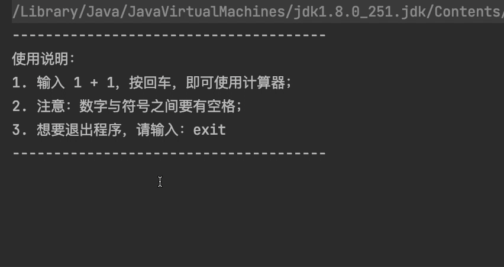

至此，我们的计算器 2.0 版本就完成了。在 2.0 版本的实操过程中，我们其实是在原有的基础上，融入了面向对象的思想，将计算器功能收拢到了一个类当中，同时也对计算器内部的方法进行了细颗粒度的拆分。

在这个过程中，我们创建了三个类：“Calculator”类，代表整个计算器；“Operation”枚举类，代表加减乘除四种运算操作符；“Expression”数据类，代表我们算式当中的数字和操作符。之后，我们又对计算器的核心功能进行了更细颗粒度的拆分，提高了程序的灵活性，为我们的功能扩展打下了基础。

好了，现在让我们进入 3.0 版本的开发吧。

## 计算器 3.0

针对 3.0 这个版本，我们也分为了两个阶段：

- 第一阶段，增加单元测试。单元测试是软件工程当中的一个概念，它指的是对软件当中的最小可执行单元进行测试，以提高软件的稳定性。在 Java 当中，最小单元一般会认为是类，因此，我们一般会以类为单元，对类当中的方法进行一一测试。

- 第二阶段，支持大数的加法。我们知道 Java、Kotlin 当中的整型都是有范围限制的，如果我们输入两个特别大的数字进行计算，那么程序是无法正常工作的。因此，我们需要对特别大的数进行兼容。

下面，我们先来搞定单元测试。

### 第一阶段：单元测试

在 Kotlin 当中，如果要使用单元测试，我们需要在 gradle 文件当中，添加 Kotlin 官方提供的依赖：

```
testImplementation 'org.jetbrains.kotlin:kotlin-test'
```

这样，我们的工程就拥有单元测试的能力了。单元测试的代码，我们一般会放在工程的 test 目录下：

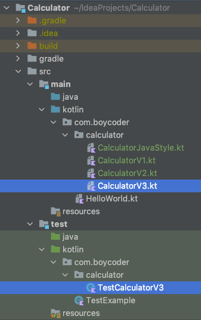

我们可以从这个图中看出很多信息：

- 第一，test 目录、main 目录，它们是平级的目录，内部拥有着相同的结构。main 目录下放的是功能代码，test 目录下放的则是测试代码。

- 第二，由于我们要开发 3.0 版本，所以我们在 main 目录下创建了 CalculatorV3 这个类；另外，由于我们需要在 3.0 版本加入单元测试，所以对应的，我们在 test 目录下相同的地方，创建了 TestCalculatorV3。这两个类的关系是一一对应的，CalculatorV3 是为了实现3.0 版本的功能，TestCalculatorV3 是为了测试 3.0 版本的功能，确保功能正常。

不过这里你要注意，虽然我们创建了 CalculatorV3 这个类，但其实它里面的代码还是用的CalculatorV2 的代码。3.0 版本的功能，我们放到第二阶段才会去实现。

接下来，让我们来编写测试代码：

```python
class TestCalculatorV3 {
   @Test
   fun testCalculate() {
       val calculator = CalculatorV3()
       val res1 = calculator.calculate("1+2")
       assertEquals("3", res1)
   }
}
```

首先，我们定义了一个方法 testCalculate()，并且使用了一个注解 @Test 来修饰它。因为这样做以后，IntelliJ 就会知道：哦，这是一个用来做测试的方法。

接着，我们在 testCalculate() 当中创建了一个 CalculatorV3 的对象，然后调用了它的calculate() 方法，传入了“1+2”。我们知道，如果程序正常工作的话，返回的结果应该是“3”。因此，我们紧接着就执行了一个断言“assertEquals(“3”, res1)”，它的意思是“res1 一定等于3”。如果 res1=3，那么我们的单元测试就会成功，否则就会失败。

我们可以看看单元测试运行成功的效果：

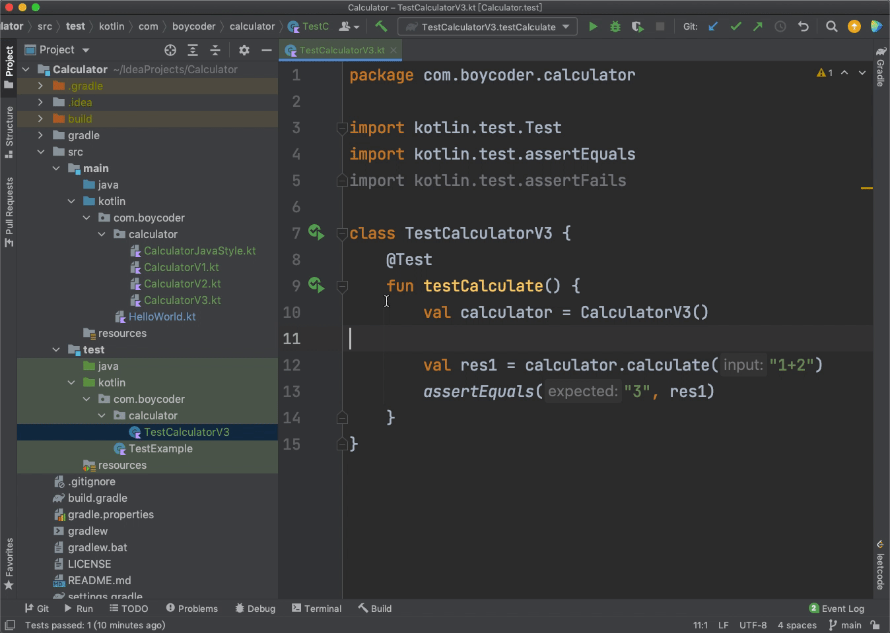

如果这时候，我们将“1+2”改成大数的加法，比如“2333333333333332+1”，并且将断言也修改一下：

```
val res1 = calculator.calculate("2333333333333332+1")
assertEquals("2333333333333333", res1)
```

那么，你觉得单元测试的结果会是怎么样的呢？

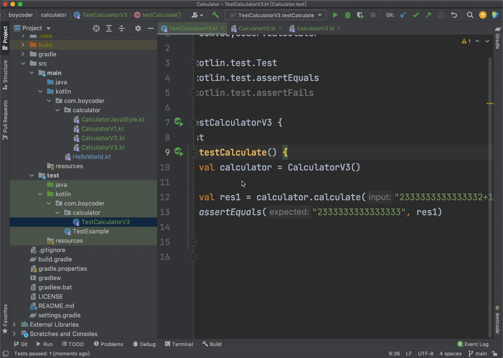

单元测试失败了！

具体原因相信你一定也能猜到，因为“2333333333333332”这个数实在太大了，已经远远超出了 Int 类型的范围，如果不做特殊处理的话，我们的程序是无法正常运行的。而这正好就是我们下一个阶段要做的事情：支持大数的加法。不论多大的两个数字相加，我们都要算出正确的结果。

这个单元测试的代码我们先留着，等我们实现“大数的加法”后，我们再重新运行一遍，这样一来，我们就可以借此验证代码是否正确。

### 第二阶段：大数加法

大数的加法，其实是我们程序员面试当中的一道高频题。它的解题思路也很简单，就是通过模拟我们手写加法竖式的方法，从个位、十位、百位、千位，一直累加，超过 10 的时候，我们需要进位。

我们以“135+99”为例：

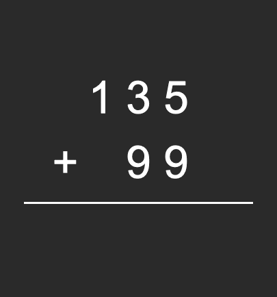

从上面的手写加法竖式的过程我们可以看出，这个计算其实就是分了三个步骤在进行，分别是个位、十位、百位：

- 个位计算，“5+9=14”，出现进位，这时候我们用 carry 来存储进位：carry=1，个位结果为4；

- 十位计算，十位相加“3+9=12”，由于之前有过进位，所以应该是“3+9+1=13”，十位结果为3；

- 百位计算，由于 99 不存在百位，我们自动补零，所以就应该是“1+0+1=2”，百位结果为2。

最终，我们将每一位的结果拼接起来，就得到了最终的结果。有了这样的思路后，我们的代码就很容易实现了。

```javascript
fun addString(leftNum: String, rightNum: String): String {
   // ①
   val result = StringBuilder()
   // ②
   var leftIndex = leftNum.length - 1
   var rightIndex = rightNum.length - 1
   // ③
   var carry = 0
   // ④
   while (leftIndex >= 0 || rightIndex >= 0) {
       // ⑤
       val leftVal = if (leftIndex >= 0) leftNum.get(leftIndex).digitToInt() els
       val rightVal = if (rightIndex >= 0) rightNum.get(rightIndex).digitToInt()
       val sum = leftVal + rightVal + carry
       // ⑥
       carry = sum / 10
       result.append(sum % 10)
       leftIndex--
       rightIndex--
   }
   // ⑦
   if (carry != 0) {
       result.append(carry)
   }
   // ⑧
   return result.reverse().toString()
}
```

上面的代码一共有 8 处注释，代表了整体的程序流程，让我们一步步来分析：

- 注释①，我们创建了一个 StringBuilder 对象，用于存储最终结果，由于我们的结果是一位位计算出来的，所以每一位结果都是慢慢拼接上去的，在这里，为了提高程序的性能，我们选择使用 StringBuilder。

- 注释②，我们定义了两个可变的变量 index，它们分别指向了两个数字的个位，这是因为我们的计算是从个位开始的。

- 注释③，carry，我们用它来存储每一位计算结果的进位。

- 注释④，这个 while 循环当中，我们会让两个 index 从低位一直到高位，直到遍历完它们所有的数字位。

- 注释⑤，这里的逻辑是取每一位上的数字，其中有个细节就是补零操作，比如当程序运行到百位的时候，99 没有百位，这时候 rightVal = 0。

- 注释⑥，当我们的程序计算出结果后，我们要分别算出 carry，以及当前位的结果。这时候我们分别使用“除法”计算 carry，使用“取余”操作计算当前位的结果。

- 注释⑦，这里是为了兼容一个特殊的场景，在“99+1”的情况下，我们的 while 循环最多只会遍历到十位，如果不做特殊处理的话，结果将变成“99+1=00”。这并不是我们想要的，所以，为了兼容这种特殊情况，我们在 while 循环结束后增加了一个判断，如果 carry=1，那就说明在最大的那一位数计算完以后，仍然有进位，我们要手动添加。

- 注释⑧，对于一个算式“135+99”，我们的 result 拼接其实是倒叙的“432”，这时候我们需要将其翻转一下，才能得到正确的结果“135+99=234”。

到这里，我们的大数加法功能，就算实现了。让我们回过头，再去运行一次单元测试，来验证下我们的代码是否正确：

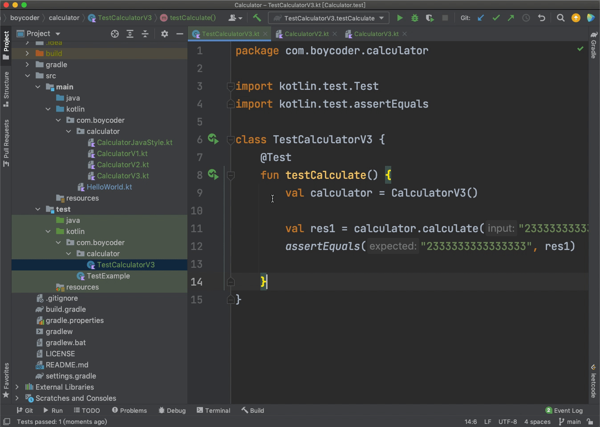

果然，在我们兼容了“大数加法”以后，单元测试就可以成功通过了。至此，我们的计算器 3.0版本就算是完成了。

在这个版本的开发过程中，首先我们引入了单元测试，通过这种方式，我们可以测试代码逻辑是否正确，并可以辅助我们排查问题。接着，我们写了一个“2333333333333332+1”的测试用例，并且失败了，不过在完成大数加法的功能后，这个测试也最终通过了。

这里我需要特殊说明的是，为了不偏离本次实战课的目的，我们的单元测试只写了两个，但在实际的开发工作当中，单元测试是需要尽量覆盖所有情况的。换句话说，仅仅只是测试“1+2”“2333333333333332+1”这两种情况，是无法保证我们的计算器逻辑正确的。一般来说，一个应用于商业的计算器，它的单元测试用例数量会达到几百上千个。

## 小结

到这里，我们就通过完成三个不同版本的四则运算计算器，一起梳理了前面课程中，学习的那些重要的 Kotlin 的知识点，比如不可变的变量 val、when 表达式、数据类、枚举类，等等。并且也在实操过程中，一起思考了代码实现时可能会出现的问题。

你也可以在动手操作的过程中，具体感受下跟 Java 代码的不同，同时也看看自己的思路与课程的思路有什么不同，课程当中的代码还有哪些可以改进的地方。

最后我想让你注意的是，在 3.0 版本中，我们引入了单元测试功能。实际上，单元测试的作用，不仅仅可以验证新开发的功能，同时它还可以用于保证旧的功能不受影响。在实际开发工作中，我们很容易因为对功能 A 的改动，导致功能 B 出问题。然后往往由于时间限制，测试人员只测试了功能 A，忽略了功能 B，最终导致线上故障带来经济损失。

而借助单元测试，在每一次的开发工作完成以后，我们就统一跑一遍所有的单元测试，只要单元测试通过了，我们就能保证，新的功能没问题，而旧的功能也没问题。

## 动手实操

在 3.0 版本的开发当中，我们仅仅只实现了“大数的加法”，其余的“大数的减法”“大数的乘法”“大数的除法”都没有实现。请你挑其中一个功能，尝试自己实现，参考答案我会在之后放出来。

欢迎你在评论区分享你的实现思路，我们下节课再见。
