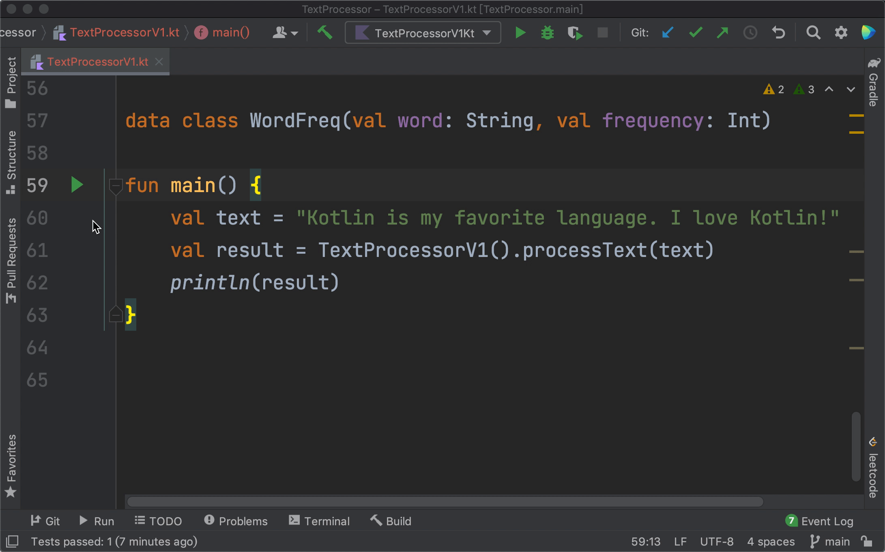
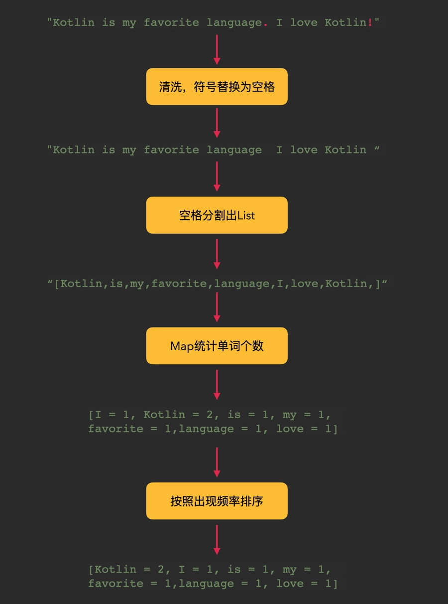
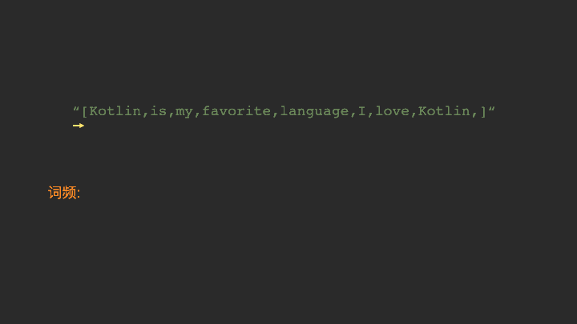
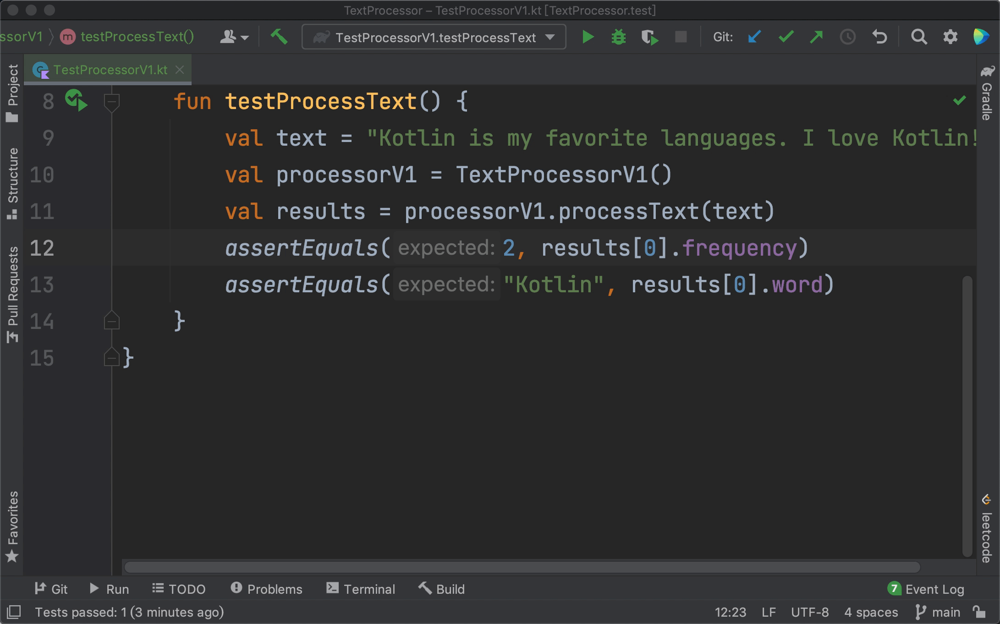
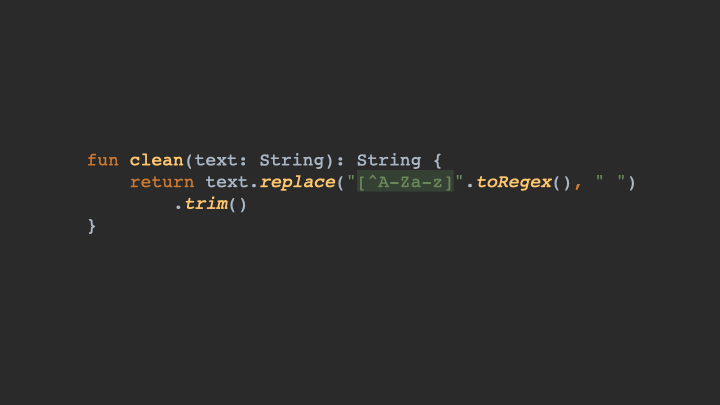
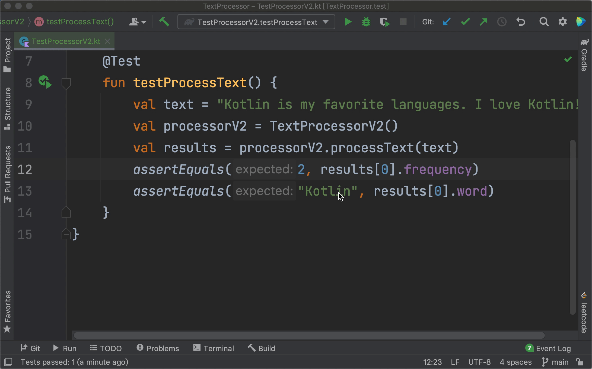
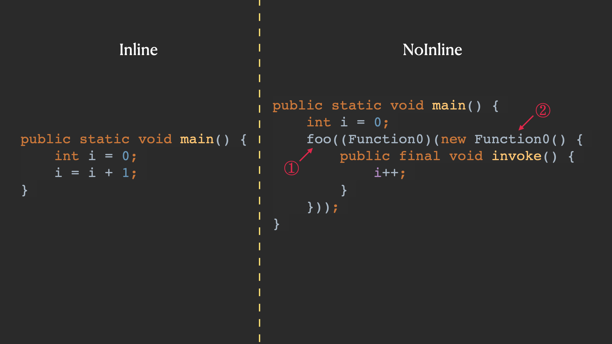
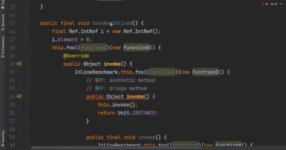
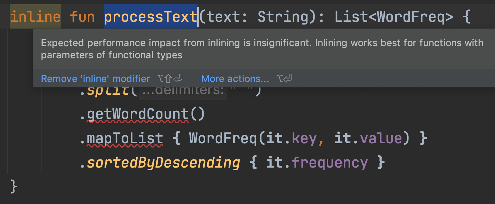
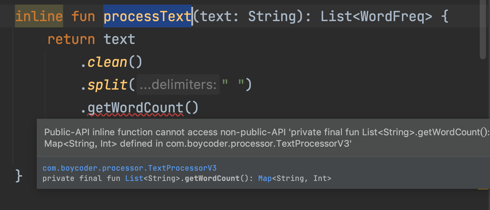

# 08-实战：用Kotlin写一个英语词频统计程序

你好，我是朱涛。

前面几节课，我们学了一些 Kotlin 独有的特性，包括扩展、高阶函数等等。虽然我在前面的几节课当中都分别介绍了这些特性的实际应用场景，但那终归不够过瘾。因此，这节课我们来尝试将这些知识点串联起来，一起来写一个“单词词频统计程序”。

英语单词的频率统计，有很多实际应用场景，比如高考、研究生考试、雅思考试，都有对应的“高频词清单”，考生优先突破这些高频词，可以大大提升备考效率。那么这个高频词是如何统计出来的呢？当然是通过计算机统计出来的。只是，我们的操作系统并没有提供这样的程序，想要用这样的功能，我们必须自己动手写。

而这节课，我将带你用 Kotlin 写一个单词频率统计程序。为了让你更容易理解，我们的程序同样会分为三个版本。

- 1.0 版本：实现频率统计基本功能，使用“命令式风格”的代码。

- 2.0 版本：利用扩展函数、高阶函数来优化代码，实现“函数式风格”的代码。

- 3.0 版本：使用 inline 进一步提升软件的性能，并分析高阶函数的实现原理，以及 inline 到底能带来多大的性能提升。

在正式开始学习之前，我也建议你去 clone 我 GitHub 上面的 TextProcessor 工程：https://github.com/chaxiu/TextProcessor.git，然后用 IntelliJ 打开，并切换到 start 分支跟着课程一步步敲代码。

## 1.0 版本：命令式风格

在正式开始写代码之前，我们先看看程序运行之后是什么样的，一起来分析一下整体的编程思路：



首先，我们的词频统计程序是一个类，“TextProcessorV1”，这是第一个版本的类名称。text 是需要被统计的一段测试文本。

所以，我们很容易就能写出这样的代码结构：

```python
class TextProcessorV1 {
   fun processText(text: String): List<WordFreq> {
   }
}
data class WordFreq(val word: String, val frequency: Int)
```

这段代码中，我们定义了一个方法 processText，它接收的参数类型是 String，返回值类型是List。与此同时，我们还定义了一个数据类 WordFreq，它里面有两个属性，分别是 word 和对应的频率 frequency。

所以，这个程序最关键的逻辑都在 processText 这个方法当中。

接下来我们以一段简短的英语作为例子，看看整体的统计步骤是怎样的。我用一张图来表示：



上面的流程图一共分为 4 个步骤：

- 步骤 1，文本清洗。正常的英语文本当中是会有很多标点符号的，比如“.”“！”，而标点符号是不需要被统计进来的。所以，在进行词频统计之前，我们还需要对文本数据进行清洗。这里的做法是将标点符号替换成空格。

- 步骤 2，文本分割。有了步骤 1 作为基础，我们的英语文本当中除了单词之外，就都是空格了。所以，为了分割出一个个单词，我们只需要以空格作为分隔符，对整个文本进行分割即可。在这个过程中，我们的文本数据就会变成一个个单词组成的列表，也就是 List 类型。

- 步骤 3，统计单词频率。在上个步骤中，我们已经得到了单词组成的 List，但这个数据结构并不适合做频率统计。为了统计单词频率，我们要借助 Map 这个数据结构。我们可以通过遍历 List 的方式，将所有单词都统计一遍，并将“单词”与“频率”以成对的方式存储在 Map 当中。

- 步骤 4，词频排序。在步骤 3 中，我们得到的词频数据是无序的，但实际场景中，频率越高的单词越重要，因此我们希望高频词可以放在前面，低频词则放在后面。

经过以上分析，我们就能进一步完善 processText() 方法当中的结构了。

```python
class TextProcessorV1 {
   fun processText(text: String): List<WordFreq> {
       // 步骤1
       val cleaned = clean(text)
       // 步骤2
       val words = cleaned.split(" ")
       // 步骤3
       val map = getWordCount(words)
       // 步骤4
       val list = sortByFrequency(map)
       return list
   }
}
```

其中，步骤 2 的逻辑很简单，我们直接使用 Kotlin 标准库提供的 split() 就可以实现空格分割。其余的几个步骤 1、3、4，则是由单独的函数来实现。所以下面，我们就来分析下clean()、getWordCount()、sortByFrequency() 这几个方法该如何实现。

### 文本清洗

首先，是文本清洗的方法 clean() 方法。

经过分析，现在我们知道针对一段文本数据，我们需要将其中的标点符号替换成空格：

```
//                            标点            标点
// 清洗前                       ↓              ↓
"Kotlin is my favorite language. I love Kotlin!"
//                            空格            空格
// 清洗后                       ↓              ↓
"Kotlin is my favorite language  I love Kotlin "
```

那么对于这样的逻辑，我们很容易就能写出以下代码：

```
fun clean(text: String): String {
   return text.replace(".", " ")
       .replace("!", " ")
       .trim()
}
```

这样的代码对于前面这种简单文本是没问题的，但这样的方式存在几个明显的问题。

第一个问题是普适性差。在复杂的文本当中，标点符号的类型很多，比如“,”“?”等标点符号。为了应对这样的问题，我们不得不尝试去枚举所有的标点符号：

```
fun clean(text: String): String {
   return text.replace(".", " ")
       .replace("!", " ")
       .replace(",", " ")
       .replace("?", " ")
       .replace("'", " ")
       .replace("*", " ")
       .replace("#", " ")
       .replace("@", " ")
       .trim()
}
```

那么随之而来的第二个问题，就是很容易出错，因为我们可能会遗漏枚举的标点符号。第三个问题则是性能差，随着枚举情况的增加，replace 执行的次数也会增多。

因此这个时候，我们必须要换一种思路，正则表达式就是一个不错的选择：

```
fun clean(text: String): String {
   return text.replace("[^A-Za-z]".toRegex(), " ")
       .trim()
}
```

上面的正则表达式的含义就是，将所有不是英文字母的字符都统一替换成空格（为了不偏离主题，这里我们不去深究正则表达式的细节）。

这样，数据清洗的功能完成以后，我们就可以对文本进行切割了，这个步骤通过 split() 就能实现。在经过分割以后，我们就得到了单词的列表。接下来，我们就需要进行词频统计getWordCount() 了。

### 词频统计

在 getWordCount() 这个方法当中，我们需要用到 Map 这个数据结构。如果你不了解这个数据结构也不必紧张，我制作了一张动图，描述 getWordCount() 的工作流程。



看过上面的 Gif 动图以后，相信你对词频统计的实现流程已经心中有数了。其实它就是跟我们生活中做统计一样，遇到一个单词，就把这个单词的频率加一就行。只是我们生活中是用本子和笔来统计，而这里，我们用程序来做统计。

那么，根据这个流程，我们就可以写出以下这样的频率统计的代码了，这里面主要用了一个Map 来存储单词和它对应频率：

```
fun getWordCount(list: List<String>): Map<String, Int> {
   val map = hashMapOf<String, Int>()
   for (word in list) {
       // ①
       if (word == "") continue
       val trim = word.trim()
       // ②
       val count = map.getOrDefault(trim, 0)
       map[trim] = count + 1
   }
   return map
}
```

上面的代码一共有两处需要注意，我们一个个看：

- 注释①，当我们将标点符号替换成空格以后，两个连续的空格进行分割后会出现空字符""，这是脏数据，我们需要将其过滤掉。

- 注释②，map.getOrDefault 是 Map 提供的一个方法，如果当前 map 中没有对应的 Key，则返回一个默认值。这里我们设置的默认值为 0，方便后面的代码计数。

这样，通过 Map 这个数据结构，我们的词频统计就实现了。而因为 Map 是无序的，所以我们还需要对统计结果进行排序。

### 词频排序

那么到这里，我们就又要将无序的数据结构换成有序的。这里我们选择 List，因为 List 是有序的集合。但由于 List 每次只能存储单个元素，为了同时存储“单词”与“频率”这两个数据，我们需要用上前面定义的数据类 WordFreq：

```
fun sortByFrequency(map: Map<String, Int>): MutableList<WordFreq> {
   val list = mutableListOf<WordFreq>()
   for (entry in map) {
       if (entry.key == "") continue
       val freq = WordFreq(entry.key, entry.value)
       // ①
       list.add(freq)
   }
   // ②
   list.sortByDescending {
       it.frequency
   }
   return list
}
```

这部分的排序代码其实思路很简单：

- 注释①处，我们将 Map 当中的词频数据，封装到 WordFreq 数据类当中，并且添加到了List 当中，这样就将所有的信息都放到了一个有序的集合当中来了；

- 注释②处，我们调用了 Kotlin 标准库提供的排序方法“sortByDescending”，它代表了以词频降序排序。

到这里，我们的 1.0 版本就算是完成了，按照惯例，我们可以写一个单元测试来看看代码运行结果是否符合预期。



由于我们的测试文本很简单，我们一眼就能分析出正确的结果。其中单词“Kotlin”出现的频率最高，是 2 次，它会排在 result 的第一位。所以，我们可以通过断言来编写以上的测试代码。最终单元测试的结果，也显示我们的代码运行结果符合预期。

这时候，你也许会想：测试的文本数据太短了，如果数据量再大一些，程序是否还能正常运行呢？

其实，我们可以让程序支持统计文件当中的单词词频，要实现这个功能也非常简单，就是利用我们在第 6 讲学过的扩展方法：

```
fun processFile(file: File): List<WordFreq> {
   val text = file.readText(Charsets.UTF_8)
   return processText(text)
}
```

从代码中我们可以看到，readText() 就是 Kotlin 标准库里提供的一个扩展函数，它可以让我们非常方便地从文件里读取文本。增加这样一行代码，我们的程序就能够统计文件当中的单词频率了。

## 2.0 版本：函数式风格

好，下面我们就一起来实现下第二个版本的词频统计程序。这里，我想先带你回过头来看看咱们 1.0 版本当中的代码：

```python
class TextProcessorV1 {
   fun processText(text: String): List<WordFreq> {
       val cleaned = clean(text)
       val words = cleaned.split(" ")
       val map = getWordCount(words)
       val list = sortByFrequency(map)
       return list
   }
}
```

是不是觉得咱们的代码实在太整齐了？甚至整齐得有点怪怪的？而且，我们定义的临时变量cleaned、words、map、list 都只会被用到一次。

其实上面的代码，就是很明显地在用 Java 思维写 Kotlin 代码。这种情况下，我们甚至可以省略掉中间所有的临时变量，将代码缩减成这样：

```
fun processText(text: String): List<WordFreq> {
   return sortByFrequency(getWordCount(clean(text).split(" ")))
}
```

不过，很明显的是，以上代码的可读性并不好。在开篇词当中，我曾提到过，Kotlin 既有命令式的一面，也有函数式的一面，它们有着各自擅长的领域。而在这里，我们就完全可以借助函数式编程的思想来优化代码，就像下面这样：

```
fun processText(text: String): List<WordFreq> {
   return text
       .clean()
       .split(" ")
       .getWordCount()
       .sortByFrequency { WordFreq(it.key, it.value) }
}
```

可以发现，这段代码从上读到下，可读性非常高，它也非常接近我们说话的习惯：我们拿到参数 text，接着对它进行清洗 clean()，然后对单词频率进行统计，最后根据词频进行排序。

那么，我们要如何修改 1.0 版本的代码，才能实现这样的代码风格呢？问题的关键还是在于clean()、getWordCount()、sortByFrequency() 这几个方法。

我们一个个来分析。首先是 text.clean()，为了让 String 能够直接调用 clean() 方法，我们必须将 clean() 定义成扩展函数：

```
// 原函数
fun clean(text: String): String {
   return text.replace("[^A-Za-z]".toRegex(), " ")
       .trim()
}
// 转换成扩展函数
fun String.clean(): String {
   return this.replace("[^A-Za-z]".toRegex(), " ")
       .trim()
}
```

从上面的代码中，我们可以清晰地看到普通函数转换为扩展函数之间的差异：

- 原本的参数类型 String，在转换成扩展函数后，就变成了“接收者类型”；

- 原本的参数 text，变成了扩展函数的 this。



对应的，我们的 getWordCount() 方法也同样可以修改成扩展函数的形式。

```
private fun List<String>.getWordCount(): Map<String, Int> {
   val map = HashMap<String, Int>()
   for (element in this) {
       if (element == "") continue
       val trim = element.trim()
       val count = map.getOrDefault(trim, 0)
       map[trim] = count + 1
   }
   return map
}
```

你能看到，原本是作为参数的 List，现在同样变成了接收者类型，原本的参数 list 集合变成了this。

最后是 sortByFrequency()，我们很容易就能写出类似下面的代码：

```
private fun Map<String, Int>.sortByFrequency(): MutableList<WordFreq> {
   val list = mutableListOf<WordFreq>()
   for (entry in this) {
       val freq = WordFreq(entry.key, entry.value)
       list.add(freq)
   }
   list.sortByDescending {
       it.frequency
   }
   return list
}
```

同样的步骤，将参数类型变成“接收者类型”，将参数变成 this。不过，这里的做法并不符合函数式编程的习惯，因为这个方法明显包含两个功能：

- 功能 1，将 Map 转换成 List；

- 功能 2，使用 sort 对 List 进行排序。

因此针对这样的情况，我们应该再对这个方法进行拆分：

```
private fun <T> Map<String, Int>.mapToList(transform: (Map.Entry<String, Int>) ->
   val list = mutableListOf<T>()
   for (entry in this) {
       val freq = transform(entry)
       list.add(freq)
   }
   return list
}
```

在上面的代码当中，为了让 Map 到 List 的转换更加得灵活，我们引入了高阶函数，它的参数transform 是函数类型的参数。那么相应的，我们的调用处代码也需要做出改变，也就是传入一个 Lambda 表达式：

```
fun processText(text: String): List<WordFreq> {
   return text
       .clean()
       .split(" ")
       .getWordCount()
       .mapToList { WordFreq(it.key, it.value) }
       .sortedByDescending { it.frequency }
}
```

看着上面的代码，我们几乎可以像读普通的英语文本一般地阅读上面的代码：首先是对 text 进行清理；然后使用 split 以空格形式进行分割；接着计算出单词的频率，然后再将无序的 Map转换成 List；最后对 List 进行排序，排序的依据就是词频降序。

至此，我们的 2.0 版本就算完成了。让我们再次执行一次单元测试，看看我们的代码逻辑是否正确：



单元测试的结果告诉我们，代码运行结果符合预期。接下来，我们就可以进行 3.0 版本的开发工作了。

## 3.0 版本：inline 优化

在上一个版本当中，我们的 mapToList 被改造成了一个高阶函数。那到了这个版本，我们实际的代码量其实很少，只需要为 mapToList 这个高阶函数增加一个 inline 关键字即可。

```
//  增加inline关键字
//        ↓
private inline fun <T> Map<String, Int>.mapToList(transform: (Map.Entry<String, I
   val list = mutableListOf<T>()
   for (entry in this) {
       val freq = transform(entry)
       list.add(freq)
   }
   return list
}
```

到这里，我们 3.0 版本的开发工作其实就完成了。

但是你要清楚，虽然我们只花几秒钟就能增加这个 inline 关键字，可我们这么做的原因却比较复杂。这涉及到 inline 关键字的实现原理。

不过，在正式研究 inline 之前，我们要先来了解下高阶函数的实现原理。由于 Kotlin 兼容Java 1.6，因此 JVM 是不懂什么是高阶函数的，我们的高阶函数最终一定会被编译器转换成JVM 能够理解的格式。

而又因为，我们的词频统计代码略微有些复杂，所以为了更好地研究高阶函数的原理，这里我们可以先写一个简单的高阶函数，然后看看它反编译后的代码长什么样。

```javascript
// HigherOrderExample.kt
fun foo(block: () -> Unit) {
   block()
}
fun main() {
   var i = 0
   foo{
       i++
   }
}
```

以上代码经过反编译成 Java 后，会变成这样：

```java
public final class HigherOrderExampleKt {
  public static final void foo(Function0 block) {
     block.invoke();
  }
  public static final void main() {
     int i = 0
     foo((Function0)(new Function0() {
        public final void invoke() {
           i++;
        }
     }));
  }
}
```

可以看到，Kotlin 高阶函数当中的函数类型参数，变成了 Function0，而 main() 函数当中的高阶函数调用，也变成了“匿名内部类”的调用方式。那么，Function0 又是个什么东西？

```java
public interface Function0<out R> : Function<R> {
   public operator fun invoke(): R
}
```

Function0 其实是 Kotlin 标准库当中定义的接口，它代表没有参数的函数类型。在Functions.kt这个文件当中，Kotlin 一共定义了 23 个类似的接口，从 Function0 一直到Function22，分别代表了“无参数的函数类型”到“22 个参数的函数类型”。

好，现在，我们已经知道 Kotlin 高阶函数是如何实现的了，接下来我们看看使用 inline 优化过的高阶函数会是什么样的：

```
// HigherOrderInlineExample.kt
/*
```

- 多了一个关键字

```javascript
  ↓                                    */
inline fun fooInline(block: () -> Unit) {
   block()
}
fun main() {
   var i = 0
   fooInline{
       i++
   }
}
```

和前面的例子唯一的不同点在于，我们在 foo() 函数的定义处增加了一个 inline 关键字，同时，为了区分，我们也改了一下函数的名称。这个时候，我们再来看看它反编译后的 Java 长什么样：

```java
public final class HigherOrderInlineExampleKt {
  // 没有变化
  public static final void fooInline(Function0 block) {
     block.invoke();
  }
  public static final void main() {
     // 差别在这里
     int i = 0;
     int i = i + 1;
  }
}
```

为了看得更加清晰，我们将有无 inline 的 main() 放到一起来对比下：



所以你能发现，inline 的作用其实就是将 inline 函数当中的代码拷贝到调用处。

而是否使用 inline，main() 函数会有以下两个区别：

- 在不使用 inline 的情况下，我们的 main() 方法当中，需要调用 foo() 这个函数，这里多了一次函数调用的开销。

- 在不使用 inline 的情况下，调用 foo() 函数时，还创建了“Function0”的匿名内部类对象，这也是额外的开销。

为了验证这一猜测，我们可以使用JMH（Java Microbenchmark Harness）对这两组代码进行性能测试。JMH 这个框架可以最大程度地排除外界因素的干扰（比如内存抖动、虚拟机预热），从而判断出我们这两组代码执行效率的差异。它的结果不一定非常精确，但足以说明一些问题。

不过，为了不偏离本节课的主题，在这里我们不去深究 JMH 的使用技巧，而是只以两组测试代码为例，来探究下 inline 到底能为我们带来多少性能上的提升：

```javascript
// 不用inline的高阶函数
fun foo(block: () -> Unit) {
   block()
}
// 使用inline的高阶函数
inline fun fooInline(block: () -> Unit) {
   block()
}
// 测试无inline的代码
@Benchmark
fun testNonInlined() {
   var i = 0
   foo {
       i++
   }
}
// 测试无inline的代码
@Benchmark
fun testInlined() {
   var i = 0
   fooInline {
       i++
   }
}
```

最终的测试结果如下，分数越高性能越好：

```
Benchmark       Mode         Score       Error   Units
testInlined     thrpt   3272062.466 ± 67403.033  ops/ms
testNonInlined  thrpt    355450.945 ± 12647.220  ops/ms
```

从上面的测试结果我们能看出来，是否使用 inline，它们之间的效率几乎相差 10 倍。而这还仅仅只是最简单的情况，如果在一些复杂的代码场景下，多个高阶函数嵌套执行，它们之间的执行效率会相差上百倍。

为了模拟复杂的代码结构，我们可以简单地将这两个函数分别嵌套 10 个层级，然后看看它们之间的性能差异：

```javascript
// 模拟复杂的代码结构，这是错误示范，请不要在其他地方写这样的代码。
@Benchmark
fun testNonInlined() {
   var i = 0
   foo {
       foo {
           foo {
               foo {
                   foo {
                       foo {
                           foo {
                               foo {
                                   foo {
                                       foo {
                                           i++
                                       }
                                   }
                               }
                           }
                       }
                   }
               }
           }
       }
   }
}
@Benchmark
fun testInlined() {
   var i = 0
   fooInline {
       fooInline {
           fooInline {
               fooInline {
                   fooInline {
                       fooInline {
                           fooInline {
                               fooInline {
                                   fooInline {
                                       fooInline {
                                           i++
                                       }
                                   }
                               }
                           }
                       }
                   }
               }
           }
       }
   }
}
```

注意：以上的代码仅仅只是为了做测试，请不要在其他地方写类似这样的代码。

```
Benchmark        Mode         Score       Error   Units
testInlined     thrpt   3266143.092 ± 85861.453  ops/ms
testNonInlined  thrpt     31404.262 ±   804.615  ops/ms
```

从上面的性能测试数据我们可以看到，在嵌套了 10 个层级以后，我们 testInlined 的性能几乎没有什么变化；而当 testNonInlined 嵌套了 10 层以后，性能也比 1 层嵌套差了 10 倍。

在这种情况下，testInlined() 与 testNonInlined() 之间的性能差异就达到了 100 倍，那么随着代码复杂度的进一步上升，它们之间的性能差异会更大。

我在下面这张 Gif 动图里展示了它们反编译成 Java 的代码：



我们能看到，对于 testNonInlined()，由于 foo() 嵌套了 10 层，它反编译后的代码也嵌套了 10层函数调用，中间还伴随了 10 次匿名内部类的创建。而 testInlined() 则只有简单的两行代码，完全没有任何嵌套的痕迹。难怪它们之间的性能相差 100 倍！

### inline 的局限性

看到这，你也许会有这样的想法：既然 inline 这么神奇，那我们是不是可以将“词频统计程序”里的所有函数都用 inline 来修饰？

答案当然是否定的。事实上，Kotlin 官方只建议我们将 inline 用于修饰高阶函数。对于普通的Kotlin 函数，如果我们用 inline 去修饰它，IntelliJ 会对我们发出警告。而且，也不是所有高阶函数都可以用 inline，它在使用上有一些局限性。

举个例子，如果我们在 processText() 的前面增加 inline 关键字，IntelliJ 会提示一个警告：



这个警告的意思是：“对于普通的函数，inline 带来的性能提升并不显著，inline 用在高阶函数上的时候，才会有显著的性能提升”。

另外，在 processText() 方法的内部，getWordCount() 和 mapToList() 这两个方法还会报错：



出现这个报错的原因是：getWordCount() 和 mapToList() 这两个函数是私有的，无法 inline。为什么呢？

前面我们提到过：inline 的作用其实就是将 inline 函数当中的代码拷贝到调用处。由于processText() 是公开的，因此它会从外部被调用，这意味着它的代码会被拷贝到外部去执行，而 getWordCount() 和 mapToList() 这两个函数却无法在外部被访问。这就是导致编译器报错的原因。

所以，inline 虽然可以为我们带来极大的性能提升，但我们不能滥用。在使用 inline 的时候，我们还需要时刻注意它的实现机制，有时候，稍有不慎就会引发问题。

除此之外，在第 3 讲中我们曾提到：Kotlin 编译器一直在幕后帮忙做着翻译的好事，那它有没有可能“好心办坏事”？

这个问题，现在我们就能够回答了：Kotlin 编译器是有可能好心办坏事的。如果我们不够了解Kotlin 的底层细节，不够了解 Kotlin 的语法实现原理，我们就可能会用错某些 Kotlin 语法，比如 inline，当我们用错这些语法后，Kotlin 在背后做的这些好事，就可能变成一件坏事。

## 小结

最后，让我们来做个简单的总结。

- 通过 1.0 版本的开发，我们初步实现了单词频率统计的功能，同时也使用了面向对象的思想，也使用了单元测试；

- 在 2.0 版本的开发中，我们初步尝试了函数式编程的风格，在这个过程中，我们灵活运用了我们前面学习的扩展、高阶函数知识。

- 在 3.0 版本中，我们使用 inline 优化了高阶函数。随后我们着重研究了高阶函数的原理，以及 inline 背后的细节。在这个过程中，我们发现 inline 可以为高阶函数带来超过 100 倍的性能提升，同时我们也了解到 inline 并不是万能的，它也存在一定的局限性。

经过这节课的实战演练之后，相信你一定感受到了 Kotlin 函数式风格的魅力。在日后不断地学习、实操中，我也希望，你可以把 Kotlin 函数式的代码应用到自己的开发工作当中，并且充分发挥出 Kotlin 简洁、优雅、可读性强的优势。

## 思考题

咱们的词频统计程序其实还有很多可以优化和提升的地方，请问你能想到哪些改进之处？欢迎你在评论区分享你的思路，我们下节课再见。
